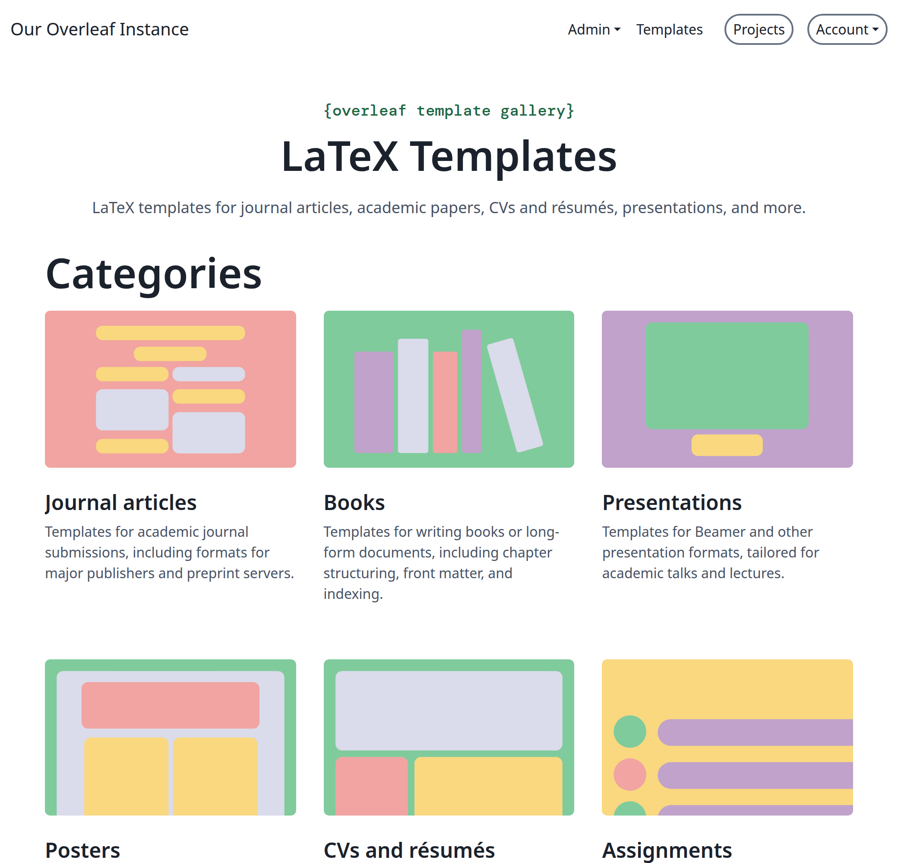

Wie een Overleaf-instantie voor een lab of een afdeling beheert, krijgt elke week dezelfde vragen. Waarom kan deze student niet inloggen? Wie gebruikt de server nog? Wie heeft dat account beheerdersrechten gegeven? Waar is het proefschrift van vorig jaar gebleven? We hebben het beheerpaneel opnieuw gebouwd zodat je deze vragen kunt beantwoorden zonder een databaseshell te openen.

Het nieuwe paneel volgt het uiterlijk van Overleaf 6.3 en is vertaald in elke taal die de interface ondersteunt. Het heeft één lijst met alle gebruikers, één lijst met alle projecten, een pagina voor elk van hen, een plek om je sjablonen te beheren, en auditlogs.

<Info>

Het nieuwe beheerpaneel is samengevoegd in onze hoofdbranch en wordt officieel uitgebracht in v6.4.0. Alle schermafbeeldingen in dit bericht komen van een testinstantie gevuld met verzonnen accounts.

</Info>

### Wat erin zit {#what’s-in-it}

* **Gebruikerslijst**: zoeken, filters op inlogmethode, rol en status, en bulkacties.
* **Gebruikerspagina**: het account, de projecten, functies, integraties, auditlogs en sessies van één persoon.
* **Projectlijst**: elk project op de instantie, doorzoekbaar op naam, ID, eigenaar of deellink.
* **Projectpagina**: de instellingen, bestanden, leden, verwijderde bestanden en auditlogs van één project.
* **Sjabloonbeheer**: publiceer een project als sjabloon, werk het bij en houd de galerij op orde.
* **Auditlogs**: wie wat heeft gedaan, wanneer en vanaf welk IP-adres.

## Eén lijst voor alle gebruikers {#one-list-for-every-user}

Klik op **Admin** en daarna op **Manage Users**. Elk account is één rij die laat zien hoe het inlogt, wat de rol is en wat de status is.

<Frame caption="De gebruikerslijst">
  
</Frame>

Zoek op naam, e-mailadres of ID. De kolomkoppen **Login**, **Role** en **Status** zijn filters, en elke optie laat zien hoeveel accounts ze zou opleveren. Je ziet in één oogopslag hoeveel mensen via SAML binnenkomen, en elke OIDC-provider verschijnt onder de naam die je hem hebt gegeven.

<Frame caption="Filteren op inlogmethode">
  
</Frame>

Elk account heeft precies één status, en de vier statussen tellen op tot het totaal.

| Status       | Betekenis                                                                |
| ------------ | ------------------------------------------------------------------------ |
| **Active**   | Heeft in de afgelopen 12 maanden ingelogd of een project geopend.        |
| **Pending**  | Heeft nog nooit ingelogd.                                                |
| **Inactive** | Heeft eerder ingelogd, maar niet in de afgelopen 12 maanden.             |
| **Disabled** | Een beheerder heeft het account het inloggen verboden.                   |

Verwijderde accounts zitten niet in de weg; ze hebben hun eigen filter. Als een zoekopdracht ook een verwijderd account vindt, meldt een regel boven de tabel dat en biedt aan het te tonen.

<Frame caption="Filteren op status">
  
</Frame>

Zoeken, sorteren en pagineren gebeuren op de server, dus de lijsten stoppen niet meer na de eerste 1.000 rijen.

### Mensen toevoegen, met of zonder e-mail {#bring-people-in-with-or-without-email}

**Create account** voegt een gebruiker toe en geeft je de link die die persoon nodig heeft. Als [e-mailbezorging](/nl/on-premises/configuration/overleaf-toolkit/email-delivery  "mention") niet is ingesteld, zegt het dialoogvenster dat duidelijk en kun je de link kopiëren, zodat ook een kleine instantie nieuwe mensen kan verwelkomen.

<Frame caption="De activeringslink van een nieuw account">
  
</Frame>

Het paneel biedt voor elk account de juiste link: **Send activation email** voor een account dat nog nooit heeft ingelogd, 7 dagen geldig, en **Send reset link** voor een account dat dat wel heeft gedaan, 1 uur geldig. Accounts die via SSO inloggen hebben geen lokaal wachtwoord en krijgen dus geen van beide.

### Veel accounts tegelijk wijzigen {#change-many-accounts-at-once}

Vink een paar accounts aan en de werkbalk biedt **Send activation email**, **Transfer this user's projects**, **Disable**, **Enable**, **Make admin**, **Remove admin** en **Delete account**. Het dialoogvenster toont de accounts voordat je bevestigt. Als sommige mislukken, vertelt het je welke, en wat al gelukt is, blijft gedaan.

<Frame caption="Bulkacties">
  
</Frame>

### Moeilijk om fout te doen {#hard-to-get-wrong}

* Je eigen account is gemarkeerd met **You** en de acties ervan zijn grijs, zodat je jezelf niet kunt uitschakelen, verwijderen of degraderen.
* Elke actie vraagt om bevestiging in een dialoogvenster dat het account noemt.
* **Delete account** kan de projecten van de gebruiker eerst aan iemand anders overdragen.
* Een verwijderd account kan worden hersteld, samen met de projecten die ermee zijn verwijderd. Alleen **Delete permanently** is definitief, en het waarschuwt je.

## Alles over één persoon {#everything-about-one-person}

Klik op een naam om de pagina van de gebruiker te openen. Die heeft zes tabbladen en dezelfde actiepictogrammen als de lijst.

### Account {#account}

De gegevens van het account, van de ID en e-mailadressen tot de laatste login en het IP-adres daarvan. Klik op het potlood om het e-mailadres, de namen of het wachtwoord te wijzigen, of om **Admin** aan of uit te zetten.

<Frame caption="Een account bewerken">
  
</Frame>

### Projecten {#projects}

De projecten waarvan deze persoon eigenaar is, met een eigen zoekfunctie, statusfilter en acties.

<Frame caption="De projecten van een gebruiker">
  
</Frame>

### Functies {#features}

Wat voor dit account is ingeschakeld, zoals medewerkers per project, de compileertime-out, integraties en AI, samen met het AI-gebruik van het account en een knop om het te resetten.

<Frame caption="De functies van een gebruiker">
  
</Frame>

### Integraties {#integrations}

De Git-toegangstokens van de persoon en de diensten die die persoon heeft gekoppeld.

<Frame caption="De integraties van een gebruiker">
  
</Frame>

### Sessies {#sessions}

Waar de persoon is ingelogd. **Clear sessions** logt die persoon overal uit, en dat is het eerste wat je doet als er een laptop zoekraakt.

<Frame caption="De sessies van een gebruiker">
  
</Frame>

## Alle projecten op de instantie {#every-project-on-the-instance}

Klik op **Admin** en daarna op **Project/Object Lookup**. De lijst toont de projecten van alle gebruikers, met hun eigenaren en statussen. Het zoekvak accepteert de naam van een project, de ID, de eigenaar of een link. Plak een deellink en je vindt het project erachter.

<Frame caption="Alle projecten">
  
</Frame>

Het filter **Status** scheidt **Active**, **Archived**, **Trashed** en **Deleted** projecten. Vink meerdere projecten aan om ze in één `.zip`-bestand te downloaden, hun eigenaar te wijzigen of ze te verwijderen. In de weergave **Deleted** zijn de knoppen **Restore** en **Delete permanently**.

<Frame caption="Projecten filteren op status">
  
</Frame>

## Alles over één project {#everything-about-one-project}

Klik op de titel van een project om de pagina ervan te openen.

### Overzicht {#overview}

Wijzig de naam, het delen via link, de compiler, de TeX Live-versie en het hoofddocument. **Change project owner** geeft het project aan een andere gebruiker, wat helpt als iemand het lab verlaat en het proefschrift moet blijven.

<Frame caption="Een project bewerken">
  
</Frame>

### Bestandsstructuur {#file-tree}

De bestanden en mappen van het project, alleen-lezen.

<Frame caption="De bestanden van een project">
  
</Frame>

### Leden {#members}

De eigenaar, de medewerkers en de openstaande uitnodigingen. Wijzig de rol van een medewerker, trek de toegang in, of verstuur een uitnodiging opnieuw of trek die in.

<Frame caption="De leden van een project wijzigen">
  
</Frame>

### Verwijderde bestanden {#deleted-files}

Bestanden die uit het project zijn verwijderd. **Restore file** zet een kopie in de hoofdmap van het project, en de rij toont de naam van de kopie.

<Frame caption="Een hersteld bestand">
  
</Frame>

## Sjabloonbeheer {#template-management}

Een sjabloon begint als een gewoon project. Je publiceert het vanuit de editor en beheert het vanaf de pagina in de galerij of vanuit het beheerpaneel.

### Alle sjablonen in één tabel {#all-templates-in-one-table}

Klik op **Admin**, dan op **Project/Object Lookup** en dan op het tabblad **Templates**. Het toont elk gepubliceerd sjabloon met auteur, eigenaar en laatste wijziging, en je kunt erin zoeken. Klik op een titel om het sjabloon te openen, op een eigenaar om de pagina van die gebruiker te openen, of op de prullenbak om een sjabloon te verwijderen. Een verwijdering komt in [je eigen auditlog](#when-there-is-no-log-left).

<Frame caption="Alle sjablonen in het beheerpaneel">
  
</Frame>

### Publiceren vanuit de editor {#publish-from-the-editor}

Open een project en compileer het tot de pdf er goed uitziet, want de galerij toont de pdf van de laatste geslaagde compilatie. Klik dan op **File** en daarna op **Manage Template**, en vul de titel, de auteur, een categorie, een beschrijving in Markdown en een licentie in. De compiler en het hoofddocument van het project gaan mee met het sjabloon, zodat projecten die ervan worden geopend dezelfde gebruiken.

<Frame caption="Een project publiceren als sjabloon">
  
</Frame>

### Een sjabloon bijwerken {#update-a-template}

Om de bestanden en de pdf van een sjabloon te wijzigen, publiceer je het project opnieuw onder dezelfde titel. Het dialoogvenster meldt dat de titel al bestaat, en de knop wordt **Overwrite**. Projecten die mensen al vanuit het sjabloon hebben geopend, veranderen niet.

<Frame caption="Publiceren onder dezelfde titel">
  
</Frame>

### De sjabloonpagina {#the-template-page}

Iedereen kan **Open as Template**, **View PDF** en de downloadknop gebruiken. Beheerders krijgen daarnaast **Admin: Source Project**, **Edit** en **Delete**.

<Frame caption="De pagina van een sjabloon">
  
</Frame>

**Edit** wijzigt wat de galerij over een sjabloon laat zien: de titel, auteur, categorie, beschrijving en licentie, en de spellingcontroletaal van projecten die ervan worden geopend. De bestanden en de pdf blijven ongewijzigd. Het sjabloon bewaart zijn eigen kopie van de bestanden, dus het verwijderen van het bronproject neemt het sjabloon niet mee.

<Frame caption="De details van een sjabloon bewerken">
  
</Frame>

### Een galerij voor je gebruikers {#a-gallery-for-your-users}

De galerij opent met een kaart voor elke categorie, en elke categorie heeft een eigen pagina. De categorieën komen uit je configuratie van [Sjablonen](/nl/on-premises/configuration/overleaf-toolkit/templates  "mention"), waar je ook een gebruiker die geen beheerder is kunt laten publiceren.

<Frame caption="De sjabloongalerij">
  
</Frame>

De pagina **All templates** toont elk sjabloon met een voorbeeld van de eerste pagina, en je gebruikers kunnen erin zoeken en sorteren op titel of datum.

<Frame caption="Alle sjablonen">
  
</Frame>

## Auditlogs: wie wat deed, en wanneer {#audit-logs-who-did-what-and-when}

Op dit deel zijn we het meest trots. Elk account en elk project heeft nu een eigen auditlog, en sitebeheerders kunnen het direct in het paneel lezen.

Open het tabblad **Audit logs** op de pagina van een gebruiker. De nieuwste vermeldingen staan bovenaan.

<Frame caption="Het auditlog van een account">
  
</Frame>

Van onder naar boven gelezen vertelt deze pagina een verhaal. Lena logde in. Een beheerder verhoogde haar compileertime-out naar 300 seconden, schakelde haar AI-toegang uit, stuurde haar een link om haar wachtwoord te resetten, maakte haar beheerder en draaide dat terug, en schakelde daarna het account uit en weer in. Lena logde opnieuw in, en de beheerder wiste haar sessies.

| Kolom          | Wat die je vertelt                                                                                      |
| -------------- | ------------------------------------------------------------------------------------------------------- |
| **Date**       | Wanneer het gebeurde.                                                                                   |
| **Operation**  | Wat er gebeurde.                                                                                        |
| **Initiator**  | Wie het deed. Wat een beheerder met een account doet, toont de beheerder, niet de gebruiker.            |
| **IP Address** | Waar het verzoek vandaan kwam.                                                                          |
| **Info**       | De details, zoals de nieuwe compileertime-out, of of de e-mail echt is verstuurd.                       |

### De vermelding vinden die je nodig hebt {#find-the-entry-you-need}

Zoek op bewerking of op IP-adres. De kolomkop **Operation** is een filter dat elke bewerking in dit log toont en hoe vaak die voorkwam.

<Frame caption="Filteren op bewerking">
  
</Frame>

### Een log voor elk project {#a-log-for-every-project}

De projectpagina heeft hetzelfde tabblad. Het toont wie is uitgenodigd, wie is toegetreden, wiens rol is gewijzigd, wie het project heeft gedownload en wie het heeft overgenomen.

<Frame caption="Het auditlog van een project">
  
</Frame>

### Wat er wordt vastgelegd {#what-gets-recorded}

Dit zijn de belangrijkste bewerkingen in elk log, onder de namen die je in het paneel ziet.

| Log     | Gebied                    | Bewerkingen                                                                                                                                                                                                                                 |
| ------- | ------------------------- | ------------------------------------------------------------------------------------------------------------------------------------------------------------------------------------------------------------------------------------------- |
| Account | Inloggen en wachtwoord    | Login, Logout, Failed password match, Update password, Reset password                                                                                                                                                                       |
| Account | E-mail en SSO             | Add email, Remove email, Change primary email, Link SSO, Unlink SSO                                                                                                                                                                         |
| Account | Integraties               | Link GitHub, Unlink GitHub, Link Dropbox, Unlink Dropbox, Integration account linked, Integration account unlinked, Create Git token, Delete Git token                                                                                      |
| Account | Acties van beheerders     | Create account, Send activation email, Send password reset email, Change name, Change admin access, Change features, Change AI features, Reset AI usage, Account suspension, Account reactivation, Clear sessions, Transfer projects, Delete account, Restore account |
| Project | Delen                     | Send invite, Resend invite, Revoke invite, Accept invite, Join via token, Accept via link sharing, Remove collaborator, Leave project, Project role changed, Toggle access level, Transfer ownership                                       |
| Project | Bestanden                 | Project downloaded, Project exported docx, Project exported markdown, Project exported html, Restore deleted doc                                                                                                                            |
| Project | Acties van beheerders     | Project deleted, Project restored                                                                                                                                                                                                           |
| Project | Git-synchronisatie        | Integration repo linked, Integration repo unlinked                                                                                                                                                                                          |

### Als er geen log meer over is {#when-there-is-no-log-left}

**Delete permanently** verwijdert een account of project samen met het log, en een sjabloon heeft er nooit een gehad. Daarom worden deze acties geschreven naar het log van de beheerder die ze uitvoerde, samen met het e-mailadres of de ID van wat is verwijderd.

<Frame caption="Definitieve verwijderingen in het eigen log van de beheerder">
  
</Frame>

### Goed om te weten {#good-to-know}

* Vermeldingen worden tweeënhalf jaar bewaard; daarna verwijdert MongoDB ze automatisch.
* Achter een reverse proxy stel je [`OVERLEAF_TRUSTED_PROXY_IPS`](/nl/on-premises/configuration/overleaf-toolkit/environment-variables  "mention") in, zodat het log het adres van de bezoeker toont en niet dat van de proxy.
* Nog niet alles wordt vastgelegd. Git clone en push, wijzigingen aan de instellingen van een project zoals de naam of de compiler, en de projecten die een eigenaar aanmaakt, archiveert, weggooit of verwijdert, verschijnen niet in het projectlog.

## Probeer het {#try-it}

Het nieuwe paneel wordt geleverd met Ayakaleaf Pro v6.4.0. De stapsgewijze handleidingen staan al online:

* [Gebruikersbeheer](/nl/on-premises/user-guide/administrators/user-management  "mention")
* [Projectbeheer](/nl/on-premises/user-guide/administrators/project-management  "mention")
* [Sjabloonbeheer](/on-premises/user-guide/administrators/template-management  "mention")

Als er iets ontbreekt of niet werkt zoals je verwacht, laat het ons dan weten op [GitHub](https://github.com/ayaka-notes/ayakaleaf-pro/issues).
