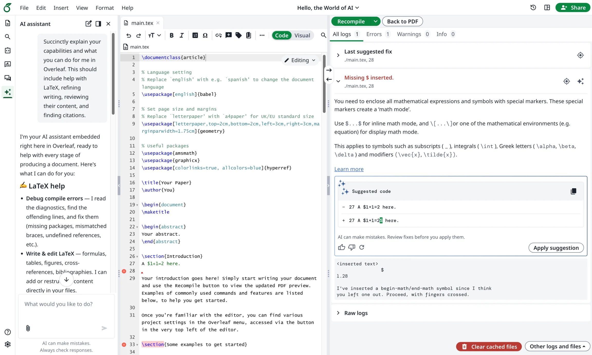
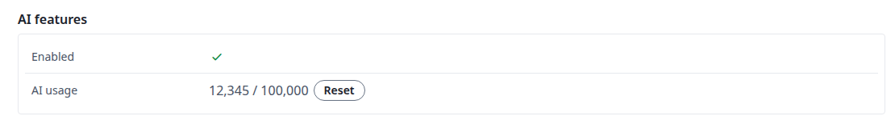

<Info>

Deze functie wordt geleverd door [ayaka-notes/ayakaleaf-pro](https://github.com/ayaka-notes/ayakaleaf-pro) en is beschikbaar vanaf v6.3.0. We horen graag je feedback als je problemen tegenkomt.

</Info>

## AI-assistent en LaTeX-foutassistent {#ai-assistant-and-latex-error-assistant}

Ayakaleaf Pro brengt AI-functies op 2 manieren naar de editor.

* De AI-assistent kan je projectdocumenten en huidige selectie als context gebruiken om vragen te beantwoorden en wijzigingen voor te stellen die je kunt beoordelen.
* De foutassistent stelt een gerichte oplossing voor wanneer je een LaTeX-compilatiefout selecteert.

<Frame>
  
</Frame>

### Toolkit-configuratie {#toolkit-configuration}

Voeg het volgende toe aan `config/variables.env` in je Toolkit-implementatie en vervang de voorbeeld-URL, -sleutel en -model door waarden van je provider:

```dotenv
AI_ENABLED=true
AI_BASE_URL=https://ai-gateway.example.com/v1
AI_API_KEY=REPLACE_WITH_YOUR_GATEWAY_API_KEY
AI_MODEL=YOUR_TEXT_MODEL_ID
```

Bewaar echte API-sleutels in het omgevingsbestand van je implementatie en houd ze buiten versiebeheer. De bovenstaande waarden zijn plaatshouders, geen werkende inloggegevens.

<Info>

De kwaliteit van AI-suggesties hangt af van het model dat je kiest. Als je al een Codex- of ChatGPT-abonnement hebt, kun je dat koppelen via het OpenAI-compatibele endpoint van [CLIProxyAPI](https://github.com/router-for-me/CLIProxyAPI).

</Info>

`AI_BASE_URL` is de basis-URL van de OpenAI-compatibele API, inclusief het versievoorvoegsel van de provider waar dat vereist is. Voeg geen `/chat/completions` toe, omdat we dit intern toevoegen. De gateway en het model moeten streaming chat completions en function tools ondersteunen. Beide functies sturen documentcontext naar deze gateway; de chat kan ook geüploade afbeeldingen en pdf-bestanden versturen bij gebruik van een model dat deze accepteert.

Toolkit geeft `config/variables.env` door aan de applicatiecontainer. Gebruik de hier getoonde variabelenamen; voeg geen voorvoegsel `OVERLEAF_` toe. Maak na het wijzigen van deze variabelen de applicatiecontainer opnieuw aan vanuit de Toolkit-map:

```sh
bin/up -d
```

### Gateway-instellingen {#gateway-settings}

| Variabele               | Standaard      | Doel                                                                                                                                                                      |
| ----------------------- | -------------- | ------------------------------------------------------------------------------------------------------------------------------------------------------------------------- |
| `AI_ENABLED`            | `false`        | Stel exact `true` in om chat en foutsuggesties voor de instantie in te schakelen. Niet ingesteld of een andere waarde houdt ze uitgeschakeld. Er is ook een werkende gatewayconfiguratie nodig. |
| `AI_BASE_URL`           | Geen; verplicht | Basis-URL van de OpenAI-compatibele API.                                                                                                                                 |
| `AI_API_KEY`            | Geen; verplicht | API-sleutel voor die gateway, gebruikt door de server.                                                                                                                   |
| `AI_MODEL`              | Geen; verplicht | Tekstmodel dat wordt gebruikt door de standaard chatconfiguratie en door suggesties voor LaTeX-fouten.                                                                   |
| `AI_IMAGE_MODEL`        | Niet ingesteld | Optioneel model dat afbeeldingen ondersteunt op dezelfde gateway, met dezelfde API-sleutel.                                                                               |
| `AI_PDF_MODEL`          | Niet ingesteld | Optioneel model op dezelfde gateway voor chats met pdf-bestanden, met dezelfde API-sleutel. Vanaf v6.4.0.                                                                 |
| `AI_MAX_STEPS`          | `20`           | Maximaal aantal tool-aanroepen per gebruikersbericht in de AI-chat, inclusief automatische vervolgstappen. Gebruik een positief geheel getal.                              |
| `AI_PROXY_URL`          | Niet ingesteld | Optionele HTTP-proxy-URL voor aanroepen naar de AI-gateway. Deze configureert niet de clients voor web- of documentatiezoekopdrachten.                                     |
| `AI_TOKEN_QUOTA`        | `0`            | Tokenlimiet per gebruiker per periode, gedeeld door chat en foutsuggesties. Niet ingesteld of `0` betekent onbeperkt; gebruik een positief geheel getal voor een limiet.    |
| `AI_TOKEN_QUOTA_PERIOD` | `month`        | `month` wordt gereset op de eerste dag om 00:00 UTC; `week` wordt gereset op maandag om 00:00 UTC. Andere waarden gebruiken `month`.                                       |

Stel voor het uploaden van afbeeldingen `AI_IMAGE_MODEL` in op een model dat afbeeldingsinvoer accepteert en de tools ondersteunt die door de chat worden gebruikt. Elk chatverzoek waarvan de geschiedenis een afbeeldingsbijlage bevat, gebruikt dit model, inclusief latere berichten in dat gesprek. Zonder deze instelling gebruiken verzoeken met afbeeldingen het normale chatmodel, dat dan zelf afbeeldingen moet ondersteunen. Suggesties voor LaTeX-fouten blijven `AI_MODEL` gebruiken.

Pdf-bijlagen zijn beschikbaar vanaf v6.4.0. Gebruikers kunnen pdf-bestanden van maximaal 2 MB bijvoegen, net als afbeeldingen. De chat stuurt elk pdf-bestand ongewijzigd door als een Chat Completions-onderdeel van het type `file`, dus de gateway en het model moeten pdf-invoer accepteren: de vision-modellen van OpenAI doen dat, terwijl veel zelf gehoste gateways, zoals vLLM, wel afbeeldingen accepteren maar pdf-bestanden weigeren. Stel `AI_PDF_MODEL` in op een model dat pdf-bestanden kan lezen; elke chat waarvan de geschiedenis een pdf-bestand bevat, gebruikt dit model, inclusief latere berichten en eventuele afbeeldingen in dat gesprek, dus het moet ook afbeeldingen accepteren. Zonder deze instelling gebruiken pdf-chats `AI_MODEL`. Wanneer het model een pdf-bestand weigert, vraagt de chat de gebruiker om de beheerder te vragen `AI_PDF_MODEL` in te stellen.

Bijvoorbeeld, om een afbeeldingsmodel en een wekelijks AI-tegoed in te schakelen:

```dotenv
AI_IMAGE_MODEL=YOUR_IMAGE_CAPABLE_MODEL_ID
AI_TOKEN_QUOTA=100000
AI_TOKEN_QUOTA_PERIOD=week
```

### Gebruikerstoegang en toestemming {#user-access-and-consent}

Beschikbaarheid op instantieniveau en gebruikersrechten staan los van elkaar. `AI_ENABLED` en de gatewayconfiguratie bepalen de beschikbaarheid op instantieniveau. Een ingelogde gebruiker moet ook voldoen aan de bestaande accountcontrole: `aiFeatures.enabled` mag niet `false` zijn. Dit bestaande databaseveld regelt zowel de chat als de suggesties voor LaTeX-fouten. Als het niet is ingesteld, zijn AI-functies voor de gebruiker ingeschakeld.

`AI_TOKEN_QUOTA` is een limiet die voor elke toegestane gebruiker gelijk geldt; de huidige module biedt geen individuele numerieke limiet per account.

Klik in **Admin → Manage Users** op de naam van de gebruiker, open het tabblad **Features** en klik op het potloodpictogram. Zet **Enabled** onder **AI features** aan of uit en klik op **Save**: hiermee wordt `aiFeatures.enabled` bijgewerkt. De server controleert de huidige rechten bij nieuwe AI-verzoeken, ook bij verzoeken vanuit een editor die al open is. Een gebruiker zonder rechten ziet de AI-assistent nog wel in de editor, maar kan geen berichten versturen.

### Gebruik en resetten {#usage-and-reset}

De rij **AI usage** op het tabblad **Features** toont het gebruik en de limiet van de huidige periode, met een knop **Reset**. Het gebruik wordt gelezen wanneer de pagina wordt geopend; het wordt niet continu vernieuwd. Laad de pagina opnieuw nadat een chat of foutsuggestie is voltooid om de nieuwste telling te zien. **Reset** werkt direct en wist alleen de teller van de huidige periode van die gebruiker, en werkt daarna het weergegeven gebruik bij. Het potloodpictogram of **Save** is daarvoor niet nodig. De knop is uitgegrijsd wanneer het gebruik 0 is en bij uw eigen account.

<Frame caption="AI-rechten en -gebruik van een gebruiker">
  
</Frame>

Het gebruik van chat en foutsuggesties deelt één Redis-teller, die na afloop van een verzoek wordt bijgewerkt op basis van het totale aantal tokens dat de modelprovider rapporteert. Dit omvat invoer- en uitvoertokens over alle modelstappen. Invoer kan gespreksgeschiedenis, documentcontext en toolresultaten bevatten, waardoor een vervolgvraag meer tokens kan verbruiken dan alleen het nieuwe bericht. Gebruik wordt ook geregistreerd wanneer de limiet **Unlimited** is. Verzoeken zonder gerapporteerd tokentotaal worden niet bij de teller opgeteld; historisch niet-geregistreerd gebruik kan niet door de module worden gereconstrueerd.

Quotacontroles vinden plaats vóór het streamen. Een verzoek, of meerdere gelijktijdige verzoeken, kan het resterende tegoed overschrijden voordat latere verzoeken worden geblokkeerd. Het gaat om een gebruikstegoed en niet om een strikt uitgavenplafond bij de provider. Als het opvragen van het quotum mislukt, wordt het verzoek toegestaan en wordt de fout gelogd.

Beide functies gebruiken `AI_TOKEN_QUOTA`; foutsuggesties hebben geen aparte limiet op het aantal verzoeken. Het resetten van de teller verandert niets aan machtigingen, toestemming, de geconfigureerde limiet of de eigen factureringsgegevens van de provider. Tellers gebruiken periodesleutels in UTC en verlopen na 40 dagen; door Redis-gegevens te behouden blijft het huidige gebruik bewaard bij herstarts van de applicatie.

### Optionele zoekservices {#optional-search-services}

Webzoeken gebruikt een Tavily-compatibele API. Het is beschikbaar wanneer er een API-sleutel voor zoeken is geconfigureerd. Deze instellingen staan los van de AI-gateway:

| Variabele                | Standaard                                | Doel                                                                                                                          |
| ------------------------ | ---------------------------------------- | ----------------------------------------------------------------------------------------------------------------------------- |
| `TAVILY_API_KEY`         | Niet ingesteld                           | API-sleutel voor zoeken. Heeft voorrang op `WEB_SEARCH_API_KEY`.                                                              |
| `WEB_SEARCH_API_KEY`     | Niet ingesteld                           | Alternatieve naam voor de API-sleutel voor zoeken.                                                                            |
| `WEB_SEARCH_URL`         | `https://api.tavily.com/search`          | Zoek-endpoint; aangepaste endpoints moeten het verzoek- en antwoordformaat van Tavily accepteren.                              |
| `WEB_SEARCH_MAX_RESULTS` | `5`                                      | Aantal opgevraagde resultaten per zoekopdracht; gebruik een positief geheel getal dat door de service wordt ondersteund.        |
| `WEB_SEARCH_DEPTH`       | `basic`                                  | Zoekdiepte, normaal gesproken `basic` of `advanced`.                                                                          |
| `WEB_SEARCH_PROVIDER`    | `tavily`                                 | De huidige implementatie ondersteunt alleen het Tavily-compatibele protocol; het wijzigen van deze waarde selecteert geen andere adapter. |
| `DOCS_MCP_URL`           | `https://docs.overleaf.com/~gitbook/mcp` | Endpoint voor het doorzoeken van documentatie. Stel in op een lege string om het doorzoeken van documentatie uit te schakelen.  |

Bijvoorbeeld:

```dotenv
TAVILY_API_KEY=REPLACE_WITH_YOUR_SEARCH_API_KEY
WEB_SEARCH_MAX_RESULTS=5
WEB_SEARCH_DEPTH=basic
DOCS_MCP_URL=https://docs.overleaf.com/~gitbook/mcp
```

Het doorzoeken van documentatie roept de tool `searchDocumentation` aan van het geconfigureerde GitBook MCP-endpoint en accepteert JSON- of SSE-antwoorden. Dit is een MCP-client voor het doorzoeken van documentatie. Zie [MCP Server](/nl/on-premises/configuration/overleaf-toolkit/integrations/mcp-server) om AI-clients buiten Ayakaleaf aan een project te laten werken.

Het lezen van webpagina's is beschikbaar vanaf v6.4.0. De chat kan een pagina lezen aan de hand van de URL, zoals een link die de gebruiker geeft of een zoekresultaat. De pagina wordt opgehaald via de linked URL proxy, dezelfde service die bestanden van externe URL's ophaalt, dus de netwerkbeperkingen die worden beschreven in [External URL](/nl/on-premises/configuration/overleaf-toolkit/external-url) gelden ook hiervoor. Er is geen verdere instelling nodig.

Zoekopdrachten gaan naar de geconfigureerde zoekservice. Zoekresultaten kunnen vervolgens worden opgenomen in verzoeken aan de AI-gateway. Via het menu **Tools** van de chat kunnen gebruikers **Web** en **Documentation** in- of uitschakelen voor hun verzoeken; een tool moet ook op de server zijn geconfigureerd om beschikbaar te zijn voor het model.

### Vragen en antwoorden {#q&a}

<Accordion title="De AI-assistent verschijnt niet in de editor">

<strong>Antwoord:</strong> De AI-assistent verschijnt alleen in de linkerbalk van de editor wanneer `AI_ENABLED=true` en `AI_BASE_URL`, `AI_API_KEY` en `AI_MODEL` allemaal zijn ingesteld. Als een van deze ontbreekt, is de AI-assistent voor alle gebruikers verborgen.

Maak na het wijzigen van `config/variables.env` de container opnieuw aan met `bin/up -d`. Alleen de browser vernieuwen past geen nieuwe variabelen toe. De schakelaar **Enabled** onder **AI features** in het beheerpaneel toont of verbergt de AI-assistent niet; die bepaalt alleen of de gebruiker berichten kan versturen.

</Accordion>

<Accordion title="Ik verstuur een bericht, maar de AI-assistent antwoordt niet">

<strong>Antwoord:</strong> Controleer eerst of de gebruiker de AI-toestemmingskaart in de AI-assistent heeft geaccepteerd. Daarvoor kunnen geen berichten worden verstuurd.

Zoek vervolgens naar fouten in het log van de webservice:

```sh
bin/logs web
```

| Logbericht                                                | Betekenis                                                                                                                                      |
| --------------------------------------------------------- | ---------------------------------------------------------------------------------------------------------------------------------------------- |
| `workbench AI chat requested but no AI gateway is configured` | Een van `AI_ENABLED`, `AI_BASE_URL`, `AI_API_KEY` of `AI_MODEL` ontbreekt in de draaiende container. Maak deze opnieuw aan met `bin/up -d`. |
| `workbench chat stream error`                             | De gateway gaf een fout terug. De gebruiker ziet "The AI service returned an error". De gelogde fout toont de statuscode en het bericht van de gateway. |
| `workbench chat failed`                                   | Het verzoek is mislukt vóór of tijdens het streamen, bijvoorbeeld omdat de gateway niet bereikbaar is.                                         |

Als het dashboard van je provider geen gebruik toont, heeft het verzoek de provider niet bereikt. Veelvoorkomende oorzaken zijn:

* `AI_BASE_URL` is onjuist, bijvoorbeeld een ontbrekende of extra `/v1`, of `/chat/completions` is eraan toegevoegd.
* De server kan de gateway niet bereiken. Als uitgaand verkeer via een proxy moet lopen, stel dan `AI_PROXY_URL` in.
* `AI_MODEL` is geen model-ID dat de gateway kent.

Als de provider wel verzoeken toont maar de chat nog steeds mislukt, controleer dan of het model streaming chat completions en function tools ondersteunt.

</Accordion>

<Accordion title="Wordt de chatgeschiedenis bewaard?">

<strong>Antwoord:</strong> Nee. Een chat wordt alleen bewaard in het geopende browsertabblad. Door de pagina te vernieuwen of te sluiten wordt deze gewist, en **Start new chat** vervangt de huidige chat. Er is geen lijst met eerdere chats en elk project toont één chat tegelijk.

</Accordion>
