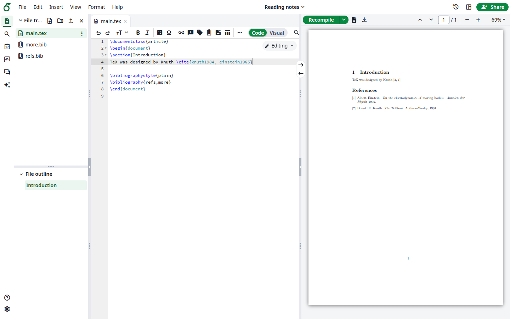

Het zoeken naar referenties doorzoekt alle `.bib`-bestanden in je project, zodat je een referentie vindt zonder de citeersleutel te onthouden. Je hoeft niets in te stellen.

Je project heeft minstens één `.bib`-bestand nodig. Je kunt er een uploaden of je bibliotheek importeren uit [Zotero](/nl/on-premises/user-guide/users/zotero-integration) of [Mendeley](/nl/on-premises/user-guide/users/mendeley-integration).

## Een citaat invoegen {#insert-a-citation}

<Steps>
<Step title="Begin een citaat">
Typ in een `.tex`-bestand `\cite{`. De editor voegt de sluitende accolade toe. Onder de cursor zie je de citeersleutels en een blauw vak, **Open advanced reference search**.

<Frame caption="Het blauwe vak onder een citaat">
  
</Frame>

Ook de knop **Insert citation** in de werkbalk en **Insert** gevolgd door **Citation** beginnen een `\cite{}` voor je. Het vak verschijnt ook bij andere citeeropdrachten, zoals `\citep`, `\autocite`, `\parencite` en `\textcite`.
</Step>

<Step title="Open het zoeken">
Klik op **Search** in het blauwe vak, of druk op Ctrl+Spatie tussen de accolades. Het dialoogvenster toont elk item met titel, citeersleutel, auteur, tijdschrift en jaar.

<Frame caption="Alle items van het project">
  
</Frame>
</Step>

<Step title="Vind het item">
Typ in het zoekvak. Er wordt gezocht in citeersleutel, auteur, titel, tijdschrift en jaar, en wat gevonden is, wordt gemarkeerd. Elk woord moet overeenkomen, dus `turing 1936` vindt het artikel van Turing uit 1936. Andere velden, zoals de uitgever, worden niet doorzocht.

<Frame caption="Zoeken op auteur en jaar">
  
</Frame>
</Step>

<Step title="Kies een of meer items">
Klik op een item. Het wordt groen en de sleutel verschijnt boven de lijst. Klik op een ander item of zoek opnieuw om er nog een toe te voegen: je keuze blijft behouden. Klik nogmaals op een item of op de <strong>×</strong> naast de sleutel om het te verwijderen.

<Frame caption="Twee gekozen items">
  
</Frame>
</Step>

<Step title="Klik op Insert">
De sleutels verschijnen tussen de accolades, gescheiden door komma's. Heeft je document nog geen bibliografie, voeg dan deze regels toe vóór `\end{document}`, met de namen van je `.bib`-bestanden zonder extensie:

```latex
\bibliographystyle{plain}
\bibliography{refs,more}
```

Klik op **Recompile**. De referenties verschijnen in de pdf.

<Frame caption="Het gecompileerde citaat">
  
</Frame>
</Step>
</Steps>

Het zoeken werkt op dezelfde manier in de **Visual**-editor.

## Een citaat wijzigen {#change-a-citation}

<strong>Een referentie toevoegen:</strong> zet de cursor tussen de accolades van een bestaand citaat en open het zoeken. **Insert** voegt de nieuwe sleutels toe na de bestaande.

<strong>Referenties vervangen:</strong> selecteer de sleutels in de editor en druk op Ctrl+Spatie. De sleutels verschijnen boven de lijst en op de knop staat nu **Replace**. Verwijder de sleutels die je niet wilt, voeg andere toe en klik op **Replace**. Een sleutel die in geen enkel `.bib`-bestand staat, blijft staan totdat je hem verwijdert.

<Frame caption="Geselecteerde sleutels vervangen">
  
</Frame>

## Het toetsenbord gebruiken {#use-the-keyboard}

| Toets | Wat deze doet |
| --- | ------------ |
| **Pijl omlaag** | Gaat van het zoekvak naar de lijst en daarna omlaag in de lijst |
| **Pijl omhoog** | Gaat omhoog in de lijst |
| **Spatie** | Kiest het item of haalt het uit je keuze |
| **Enter** | Voegt je keuze in als je in de lijst bent |
| **Tab** | Wisselt tussen het zoekvak, de lijst en de knoppen |
| **Esc** | Sluit het dialoogvenster zonder iets te wijzigen |

## Waar de items vandaan komen {#where-the-entries-come-from}

Het zoeken omvat elk `.bib`-bestand in het project, ook bestanden die uit Zotero of Mendeley zijn geïmporteerd. Bewerk je een `.bib`-bestand, dan vindt de volgende zoekopdracht de nieuwe items.

## Als er iets misgaat {#if-something-goes-wrong}

| Wat je ziet | Waarom | Wat je doet |
| ------------ | --- | ---------- |
| De lijst in het dialoogvenster is leeg | Het project heeft geen `.bib`-bestand | Upload of maak er een |
| Geen blauw vak, en Ctrl+Spatie toont LaTeX-opdrachten | De cursor staat niet tussen de accolades van een citaat | Klik tussen de accolades |
| Ctrl+Spatie doet niets | Je computer gebruikt deze sneltoets voor iets anders | Klik op **Search** in het blauwe vak |
| Een item wordt niet gevonden | Het zoeken omvat alleen sleutel, auteur, titel, tijdschrift en jaar | Zoek op een van die velden |
