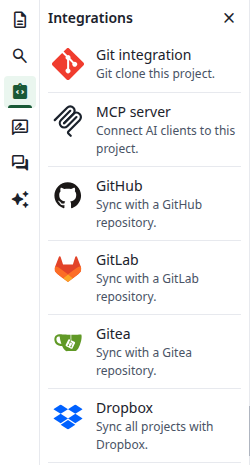

Houd al uw projecten gesynchroniseerd met een map in uw Dropbox. Wijzigingen gaan op de achtergrond in beide richtingen, met één uitzondering: wat u in de editor typt, bereikt Dropbox een paar minuten nadat u het project hebt verlaten, of wanneer u op **sync this project now** klikt.

<Info>

Als u geen Dropbox-optie ziet in **Account settings** of in de editor, vraag uw beheerder dan om [Dropbox-synchronisatie](/nl/on-premises/configuration/overleaf-toolkit/integrations/dropbox-synchronisation) in te schakelen.

</Info>

## Uw Dropbox-account koppelen {#link-your-dropbox-account}

Dit doet u één keer.

<Steps>
<Step title="Open uw accountinstellingen">
Klik op **Account** en daarna op **Account settings**. Zoek onder **Project synchronisation** naar **Dropbox** en klik op **Link**.

<Frame caption="Dropbox in de accountinstellingen">
  
</Frame>
</Step>

<Step title="Autoriseer op Dropbox">
Dropbox wordt geopend. Meld u aan als daarom wordt gevraagd en autoriseer daarna de applicatie.
</Step>

<Step title="Controleer de koppeling">
U bent terug in de accountinstellingen. Een groene melding geeft aan dat uw Dropbox-account is gekoppeld, en op de knop staat nu **Unlink**. Onder Dropbox geeft een status aan dat uw projecten worden verzonden.

<Frame caption="Uw Dropbox-account is gekoppeld">
  
</Frame>

De status verandert in **Overleaf and Dropbox have processed all updates** wanneer ze er allemaal zijn.

<Frame caption="Alles is gesynchroniseerd">
  
</Frame>
</Step>
</Steps>

Als uw account nog niet is gekoppeld, vraagt de kaart **Dropbox** in de editor u om dat eerst te doen. Klik op **Update Dropbox Settings**: de accountinstellingen worden geopend in een nieuw tabblad. Koppel daar uw account en vernieuw daarna de editorpagina, zoals het dialoogvenster aangeeft.

<Frame caption="De melding wanneer uw account niet is gekoppeld">
  
</Frame>

Als u op Dropbox geen toegang verleent, komt u zonder melding terug in de accountinstellingen, en op de knop staat nog steeds **Link**.

### Als u projecten met dezelfde naam hebt {#if-you-have-projects-with-the-same-name}

U kunt niet koppelen zolang twee van uw projecten dezelfde naam hebben. De melding noemt ze. Gearchiveerde projecten en projecten in de prullenbak tellen ook mee.

<Frame caption="Twee projecten met dezelfde naam">
  
</Frame>

Wijzig de naam van een van beide en klik opnieuw op **Link**.

## Uw projecten in Dropbox vinden {#find-your-projects-in-dropbox}

Elk van uw projecten is een map in `Apps/<app name>/` in uw Dropbox, met al zijn bestanden. Uw beheerder heeft de appnaam gekozen. Elk project wordt gesynchroniseerd, ook de projecten die u later aanmaakt: u kunt er niet enkele uitkiezen.

Om de map van een project te zien, opent u het project. Klik in de linkerbalk op **Integrations** en daarna op **Dropbox**.

<Frame caption="Het paneel Integrations">
  
</Frame>

Het dialoogvenster noemt de map en linkt ernaar op Dropbox.

<Frame caption="De map van dit project">
  
</Frame>

Een nieuw project met dezelfde naam als een bestaand project krijgt een genummerde map, zoals `Field notes (1)`. Het dialoogvenster toont welke map erbij hoort.

<Frame caption="Een genummerde map">
  
</Frame>

## Wijzigingen die u in Overleaf aanbrengt {#changes-you-make-in-overleaf}

U hoeft nergens op te klikken.

* **Nieuwe bestanden, hernoemingen, verplaatsingen en verwijderingen** bereiken Dropbox meteen. Een nieuwe map verschijnt daar met het eerste bestand.
* **Een project hernoemen** hernoemt de map.
* **Bewerkingen die u in de editor typt**, bereiken Dropbox niet zolang het project open is, en klikken op **Recompile** verzendt ze niet. Ze gaan ongeveer drie minuten nadat iedereen het project heeft verlaten. Om ze eerder te verzenden, zie [Een synchronisatie forceren](#force-a-sync).
* **Een project verwijderen** laat de map in Dropbox staan. Verwijder de map zelf als u die niet meer nodig hebt.

## Wijzigingen die u in Dropbox aanbrengt {#changes-you-make-in-dropbox}

Ook hier hoeft u nergens op te klikken. Dropbox laat Overleaf weten dat er iets is gewijzigd, en de wijziging verschijnt meestal binnen enkele seconden, ook in een geopende editor, zonder opnieuw te laden.

* **Nieuwe bestanden, bewerkingen, hernoemingen en verwijderingen** in een projectmap worden op het project toegepast. Net als nieuwe mappen.
* **Een nieuwe map op het hoogste niveau van de app-map** wordt een nieuw project.
* **Bestanden die Overleaf niet synchroniseert**, zoals `.DS_Store`- of `.aux`-bestanden, blijven alleen in Dropbox.

De geschiedenis van het project markeert deze wijzigingen met <strong>(via Dropbox)</strong>.

### Als het bestand open is in de editor {#if-the-file-is-open-in-the-editor}

Het bestand verandert voor uw ogen, en een dialoogvenster meldt dit. Klik op **OK**.

<Frame caption="Een geopend bestand is gewijzigd in Dropbox">
  
</Frame>

De Dropbox-versie vervangt wat u had getypt en nog niet was verzonden. Uw tekst gaat niet verloren: die blijft in de geschiedenis van het project.

<Frame caption="De vervangen tekst in de geschiedenis">
  
</Frame>

### Een projectmap hernoemen of verwijderen {#rename-or-delete-a-project-folder}

Hernoem een project in Overleaf, niet in Dropbox. Voor Overleaf is een map die in Dropbox is hernoemd een verwijderde map plus een nieuwe: u krijgt een nieuw project met de nieuwe naam, en het oude project blijft bestaan.

Wanneer u een projectmap in Dropbox verwijdert, blijft het project in uw projectenlijst staan, met zijn bestanden en geschiedenis. De volgende keer dat u het opent, meldt een dialoogvenster dit één keer. Klik op **OK**.

<Frame caption="De map van dit project is verdwenen uit Dropbox">
  
</Frame>

Het project blijft synchroniseren. Om het helemaal terug te zetten in Dropbox, klikt u op **sync this project now**.

### Terwijl een project gearchiveerd is of in de prullenbak staat {#while-a-project-is-archived-or-in-the-trash}

Wijzigingen die u in de map in Dropbox aanbrengt, worden niet toegepast, en het herstellen van het project haalt ze niet binnen. Overleaf stopt dan met het verzenden van de bestanden die u hebt gewijzigd, zodat beide kanten van elkaar verschillen. Sla zo'n bestand nog een keer op in Dropbox: de Dropbox-versie vervangt dan die in Overleaf.

## Een synchronisatie forceren {#force-a-sync}

Elk project heeft een eigen link. Gebruik die wanneer u uw bewerkingen nu in Dropbox wilt hebben, zonder het project te verlaten.

<Steps>
<Step title="Open het synchronisatievenster">
Open het project. Klik in de linkerbalk op **Integrations** en daarna op **Dropbox**.
</Step>

<Step title="Klik op sync this project now">
De link staat aan het einde van <strong>Changes not appearing in Dropbox?</strong>
</Step>

<Step title="Controleer het resultaat">
Een blauwe melding geeft aan dat een handmatige synchronisatie is gestart, en de status toont **Sending and receiving updates**. Die verandert terug in **Overleaf and Dropbox have processed all updates** wanneer de synchronisatie klaar is.

<Frame caption="Een handmatige synchronisatie loopt">
  
</Frame>
</Step>
</Steps>

De link verzendt het hele project naar Dropbox, inclusief de bewerkingen die nog in de editor staan. Hij leest ook de wijzigingen die in Dropbox wachten, voor al uw projecten. Als uw site geen [meldingen van Dropbox](/nl/on-premises/configuration/overleaf-toolkit/integrations/dropbox-synchronisation#webhook) kan ontvangen, komen wijzigingen uit Dropbox alleen op deze manier binnen.

U kunt dit eens per minuut per project doen. Eerder vraagt een rode melding u te wachten.

<Frame caption="Wacht een minuut tot de volgende">
  
</Frame>

## Uw Dropbox-account ontkoppelen {#unlink-your-dropbox-account}

<Steps>
<Step title="Klik op Unlink">
Klik in **Account settings**, onder **Dropbox**, op **Unlink**.
</Step>

<Step title="Bevestig">
Klik op **Unlink** in het dialoogvenster.

<Frame caption="Uw account ontkoppelen">
  
</Frame>
</Step>

<Step title="Controleer het resultaat">
Op de knop staat weer **Link**, en de kaart **Dropbox** in de editor meldt dat uw account niet is gekoppeld. Er wordt in geen enkele richting meer iets gesynchroniseerd. Uw projecten en de mappen in Dropbox behouden hun bestanden.
</Step>
</Steps>

### Later opnieuw koppelen {#link-again-later}

Klik op **Link**. Uw projecten worden opnieuw naar Dropbox verzonden:

* Elk bestand vervangt het bestand met dezelfde naam in Dropbox. Wat u in die bestanden in Dropbox hebt gewijzigd terwijl het account was ontkoppeld, wordt overschreven, dus zet zulke wijzigingen eerst over naar het project.
* Een bestand dat alleen in Dropbox bestaat, blijft daar staan en komt in het project wanneer u het de volgende keer wijzigt.
* Een project dat u hebt hernoemd terwijl het account was ontkoppeld, krijgt een nieuwe map. De oude map blijft bestaan.

### Als Overleaf uw account ontkoppelt {#if-overleaf-unlinks-your-account}

Overleaf ontkoppelt uw account wanneer Dropbox de koppeling niet meer accepteert. De projectenlijst geeft de reden aan totdat u opnieuw koppelt.

<Frame caption="Uw account is ontkoppeld">
  
</Frame>

Voor de redenen, zie de Q\&A van [Dropbox-synchronisatie](/nl/on-premises/configuration/overleaf-toolkit/integrations/dropbox-synchronisation).

<Info>

Wat medewerkers in een gedeeld project krijgen, leest u in [Hoe synchroniseren werkt](/nl/on-premises/configuration/overleaf-toolkit/integrations/dropbox-synchronisation#hoe-synchroniseren-werkt).

</Info>
