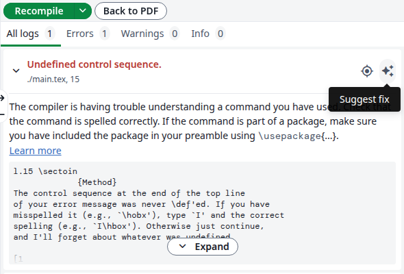

<Info>

Heeft een logregel geen knop **Suggest fix**, verwijs je beheerder dan naar [AI-integratie](/nl/on-premises/configuration/overleaf-toolkit/integrations/ai-integration).

</Info>

<Steps>
<Step title="Open de logs">
Na een compilatie met fouten verschijnt een rood getal op het logpictogram naast **Recompile**, en een rode stip markeert de regel in de editor. Klik op het pictogram. Heeft de compilatie geen pdf opgeleverd, dan zijn de logs al geopend.

<Frame caption="Een compilatie met één fout">
  
</Frame>
</Step>

<Step title="Klik op Suggest fix">
Klik op het sprankelpictogram, **Suggest fix**, rechts van de logregel. Waarschuwingen die naar een bestand in je project verwijzen, hebben het ook.

<Frame caption="De knop Suggest fix">
  
</Frame>

De eerste keer staat er **Before you use Error Assist** in de regel. Klik op **Accept and continue**. Dit doe je één keer, en het geldt ook voor de [AI-assistent](/nl/on-premises/user-guide/users/ai-assistant).

<Frame caption="Eén keer getoond">
  
</Frame>
</Step>

<Step title="Lees de suggestie">
De regel legt de fout uit en toont de regel die moet veranderen: de oude tekst op de rij <strong>-</strong> en de nieuwe tekst op de rij <strong>+</strong>. Klik op het regelnummer om naar die regel in de editor te gaan; het kopieerpictogram kopieert de nieuwe tekst.

<Frame caption="Een voorgestelde oplossing">
  
</Frame>

Heeft de assistent geen oplossing, dan geeft hij alleen uitleg en valt er niets toe te passen. Het vernieuwpictogram, **Suggest a different fix**, vraagt het opnieuw.
</Step>

<Step title="Pas toe of laat liggen">
Klik op **Apply suggestion** om de oplossing toe te passen. De regel verandert in de editor, de logregel meldt **Suggestion applied** en het project wordt opnieuw gecompileerd. Zodra er geen fout meer over is, komt de pdf terug. Druk in de editor op `Ctrl+Z` om de wijziging ongedaan te maken.

<Frame caption="De oplossing is toegepast">
  
</Frame>

Wil je de suggestie afwijzen, doe dan niets: er is geen afwijsknop, en het document blijft zoals het is totdat je op **Apply suggestion** klikt.

Bewerk je die regel eerst, dan is **Apply suggestion** uitgeschakeld. Klik op **Suggest a different fix** voor een nieuwe suggestie.
</Step>
</Steps>

## De suggestie terugvinden {#find-the-suggestion-again}

Na de volgende compilatie tonen de logs de suggestie als **Last suggested fix**, of je die nu hebt toegepast of niet. Klik op de pijl om haar te openen.

<Frame caption="De laatste suggestie blijft in de logs staan">
  
</Frame>

De foutassistent telt mee voor dezelfde limiet als de AI-assistent, zie [Tokengebruik](/nl/on-premises/user-guide/users/ai-assistant#token-usage).
