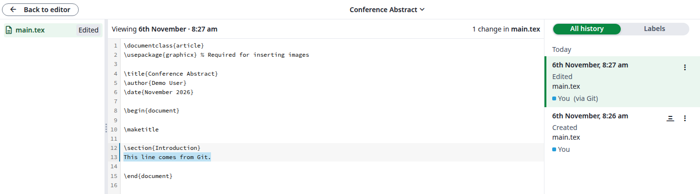

Werk met Git op uw eigen computer aan een project. Wijzigingen worden alleen overgedragen wanneer u `git pull` of `git push` uitvoert.

<Info>

Een beheerder moet eerst de [Git-integratie](/nl/on-premises/configuration/overleaf-toolkit/integrations/git-integration) inschakelen.

</Info>

## Een token aanmaken {#create-a-token}

Git meldt zich aan met een Git-authenticatietoken, niet met het wachtwoord van uw account.

<Steps>
<Step title="Open uw accountinstellingen">
Klik op **Account** en daarna op **Account settings**. Klik onder **Git integration** op **Generate token**. Zodra u een token hebt, heet deze knop **Add another token**.

<Frame caption="Git-integratie in de accountinstellingen">
  
</Frame>
</Step>

<Step title="Kopieer het token">
Klik op **Copy** en bewaar het token op een veilige plek. U ziet het maar één keer. Klik daarna op **Close**.

<Frame caption="Uw nieuwe token">
  
</Frame>
</Step>

<Step title="Controleer het token">
De lijst toont nu het begin van het token, wanneer het is aangemaakt en wanneer het voor het laatst is gebruikt. Het verloopt na een jaar. U kunt maximaal 10 tokens hebben.

<Frame caption="Uw tokens">
  
</Frame>
</Step>
</Steps>

## Een project klonen {#clone-a-project}

<Steps>
<Step title="Open de Git-integratie in de editor">
Open het project. Klik in de linkerbalk op **Integrations** en daarna op **Git integration**.

<Frame caption="Het paneel Integrations">
  
</Frame>
</Step>

<Step title="Kopieer de opdracht">
Het dialoogvenster **Clone with Git** toont de opdracht, met het adres van uw site en de ID van het project. Klik op **Copy**. Als u nog geen token hebt, opent **Go to settings** uw accountinstellingen in een nieuw tabblad.

<Frame caption="De kloonopdracht">
  
</Frame>
</Step>

<Step title="Voer de opdracht uit">
Plak de opdracht in een terminal. Wanneer Git om een wachtwoord vraagt, plakt u uw token.

```text
$ git clone https://git@<your-site>/git/<project-id>
Cloning into '<project-id>'...
Password for 'https://git@<your-site>': <your-token>
```

Een map met de project-ID als naam bevat nu de bestanden van het project, op de branch `main`. Om zelf de mapnaam te kiezen, voegt u die toe aan het einde van de opdracht.
</Step>
</Steps>

Git vraagt elke keer om het token wanneer het contact maakt met de site. Om het te laten onthouden, schakelt u een credential helper in: Git vraagt er nog één keer om en bewaart het daarna. De helper `store` bewaart het onversleuteld in `~/.git-credentials`.

```bash
git config --global credential.helper store
```

## Wijzigingen uit de editor ophalen {#pull-changes-from-the-editor}

Voer in de map het volgende uit:

```bash
git pull
```

Git toont de bestanden die zijn gewijzigd. Wijzigingen uit de editor komen binnen als commits met de naam `Update on Overleaf.`.

```text
Updating db007e3..c3e6332
Fast-forward
 main.tex | 2 +-
 1 file changed, 1 insertion(+), 1 deletion(-)
```

## Uw wijzigingen pushen {#push-your-changes}

Commit uw wijzigingen en push ze daarna:

```bash
git add main.tex
git commit -m "Add a line from Git"
git push
```

De laatste regel van de uitvoer toont de branch die is verplaatst:

```text
   53aca61..db007e3  main -> main
```

De wijzigingen verschijnen in de editor, en een geopende editor werkt zichzelf bij. Nieuwe bestanden, mappen en hernoemingen verschijnen in de bestandsstructuur. In **History** is uw wijziging gemarkeerd als <strong>You (via Git)</strong>. Uw commitbericht wordt daar niet getoond.

<Frame caption="Een push in de projectgeschiedenis">
  
</Frame>

### Als Git uw push weigert {#if-git-refuses-your-push}

Als het project intussen is gewijzigd, weigert Git de push:

```text
 ! [rejected]        main -> main (fetch first)
```

Haal eerst die wijzigingen op en push daarna opnieuw:

```bash
git pull --no-rebase --no-edit
git push
```

Een gewone `git pull` kan stoppen met `fatal: Need to specify how to reconcile divergent branches.` De optie `--no-rebase` hierboven lost dat op: die voegt beide kanten samen.

Als dezelfde regels aan beide kanten zijn gewijzigd, stopt de pull met `CONFLICT (content): Merge conflict in main.tex`. Herstel het bestand en voer daarna uit:

```bash
git add main.tex
git commit -m "Merge the changes from the editor"
git push
```

Twee dingen accepteert de site niet:

* Andere branches: `! [remote rejected] feature -> feature (wrong branch)`. Alleen `main` bestaat, dus push uw werk daarheen.
* Force pushes: `! [remote rejected] main -> main (forced push prohibited)`. Zet uw wijzigingen in plaats daarvan bovenop de huidige `main`.

### Als Git Authentication failed meldt {#if-git-says-authentication-failed}

```text
remote: Enter your Git authentication token when prompted for a password.
fatal: Authentication failed for 'https://<your-site>/git/<project-id>/'
```

Het token is onjuist of verwijderd, of u hebt het wachtwoord van uw account ingevoerd. Maak een nieuw token aan als u het niet meer hebt, want een bestaand token kunt u niet opnieuw bekijken.

## Een token verwijderen {#delete-a-token}

Klik in **Account settings**, onder **Git integration**, op het verwijderpictogram naast het token en daarna op **Delete** in het dialoogvenster. Vanaf dat moment antwoordt Git `Authentication failed` op dat token.

<Frame caption="Een token verwijderen">
  
</Frame>

<Info>

Wat medewerkers met alleen-lezentoegang kunnen doen, leest u in de Q\&A van de [Git-integratie](/nl/on-premises/configuration/overleaf-toolkit/integrations/git-integration).

</Info>
