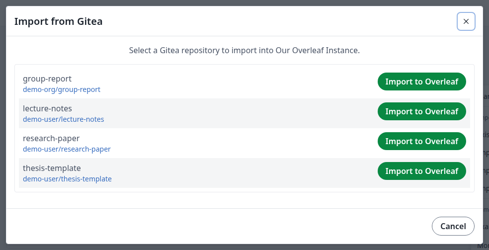

Verbind een project met een Gitea-repository. Wijzigingen gaan in beide richtingen, en alleen wanneer u op **Sync** klikt: niets wordt vanzelf gesynchroniseerd.

<Info>

Een beheerder moet eerst de [Gitea-synchronisatie](/nl/on-premises/configuration/overleaf-toolkit/integrations/gitea-synchronisation) inschakelen.

</Info>

## Uw Gitea-account koppelen {#link-your-gitea-account}

Dit doet u één keer.

<Steps>
<Step title="Open uw accountinstellingen">
Klik op **Account** en daarna op **Account settings**. Zoek onder **Project synchronisation** naar **Gitea** en klik op **Link**.

<Frame caption="Gitea in de accountinstellingen">
  
</Frame>
</Step>

<Step title="Autoriseer op Gitea">
Gitea wordt geopend. Meld u aan als daarom wordt gevraagd en autoriseer daarna de applicatie.
</Step>

<Step title="Controleer de koppeling">
U bent terug in de accountinstellingen. Een groene melding geeft aan dat uw Gitea-account is gekoppeld, en op de knop staat nu **Unlink**.

<Frame caption="Uw Gitea-account is gekoppeld">
  
</Frame>
</Step>
</Steps>

Als uw account nog niet is gekoppeld, vragen **Import from Gitea** en de kaart **Gitea** in de editor u om dat eerst te doen. Klik op **Link to your Gitea account**. Ook zo komt u in de accountinstellingen terecht, in een nieuw tabblad als u in de editor bent begonnen. Ga daarna terug en begin opnieuw.

<Frame caption="De melding wanneer uw account niet is gekoppeld">
  
</Frame>

## Een repository importeren {#import-a-repository}

Hiermee maakt u een nieuw project van een Gitea-repository, dat er al aan is gekoppeld.

<Steps>
<Step title="Open het importvenster">
Klik op de projectenpagina op **New project** en daarna op **Import from Gitea**.

<Frame caption="Het menu New project">
  
</Frame>
</Step>

<Step title="Kies de repository">
Klik op **Import to Overleaf** naast de repository. De lijst bevat uw repository's en die van uw organisaties. Een lege repository wordt niet getoond: er is minstens één commit nodig.

<Frame caption="Uw Gitea-repository's">
  
</Frame>
</Step>

<Step title="Controleer het project">
Het nieuwe project wordt geopend met de bestanden van de repository.

<Frame caption="Het geïmporteerde project">
  
</Frame>
</Step>
</Steps>

## Een project exporteren naar een nieuwe repository {#export-a-project-to-a-new-repository}

Hiermee maakt u een repository van een project en koppelt u ze. Een project kan alleen op deze manier of door te importeren worden gekoppeld: u kunt het niet koppelen aan een repository die al bestaat.

<Steps>
<Step title="Open Gitea in de editor">
Open het project. Klik in de linkerbalk op **Integrations** en daarna op **Gitea**.

<Frame caption="Het paneel Integrations">
  
</Frame>
</Step>

<Step title="Vul de repository in">
Kies de **Owner**: uzelf of een van uw organisaties. Wanneer u een organisatie kiest, heet dit veld **Organization**. **Repository Name** begint als de naam van het project: als die naam spaties bevat, wijzig hem dan, want Gitea accepteert geen spaties. De beschrijving is optioneel, en **Private** is standaard geselecteerd. Klik op **Create a Gitea repository**.

<Frame caption="Export Project to Gitea">
  
</Frame>

Als de naam spaties bevat of al in gebruik is, toont het dialoogvenster <strong>Please check that the repository name is valid, and that you have permission to create the repository.</strong> Wijzig de naam en klik opnieuw op de knop.
</Step>

<Step title="Controleer de koppeling">
Het dialoogvenster toont nu **This project is linked to** en de naam van de repository.

<Frame caption="Het project is gekoppeld">
  
</Frame>
</Step>
</Steps>

## Synchroniseren {#sync}

<Steps>
<Step title="Open het synchronisatievenster">
Open een gekoppeld project. Klik in de linkerbalk op **Integrations** en daarna op **Gitea**.

**Recent commits in Gitea** toont wat er in het project binnenkomt.

<Frame caption="Een nieuwe commit wacht in Gitea">
  
</Frame>
</Step>

<Step title="Beschrijf uw wijzigingen">
Als u iets in het project hebt gewijzigd, verschijnt een veld voor het commitbericht. Het is optioneel: als u het leeg laat, heet de commit `Updates from Overleaf`.

<Frame caption="Het commitbericht voor uw wijzigingen">
  
</Frame>
</Step>

<Step title="Klik op Sync">
Klik op **Sync**. Nieuwe commits uit Gitea komen in het project, en uw wijzigingen gaan naar de standaardbranch van de repository. Als beide kanten verschillende dingen hebben gewijzigd, worden ze voor u samengevoegd via een pull request, die als vastlegging op Gitea blijft staan.
</Step>

<Step title="Controleer het resultaat">
Het dialoogvenster toont <strong>No new commits in Gitea since last merge.</strong> en het veld voor het commitbericht is verdwenen. De bestanden in de editor en de commits op Gitea zijn bijgewerkt.

<Frame caption="Alles is gesynchroniseerd">
  
</Frame>
</Step>
</Steps>

### Als dezelfde regels aan beide kanten zijn gewijzigd {#if-the-same-lines-changed-on-both-sides}

Het dialoogvenster meldt dat de wijzigingen niet konden worden samengevoegd en noemt een nieuwe branch, `overleaf-YYYY-MM-DD-HHMMSS`, die uw wijzigingen bevat. Overleaf opent ook een pull request vanuit die branch op Gitea.

<Frame caption="Een conflict">
  
</Frame>

1.  Voeg die branch met Git samen in de standaardbranch en los het conflict op. U kunt het dialoogvenster intussen sluiten: het toont dezelfde melding wanneer u het opnieuw opent.

    ```bash
    git clone <repository-address>
    cd <repository-name>
    git merge origin/overleaf-YYYY-MM-DD-HHMMSS
    # fix the conflict in the file Git names
    git add <file>
    git commit
    git push
    ```
2. Klik op **I have manually merged. Continue**. Het samengevoegde resultaat komt in het project. Als u erop klikt voordat de branch is samengevoegd, blijft het dialoogvenster ongewijzigd.
3. De branch blijft op Gitea staan en de bijbehorende pull request blijft open. Sluit de pull request en verwijder de branch wanneer u ze niet meer nodig hebt.

Hetzelfde dialoogvenster verschijnt wanneer een branchbeveiligingsregel de pull request tegenhoudt, bijvoorbeeld omdat er een goedkeuring nodig is, ook als er geen regels conflicteren. Zodra de regel het toestaat, voegt u de pull request samen op Gitea en klikt u op **I have manually merged. Continue**. Zie [Hoe synchroniseren met Gitea werkt](/nl/on-premises/configuration/overleaf-toolkit/integrations/gitea-synchronisation#how-syncing-works-with-gitea).

## Een project ontkoppelen {#unlink-a-project}

Doe dit wanneer u niet meer wilt dat het project synchroniseert.

<Steps>
<Step title="Klik op Unlink">
Klik in het synchronisatievenster op **Unlink**.
</Step>

<Step title="Bevestig">
Klik op **Confirm**. Dit verwijdert alleen de koppeling: de verbinding met een repository waarvan u eigenaar bent, die de waarschuwing noemt, is een mogelijkheid die u daarna hebt, niet iets wat nu gebeurt.

<Frame caption="Bevestig het ontkoppelen">
  
</Frame>
</Step>

<Step title="Controleer het resultaat">
Het dialoogvenster toont nu **Export Project to Gitea**. Het project en de repository behouden allebei hun inhoud. Om opnieuw te synchroniseren, exporteert u het project naar een nieuwe repository of importeert u de repository in een nieuw project.
</Step>
</Steps>

## Uw Gitea-account ontkoppelen {#unlink-your-gitea-account}

Klik in **Account settings**, onder **Gitea**, op **Unlink** en daarna nogmaals op **Unlink** in het dialoogvenster.

<Frame caption="Uw account ontkoppelen">
  
</Frame>

Uw projecten blijven gekoppeld aan hun repository's. U kunt ze pas weer synchroniseren wanneer u uw account opnieuw koppelt.

<Info>

Wie wat kan doen in een gedeeld project, leest u in [Wie kan koppelen en synchroniseren](/nl/on-premises/configuration/overleaf-toolkit/integrations/gitea-synchronisation#who-can-link-and-sync).

</Info>
