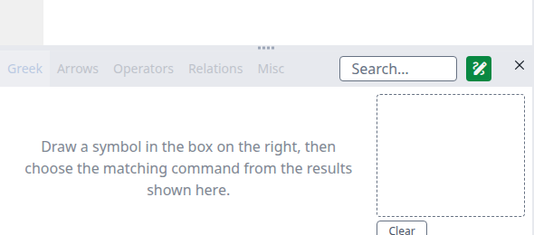

Het symboolpalet voegt wiskundige symbolen in uw document in. Als u de naam van een symbool niet kent, tekent u het en vindt uw browser de opdracht. Er hoeft niets te worden ingesteld.

## Een symbool invoegen {#insert-a-symbol}

<Steps>
<Step title="Plaats de cursor in de wiskundemodus">
De meeste symbolen werken alleen in de wiskundemodus. Klik op de plek waar het symbool moet komen. Klik in de werkbalk van de editor op **Insert math** en daarna op **Inline**. De cursor staat nu tussen `\(` en `\)`.

<Frame caption="Het menu Insert math">
  
</Frame>
</Step>

<Step title="Open het palet">
Klik in de werkbalk op de knop **Ω**, **Insert symbol**. U kunt ook bovenaan de pagina op **Insert** en daarna op **Symbol** klikken. Het palet opent onder de editor.

<Frame caption="Het symboolpalet">
  
</Frame>
</Step>

<Step title="Zoek het symbool">
Klik op een tabblad: **Greek**, **Arrows**, **Operators**, **Relations** of **Misc**. Houd de aanwijzer boven een symbool om de naam en de opdracht te zien. Sommige tonen ook een opmerking, zoals het pakket dat ze nodig hebben.

<Frame caption="De naam, opdracht en opmerking van een symbool">
  
</Frame>
</Step>

<Step title="Klik erop">
De opdracht verschijnt bij de cursor. Het palet blijft open, zodat u meteen het volgende symbool kunt toevoegen. Klik op **Recompile** om het symbool in de pdf te zien.

<Frame caption="Het symbool in het document en de pdf">
  
</Frame>
</Step>
</Steps>

Het palet werkt op dezelfde manier in de **Visual**-editor.

## Een symbool zoeken {#search-for-a-symbol}

Typ in het vak **Search**. U kunt zoeken op een opdracht (`\sum`), een woord uit de naam van het symbool (`arrow`) of het teken zelf (`α`). De zoekopdracht omvat alle tabbladen. Maak het vak leeg om terug te gaan naar de tabbladen.

<Frame caption="Zoeken naar arrow">
  
</Frame>

Als niets overeenkomt, toont het palet **No symbols found**.

## Een symbool tekenen {#draw-a-symbol}

Gebruik dit wanneer u een symbool voor u ziet maar de naam niet kent.

<Steps>
<Step title="Klik op het potloodpictogram">
Klik op het potloodpictogram, **Draw a symbol**, rechts van het vak **Search**. De tabbladen worden uitgeschakeld en rechts verschijnt een gestippeld vak.

<strong>Loading model…</strong> wordt getoond tot de herkenning klaar is. De eerste keer downloadt uw browser ongeveer 40 MB van uw site. Daarna bewaart hij deze bestanden.

<Frame caption="Tekenmodus">
  
</Frame>
</Step>

<Step title="Teken in het gestippelde vak">
Wanneer u een lijn afmaakt, verschijnen links maximaal tien overeenkomsten, de beste eerst. Houd de aanwijzer boven een overeenkomst om de opdracht te zien. Bij een symbool met meerdere lijnen worden de overeenkomsten na elke lijn bijgewerkt.

<Frame caption="De overeenkomsten voor een tekening">
  
</Frame>
</Step>

<Step title="Klik op de overeenkomst">
De opdracht verschijnt bij de cursor. Uw tekening blijft staan, zodat u een andere overeenkomst kunt proberen. Klik op **Clear** voordat u het volgende symbool tekent.

<Frame caption="De opdracht bij de cursor">
  
</Frame>
</Step>
</Steps>

Om terug te gaan naar de tabbladen, klikt u nogmaals op het potloodpictogram of in het vak **Search**.

De herkenning draait in uw browser. Uw tekening wordt niet naar uw site verzonden.

### Overeenkomsten die een pakket nodig hebben {#matches-that-need-a-package}

Tekenen kent meer dan 1.300 opdrachten, terwijl de tabbladen er 117 tonen. Veel van de andere komen uit een LaTeX-pakket. In dat geval toont de knopinfo de regel die u moet toevoegen.

<Frame caption="Een overeenkomst die een pakket nodig heeft">
  
</Frame>

Voeg de regel toe aan uw preambule, vóór `\begin{document}`:

```latex
\usepackage{amssymb}
```

Het palet voegt deze niet voor u toe.

## Het toetsenbord gebruiken {#use-the-keyboard}

Druk vanuit het vak **Search** op Tab tot een symbool is geselecteerd. Met de pijltoetsen gaat u van symbool naar symbool. Enter voegt het geselecteerde symbool in en sluit het palet.

## Het palet sluiten {#close-the-palette}

Klik op de <strong>×</strong> rechtsboven in het palet. De knop **Ω** en **Insert**, daarna **Symbol**, sluiten het ook.

## Als er iets misgaat {#if-something-goes-wrong}

| Wat u ziet | Waarom | Wat u moet doen |
| ------------ | --- | ---------- |
| De compilatie meldt **Missing \$ inserted** | Het symbool staat buiten de wiskundemodus | Verplaats het tussen `\(` en `\)`, of gebruik eerst **Insert math** |
| De compilatie meldt **Undefined control sequence** | De opdracht heeft een pakket nodig | Houd de aanwijzer boven het symbool in het palet om te zien welk, en voeg het toe aan uw preambule |
| Er is geen potloodpictogram | Uw browser kan de herkenning niet uitvoeren, bijvoorbeeld Safari 15 | Werk uw browser bij of gebruik een andere. De tabbladen en de zoekfunctie werken nog steeds |
| **Recognition unavailable** onder het gestippelde vak | De browser kon de herkenningsbestanden niet laden | Klik op **Please try again** |
