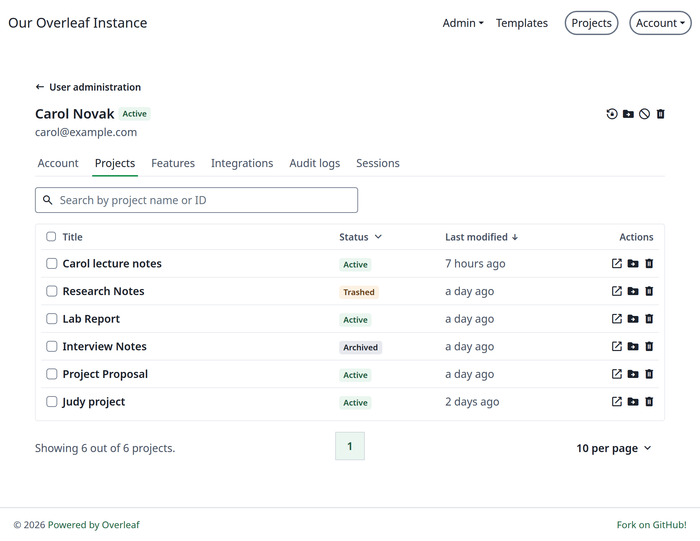

Når du drifter en Overleaf-instans for et laboratorium eller et institutt, kommer de samme spørsmålene hver uke. Hvorfor kan ikke denne studenten logge inn? Hvem bruker fortsatt serveren? Hvem ga den kontoen administratorrettigheter? Hvor ble det av fjorårets masteroppgave? Vi har bygget administrasjonspanelet på nytt slik at du kan svare på dem uten å åpne et databaseskall.

Det nye panelet følger utseendet til Overleaf 6.3 og er oversatt til alle språkene grensesnittet støtter. Det har én liste over alle brukere, én liste over alle prosjekter, en side for hver av dem, et sted for å administrere malene dine, og revisjonslogger.

<Info>

Det nye administrasjonspanelet er slått sammen i hovedgrenen vår og blir offisielt lansert i v6.4.0. Alle skjermbildene i dette innlegget kommer fra en testinstans fylt med oppdiktede kontoer.

</Info>

### Hva det inneholder {#what’s-in-it}

* **Brukerliste**: søk, filtre etter innloggingsmetode, rolle og status, og massehandlinger.
* **Brukerside**: kontoen, prosjektene, funksjonene, integrasjonene, revisjonsloggene og øktene til én person.
* **Prosjektliste**: alle prosjekter på instansen, søkbare etter navn, ID, eier eller delingslenke.
* **Prosjektside**: innstillingene, filene, medlemmene, de slettede filene og revisjonsloggene til ett prosjekt.
* **Maladministrasjon**: publiser et prosjekt som mal, oppdater det, og hold galleriet i orden.
* **Revisjonslogger**: hvem som gjorde hva, når og fra hvilken IP-adresse.

## Én liste for alle brukere {#one-list-for-every-user}

Klikk **Admin**, deretter **Manage Users**. Hver konto er én rad som viser hvordan den logger inn, rollen og statusen.

<Frame caption="Brukerlisten">
  
</Frame>

Søk etter navn, e-post eller ID. Kolonneoverskriftene **Login**, **Role** og **Status** er filtre, og hvert valg viser hvor mange kontoer det ville gitt. Du ser med et blikk hvor mange som kommer inn via SAML, og hver OIDC-leverandør vises under navnet du ga den.

<Frame caption="Filtrering etter innloggingsmetode">
  
</Frame>

Hver konto har nøyaktig én status, og de fire statusene summerer seg til totalen.

| Status       | Hva det betyr                                                       |
| ------------ | ------------------------------------------------------------------- |
| **Active**   | Har logget inn eller åpnet et prosjekt de siste 12 månedene.        |
| **Pending**  | Har aldri logget inn.                                               |
| **Inactive** | Har logget inn før, men ikke de siste 12 månedene.                  |
| **Disabled** | En administrator har hindret kontoen i å logge inn.                 |

Slettede kontoer holdes unna i sitt eget filter. Hvis et søk også treffer en slettet konto, sier en linje over tabellen fra og tilbyr å vise den.

<Frame caption="Filtrering etter status">
  
</Frame>

Søk, sortering og sideinndeling kjører på serveren, så listene stopper ikke lenger ved de første 1 000 radene.

### Få folk inn, med eller uten e-post {#bring-people-in-with-or-without-email}

**Create account** legger til en bruker og gir deg lenken vedkommende trenger. Når [e-postlevering](/no/on-premises/configuration/overleaf-toolkit/email-delivery  "mention") ikke er satt opp, sier dialogen det tydelig og lar deg kopiere lenken, slik at også en liten instans kan ta imot nye brukere.

<Frame caption="Aktiveringslenken til en ny konto">
  
</Frame>

Panelet tilbyr riktig lenke for hver konto: **Send activation email** for en konto som aldri har logget inn, gyldig i 7 dager, og **Send reset link** for en som har det, gyldig i 1 time. Kontoer som logger inn via SSO har ikke noe lokalt passord, så de får ingen av dem.

### Endre mange kontoer samtidig {#change-many-accounts-at-once}

Huk av noen kontoer, så tilbyr verktøylinjen **Send activation email**, **Transfer this user's projects**, **Disable**, **Enable**, **Make admin**, **Remove admin** og **Delete account**. Dialogen viser kontoene før du bekrefter. Hvis noen av dem feiler, forteller den deg hvilke, og det som allerede fungerte, forblir gjort.

<Frame caption="Massehandlinger">
  
</Frame>

### Vanskelig å gjøre feil {#hard-to-get-wrong}

* Din egen konto er merket **You**, og handlingene for den er nedtonet, så du kan ikke deaktivere, slette eller degradere deg selv.
* Hver handling ber om bekreftelse i en dialog som nevner kontoen ved navn.
* **Delete account** kan først overlate brukerens prosjekter til noen andre.
* En slettet konto kan gjenopprettes sammen med prosjektene som ble slettet med den. Bare **Delete permanently** er endelig, og den advarer deg.

## Alt om én person {#everything-about-one-person}

Klikk et navn for å åpne brukerens side. Den har seks faner og de samme handlingsikonene som listen.

### Konto {#account}

Kontoens detaljer, fra ID og e-postadresser til siste innlogging og IP-adressen for den. Klikk blyanten for å endre e-post, navn eller passord, eller for å slå **Admin** på eller av.

<Frame caption="Redigering av en konto">
  
</Frame>

### Prosjekter {#projects}

Prosjektene denne personen eier, med eget søk, statusfilter og egne handlinger.

<Frame caption="En brukers prosjekter">
  
</Frame>

### Funksjoner {#features}

Hva denne kontoen har slått på, som samarbeidspartnere per prosjekt, tidsavbrudd for kompilering, integrasjoner og AI, sammen med kontoens AI-bruk og en knapp for å nullstille den.

<Frame caption="En brukers funksjoner">
  
</Frame>

### Integrasjoner {#integrations}

Personens Git-tilgangstokener og tjenestene vedkommende har koblet til.

<Frame caption="En brukers integrasjoner">
  
</Frame>

### Økter {#sessions}

Hvor personen er logget inn. **Clear sessions** logger vedkommende ut overalt, og det er det første du bør gjøre når en bærbar datamaskin forsvinner.

<Frame caption="En brukers økter">
  
</Frame>

## Alle prosjekter på instansen {#every-project-on-the-instance}

Klikk **Admin**, deretter **Project/Object Lookup**. Listen viser prosjektene til alle brukere, med eiere og statuser. Søkefeltet tar et prosjekts navn, ID, eier eller en lenke. Lim inn en delingslenke, så finner du prosjektet bak den.

<Frame caption="Alle prosjekter">
  
</Frame>

Filteret **Status** skiller prosjekter som er **Active**, **Archived**, **Trashed** og **Deleted**. Huk av flere prosjekter for å laste dem ned i én `.zip`-fil, bytte eier eller slette dem. I visningen **Deleted** er knappene **Restore** og **Delete permanently**.

<Frame caption="Filtrering av prosjekter etter status">
  
</Frame>

## Alt om ett prosjekt {#everything-about-one-project}

Klikk tittelen på et prosjekt for å åpne siden.

### Oversikt {#overview}

Endre navn, lenkedeling, kompilator, TeX Live-versjon og hoveddokument. **Change project owner** gir prosjektet til en annen bruker, noe som hjelper når noen forlater laboratoriet og oppgaven deres må bli værende.

<Frame caption="Redigering av et prosjekt">
  
</Frame>

### Filtre {#file-tree}

Prosjektets filer og mapper, skrivebeskyttet.

<Frame caption="Et prosjekts filer">
  
</Frame>

### Medlemmer {#members}

Eieren, samarbeidspartnerne og ventende invitasjoner. Endre rollen til en samarbeidspartner, fjern tilgangen, eller send en invitasjon på nytt eller trekk den tilbake.

<Frame caption="Endring av et prosjekts medlemmer">
  
</Frame>

### Slettede filer {#deleted-files}

Filer som er fjernet fra prosjektet. **Restore file** legger en kopi i prosjektets rotmappe, og raden viser navnet på kopien.

<Frame caption="En gjenopprettet fil">
  
</Frame>

## Maladministrasjon {#template-management}

En mal starter som et vanlig prosjekt. Du publiserer den fra editoren og administrerer den fra siden dens i galleriet eller fra administrasjonspanelet.

### Alle maler i én tabell {#all-templates-in-one-table}

Klikk **Admin**, deretter **Project/Object Lookup**, og så fanen **Templates**. Den viser alle publiserte maler med forfatter, eier og når de sist ble endret, og du kan søke i den. Klikk en tittel for å åpne malen, klikk en eier for å åpne brukerens side, eller klikk søppelbøtten for å slette en mal. En sletning skrives i [din egen revisjonslogg](#when-there-is-no-log-left).

<Frame caption="Alle maler i administrasjonspanelet">
  
</Frame>

### Publiser fra editoren {#publish-from-the-editor}

Åpne et prosjekt og kompiler det til PDF-en ser riktig ut, for galleriet viser PDF-en fra siste vellykkede kompilering. Klikk deretter **File** og så **Manage Template**, og fyll inn tittel, forfatter, en kategori, en beskrivelse i Markdown og en lisens. Prosjektets kompilator og hoveddokument følger med malen, så prosjekter som åpnes fra den, bruker de samme.

<Frame caption="Publisering av et prosjekt som mal">
  
</Frame>

### Oppdater en mal {#update-a-template}

For å endre filene og PDF-en til en mal publiserer du prosjektet på nytt under samme tittel. Dialogen forteller deg at tittelen allerede finnes, og knappen blir **Overwrite**. Prosjekter som folk allerede har åpnet fra malen, endres ikke.

<Frame caption="Publisering under samme tittel">
  
</Frame>

### Malsiden {#the-template-page}

Alle kan bruke **Open as Template**, **View PDF** og nedlastingsknappen. Administratorer får i tillegg **Admin: Source Project**, **Edit** og **Delete**.

<Frame caption="Siden til en mal">
  
</Frame>

**Edit** endrer hva galleriet viser om en mal: tittel, forfatter, kategori, beskrivelse og lisens, og stavekontrollspråket for prosjekter som åpnes fra den. Den rører ikke filene eller PDF-en. Malen beholder sin egen kopi av filene, så sletting av kildeprosjektet tar ikke malen med seg.

<Frame caption="Redigering av en mals detaljer">
  
</Frame>

### Et galleri for brukerne dine {#a-gallery-for-your-users}

Galleriet åpner med et kort for hver kategori, og hver kategori har sin egen side. Kategoriene kommer fra konfigurasjonen av [Maler](/no/on-premises/configuration/overleaf-toolkit/templates  "mention"), der du også kan la en bruker som ikke er administrator, publisere.

<Frame caption="Malgalleriet">
  
</Frame>

Siden **All templates** viser alle maler med en forhåndsvisning av første side, og brukerne dine kan søke i den og sortere den etter tittel eller dato.

<Frame caption="Alle maler">
  
</Frame>

## Revisjonslogger: hvem gjorde hva, og når {#audit-logs-who-did-what-and-when}

Dette er delen vi er mest fornøyd med. Hver konto og hvert prosjekt har nå sin egen revisjonslogg, og nettstedets administratorer kan lese den direkte i panelet.

Åpne fanen **Audit logs** på en brukers side. De nyeste oppføringene kommer først.

<Frame caption="Revisjonsloggen til en konto">
  
</Frame>

Lest nedenfra og opp forteller denne siden en historie. Lena logget inn. En administrator økte tidsavbruddet for kompileringen hennes til 300 sekunder, slo av AI-tilgangen hennes, sendte henne en lenke for tilbakestilling av passord, gjorde henne til administrator og tok det tilbake, og deaktiverte og reaktiverte deretter kontoen. Lena logget inn igjen, og administratoren tømte øktene hennes.

| Kolonne        | Hva den forteller deg                                                                               |
| -------------- | --------------------------------------------------------------------------------------------------- |
| **Date**       | Når det skjedde.                                                                                    |
| **Operation**  | Hva som skjedde.                                                                                    |
| **Initiator**  | Hvem som gjorde det. Det en administrator gjør med en konto, viser administratoren, ikke brukeren.   |
| **IP Address** | Hvor forespørselen kom fra.                                                                         |
| **Info**       | Detaljene, som det nye tidsavbruddet for kompilering, eller om e-posten faktisk ble sendt.          |

### Finn oppføringen du trenger {#find-the-entry-you-need}

Søk etter handling eller IP-adresse. Kolonneoverskriften **Operation** er et filter som viser alle handlingene i denne loggen og hvor mange ganger hver skjedde.

<Frame caption="Filtrering etter handling">
  
</Frame>

### En logg for hvert prosjekt {#a-log-for-every-project}

Prosjektsiden har samme fane. Den viser hvem som ble invitert, hvem som ble med, hvem som fikk endret rolle, hvem som lastet ned prosjektet og hvem som overtok det.

<Frame caption="Revisjonsloggen til et prosjekt">
  
</Frame>

### Hva som registreres {#what-gets-recorded}

Dette er de viktigste handlingene i hver logg, med navnene du ser i panelet.

| Logg     | Område                     | Handlinger                                                                                                                                                                                                                                  |
| -------- | -------------------------- | ------------------------------------------------------------------------------------------------------------------------------------------------------------------------------------------------------------------------------------------- |
| Konto    | Innlogging og passord      | Login, Logout, Failed password match, Update password, Reset password                                                                                                                                                                       |
| Konto    | E-post og SSO              | Add email, Remove email, Change primary email, Link SSO, Unlink SSO                                                                                                                                                                         |
| Konto    | Integrasjoner              | Link GitHub, Unlink GitHub, Link Dropbox, Unlink Dropbox, Integration account linked, Integration account unlinked, Create Git token, Delete Git token                                                                                      |
| Konto    | Administratorhandlinger    | Create account, Send activation email, Send password reset email, Change name, Change admin access, Change features, Change AI features, Reset AI usage, Account suspension, Account reactivation, Clear sessions, Transfer projects, Delete account, Restore account |
| Prosjekt | Deling                     | Send invite, Resend invite, Revoke invite, Accept invite, Join via token, Accept via link sharing, Remove collaborator, Leave project, Project role changed, Toggle access level, Transfer ownership                                       |
| Prosjekt | Filer                      | Project downloaded, Project exported docx, Project exported markdown, Project exported html, Restore deleted doc                                                                                                                            |
| Prosjekt | Administratorhandlinger    | Project deleted, Project restored                                                                                                                                                                                                           |
| Prosjekt | Git-synkronisering         | Integration repo linked, Integration repo unlinked                                                                                                                                                                                          |

### Når det ikke er noen logg igjen {#when-there-is-no-log-left}

**Delete permanently** fjerner en konto eller et prosjekt sammen med loggen, og en mal har aldri hatt en. Derfor skrives disse handlingene i loggen til administratoren som utførte dem, sammen med e-posten eller ID-en til det som ble fjernet.

<Frame caption="Permanente slettinger i administratorens egen logg">
  
</Frame>

### Greit å vite {#good-to-know}

* Oppføringer beholdes i to og et halvt år, deretter fjerner MongoDB dem automatisk.
* Bak en omvendt proxy må du sette [`OVERLEAF_TRUSTED_PROXY_IPS`](/no/on-premises/configuration/overleaf-toolkit/environment-variables  "mention") slik at loggen viser besøkendes adresse og ikke proxyens.
* Ikke alt registreres ennå. Git clone og push, endringer i et prosjekts innstillinger som navn eller kompilator, og prosjektene en eier oppretter, arkiverer, kaster eller sletter, vises ikke i prosjektloggen.

## Prøv det {#try-it}

Det nye panelet leveres med Ayakaleaf Pro v6.4.0. Trinnvise veiledninger er allerede på nett:

* [Brukeradministrasjon](/no/on-premises/user-guide/administrators/user-management  "mention")
* [Prosjektadministrasjon](/no/on-premises/user-guide/administrators/project-management  "mention")
* [Maladministrasjon](/on-premises/user-guide/administrators/template-management  "mention")

Hvis noe mangler eller ikke fungerer slik du forventer, si fra til oss på [GitHub](https://github.com/ayaka-notes/ayakaleaf-pro/issues).
