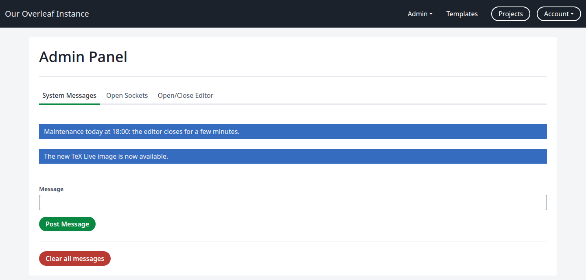
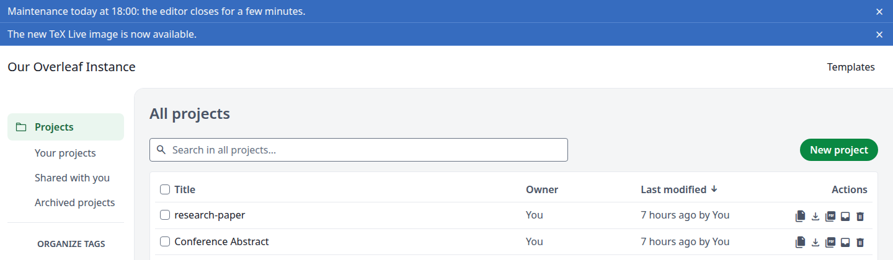
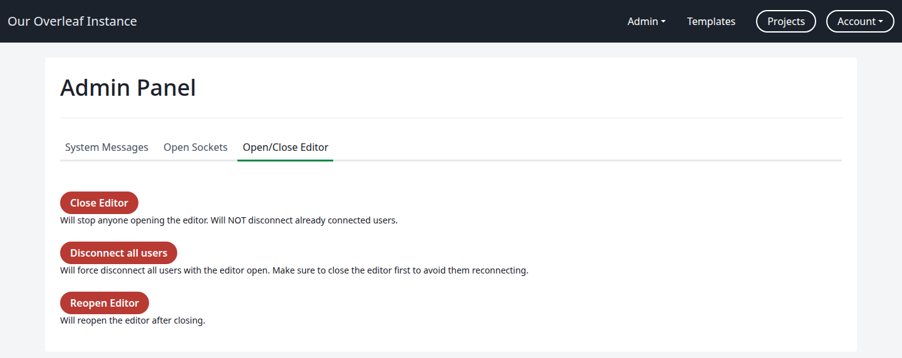
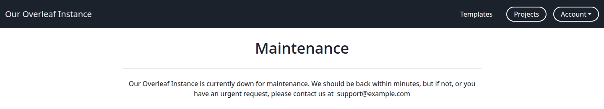
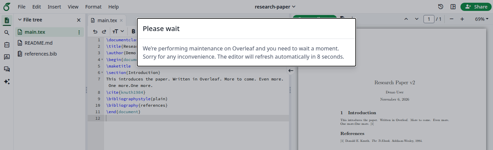

Klikk på **Admin** og deretter på **Manage Site**. **Admin Panel** har tre faner: **System Messages**, **Open Sockets** og **Open/Close Editor**.

## Systemmeldinger {#system-messages}

En systemmelding er et blått banner øverst på siden **Projects** og i redigeringsprogrammet. Alle brukere ser den.

### Publiser en melding {#post-a-message}

Skriv inn teksten under **Message** og klikk på **Post Message**. Fanen viser meldingene som vises nå.

<Frame caption="To publiserte meldinger">
  
</Frame>

<Frame caption="Det brukerne ser">
  
</Frame>

* En bruker kan lukke en melding med <strong>×</strong>. Den forblir lukket i den nettleseren.
* En side som allerede er åpen, ser etter nye meldinger hvert 15. minutt. Når siden lastes inn på nytt, vises de med en gang.

### Fjern meldinger {#remove-messages}

**Clear all messages** fjerner alle meldinger på én gang og ber ikke om bekreftelse. Du kan ikke fjerne én enkelt melding.

## Åpne sockets {#open-sockets}

En diagnostisk visning av de utgående tilkoblingene webtjenesten har åpne akkurat nå. Den viser ikke hvem som er pålogget: listen kan være tom mens brukere er i redigeringsprogrammet.

## Lukk redigeringsprogrammet for vedlikehold {#close-the-editor-for-maintenance}

Bruk fanen **Open/Close Editor**. Knappene virker umiddelbart og ber ikke om bekreftelse, og fanen viser ikke om redigeringsprogrammet er lukket. Klikk på **Projects** for å sjekke: du ser siden **Maintenance** mens det er lukket.

<Frame caption="Fanen Open/Close Editor">
  
</Frame>

<Steps>
<Step id="tell-your-users" title="Informer brukerne dine">
[Publiser en melding](/no/on-premises/user-guide/administrators/basic-management#post-a-message) med tidspunktet for vedlikeholdet.
</Step>

<Step id="click-close-editor" title="Klikk på Close Editor">
Til tross for navnet lukker dette nesten hele nettstedet. Alle sider unntatt adminpanelet viser **Maintenance**, inkludert **Projects**, **Account Settings**, **Templates** og påloggingssiden. **Manage Users** og **Project/Object Lookup** fortsetter å fungere.

<Frame caption="Det brukerne ser mens redigeringsprogrammet er lukket">
  
</Frame>

Brukere som allerede har redigeringsprogrammet åpent, forblir tilkoblet. De kan fortsette å skrive, og endringene deres beholdes, men **Recompile** ender med **Server Error**.

Se [Vedlikeholdsside](/no/on-premises/configuration/overleaf-toolkit/branding#maintenance-page) for å endre teksten på denne siden.
</Step>

<Step id="click-disconnect-all-users" title="Klikk på Disconnect all users">
Brukere i redigeringsprogrammet ser dialogboksen **Please wait**, som teller ned fra 10 sekunder. Deretter oppdateres siden deres og viser **Maintenance**.

<Frame caption="Det brukere i redigeringsprogrammet ser">
  
</Frame>

Lukk redigeringsprogrammet først: ellers tar oppdateringen brukerne rett tilbake til redigeringsprogrammet.
</Step>

<Step id="do-the-maintenance-then-click-reopen-editor" title="Utfør vedlikeholdet, og klikk deretter på Reopen Editor">
Alle sider fungerer igjen umiddelbart. Brukerne laster inn siden på nytt for å fortsette.
</Step>
</Steps>

<Warning>

Påloggingssiden er også lukket, så forbli pålogget til du har gjenåpnet redigeringsprogrammet. Hvis du er utestengt, start instansen på nytt: den lukkede tilstanden holdes bare i minnet, så en omstart åpner redigeringsprogrammet igjen.

</Warning>

<Info>

På Kubernetes med flere replikaer lukker **Close Editor** bare replikaen som håndterte forespørselen din. Bruk [vedlikeholdsmodus](/no/on-premises/configuration/kubernetes/branding#maintenance-mode) i stedet.

</Info>
