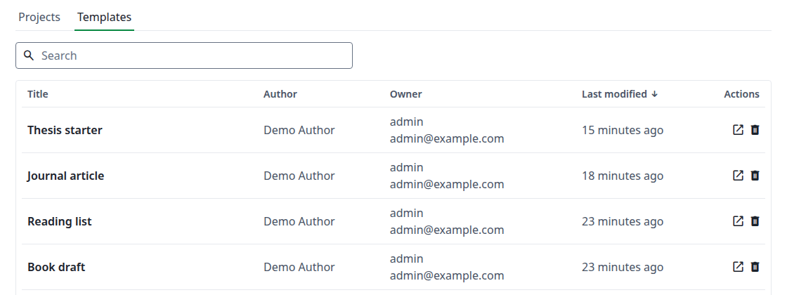

Du publiserer maler fra redigeringsprogrammet og administrerer dem på sidene deres i galleriet eller i administrasjonspanelet.

<Info>

For å slå på galleriet, velge kategoriene eller la en bruker som ikke er administrator publisere, se [Maler](/no/on-premises/configuration/overleaf-toolkit/templates).

</Info>

## Publisere et prosjekt {#publish-a-project}

<Steps>
<Step title="Kompiler prosjektet">
Åpne prosjektet og klikk på **Recompile**. PDF-en du ser, er den galleriet vil vise.

Så lenge redigeringsprogrammet ikke har noen PDF, for eksempel når du åpner et prosjekt som ikke kompilerer, er **Manage Template** nedtonet.

<Frame caption="Ingen PDF ennå, så ingenting å publisere">
  
</Frame>

<Warning>

Publisering lagrer filene slik de er nå, og PDF-en fra den siste vellykkede kompileringen. Hvis du redigerte prosjektet etter den kompileringen, eller den siste kompileringen mislyktes, viser galleriet en gammel PDF ved siden av nyere filer, som kanskje ikke kompilerer. Kompiler på nytt til PDF-en er riktig, og publiser deretter.

</Warning>
</Step>

<Step title="Åpne skjemaet">
Klikk på **File** i toppmenyen i redigeringsprogrammet, og deretter på **Manage Template**.

<Frame caption="Menyen File">
  
</Frame>
</Step>

<Step title="Fyll ut skjemaet">
<Frame caption="Dialogboksen Manage Template">
  
</Frame>

| Felt | Merknader |
| --- | --- |
| **Title** | Starter som prosjektets navn. Må være unikt i galleriet. Maksimalt 150 tegn. |
| **Author** | Starter som navnet ditt. En Markdown-lenke som `[Demo Author](https://example.com)` blir en lenke på malsiden. |
| **Categories** | Én kategori, se [Kategorier](/no/on-premises/user-guide/administrators/template-management#categories). |
| **Description** | Støtter Markdown. Maksimalt 4096 tegn. Malsiden viser den som **Abstract**, og galleriet viser starten av den som ren tekst. |
| **License** | **Creative Commons CC BY 4.0**, **LaTeX Project Public License 1.3c** eller <strong>Other (as stated in the work)</strong>. |

Prosjektets kompilator og hoveddokument følger med malen, så angi dem i prosjektet først. Prosjekter som åpnes fra malen, bruker de samme.
</Step>

<Step title="Klikk på Publish">
Malsiden åpnes.

<Frame caption="Den nye malen">
  
</Frame>

**Admin: Source Project**, **Edit** og **Delete** er bare for deg. Andre brukere ser bare **Open as Template**, **View PDF** og nedlastingsknappen.
</Step>

<Step title="Sjekk galleriet">
Klikk på **Templates** øverst til høyre. Den nye malen står først i listen.
</Step>
</Steps>

## Kategorier {#categories}

En mal hører til én kategori. Navnene og beskrivelsene kommer fra [konfigurasjonen](/no/on-premises/configuration/overleaf-toolkit/templates#configuration) din og kan ikke endres på nettstedet.

Du ser dem på disse stedene:

* **Categories** i skjemaet.
* Kortene øverst på gallerisiden, `/templates`. Klikk på **Template Gallery** på siden **All templates** for å komme dit.
* En side for hver kategori, for eksempel `/templates/presentation`. En kategori uten maler viser <strong>No Templates.</strong>
* **New project**, deretter **More templates**, på prosjektsiden.
* Lenken over tittelen på malsiden.

<Frame caption="Kategorier på gallerisiden">
  
</Frame>

**All templates** i skjemaet betyr ingen egen kategori: malen står bare i den fullstendige listen.

## Oppdatere en mal {#update-a-template}

For å endre filene og PDF-en publiserer du prosjektet på nytt under samme tittel.

<Steps>
<Step title="Endre prosjektet">
Rediger prosjektet og klikk på **Recompile**.
</Step>

<Step title="Publiser på nytt">
Klikk på **File** og deretter på **Manage Template**. Skjemaet viser detaljene til malen, som du kan endre. Klikk på **Publish**.

En melding sier at tittelen allerede finnes, og knappen blir **Overwrite**.

<Frame caption="Publisere under samme tittel">
  
</Frame>

Hvis du endrer **Title** nå, forsvinner meldingen, og **Publish** oppretter en ny mal.
</Step>

<Step title="Klikk på Overwrite">
Den samme malsiden åpnes, med den nye PDF-en.

<Frame caption="Den oppdaterte malen">
  
</Frame>

Prosjekter som brukere allerede har åpnet fra malen, endres ikke.
</Step>
</Steps>

<Warning>

Skjemaet finner malen ut fra prosjektets navn. Hvis du har gitt malen nytt navn med **Edit**, åpnes skjemaet med prosjektnavnet, navnet ditt, den første kategorien og en tom beskrivelse, og å skrive inn malens tittel henter ikke tilbake detaljene. **Overwrite** erstatter da detaljene med det som står i skjemaet, så fyll dem ut på nytt først.

</Warning>

## Redigere detaljene {#edit-the-details}

Dette endrer hva galleriet viser om en mal, ikke filene eller PDF-en.

<Steps>
<Step title="Åpne malen">
Klikk på **Templates** øverst til høyre, klikk på malen og deretter på **Edit**.
</Step>

<Step title="Endre feltene">
Feltene er de samme som ved publisering, med ett ekstra: **Language** er stavekontrollspråket for prosjekter som åpnes fra malen. For et prosjekt publisert med standardspråket viser det **Off**, og prosjekter som åpnes fra det, bruker <strong>English (American)</strong>.

<Frame caption="Dialogboksen Edit template">
  
</Frame>

En tittel som en annen mal allerede har, avvises: **Save** forblir nedtonet til du endrer **Title**.
</Step>

<Step title="Klikk på Save">
Dialogboksen lukkes, og malsiden viser de nye detaljene.
</Step>
</Steps>

## Kildeprosjektet {#the-source-project}

**Admin: Source Project** åpner prosjektet malen ble publisert fra.

Malen beholder sin egen kopi av filene. Hvis du sletter prosjektet permanent, forsvinner knappen, og brukere kan fortsatt åpne malen. Et prosjekt som bare ligger i **Trash**, beholder knappen. Se også spørsmål og svar under [Maler](/no/on-premises/configuration/overleaf-toolkit/templates).

## Slette en mal {#delete-a-template}

<Steps>
<Step title="Klikk på Delete">
Klikk på **Delete** på malsiden. Dialogboksen nevner malen ved navn.

<Frame caption="Dialogboksen Delete template">
  
</Frame>
</Step>

<Step title="Klikk på Confirm">
Du er tilbake på siden du kom fra, og malen er ikke lenger i galleriet. Lenken til den viser nå **Not found**.

Kildeprosjektet blir værende, og det gjør også prosjektene brukere har åpnet fra malen.
</Step>
</Steps>

## Administrere maler i administrasjonspanelet {#manage-templates-in-the-admin-panel}

Klikk på **Admin**, deretter **Project/Object Lookup** og deretter fanen **Templates**. Den viser alle maler med forfatter og eier, og du kan søke i den.

<Frame caption="Alle maler i administrasjonspanelet">
  
</Frame>

* Klikk på en tittel for å åpne malsiden, eller på åpne-ikonet for å åpne den i en ny fane.
* Klikk på en eier for å åpne siden til den brukeren.
* Klikk på søppelbøtteikonet og deretter **Delete** for å slette en mal. Dialogboksen advarer om at dette ikke kan angres, og malen forsvinner fra galleriet.

## Hvis publiseringen avvises {#if-publishing-is-refused}

Skjemaet lar deg skrive mer enn nettstedet godtar. En **Title** på over 150 tegn viser `Template title exceeds the maximum length of 150 characters.`, og en **Description** på over 4096 tegn viser `Template description exceeds the maximum length of 4096 characters.`

**Publish** forblir da nedtonet selv om du forkorter teksten. Klikk på **Cancel**, deretter **File** og **Manage Template**, og fyll ut skjemaet på nytt.
