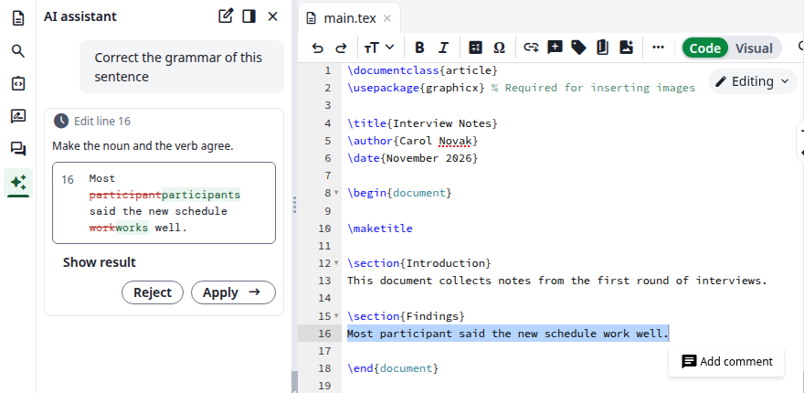

Assistenten arbeider med prosjektet du har åpent. Den leser dokumentene dine og foreslår endringer, og du bruker eller avviser hver endring. Svarene i skjermbildene er eksempler: hva du får, avhenger av modellen nettstedet ditt bruker.

<Info>

Hvis du ikke ser **AI assistant** i venstre felt, henviser du administratoren din til [AI-integrasjon](/no/on-premises/configuration/overleaf-toolkit/integrations/ai-integration).

</Info>

## Start en chat {#start-a-chat}

<Steps>
<Step title="Åpne assistenten">
Klikk på **AI assistant** i redigeringsprogrammets venstre felt. Panelet åpnes ved siden av redigeringsprogrammet.
</Step>

<Step title="Godta vilkårene">
Første gang viser panelet vilkårene for AI-funksjoner. Klikk på **Accept and continue**. Dette gjør du én gang, og det gjelder også [Feilassistenten](/no/on-premises/user-guide/users/error-assistant).

<Frame caption="Vilkårene, vist én gang">
  
</Frame>
</Step>

<Step title="Spør om noe">
Skriv i <strong>What would you like to do?</strong>, og trykk på Enter, eller klikk på pilen. Du kan også klikke på et forslag under **Start a chat**. Forslagene varierer fra chat til chat, og **Fix the compile errors** kommer i tillegg når den siste kompileringen har feil.

<Frame caption="En tom chat">
  
</Frame>
</Step>

<Step title="Les svaret">
Det assistenten gjorde, vises som linjer i en boks, for eksempel **Read line 15-16 of main.tex**, med en hake når trinnet er ferdig. Deretter kommer svaret. Hvis modellen deler resonnementet sitt, klikker du på **Reasoned for 1 s** for å lese det.

<Frame caption="Et spørsmål og svaret">
  
</Frame>
</Step>
</Steps>

## Spør om merkede linjer {#ask-about-selected-lines}

Merk linjer i redigeringsprogrammet. En etikett som `main.tex: 16` vises over meldingsfeltet, og den merkede teksten sendes med meldingen din. I en tom chat handler forslagene om utvalget, for eksempel **Make it shorter**.

<Frame caption="En merket linje">
  
</Frame>

## Gå gjennom en foreslått endring {#review-a-suggested-edit}

En endring kommer ikke inn i dokumentet før du bruker den.

<Steps>
<Step title="Les forslaget">
En boks kalt **Edit line 16** viser årsaken, linjenummeret og endringen: den gamle teksten er gjennomstreket, og den nye er uthevet. Dokumentet er ikke endret ennå. **Show result** viser bare den nye teksten, og **Show diff** går tilbake.

<Frame caption="En endring som venter på avgjørelsen din">
  
</Frame>
</Step>

<Step title="Bruk den">
Klikk på **Apply**. Endringen vises i redigeringsprogrammet, boksen får en hake, og assistenten fortsetter. Hvis endringen gjelder et annet dokument, åpnes det dokumentet.

<Frame caption="Endringen er brukt">
  
</Frame>
</Step>

<Step title="Angre hvis du ombestemmer deg">
**Undo** fjerner endringen fra dokumentet, og **Apply** setter den inn igjen. Assistenten får ikke vite om noen av delene.
</Step>
</Steps>

### Avvis en endring {#reject-an-edit}

Klikk på **Reject**. Dokumentet forblir som det er, boksen sier <strong>The user declined this edit.</strong>, og assistenten fortsetter og vet at du takket nei. Knappene forsvinner, så be om endringen på nytt hvis du vil ha den tilbake.

Hvis du skriver en ny melding i stedet for å bestemme deg, brukes ikke endringen, og boksen sier fra om det.

<Frame caption="En avvist endring og en uavgjort">
  
</Frame>

## Hva assistenten kan gjøre i et prosjekt {#what-the-assistant-can-do-in-a-project}

Bare endringer venter på deg. De andre trinnene kjøres så snart assistenten tar dem.

| Linjen i chatten | Hva den gjør |
| -------------------- | ------------ |
| **Read line 15-16 of main.tex** | Leser linjer i et dokument |
| **Find “schedule” in main.tex** | Søker etter tekst i et dokument |
| **List the project files** | Viser prosjektets filer |
| **Create appendix.tex** | Oppretter et tomt dokument og åpner det |
| **Edit line 16** | Foreslår en endring, se ovenfor |
| **Compile** | Kompilerer prosjektet |
| **Check the compile log** | Leser feil og advarsler fra den siste kompileringen |
| **Look at PDF page 1** | Viser en side av PDF-en i chatten |
| **Read the PDF structure** | Leser strukturen i PDF-en |
| **Switch to xelatex** | Bytter prosjektets kompilator, som i **Settings** |
| <strong>Search the web for “...”</strong> | Søker på nettet |
| <strong>Search the help pages for “...”</strong> | Søker i hjelpesidene |

<Frame caption="En ny fil og deretter en endring i et annet dokument">
  
</Frame>

<Frame caption="En kompilering og en side av PDF-en">
  
</Frame>

En søkelinje viser hvor mange resultater den fant. Klikk på den for å vise dem. Om søkene er tilgjengelige, avhenger av nettstedet ditt, se [Valgfrie søketjenester](/no/on-premises/configuration/overleaf-toolkit/integrations/ai-integration#optional-search-services).

<Frame caption="Resultatene av et søk">
  
</Frame>

Forslaget **Fix the compile errors** ber assistenten sjekke loggen og rette det den finner. Rettingene kommer som endringer du går gjennom.

## Legg ved et bilde eller en PDF {#attach-an-image-or-a-pdf}

Klikk på bildeikonet, **Attach image or PDF**, i meldingsfeltet, og velg en fil. Filnavnet vises over teksten din. Skriv meldingen, og send den.

<Frame caption="En fil lagt ved en melding">
  
</Frame>

Panelet avviser andre filer med <strong>Only images and PDF files can be attached.</strong> og store filer med <strong>Files must be smaller than 2 MB.</strong>

## Stopp assistenten {#stop-the-assistant}

Mens assistenten arbeider, blir pilen i meldingsfeltet til en knapp, **Stop**. Klikk på den. Et pågående trinn avsluttes med <strong>Stopped by the user.</strong>, og ingenting mer skjer før du skriver igjen.

<Frame caption="Knappen Stop">
  
</Frame>

## Hvis assistenten stopper av seg selv {#if-the-assistant-stops-by-itself}

Assistenten kan ta et begrenset antall trinn per melding. Ved grensen sier panelet <strong>The assistant used all the steps it may take for one message. Reply to let it carry on.</strong> Svar, for eksempel med `Go on`, så fortsetter den.

<Frame caption="Trinngrensen">
  
</Frame>

Hvis panelet sier **Something’s gone wrong**, mislyktes forespørselen. Send meldingen på nytt, eller klikk på **Start new chat**.

## Flytt panelet, og begynn på nytt {#move-the-panel-and-start-over}

Disse knappene er øverst i panelet:

* **Start new chat** tømmer panelet. Det finnes ingen liste over tidligere chatter. Å laste inn siden på nytt tømmer også chatten.
* **Move to the right** plasserer panelet til høyre for PDF-en, der det forblir åpent mens du bruker filtreet. **Move to the left** flytter det tilbake. Chatten blir værende.
* **Close** skjuler panelet. Klikk på **AI assistant** i venstre felt for å få det tilbake, med chatten fortsatt der.

<Frame caption="Panelet til høyre">
  
</Frame>

## Tokenbruk {#token-usage}

Assistenten viser ikke hvor mange tokens du har brukt. Hvis nettstedet ditt har en grense og du når den, får neste melding ikke noe svar. Panelet viser **Usage limit reached** og hvor lenge det er til du kan chatte igjen, og meldingsfeltet er nedtonet.

<Frame caption="Grensen er nådd">
  
</Frame>

En ny chat viser samme melding. Etter at siden er lastet inn på nytt, ser feltet normalt ut igjen, men neste melding får også meldingen. [Feilassistenten](/no/on-premises/user-guide/users/error-assistant) teller mot samme grense og viser **Usage limit reached** i loggoppføringen.

Administratoren din angir grensen, se [Bruk og tilbakestilling](/no/on-premises/configuration/overleaf-toolkit/integrations/ai-integration#usage-and-reset).
