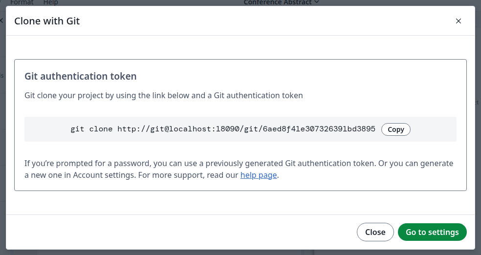

Arbeid med et prosjekt på din egen datamaskin med Git. Endringer overføres bare når du kjører `git pull` eller `git push`.

<Info>

En administrator må først slå på [Git-integrasjonen](/no/on-premises/configuration/overleaf-toolkit/integrations/git-integration).

</Info>

## Opprett et token {#create-a-token}

Git logger inn med et Git-autentiseringstoken, ikke med passordet til kontoen din.

<Steps>
<Step title="Åpne kontoinnstillingene">
Klikk på **Account** og deretter på **Account settings**. Under **Git integration** klikker du på **Generate token**. Når du har et token, heter denne knappen **Add another token**.

<Frame caption="Git-integrasjon i kontoinnstillingene">
  
</Frame>
</Step>

<Step title="Kopier tokenet">
Klikk på **Copy** og oppbevar tokenet et trygt sted. Du ser det bare én gang. Klikk deretter på **Close**.

<Frame caption="Det nye tokenet ditt">
  
</Frame>
</Step>

<Step title="Kontroller tokenet">
Listen viser nå starten på tokenet, når det ble opprettet og når det sist ble brukt. Det utløper etter ett år. Du kan ha opptil 10 tokener.

<Frame caption="Tokenene dine">
  
</Frame>
</Step>
</Steps>

## Klon et prosjekt {#clone-a-project}

<Steps>
<Step title="Åpne Git-integrasjonen i redigeringsprogrammet">
Åpne prosjektet. Klikk på **Integrations** i venstre felt og deretter på **Git integration**.

<Frame caption="Panelet Integrations">
  
</Frame>
</Step>

<Step title="Kopier kommandoen">
Dialogboksen **Clone with Git** viser kommandoen, med adressen til nettstedet ditt og prosjektets ID. Klikk på **Copy**. Hvis du ikke har et token ennå, åpner **Go to settings** kontoinnstillingene i en ny fane.

<Frame caption="Klonekommandoen">
  
</Frame>
</Step>

<Step title="Kjør den">
Lim inn kommandoen i en terminal. Når Git ber om et passord, limer du inn tokenet ditt.

```text
$ git clone https://git@<your-site>/git/<project-id>
Cloning into '<project-id>'...
Password for 'https://git@<your-site>': <your-token>
```

En mappe med prosjekt-ID-en som navn inneholder nå prosjektets filer, på grenen `main`. Hvis du vil velge mappenavnet, legger du det til på slutten av kommandoen.
</Step>
</Steps>

Git spør etter tokenet hver gang det kontakter nettstedet. For å få det husket slår du på en credential helper: Git spør én gang til og beholder deretter tokenet. Helperen `store` lagrer det ukryptert i `~/.git-credentials`.

```bash
git config --global credential.helper store
```

## Hent endringer fra redigeringsprogrammet {#pull-changes-from-the-editor}

Kjør følgende i mappen:

```bash
git pull
```

Git viser filene som er endret. Endringer gjort i redigeringsprogrammet kommer som commits med navnet `Update on Overleaf.`.

```text
Updating db007e3..c3e6332
Fast-forward
 main.tex | 2 +-
 1 file changed, 1 insertion(+), 1 deletion(-)
```

## Send endringene dine {#push-your-changes}

Gjør commit av endringene, og send dem deretter:

```bash
git add main.tex
git commit -m "Add a line from Git"
git push
```

Den siste linjen i utdataene viser grenen som ble flyttet:

```text
   53aca61..db007e3  main -> main
```

Endringene vises i redigeringsprogrammet, og et åpent redigeringsprogram oppdaterer seg selv. Nye filer, mapper og navneendringer vises i filtreet. I **History** er endringen din merket <strong>You (via Git)</strong>. Commit-meldingen din vises ikke der.

<Frame caption="En push i prosjekthistorikken">
  
</Frame>

### Hvis Git avviser pushen din {#if-git-refuses-your-push}

Hvis prosjektet har endret seg i mellomtiden, avviser Git pushen:

```text
 ! [rejected]        main -> main (fetch first)
```

Hent først disse endringene, og send deretter på nytt:

```bash
git pull --no-rebase --no-edit
git push
```

En vanlig `git pull` kan stoppe med `fatal: Need to specify how to reconcile divergent branches.` Alternativet `--no-rebase` ovenfor løser dette: det slår sammen begge sider.

Hvis de samme linjene er endret på begge sider, stopper pull med `CONFLICT (content): Merge conflict in main.tex`. Rett filen, og kjør deretter:

```bash
git add main.tex
git commit -m "Merge the changes from the editor"
git push
```

Det er to ting nettstedet ikke godtar:

* Andre grener: `! [remote rejected] feature -> feature (wrong branch)`. Bare `main` finnes, så send arbeidet ditt dit.
* Tvungen push: `! [remote rejected] main -> main (forced push prohibited)`. Legg i stedet endringene dine oppå gjeldende `main`.

### Hvis Git sier Authentication failed {#if-git-says-authentication-failed}

```text
remote: Enter your Git authentication token when prompted for a password.
fatal: Authentication failed for 'https://<your-site>/git/<project-id>/'
```

Tokenet er feil eller slettet, eller du skrev inn passordet til kontoen din. Opprett et nytt token hvis du ikke lenger har det, fordi du ikke kan se et eksisterende token igjen.

## Slett et token {#delete-a-token}

I **Account settings**, under **Git integration**, klikker du på sletteikonet ved siden av tokenet og deretter på **Delete** i dialogboksen. Fra da av svarer Git `Authentication failed` på det tokenet.

<Frame caption="Slett et token">
  
</Frame>

<Info>

Hva samarbeidspartnere med skrivebeskyttet tilgang kan gjøre, finner du i Q\&A for [Git-integrasjonen](/no/on-premises/configuration/overleaf-toolkit/integrations/git-integration).

</Info>
