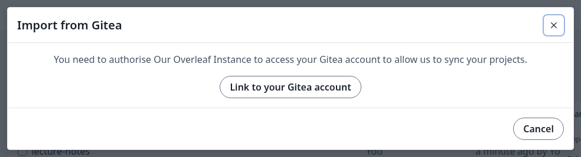

Koble et prosjekt til et Gitea-repository. Endringer går begge veier, og bare når du klikker på **Sync**: ingenting synkroniseres av seg selv.

<Info>

En administrator må først slå på [Gitea-synkronisering](/no/on-premises/configuration/overleaf-toolkit/integrations/gitea-synchronisation).

</Info>

## Koble til Gitea-kontoen din {#link-your-gitea-account}

Dette gjør du én gang.

<Steps>
<Step title="Åpne kontoinnstillingene">
Klikk på **Account** og deretter på **Account settings**. Under **Project synchronisation** finner du **Gitea** og klikker på **Link**.

<Frame caption="Gitea i kontoinnstillingene">
  
</Frame>
</Step>

<Step title="Autoriser på Gitea">
Gitea åpnes. Logg inn hvis du blir bedt om det, og autoriser deretter programmet.
</Step>

<Step title="Kontroller tilkoblingen">
Du er tilbake i kontoinnstillingene. En grønn melding sier at Gitea-kontoen din er koblet til, og på knappen står det nå **Unlink**.

<Frame caption="Gitea-kontoen din er koblet til">
  
</Frame>
</Step>
</Steps>

Hvis kontoen din ikke er koblet til ennå, ber **Import from Gitea** og kortet **Gitea** i redigeringsprogrammet deg om å koble den til først. Klikk på **Link to your Gitea account**. Da havner du også i kontoinnstillingene, i en ny fane hvis du startet i redigeringsprogrammet. Gå deretter tilbake og start på nytt.

<Frame caption="Meldingen når kontoen din ikke er koblet til">
  
</Frame>

## Importer et repository {#import-a-repository}

Dette oppretter et nytt prosjekt fra et Gitea-repository, allerede koblet til det.

<Steps>
<Step title="Åpne importdialogboksen">
Klikk på **New project** på prosjektsiden og deretter på **Import from Gitea**.

<Frame caption="Menyen New project">
  
</Frame>
</Step>

<Step title="Velg repository">
Klikk på **Import to Overleaf** ved siden av repositoryet. Listen inneholder dine repositories og organisasjonenes. Et tomt repository vises ikke: det trenger minst én commit.

<Frame caption="Gitea-repositoriene dine">
  
</Frame>
</Step>

<Step title="Kontroller prosjektet">
Det nye prosjektet åpnes med filene fra repositoryet.

<Frame caption="Det importerte prosjektet">
  
</Frame>
</Step>
</Steps>

## Eksporter et prosjekt til et nytt repository {#export-a-project-to-a-new-repository}

Dette oppretter et repository fra et prosjekt og kobler dem sammen. Et prosjekt kan bare kobles på denne måten eller ved import: du kan ikke koble det til et repository som allerede finnes.

<Steps>
<Step title="Åpne Gitea i redigeringsprogrammet">
Åpne prosjektet. Klikk på **Integrations** i venstre felt og deretter på **Gitea**.

<Frame caption="Panelet Integrations">
  
</Frame>
</Step>

<Step title="Fyll ut repositoryet">
Velg **Owner**, som kan være deg eller en av organisasjonene dine. Når du velger en organisasjon, heter feltet **Organization**. **Repository Name** er i utgangspunktet prosjektets navn: hvis navnet har mellomrom, endrer du det, fordi Gitea ikke godtar mellomrom. Beskrivelsen er valgfri, og **Private** er valgt som standard. Klikk på **Create a Gitea repository**.

<Frame caption="Export Project to Gitea">
  
</Frame>

Hvis navnet har mellomrom eller allerede er tatt, viser dialogboksen <strong>Please check that the repository name is valid, and that you have permission to create the repository.</strong> Endre navnet og klikk på knappen igjen.
</Step>

<Step title="Kontroller tilkoblingen">
Dialogboksen viser nå **This project is linked to** og navnet på repositoryet.

<Frame caption="Prosjektet er koblet til">
  
</Frame>
</Step>
</Steps>

## Synkroniser {#sync}

<Steps>
<Step title="Åpne synkroniseringsdialogboksen">
Åpne et tilkoblet prosjekt. Klikk på **Integrations** i venstre felt og deretter på **Gitea**.

**Recent commits in Gitea** viser hva som kommer inn i prosjektet.

<Frame caption="En ny commit venter på Gitea">
  
</Frame>
</Step>

<Step title="Beskriv endringene dine">
Hvis du har endret noe i prosjektet, vises en boks for commit-meldingen. Den er valgfri: hvis du lar den stå tom, heter commiten `Updates from Overleaf`.

<Frame caption="Commit-meldingen for endringene dine">
  
</Frame>
</Step>

<Step title="Klikk på Sync">
Klikk på **Sync**. Nye commits fra Gitea kommer inn i prosjektet, og endringene dine går til standardgrenen i repositoryet. Hvis begge sider har endret forskjellige ting, slås de sammen for deg gjennom en pull request, som blir værende på Gitea som en logg.
</Step>

<Step title="Kontroller resultatet">
Dialogboksen viser <strong>No new commits in Gitea since last merge.</strong>, og boksen for commit-meldingen er borte. Filene i redigeringsprogrammet og commitene på Gitea er oppdatert.

<Frame caption="Alt er synkronisert">
  
</Frame>
</Step>
</Steps>

### Hvis de samme linjene er endret på begge sider {#if-the-same-lines-changed-on-both-sides}

Dialogboksen sier at endringene ikke kunne slås sammen, og navngir en ny gren, `overleaf-YYYY-MM-DD-HHMMSS`, som inneholder endringene dine. Overleaf åpner også en pull request fra den grenen på Gitea.

<Frame caption="En konflikt">
  
</Frame>

1.  Slå sammen den grenen med standardgrenen med Git, og løs konflikten. Du kan lukke dialogboksen i mellomtiden: den viser den samme meldingen når du åpner den igjen.

    ```bash
    git clone <repository-address>
    cd <repository-name>
    git merge origin/overleaf-YYYY-MM-DD-HHMMSS
    # fix the conflict in the file Git names
    git add <file>
    git commit
    git push
    ```
2. Klikk på **I have manually merged. Continue**. Det sammenslåtte resultatet kommer inn i prosjektet. Hvis du klikker før grenen er slått sammen, forblir dialogboksen uendret.
3. Grenen blir værende på Gitea, og pull requesten forblir åpen. Lukk pull requesten og slett grenen når du ikke lenger trenger dem.

Den samme dialogboksen vises når en regel for grenbeskyttelse holder tilbake pull requesten, for eksempel når den trenger en godkjenning, selv om ingen linjer er i konflikt. Når regelen tillater det, slår du sammen pull requesten på Gitea og klikker på **I have manually merged. Continue**. Se [Slik fungerer synkronisering med Gitea](/no/on-premises/configuration/overleaf-toolkit/integrations/gitea-synchronisation#how-syncing-works-with-gitea).

## Koble fra et prosjekt {#unlink-a-project}

Gjør dette når du ikke lenger vil at prosjektet skal synkroniseres.

<Steps>
<Step title="Klikk på Unlink">
Klikk på **Unlink** i synkroniseringsdialogboksen.
</Step>

<Step title="Bekreft">
Klikk på **Confirm**. Dette fjerner bare tilkoblingen: tilkoblingen til et repository du eier, som advarselen nevner, er et alternativ du har etterpå, ikke noe som skjer nå.

<Frame caption="Bekreft frakoblingen">
  
</Frame>
</Step>

<Step title="Kontroller resultatet">
Dialogboksen viser nå **Export Project to Gitea**. Både prosjektet og repositoryet beholder innholdet sitt. For å synkronisere igjen eksporterer du prosjektet til et nytt repository eller importerer repositoryet til et nytt prosjekt.
</Step>
</Steps>

## Koble fra Gitea-kontoen din {#unlink-your-gitea-account}

I **Account settings**, under **Gitea**, klikker du på **Unlink** og deretter på **Unlink** igjen i dialogboksen.

<Frame caption="Koble fra kontoen din">
  
</Frame>

Prosjektene dine forblir koblet til repositoriene sine. Du kan ikke synkronisere dem før du kobler til kontoen din igjen.

<Info>

Hvem som kan gjøre hva i et delt prosjekt, finner du i [Hvem kan koble til og synkronisere](/no/on-premises/configuration/overleaf-toolkit/integrations/gitea-synchronisation#who-can-link-and-sync).

</Info>
