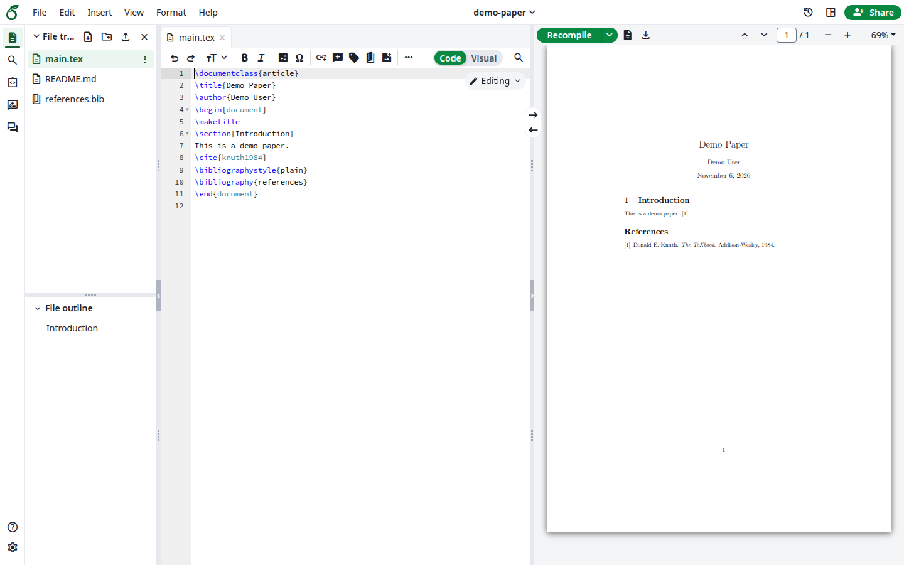
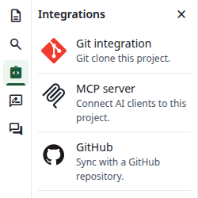
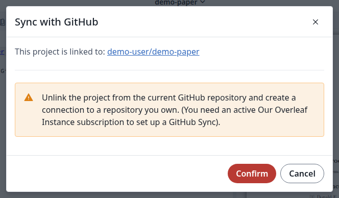

Koble et prosjekt til et GitHub-repository. Endringer går begge veier, og bare når du klikker på **Sync**: ingenting synkroniseres av seg selv.

<Info>

Hvis du ikke ser noe GitHub-alternativ i **Account settings** eller i redigeringsprogrammet, ber du administratoren din om å slå på [GitHub-synkronisering](/no/on-premises/configuration/overleaf-toolkit/integrations/github-synchronisation).

</Info>

## Koble til GitHub-kontoen din {#link-your-github-account}

Dette gjør du én gang.

<Steps>
<Step title="Åpne kontoinnstillingene">
Klikk på **Account** og deretter på **Account settings**. Rull til **GitHub** og klikk på **Link**.

<Frame caption="GitHub i kontoinnstillingene">
  
</Frame>
</Step>

<Step title="Autoriser på GitHub">
GitHub åpnes. Logg inn hvis du blir bedt om det, og autoriser deretter programmet.
</Step>

<Step title="Kontroller tilkoblingen">
Du er tilbake i kontoinnstillingene, og på knappen står det nå **Unlink**.

<Frame caption="GitHub-kontoen din er koblet til">
  
</Frame>
</Step>
</Steps>

Hvis kontoen din ikke er koblet til ennå, ber **Import from GitHub** og kortet **GitHub** i redigeringsprogrammet deg om å koble den til først. Klikk på **Link to your GitHub account**. Da havner du også i kontoinnstillingene, i en ny fane hvis du startet i redigeringsprogrammet. Gå deretter tilbake og start på nytt.

<Frame caption="Meldingen når kontoen din ikke er koblet til">
  
</Frame>

## Importer et repository {#import-a-repository}

Dette oppretter et nytt prosjekt fra et GitHub-repository, allerede koblet til det.

<Steps>
<Step title="Åpne importdialogboksen">
Klikk på **New project** på prosjektsiden og deretter på **Import from GitHub**.

<Frame caption="Menyen New project">
  
</Frame>

<Info>

**New project** vises når du har et prosjekt. Menyen **Create a new project** på velkomstsiden har ingen import, så opprett et tomt prosjekt først.

</Info>
</Step>

<Step title="Velg repository">
Klikk på **Import to Overleaf** ved siden av repositoryet. Listen inneholder dine repositories og organisasjonenes.

<Frame caption="GitHub-repositoriene dine">
  
</Frame>

Hvis en organisasjons repository mangler, klikker du på <strong>Can't see what you're looking for?</strong> for GitHubs hjelp om å godkjenne programmet for den organisasjonen.
</Step>

<Step title="Kontroller prosjektet">
Det nye prosjektet åpnes med filene fra repositoryet.

<Frame caption="Det importerte prosjektet">
  
</Frame>
</Step>
</Steps>

## Eksporter et prosjekt til et nytt repository {#export-a-project-to-a-new-repository}

Dette oppretter et repository fra et prosjekt du eier, og kobler dem sammen. Et prosjekt kan bare kobles på denne måten eller ved import: du kan ikke koble det til et repository som allerede finnes.

<Steps>
<Step title="Åpne GitHub i redigeringsprogrammet">
Åpne prosjektet. Klikk på **Integrations** i venstre felt og deretter på **GitHub**.

<Frame caption="Panelet Integrations">
  
</Frame>
</Step>

<Step title="Fyll ut repositoryet">
Velg **Owner**, som kan være deg eller en av organisasjonene dine. **Repository Name** er i utgangspunktet prosjektets navn. Beskrivelsen er valgfri, og **Private** er valgt som standard. Klikk på **Create a GitHub repository**.

<Frame caption="Export Project to GitHub">
  
</Frame>
</Step>

<Step title="Kontroller tilkoblingen">
Dialogboksen viser nå **This project is linked to** og navnet på repositoryet.

<Frame caption="Prosjektet er koblet til">
  
</Frame>
</Step>
</Steps>

## Synkroniser {#sync}

<Steps>
<Step title="Åpne synkroniseringsdialogboksen">
Åpne et tilkoblet prosjekt. Klikk på **Integrations** i venstre felt og deretter på **GitHub**.

**Recent commits in GitHub** viser hva som kommer inn i prosjektet.

<Frame caption="En ny commit venter på GitHub">
  
</Frame>
</Step>

<Step title="Beskriv endringene dine">
Hvis du har endret noe i prosjektet, vises en boks for commit-meldingen. Den er valgfri: hvis du lar den stå tom, heter commiten `Updates from Overleaf`.

<Frame caption="Commit-meldingen for endringene dine">
  
</Frame>
</Step>

<Step title="Klikk på Sync">
Klikk på **Sync**. Nye commits fra GitHub kommer inn i prosjektet, og endringene dine går til standardgrenen i repositoryet. Hvis begge sider har endret forskjellige ting, slås de sammen for deg.
</Step>

<Step title="Kontroller resultatet">
Dialogboksen viser <strong>No new commits in GitHub since last merge.</strong>, og boksen for commit-meldingen er borte. Filene i redigeringsprogrammet og commitene på GitHub er oppdatert.

<Frame caption="Alt er synkronisert">
  
</Frame>
</Step>
</Steps>

### Hvis de samme linjene er endret på begge sider {#if-the-same-lines-changed-on-both-sides}

Dialogboksen sier at endringene ikke kunne slås sammen, og navngir en ny gren, `overleaf-YYYY-MM-DD-HHMMSS`, som inneholder endringene dine.

<Frame caption="En konflikt">
  
</Frame>

1. Slå sammen den grenen med standardgrenen på GitHub eller med Git. Du kan lukke dialogboksen i mellomtiden: den viser den samme meldingen når du åpner den igjen.
2. Klikk på **I have manually merged. Continue**. Det sammenslåtte resultatet kommer inn i prosjektet.
3. Grenen blir værende på GitHub. Slett den når du ikke lenger trenger den.

## Koble fra et prosjekt {#unlink-a-project}

Gjør dette når du ikke lenger vil at prosjektet skal synkroniseres. Bare prosjekteieren kan gjøre det.

<Steps>
<Step title="Klikk på Unlink">
Klikk på **Unlink** i synkroniseringsdialogboksen.
</Step>

<Step title="Bekreft">
Klikk på **Confirm**. Merknaden om et abonnement hindrer deg ikke i å koble til prosjektet igjen.

<Frame caption="Bekreft frakoblingen">
  
</Frame>
</Step>

<Step title="Kontroller resultatet">
Dialogboksen viser nå **Export Project to GitHub**. Både prosjektet og repositoryet beholder innholdet sitt. For å synkronisere igjen eksporterer du prosjektet til et nytt repository eller importerer repositoryet til et nytt prosjekt.
</Step>
</Steps>

## Koble fra GitHub-kontoen din {#unlink-your-github-account}

I **Account settings**, under **GitHub**, klikker du på **Unlink** og deretter på **Unlink** igjen i dialogboksen.

<Frame caption="Koble fra kontoen din">
  
</Frame>

Prosjektene dine forblir koblet til repositoriene sine. Du kan ikke synkronisere dem før du kobler til kontoen din igjen.

<Info>

Hvem som kan gjøre hva i et delt prosjekt, finner du i [Hvem kan koble til og synkronisere](/no/on-premises/configuration/overleaf-toolkit/integrations/github-synchronisation#who-can-link-and-sync). Hver samarbeidspartner som synkroniserer, kobler til sin egen GitHub-konto.

</Info>
