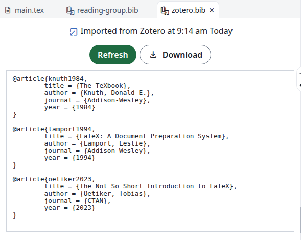

Importer et Zotero-bibliotek til et prosjekt som en `.bib`-fil, og siter deretter fra den som vanlig. Filen er en kopi: den endres bare når du klikker på **Refresh**.

<Info>

Hvis du ikke ser noe Zotero-alternativ i **Account settings**, ber du administratoren din om å slå på [Zotero-integrasjon](/no/on-premises/configuration/overleaf-toolkit/integrations/zotero-integration).

</Info>

## Koble til Zotero-kontoen din {#link-your-zotero-account}

Dette gjør du én gang.

<Steps>
<Step title="Åpne kontoinnstillingene">
Klikk på **Account** og deretter på **Account settings**. Finn **Zotero** under **Reference managers**, og klikk på **Link to Zotero**.

<Frame caption="Zotero i kontoinnstillingene">
  
</Frame>

Kortet **Zotero** i redigeringsprogrammets panel **Integrations** tar deg til samme sted, i samme fane.

<Frame caption="Panelet Integrations">
  
</Frame>
</Step>

<Step title="Godkjenn hos Zotero">
Zotero åpnes. Logg på hvis du blir bedt om det, og godkjenn deretter programmet. Det ber bare om å lese biblioteket og gruppene dine, så det kan ikke endre noe i Zotero.
</Step>

<Step title="Kontroller tilkoblingen">
Du er tilbake i kontoinnstillingene. En grønn melding sier **Reference manager linked**, og knappen sier nå **Unlink**.

<Frame caption="Zotero-kontoen din er koblet til">
  
</Frame>
</Step>
</Steps>

Hvis du ikke gir tilgang hos Zotero, viser samme del **Sorry, something went wrong**. Klikk på **Link to Zotero** for å prøve igjen.

## Opprett en fil fra biblioteket ditt {#create-a-file-from-your-library}

<Steps>
<Step title="Åpne dialogboksen Add files">
Åpne et prosjekt. Klikk på **New file** i filtreet og deretter på **From Zotero**. Dette valget finnes bare når kontoen din er koblet til.
</Step>

<Step title="Velg filnavn og bibliotek">
**File Name** er i utgangspunktet `zotero.bib`. Behold endelsen `.bib`: uten den får du ingen forhåndsvisning, og verken `\cite` eller `\bibliography` finner oppføringene.

**Library** er i utgangspunktet **My Library** og viser også gruppebibliotekene dine. Én fil inneholder ett bibliotek.

<Frame caption="En fil fra det personlige biblioteket ditt">
  
</Frame>
</Step>

<Step title="Klikk på Create">
Dialogboksen lukkes, og filen ligger i filtreet. Klikk på den: den viser når den ble importert, og oppføringene. Du kan ikke redigere den i redigeringsprogrammet.

<Frame caption="Den importerte filen">
  
</Frame>

Hvis **Create** ikke ser ut til å gjøre noe, finnes det allerede en fil med det navnet. Velg et annet navn.
</Step>
</Steps>

### Importer et gruppebibliotek {#import-a-group-library}

Gjør det samme igjen med et eget filnavn, og velg gruppen under **Library**. Et prosjekt kan ha flere slike filer.

<Frame caption="En fil fra et gruppebibliotek">
  
</Frame>

## Siter fra filen {#cite-from-the-file}

<Steps>
<Step title="Start en sitering">
Skriv `\cite{` i en `.tex`-fil. Listen viser oppføringene i alle `.bib`-filene i prosjektet. Klikk på én for å sette den inn.

<Frame caption="Oppføringene i de importerte filene">
  
</Frame>
</Step>

<Step title="Eller søk etter tittel eller forfatter">
Klikk på **Search** under listen, eller trykk på Ctrl+Mellomrom mellom krøllparentesene. Skriv for å filtrere, klikk på én eller flere oppføringer og deretter på **Insert**.

<Frame caption="Referansesøket">
  
</Frame>
</Step>

<Step title="Legg til litteraturlisten">
Legg til disse linjene før `\end{document}` med navnene på filene dine uten `.bib`, atskilt med komma:

```latex
\bibliographystyle{plain}
\bibliography{reading-group,zotero}
```

Klikk på **Recompile**. Referansen vises i PDF-en.

<Frame caption="Den kompilerte referansen">
  
</Frame>
</Step>
</Steps>

Importerte filer tilbys ikke i **Settings** under **References**, **Main bibliography file for this project**, så listen forblir tom hvis prosjektet ikke har en annen `.bib`-fil. Du kan likevel sitere fra dem.

<Frame caption="Den tomme listen er forventet">
  
</Frame>

## Oppdater filen {#refresh-the-file}

Endringer i Zotero-biblioteket ditt kommer ikke til prosjektet av seg selv, og kompilering henter dem ikke.

<Steps>
<Step title="Åpne filen">
Klikk på den importerte filen i filtreet.
</Step>

<Step title="Klikk på Refresh">
Hele filen importeres på nytt fra biblioteket du valgte da du opprettet den: nye oppføringer vises, og fjernede forsvinner. Tidspunktet øverst endres.

<Frame caption="Den oppdaterte filen">
  
</Frame>
</Step>

<Step title="Kompiler på nytt">
Nye oppføringer står med en gang i `\cite{`-listen. Klikk på **Recompile** for å oppdatere PDF-en.
</Step>
</Steps>

Hver fil oppdateres for seg: oppdater gruppens fil separat. Hvem som kan oppdatere en fil i et delt prosjekt, står i [merknadene for administratorer](/on-premises/configuration/overleaf-toolkit/integrations/zotero-integration#notes).

## Koble fra Zotero-kontoen din {#unlink-your-zotero-account}

Klikk på **Unlink** under **Zotero** i **Account settings**, og klikk deretter på **Unlink** igjen i dialogboksen. Knappen sier **Link to Zotero** igjen.

<Frame caption="Koble fra kontoen din">
  
</Frame>

Filene du importerte, blir værende i prosjektene dine og kompileres fortsatt. **From Zotero** forsvinner fra dialogboksen **Add files**, og **Refresh** viser en feil til du kobler til kontoen igjen.

<Frame caption="Oppdatering uten tilkoblet konto">
  
</Frame>

Når du har koblet til igjen, fungerer **Refresh** på de samme filene.

## Hvis noe går galt {#if-something-goes-wrong}

**Could not load references from Zotero, please re-link your account and try again** eller **There was an error accessing your Zotero data** i dialogboksen **Add files**: Overleaf kan ikke lenger lese biblioteket ditt, for eksempel fordi du har fjernet tilgangen hos Zotero. Klikk på **Unlink** og deretter på **Link to Zotero** i **Account settings**. Inntil da mislykkes også **Create**, med meldingen **The project that contains this file is not shared with you**, selv i ditt eget prosjekt.

<Frame caption="Overleaf kan ikke lenger lese biblioteket ditt">
  
</Frame>

**The remote service produced an error** når du klikker på **Refresh**: forespørselen til Zotero mislyktes. Filen beholder innholdet sitt. Klikk på **Refresh** igjen senere.
