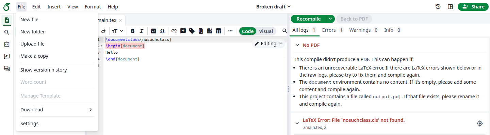
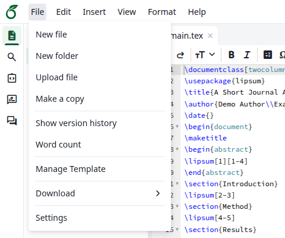
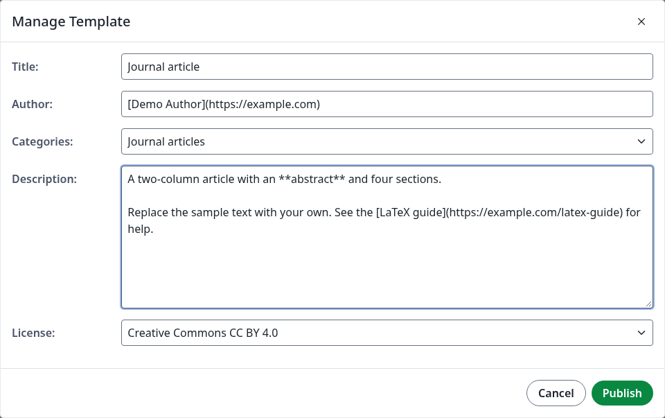
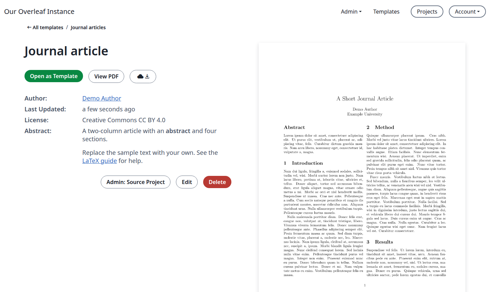
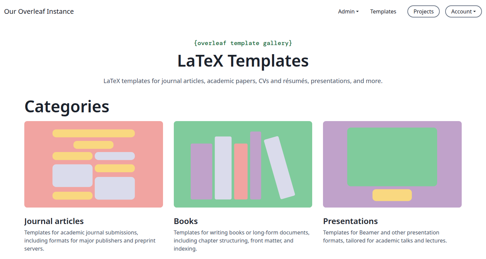
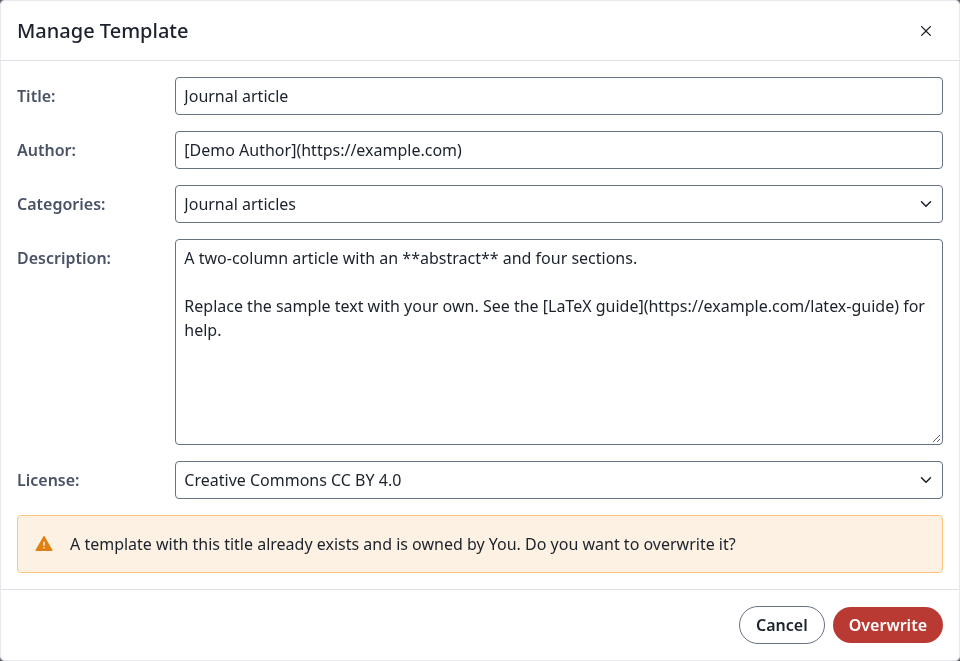
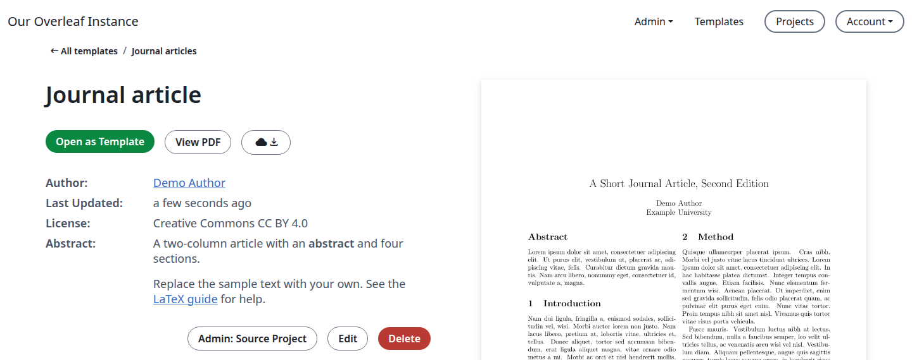
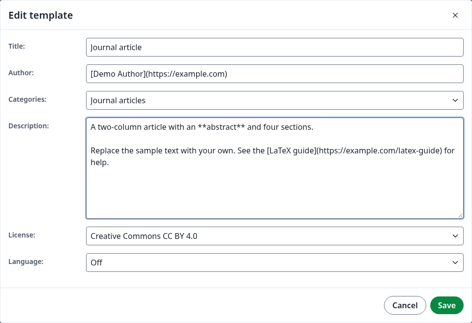
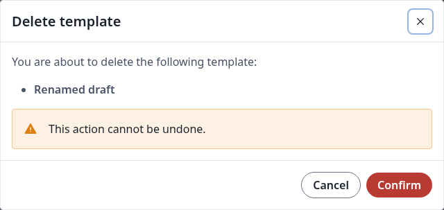
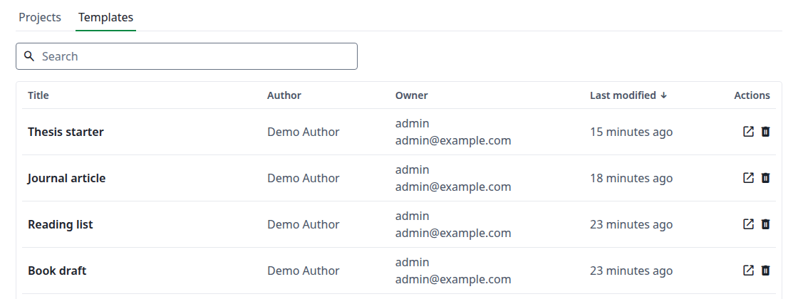

You publish templates from the editor, and manage them on their page in the gallery or in the admin panel.

<Info>

To turn the gallery on, choose its categories or let a user who is not an administrator publish, see [Templates](/on-premises/configuration/overleaf-toolkit/templates).

</Info>

## Publish a project

<Steps>
<Step title="Compile the project">
Open the project and click **Recompile**. The PDF you see is the one the gallery will show.

While the editor has no PDF, for example when you open a project that does not compile, **Manage Template** is greyed out.

<Frame caption="No PDF yet, so nothing to publish">
  
</Frame>

<Warning>

Publishing saves the files as they are now, and the PDF of the last successful compile. If you edited the project after that compile, or the last compile failed, the gallery shows an old PDF next to newer files, which may not compile. Recompile until the PDF is right, then publish.

</Warning>
</Step>

<Step title="Open the form">
In the top menu of the editor, click **File**, then **Manage Template**.

<Frame caption="The File menu">
  
</Frame>
</Step>

<Step title="Fill in the form">
<Frame caption="The Manage Template dialog">
  
</Frame>

| Field           | Notes                                                                                                                                                         |
| --------------- | ------------------------------------------------------------------------------------------------------------------------------------------------------------- |
| **Title**       | Starts as the project's name. Must be unique in the gallery. At most 150 characters.                                                                          |
| **Author**      | Starts as your name. A Markdown link such as `[Demo Author](https://example.com)` becomes a link on the template page.                                        |
| **Categories**  | One category, see [Categories](/on-premises/user-guide/administrators/template-management#categories).                                                                                               |
| **Description** | Supports Markdown. At most 4096 characters. The template page shows it as **Abstract**, and the gallery shows the start of it as plain text.                  |
| **License**     | **Creative Commons CC BY 4.0**, **LaTeX Project Public License 1.3c** or <strong>Other (as stated in the work)</strong>.                                                   |

The compiler and the main document of the project go with the template, so set them in the project first. Projects opened from the template use the same ones.
</Step>

<Step title="Click Publish">
The template page opens.

<Frame caption="The new template">
  
</Frame>

**Admin: Source Project**, **Edit** and **Delete** are for you. Other users see only **Open as Template**, **View PDF** and the download button.
</Step>

<Step title="Check the gallery">
Click **Templates** at the top right. The new template is first in the list.
</Step>
</Steps>

## Categories

A template is in one category. The names and descriptions come from your [configuration](/on-premises/configuration/overleaf-toolkit/templates#configuration) and cannot be changed in the site.

You see them in these places:

* **Categories** in the form.
* The cards at the top of the gallery page, `/templates`. Click **Template Gallery** on the **All templates** page to get there.
* A page for each category, for example `/templates/presentation`. A category without templates shows <strong>No Templates.</strong>
* **New project**, then **More templates**, on the projects page.
* The link above the title on the template page.

<Frame caption="Categories on the gallery page">
  
</Frame>

**All templates** in the form means no category of its own: the template is only in the full list.

## Update a template

To change the files and the PDF, publish the project again under the same title.

<Steps>
<Step title="Change the project">
Edit the project and click **Recompile**.
</Step>

<Step title="Publish again">
Click **File**, then **Manage Template**. The form shows the details of the template, which you can change. Click **Publish**.

A message says that the title already exists, and the button becomes **Overwrite**.

<Frame caption="Publishing under the same title">
  
</Frame>

If you change **Title** now, the message goes away and **Publish** creates a new template.
</Step>

<Step title="Click Overwrite">
The same template page opens, with the new PDF.

<Frame caption="The updated template">
  
</Frame>

Projects that users already opened from the template do not change.
</Step>
</Steps>

<Warning>

The form finds the template by the project's name. If you renamed the template with **Edit**, the form opens with the project's name, your name, the first category and an empty description, and typing the template's title does not bring its details back. **Overwrite** then replaces the details with what is in the form, so fill them in again first.

</Warning>

## Edit the details

This changes what the gallery shows about a template, not its files or PDF.

<Steps>
<Step title="Open the template">
Click **Templates** at the top right, click the template, then click **Edit**.
</Step>

<Step title="Change the fields">
The fields are the same as when publishing, with one more: **Language** is the spell check language of projects opened from the template. For a project published with the default language it shows **Off**, and projects opened from it use <strong>English (American)</strong>.

<Frame caption="The Edit template dialog">
  
</Frame>

A title that another template has is refused: **Save** stays greyed out until you change **Title**.
</Step>

<Step title="Click Save">
The dialog closes and the template page shows the new details.
</Step>
</Steps>

## The source project

**Admin: Source Project** opens the project the template was published from.

The template keeps its own copy of the files. If you delete the project forever, the button disappears, and users can still open the template. A project that is only in **Trash** keeps the button. See also the Q&A under [Templates](/on-premises/configuration/overleaf-toolkit/templates).

## Delete a template

<Steps>
<Step title="Click Delete">
On the template page, click **Delete**. The dialog names the template.

<Frame caption="The Delete template dialog">
  
</Frame>
</Step>

<Step title="Click Confirm">
You are back on the page you came from, and the template is no longer in the gallery. Its link now shows **Not found**.

The source project stays, and so do the projects that users opened from the template.
</Step>
</Steps>

## Manage templates in the admin panel

Click **Admin**, then **Project/Object Lookup**, then the **Templates** tab. It lists every template with its author and owner, and you can search it.

<Frame caption="All templates in the admin panel">
  
</Frame>

* Click a title to open the template page, or the open icon to open it in a new tab.
* Click an owner to open that user's page.
* Click the bin icon, then **Delete**, to delete a template. The dialog warns that this cannot be undone, and the template leaves the gallery.

## If publishing is refused

The form lets you type more than the site accepts. A **Title** over 150 characters shows `Template title exceeds the maximum length of 150 characters.`, and a **Description** over 4096 characters shows `Template description exceeds the maximum length of 4096 characters.`

**Publish** then stays greyed out even when you shorten the text. Click **Cancel**, click **File**, then **Manage Template**, and fill in the form again.
