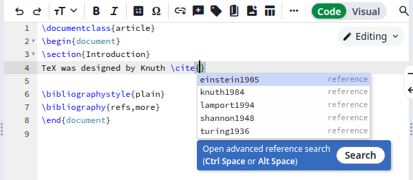
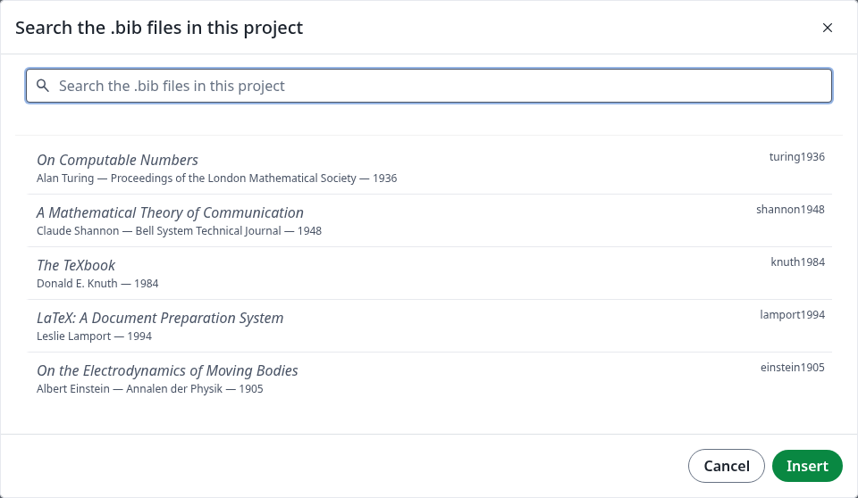
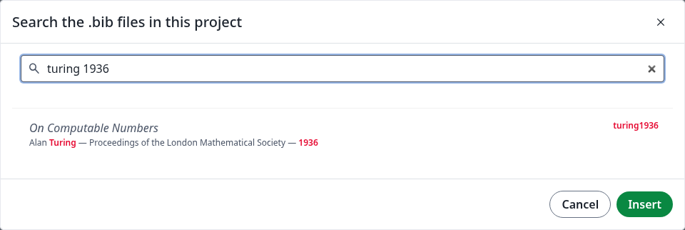
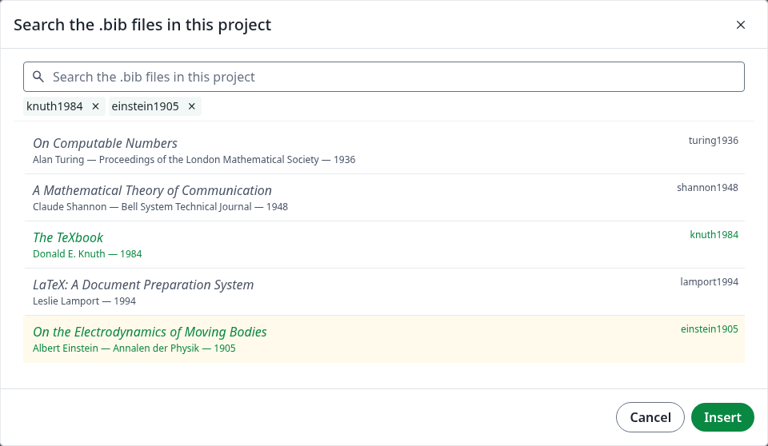
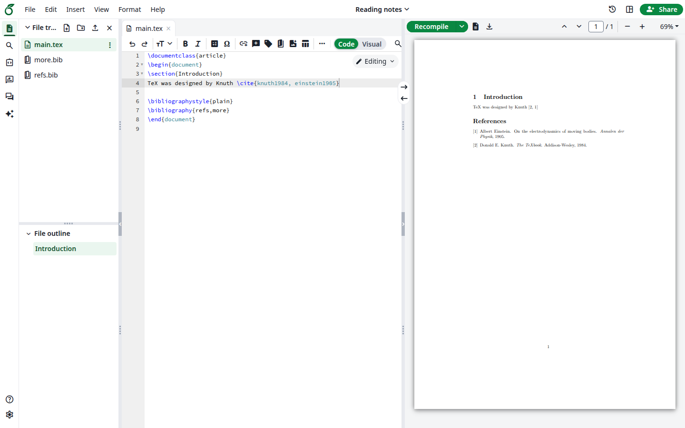
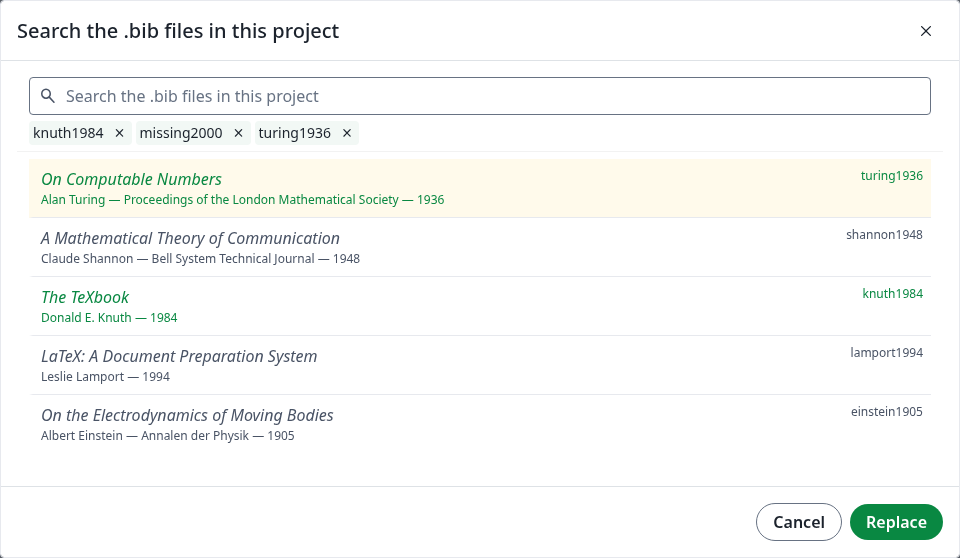

The reference search looks through all the `.bib` files in your project, so you can find a reference without remembering its citation key. Nothing needs to be set up.

Your project needs at least one `.bib` file. You can upload one, or import your library from [Zotero](/on-premises/user-guide/users/zotero-integration) or [Mendeley](/on-premises/user-guide/users/mendeley-integration).

## Insert a citation

<Steps>
<Step title="Start a citation">
In a `.tex` file, type `\cite{`. The editor adds the closing brace. Below the cursor you see the citation keys and a blue box, **Open advanced reference search**.

<Frame caption="The blue box under a citation">
  
</Frame>

The **Insert citation** button in the toolbar and **Insert**, then **Citation**, also start a `\cite{}` for you. The box appears for other citation commands too, such as `\citep`, `\autocite`, `\parencite` and `\textcite`.
</Step>

<Step title="Open the search">
Click **Search** in the blue box, or press Ctrl+Space between the braces. The dialog lists every entry, with its title, citation key, author, journal and year.

<Frame caption="All the entries of the project">
  
</Frame>
</Step>

<Step title="Find the entry">
Type in the search box. It looks in the citation key, author, title, journal and year, and highlights what it found. Every word must match, so `turing 1936` finds Turing's paper from 1936. Other fields, such as the publisher, are not searched.

<Frame caption="Searching by author and year">
  
</Frame>
</Step>

<Step title="Choose one or more entries">
Click an entry. It turns green and its key appears above the list. To add another, click it, or search again: what you chose stays. To remove one, click it again or click the <strong>×</strong> next to its key.

<Frame caption="Two chosen entries">
  
</Frame>
</Step>

<Step title="Click Insert">
The keys appear between the braces, separated by commas. If your document has no bibliography yet, add these lines before `\end{document}`, using the names of your `.bib` files without the extension:

```latex
\bibliographystyle{plain}
\bibliography{refs,more}
```

Click **Recompile**. The references appear in the PDF.

<Frame caption="The compiled citation">
  
</Frame>
</Step>
</Steps>

The search works the same way in the **Visual** editor.

## Change a citation

<strong>Add a reference:</strong> put the cursor between the braces of an existing citation and open the search. **Insert** adds the new keys after the ones already there.

<strong>Replace references:</strong> select the keys in the editor, then press Ctrl+Space. The keys appear above the list and the button now says **Replace**. Remove the ones you do not want, add others, then click **Replace**. A key that is not in any `.bib` file stays until you remove it.

<Frame caption="Replacing selected keys">
  
</Frame>

## Use the keyboard

| Key | What it does |
| --- | ------------ |
| **Down arrow** | Moves from the search box into the list, then down the list |
| **Up arrow** | Moves up the list |
| **Space** | Chooses the entry, or removes it from what you chose |
| **Enter** | Inserts what you chose, when you are in the list |
| **Tab** | Moves between the search box, the list and the buttons |
| **Esc** | Closes the dialog and changes nothing |

## Where the entries come from

The search covers every `.bib` file in the project, including files imported from Zotero or Mendeley. When you edit a `.bib` file, the next search finds the new entries.

## If something goes wrong

| What you see | Why | What to do |
| ------------ | --- | ---------- |
| The list in the dialog is empty | The project has no `.bib` file | Upload one or create one |
| No blue box, and Ctrl+Space lists LaTeX commands | The cursor is not between the braces of a citation | Click between the braces |
| Ctrl+Space does nothing | Your computer uses this shortcut for something else | Click **Search** in the blue box |
| An entry is not found | The search only covers the key, author, title, journal and year | Search by one of those |
