The assistant works on the project you have open. It reads your documents and suggests edits, and you apply or reject each edit. The answers in the screenshots are examples: what you get depends on the model your site uses.

<Info>

If you see no **AI assistant** in the left bar, see [AI Integration](/on-premises/configuration/overleaf-toolkit/integrations/ai-integration) for your administrator.

</Info>

## Start a chat

<Steps>
<Step title="Open the assistant">
In the left bar of the editor, click **AI assistant**. The panel opens next to the editor.
</Step>

<Step title="Accept the terms">
The first time, the panel shows the terms for AI features. Click **Accept and continue**. You do this once, and it also covers the [Error Assistant](/on-premises/user-guide/users/error-assistant).

<Frame caption="The terms, shown once">
  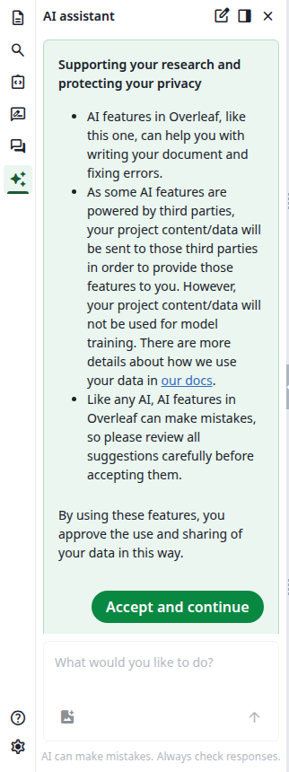
</Frame>
</Step>

<Step title="Ask something">
Type in <strong>What would you like to do?</strong> and press Enter, or click the arrow. You can also click a suggestion under **Start a chat**. The suggestions change from one chat to the next, and **Fix the compile errors** joins them when the last compile has errors.

<Frame caption="An empty chat">
  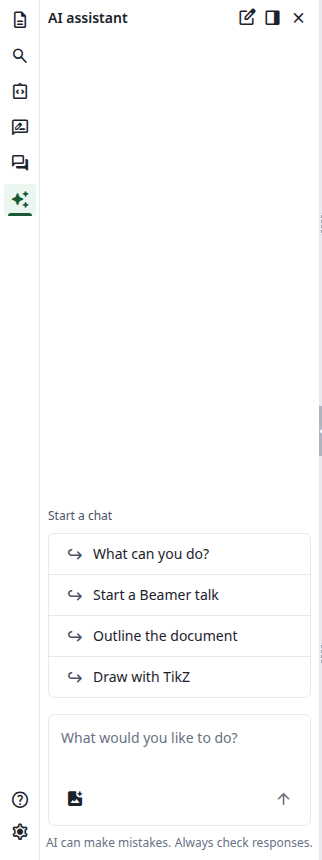
</Frame>
</Step>

<Step title="Read the answer">
What the assistant did appears as lines in a box, such as **Read line 15-16 of main.tex**, with a check mark when the step is done. The answer follows. If the model shares its reasoning, click **Reasoned for 1 s** to read it.

<Frame caption="A question and its answer">
  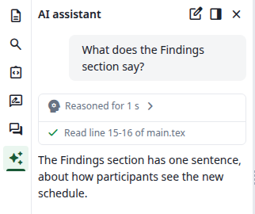
</Frame>
</Step>
</Steps>

## Ask about selected lines

Select lines in the editor. A label such as `main.tex: 16` appears above the message box, and the selected text goes with your message. In an empty chat, the suggestions turn to the selection, such as **Make it shorter**.

<Frame caption="A selected line">
  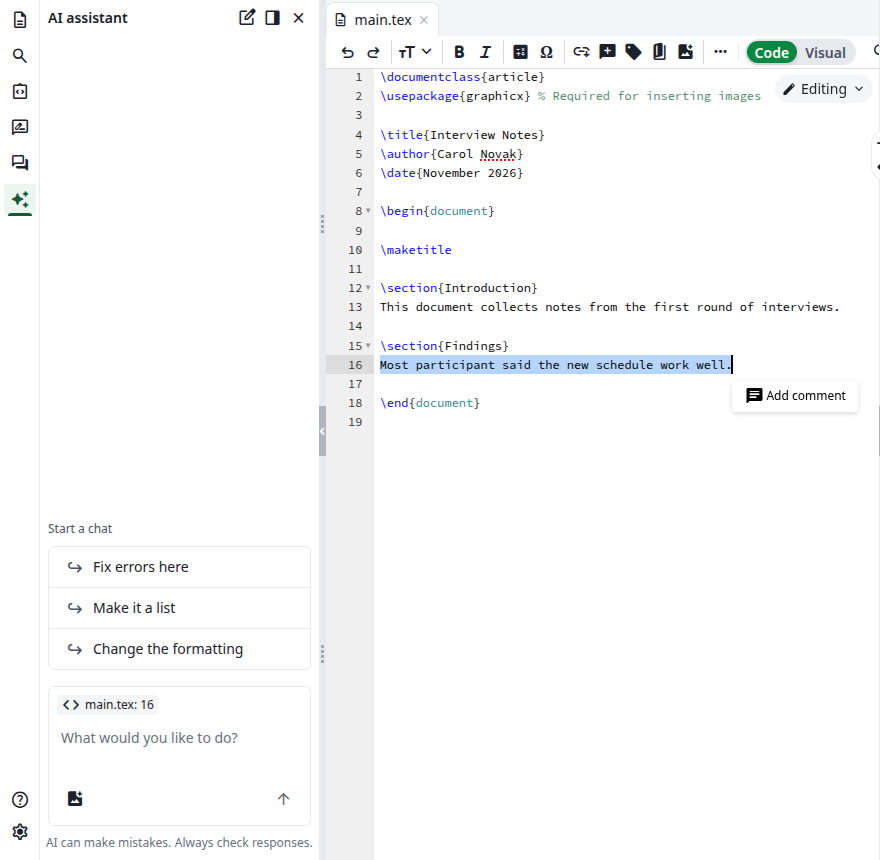
</Frame>

## Review a suggested edit

An edit does not go into your document until you apply it.

<Steps>
<Step title="Read the suggestion">
A box called **Edit line 16** shows the reason, the line number and the change: the old text is struck through and the new text is highlighted. The document has not changed yet. **Show result** shows only the new text, and **Show diff** goes back.

<Frame caption="An edit waiting for your decision">
  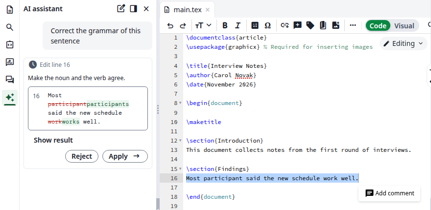
</Frame>
</Step>

<Step title="Apply it">
Click **Apply**. The change appears in the editor, the box gets a check mark and the assistant carries on. If the edit is in another document, that document opens.

<Frame caption="The edit is applied">
  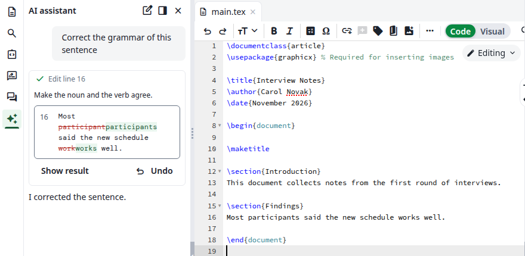
</Frame>
</Step>

<Step title="Take it back if you change your mind">
**Undo** takes the change out of the document, and **Apply** puts it back. The assistant is not told about either.
</Step>
</Steps>

### Reject an edit

Click **Reject**. The document stays as it is, the box says <strong>The user declined this edit.</strong> and the assistant carries on, knowing you declined. The buttons are gone, so to get the edit back, ask again.

If you write a new message instead of deciding, the edit is not applied and the box says so.

<Frame caption="A rejected edit, and one left undecided">
  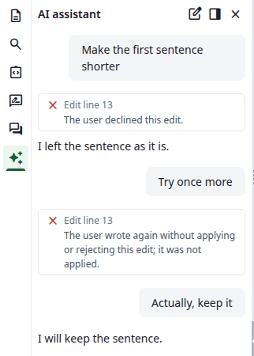
</Frame>

## What the assistant can do in a project

Only edits wait for you. The other steps run as soon as the assistant takes them.

| The line in the chat | What it does |
| -------------------- | ------------ |
| **Read line 15-16 of main.tex** | Reads lines of a document |
| **Find “schedule” in main.tex** | Looks for text in a document |
| **List the project files** | Lists the files of the project |
| **Create appendix.tex** | Creates an empty document and opens it |
| **Edit line 16** | Suggests an edit, see above |
| **Compile** | Compiles the project |
| **Check the compile log** | Reads the errors and warnings of the last compile |
| **Look at PDF page 1** | Shows a page of the PDF in the chat |
| **Read the PDF structure** | Reads the structure of the PDF |
| **Switch to xelatex** | Changes the compiler of the project, as in **Settings** |
| <strong>Search the web for “...”</strong> | Searches the web |
| <strong>Search the help pages for “...”</strong> | Searches the help pages |

<Frame caption="A new file, then an edit in another document">
  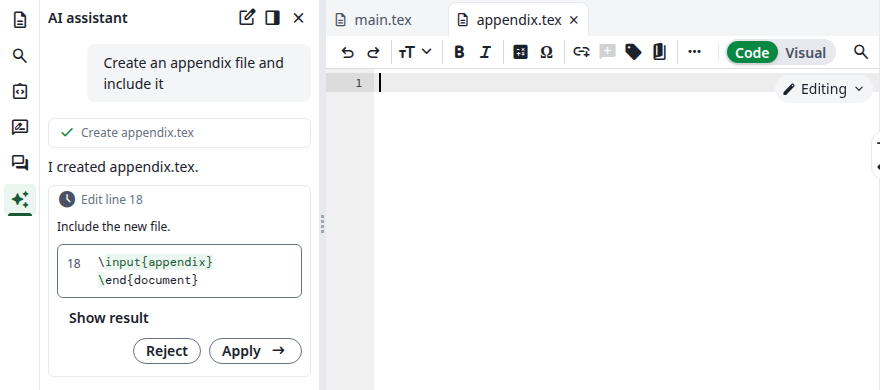
</Frame>

<Frame caption="A compile and a page of the PDF">
  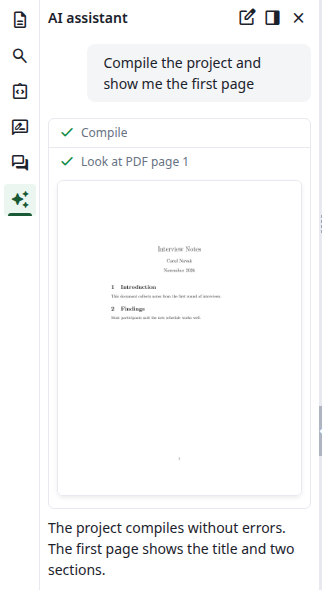
</Frame>

A search line shows how many results it found. Click it to list them. Whether the searches are available depends on your site, see [Optional search services](/on-premises/configuration/overleaf-toolkit/integrations/ai-integration#optional-search-services).

<Frame caption="The results of a search">
  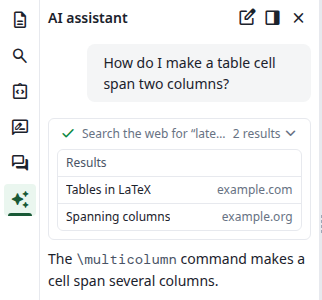
</Frame>

The **Fix the compile errors** suggestion asks the assistant to check the log and fix what it finds. Its fixes arrive as edits for you to review.

## Attach an image or a PDF

In the message box, click the picture icon, **Attach image or PDF**, and choose a file. Its name appears above your text. Write your message and send it.

<Frame caption="A file attached to a message">
  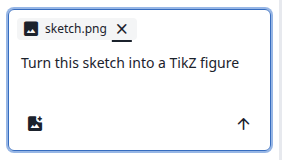
</Frame>

The panel refuses other files with <strong>Only images and PDF files can be attached.</strong> and large ones with <strong>Files must be smaller than 2 MB.</strong>

## Stop the assistant

While the assistant works, the arrow in the message box becomes a **Stop** button. Click it. A running step ends with <strong>Stopped by the user.</strong> and nothing else happens until you write again.

<Frame caption="The Stop button">
  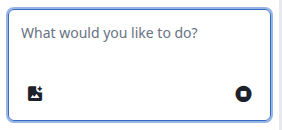
</Frame>

## If the assistant stops by itself

The assistant can take a limited number of steps for one message. At the limit, the panel says <strong>The assistant used all the steps it may take for one message. Reply to let it carry on.</strong> Reply, for example with `Go on`, and it continues.

<Frame caption="The step limit">
  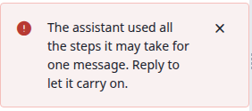
</Frame>

If the panel says **Something’s gone wrong**, the request failed. Send your message again, or click **Start new chat**.

## Move the panel and start over

These buttons are at the top of the panel:

* **Start new chat** clears the panel. There is no list of earlier chats. Reloading the page clears the chat too.
* **Move to the right** puts the panel to the right of the PDF, where it stays open while you use the file tree. **Move to the left** puts it back. The chat stays.
* **Close** hides the panel. Click **AI assistant** in the left bar to bring it back, with the chat still there.

<Frame caption="The panel on the right">
  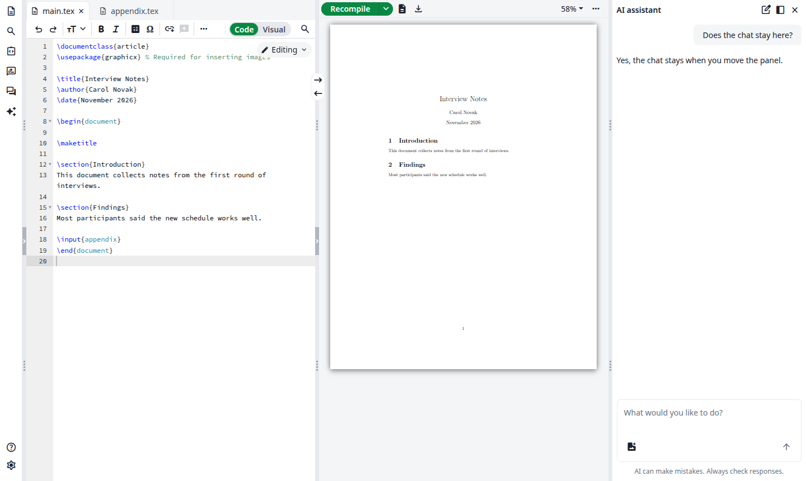
</Frame>

## Token usage

The assistant does not show how many tokens you have used. If your site sets a limit and you reach it, your next message gets no answer. The panel shows **Usage limit reached** and how long until you can chat again, and the message box is greyed out.

<Frame caption="The limit is reached">
  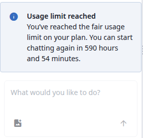
</Frame>

A new chat shows the same notice. After a reload the box looks normal again, but the next message gets the notice as well. The [Error Assistant](/on-premises/user-guide/users/error-assistant) counts towards the same limit and shows **Usage limit reached** in the log entry.

Your administrator sets the limit, see [Usage and reset](/on-premises/configuration/overleaf-toolkit/integrations/ai-integration#usage-and-reset).
