Keep all your projects in sync with a folder in your Dropbox. Changes go both ways in the background, with one exception: what you type in the editor reaches Dropbox a few minutes after you leave the project, or when you click **sync this project now**.

<Info>

If you see no Dropbox option in **Account settings** or in the editor, ask your administrator to turn on [Dropbox Synchronisation](/on-premises/configuration/overleaf-toolkit/integrations/dropbox-synchronisation).

</Info>

## Link your Dropbox account

You do this once.

<Steps>
<Step title="Open your account settings">
Click **Account**, then **Account settings**. Under **Project synchronisation**, find **Dropbox** and click **Link**.

<Frame caption="Dropbox in the account settings">
  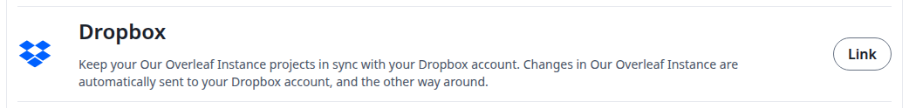
</Frame>
</Step>

<Step title="Authorize on Dropbox">
Dropbox opens. Sign in if you are asked to, then authorize the application.
</Step>

<Step title="Check the link">
You are back in the account settings. A green message says your Dropbox account is linked, and the button now says **Unlink**. Under Dropbox, a status shows that your projects are being sent.

<Frame caption="Your Dropbox account is linked">
  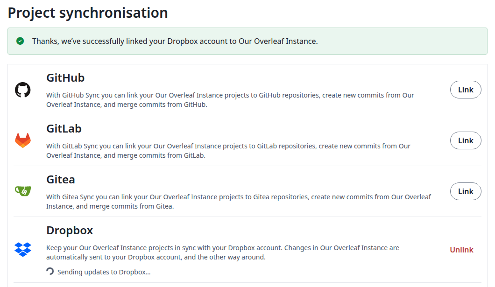
</Frame>

The status changes to **Overleaf and Dropbox have processed all updates** when they are all there.

<Frame caption="Everything is in sync">
  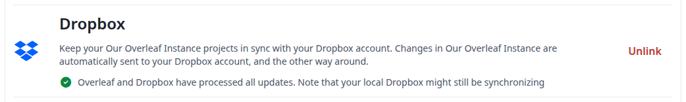
</Frame>
</Step>
</Steps>

If your account is not linked yet, the **Dropbox** card in the editor asks you to link it first. Click **Update Dropbox Settings**: the account settings open in a new tab. Link your account there, then refresh the editor page, as the dialog tells you to.

<Frame caption="The prompt when your account is not linked">
  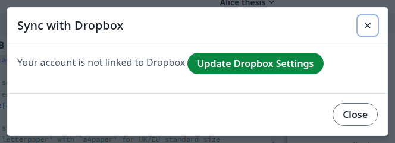
</Frame>

If you do not allow access on Dropbox, you come back to the account settings without a message, and the button still says **Link**.

### If you have projects with the same name

You cannot link while two of your projects share a name. The message names them. Archived and trashed projects count too.

<Frame caption="Two projects with the same name">
  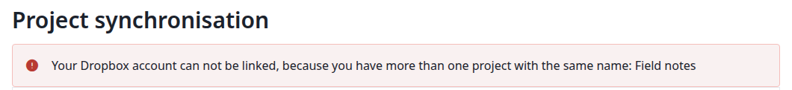
</Frame>

Rename one of them and click **Link** again.

## Find your projects in Dropbox

Each of your projects is a folder in `Apps/<app name>/` in your Dropbox, with all its files. Your administrator chose the app name. Every project is synced, also the ones you create later: you cannot pick some of them.

To see the folder of a project, open the project. In the left bar, click **Integrations**, then **Dropbox**.

<Frame caption="The Integrations panel">
  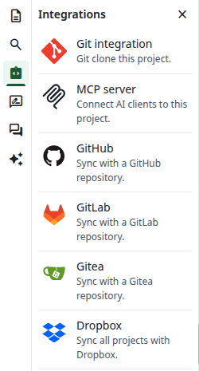
</Frame>

The dialog names the folder, and links to it on Dropbox.

<Frame caption="The folder of this project">
  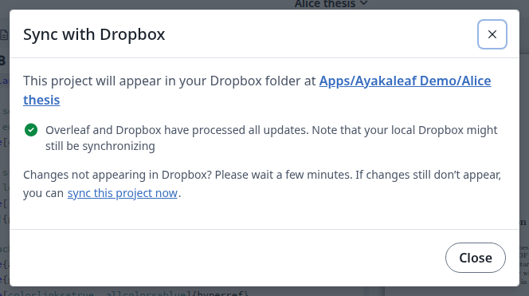
</Frame>

A new project named like one you already have gets a numbered folder, such as `Field notes (1)`. The dialog shows which one is its folder.

<Frame caption="A numbered folder">
  
</Frame>

## Changes you make in Overleaf

You do not need to click anything.

* **New files, renames, moves and deletions** reach Dropbox right away. A new folder appears there with its first file.
* **Renaming a project** renames its folder.
* **Edits you type in the editor** do not reach Dropbox while the project is open, and clicking **Recompile** does not send them. They go about three minutes after everyone has left the project. To send them earlier, see [Force a sync](#force-a-sync).
* **Deleting a project** leaves its folder in Dropbox. Delete the folder yourself if you no longer need it.

## Changes you make in Dropbox

You do not need to click anything here either. Dropbox tells Overleaf about the change, and it usually shows up within seconds, also in an open editor, without reloading.

* **New files, edits, renames and deletions** in a project folder are applied to the project. So are new folders.
* **A new folder at the top of the app folder** becomes a new project.
* **Files Overleaf does not sync**, such as `.DS_Store` or `.aux` files, stay in Dropbox only.

The history of the project marks these changes <strong>(via Dropbox)</strong>.

### If the file is open in the editor

The file changes in front of you, and a dialog tells you so. Click **OK**.

<Frame caption="A file you have open changed in Dropbox">
  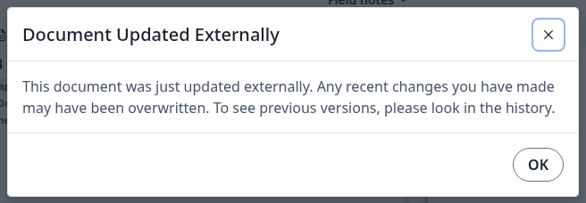
</Frame>

The Dropbox version replaces what you typed and had not sent yet. Your text is not lost: it stays in the project's history.

<Frame caption="The replaced text in the history">
  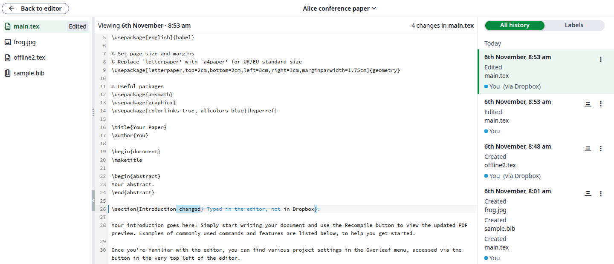
</Frame>

### Rename or delete a project folder

Rename a project in Overleaf, not in Dropbox. To Overleaf, a folder renamed in Dropbox is a deleted folder and a new one: you get a new project with the new name, and the old project stays.

When you delete a project folder in Dropbox, the project stays in your project list, with its files and history. The next time you open it, a dialog tells you once. Click **OK**.

<Frame caption="The folder of this project is gone from Dropbox">
  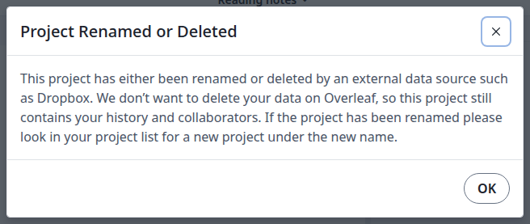
</Frame>

The project keeps syncing. To put all of it back in Dropbox, click **sync this project now**.

### While a project is archived or in the trash

Changes you make in its folder in Dropbox are not applied, and restoring the project does not bring them in. Overleaf then stops sending the files you changed, so the two sides differ. Save such a file once more in Dropbox: the Dropbox version replaces the one in Overleaf.

## Force a sync

Each project has its own link. Use it when you want your edits in Dropbox now, without leaving the project.

<Steps>
<Step title="Open the sync dialog">
Open the project. In the left bar, click **Integrations**, then **Dropbox**.
</Step>

<Step title="Click sync this project now">
The link is at the end of <strong>Changes not appearing in Dropbox?</strong>
</Step>

<Step title="Check the result">
A blue message says a manual sync has started, and the status shows **Sending and receiving updates**. It changes back to **Overleaf and Dropbox have processed all updates** when the sync is done.

<Frame caption="A manual sync is running">
  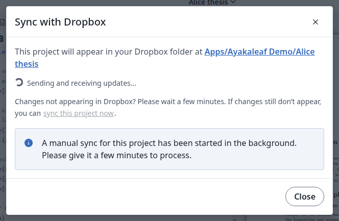
</Frame>
</Step>
</Steps>

The link sends the whole project to Dropbox, including the edits still in the editor. It also reads the changes waiting in Dropbox, for all your projects. If your site cannot receive [notifications from Dropbox](/on-premises/configuration/overleaf-toolkit/integrations/dropbox-synchronisation#webhook), changes from Dropbox only come in this way.

You can do this once per minute for each project. Sooner than that, a red message asks you to wait.

<Frame caption="Wait a minute before the next one">
  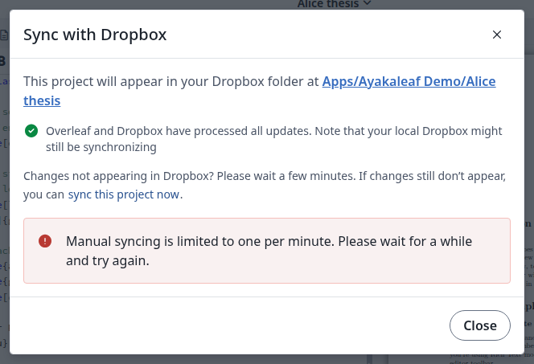
</Frame>

## Unlink your Dropbox account

<Steps>
<Step title="Click Unlink">
In **Account settings**, under **Dropbox**, click **Unlink**.
</Step>

<Step title="Confirm">
Click **Unlink** in the dialog.

<Frame caption="Unlink your account">
  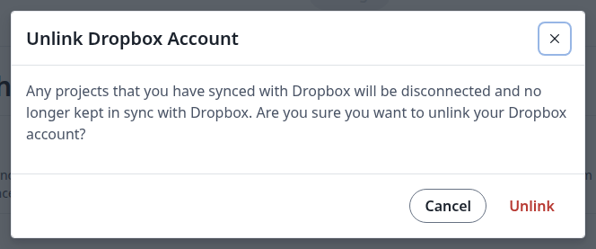
</Frame>
</Step>

<Step title="Check the result">
The button says **Link** again, and the **Dropbox** card in the editor says your account is not linked. Nothing syncs any more in either direction. Your projects and the folders in Dropbox keep their files.
</Step>
</Steps>

### Link again later

Click **Link**. Your projects are sent to Dropbox again:

* Each file replaces the one with the same name in Dropbox. What you changed in those files in Dropbox while unlinked is overwritten, so move such changes to the project first.
* A file that exists only in Dropbox stays there, and comes into the project when you next change it.
* A project you renamed while unlinked gets a new folder. The old folder stays.

### If Overleaf unlinks your account

Overleaf unlinks your account when Dropbox no longer accepts the link. The project list says why, until you link again.

<Frame caption="Your account was unlinked">
  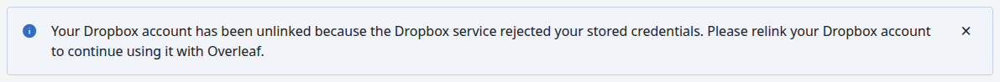
</Frame>

For the reasons, see the Q\&A of [Dropbox Synchronisation](/on-premises/configuration/overleaf-toolkit/integrations/dropbox-synchronisation).

<Info>

For what collaborators get in a shared project, see [How syncing works](/on-premises/configuration/overleaf-toolkit/integrations/dropbox-synchronisation#how-syncing-works).

</Info>
