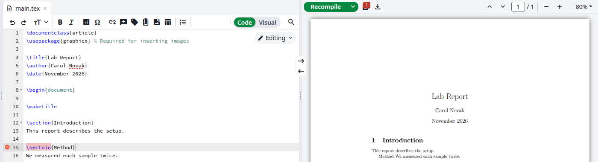
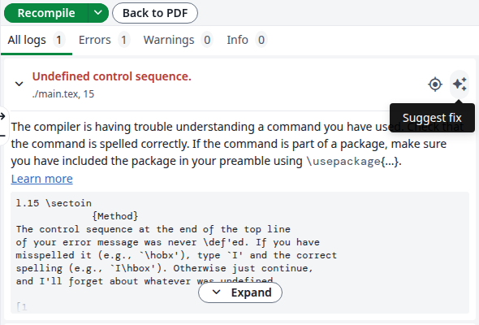
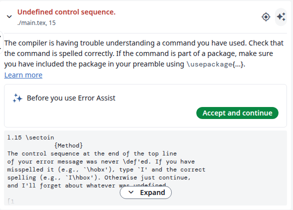
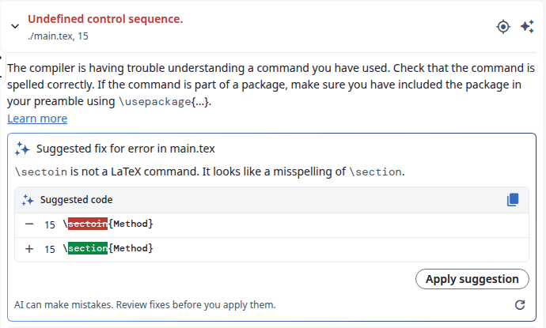
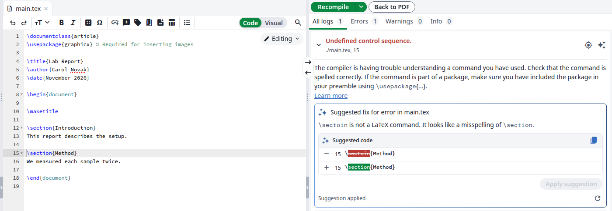
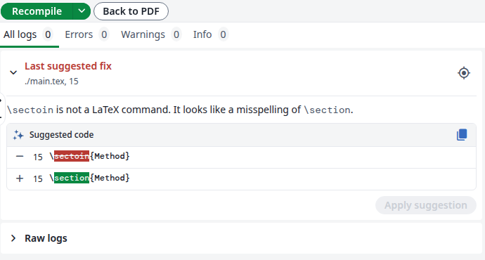

<Info>

If a log entry has no **Suggest fix** button, see [AI Integration](/on-premises/configuration/overleaf-toolkit/integrations/ai-integration) for your administrator.

</Info>

<Steps>
<Step title="Open the logs">
After a compile with errors, a red count appears on the logs icon next to **Recompile**, and a red dot marks the line in the editor. Click the icon. If the compile produced no PDF, the logs are already open.

<Frame caption="A compile with one error">
  
</Frame>
</Step>

<Step title="Click Suggest fix">
Click the sparkle icon, **Suggest fix**, on the right of the log entry. Warnings that point to a file of your project have it too.

<Frame caption="The Suggest fix button">
  
</Frame>

The first time, the entry says **Before you use Error Assist**. Click **Accept and continue**. You do this once, and it also covers the [AI Assistant](/on-premises/user-guide/users/ai-assistant).

<Frame caption="Shown once">
  
</Frame>
</Step>

<Step title="Read the suggestion">
The entry explains the error and shows the line to change, the old text on the <strong>-</strong> row and the new text on the <strong>+</strong> row. Clicking the line number takes you to that line in the editor, and the copy icon copies the new text.

<Frame caption="A suggested fix">
  
</Frame>

If the assistant has no fix, it only explains, and there is nothing to apply. The refresh icon, **Suggest a different fix**, asks again.
</Step>

<Step title="Apply it or leave it">
To apply it, click **Apply suggestion**. The line changes in the editor, the entry says **Suggestion applied** and the project recompiles. Once no error is left, the PDF comes back. To take the change back, press `Ctrl+Z` in the editor.

<Frame caption="The fix is applied">
  
</Frame>

To reject it, do nothing: there is no reject button, and the document stays as it is until you click **Apply suggestion**.

If you edit that line first, **Apply suggestion** is disabled. Click **Suggest a different fix** for a new suggestion.
</Step>
</Steps>

## Find the suggestion again

After the next compile, the logs list the suggestion as **Last suggested fix**, whether you applied it or not. Click the arrow to open it.

<Frame caption="The last suggestion stays in the logs">
  
</Frame>

The Error Assistant counts towards the same limit as the AI Assistant, see [Token usage](/on-premises/user-guide/users/ai-assistant#token-usage).
