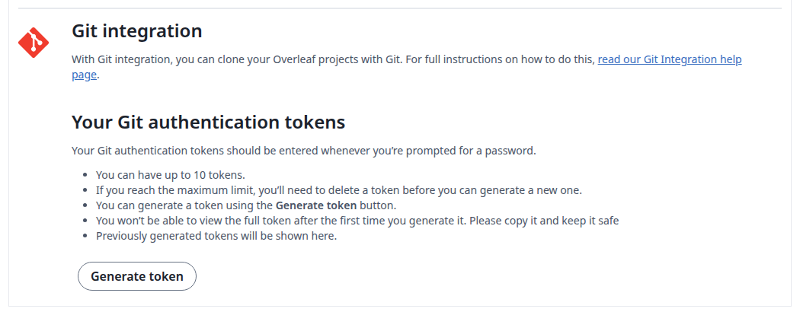
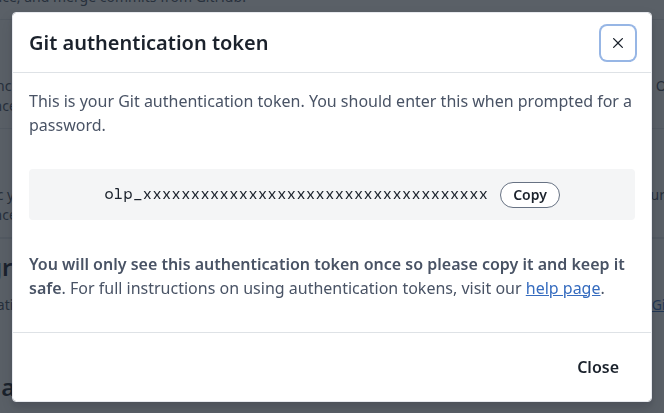
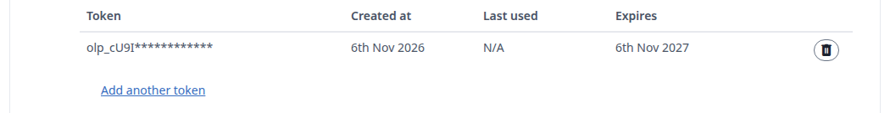
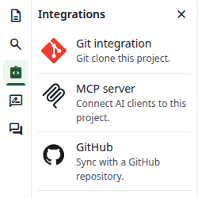
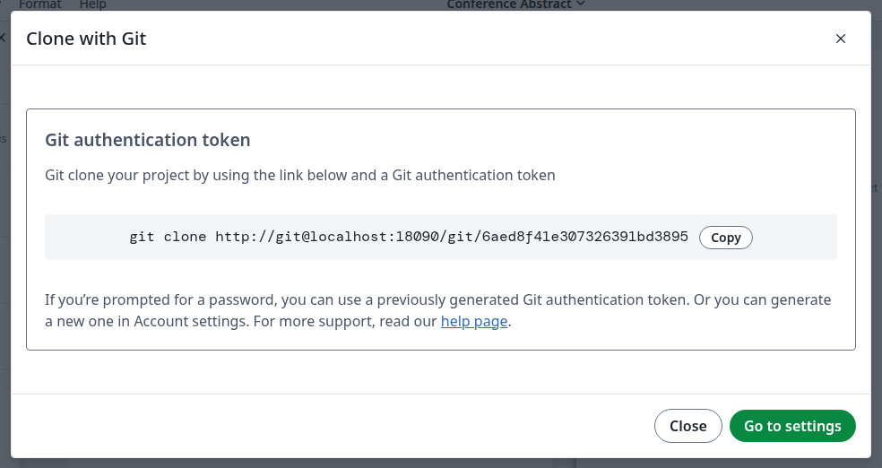
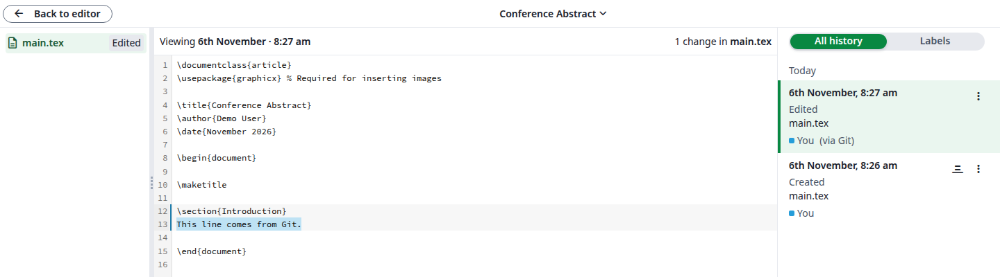
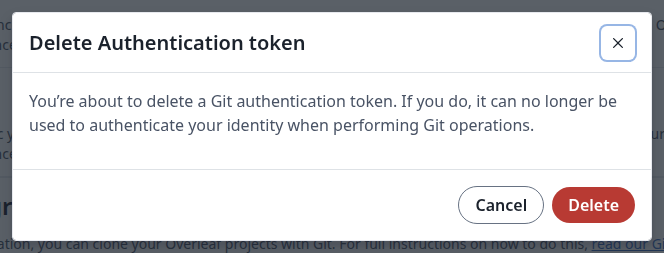

Work on a project on your own computer with Git. Changes only move when you run `git pull` or `git push`.

<Info>

An administrator has to turn on [Git integration](/on-premises/configuration/overleaf-toolkit/integrations/git-integration) first.

</Info>

## Create a token

Git signs in with a Git authentication token, not with your account password.

<Steps>
<Step title="Open your account settings">
Click **Account**, then **Account settings**. Under **Git integration**, click **Generate token**. Once you have a token, this button is called **Add another token**.

<Frame caption="Git integration in the account settings">
  
</Frame>
</Step>

<Step title="Copy the token">
Click **Copy** and keep the token somewhere safe. You only see it once. Then click **Close**.

<Frame caption="Your new token">
  
</Frame>
</Step>

<Step title="Check the token">
The list now shows the start of the token, when it was created and when it was last used. It expires after one year. You can have up to 10 tokens.

<Frame caption="Your tokens">
  
</Frame>
</Step>
</Steps>

## Clone a project

<Steps>
<Step title="Open Git integration in the editor">
Open the project. In the left bar, click **Integrations**, then **Git integration**.

<Frame caption="The Integrations panel">
  
</Frame>
</Step>

<Step title="Copy the command">
The **Clone with Git** dialog shows the command, with the address of your site and the ID of the project. Click **Copy**. If you have no token yet, **Go to settings** opens your account settings in a new tab.

<Frame caption="The clone command">
  
</Frame>
</Step>

<Step title="Run it">
Paste the command in a terminal. When Git asks for a password, paste your token.

```text
$ git clone https://git@<your-site>/git/<project-id>
Cloning into '<project-id>'...
Password for 'https://git@<your-site>': <your-token>
```

A folder named after the project ID now holds the project's files, on the branch `main`. To choose the folder's name, add it at the end of the command.
</Step>
</Steps>

Git asks for the token every time it contacts the site. To have it remembered, turn on a credential helper: Git asks once more, then keeps the token. The `store` helper keeps it unencrypted in `~/.git-credentials`.

```bash
git config --global credential.helper store
```

## Pull changes from the editor

Inside the folder, run:

```bash
git pull
```

Git lists the files that changed. Changes made in the editor arrive as commits called `Update on Overleaf.`.

```text
Updating db007e3..c3e6332
Fast-forward
 main.tex | 2 +-
 1 file changed, 1 insertion(+), 1 deletion(-)
```

## Push your changes

Commit your changes, then push them:

```bash
git add main.tex
git commit -m "Add a line from Git"
git push
```

The last line of the output shows the branch that moved:

```text
   53aca61..db007e3  main -> main
```

The changes appear in the editor, and an open editor updates by itself. New files, folders and renames show up in the file tree. In **History**, your change is marked <strong>You (via Git)</strong>. Your commit message is not shown there.

<Frame caption="A push in the project history">
  
</Frame>

### If Git refuses your push

When the project changed in the meantime, Git rejects the push:

```text
 ! [rejected]        main -> main (fetch first)
```

Get those changes first, then push again:

```bash
git pull --no-rebase --no-edit
git push
```

A plain `git pull` can stop with `fatal: Need to specify how to reconcile divergent branches.` The `--no-rebase` option above answers that: it merges the two sides.

If the same lines changed on both sides, the pull stops with `CONFLICT (content): Merge conflict in main.tex`. Fix the file, then:

```bash
git add main.tex
git commit -m "Merge the changes from the editor"
git push
```

There are two things the site does not accept:

* Other branches: `! [remote rejected] feature -> feature (wrong branch)`. Only `main` exists, so push your work there.
* Force pushes: `! [remote rejected] main -> main (forced push prohibited)`. Put your changes on top of the current `main` instead.

### If Git says Authentication failed

```text
remote: Enter your Git authentication token when prompted for a password.
fatal: Authentication failed for 'https://<your-site>/git/<project-id>/'
```

The token is wrong or was deleted, or you entered your account password. Create a new token if you no longer have it, because you cannot view an existing one again.

## Delete a token

In **Account settings**, under **Git integration**, click the delete icon next to the token, then **Delete** in the dialog. From then on, Git answers `Authentication failed` to that token.

<Frame caption="Delete a token">
  
</Frame>

<Info>

For what collaborators with read-only access can do, see the Q\&A of [Git integration](/on-premises/configuration/overleaf-toolkit/integrations/git-integration).

</Info>
