Connect a project to a Gitea repository. Changes go both ways, and only when you click **Sync**: nothing syncs on its own.

<Info>

An administrator has to turn on [Gitea Synchronisation](/on-premises/configuration/overleaf-toolkit/integrations/gitea-synchronisation) first.

</Info>

## Link your Gitea account

You do this once.

<Steps>
<Step title="Open your account settings">
Click **Account**, then **Account settings**. Under **Project synchronisation**, find **Gitea** and click **Link**.

<Frame caption="Gitea in the account settings">
  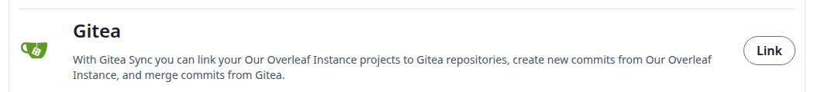
</Frame>
</Step>

<Step title="Authorize on Gitea">
Gitea opens. Sign in if you are asked to, then authorize the application.
</Step>

<Step title="Check the link">
You are back in the account settings. A green message says your Gitea account is linked, and the button now says **Unlink**.

<Frame caption="Your Gitea account is linked">
  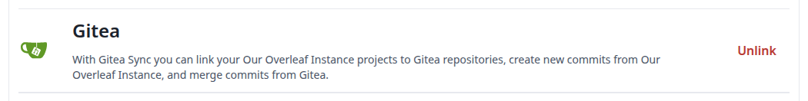
</Frame>
</Step>
</Steps>

If your account is not linked yet, **Import from Gitea** and the **Gitea** card in the editor ask you to link it first. Click **Link to your Gitea account**. You also end up in the account settings, in a new tab if you started in the editor. Then go back and start again.

<Frame caption="The prompt when your account is not linked">
  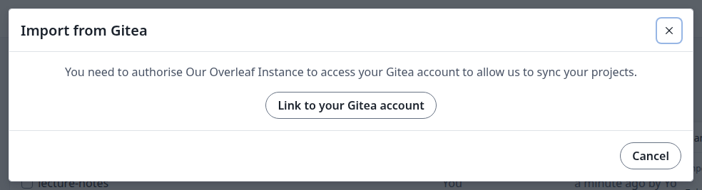
</Frame>

## Import a repository

This creates a new project from a Gitea repository, already linked to it.

<Steps>
<Step title="Open the import dialog">
On the projects page, click **New project**, then **Import from Gitea**.

<Frame caption="The New project menu">
  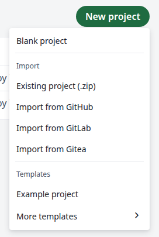
</Frame>
</Step>

<Step title="Choose the repository">
Click **Import to Overleaf** next to the repository. The list includes your repositories and those of your organizations. An empty repository is not listed: it needs at least one commit.

<Frame caption="Your Gitea repositories">
  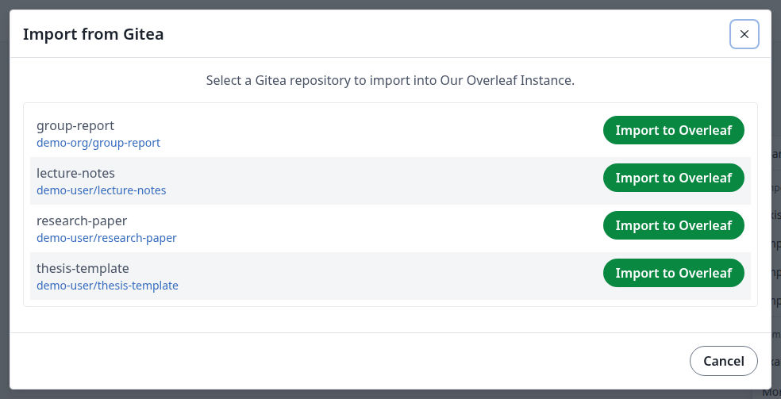
</Frame>
</Step>

<Step title="Check the project">
The new project opens with the files of the repository.

<Frame caption="The imported project">
  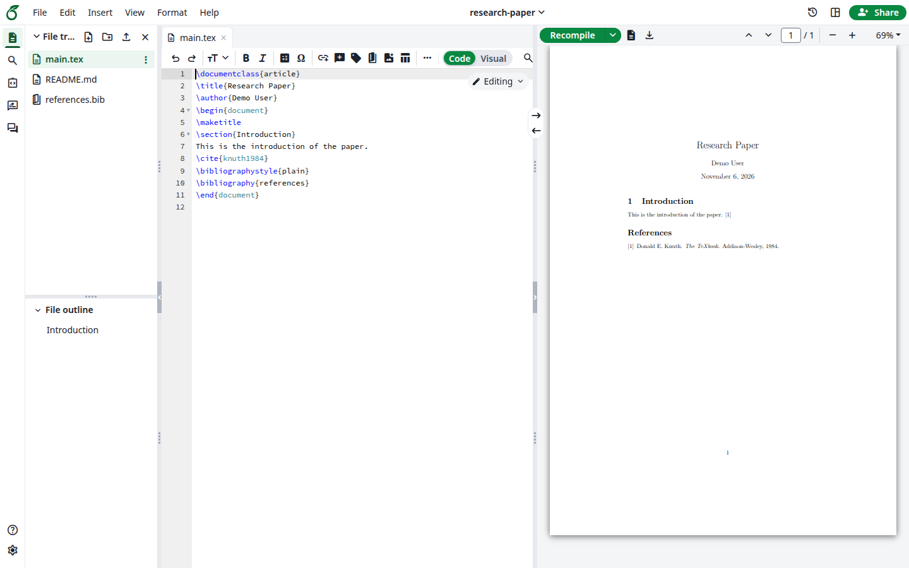
</Frame>
</Step>
</Steps>

## Export a project to a new repository

This creates a repository from a project and links them. A project can only be linked this way or by importing: you cannot link it to a repository that already exists.

<Steps>
<Step title="Open Gitea in the editor">
Open the project. In the left bar, click **Integrations**, then **Gitea**.

<Frame caption="The Integrations panel">
  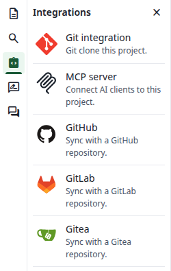
</Frame>
</Step>

<Step title="Fill in the repository">
Choose the **Owner**, which can be you or one of your organizations. When you pick an organization, this field is called **Organization**. **Repository Name** starts as the project's name: if that name has spaces, change it, because Gitea does not accept them. The description is optional, and **Private** is selected by default. Click **Create a Gitea repository**.

<Frame caption="Export Project to Gitea">
  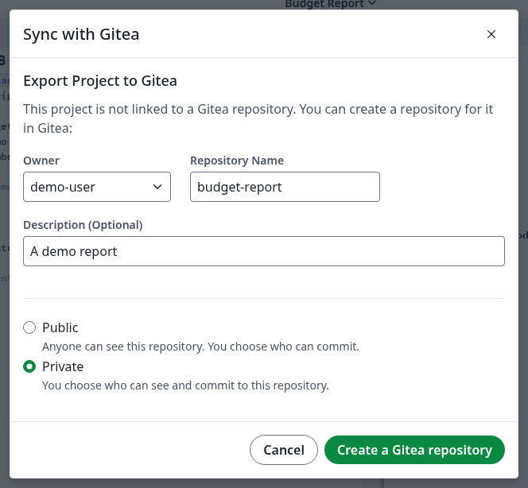
</Frame>

If the name has spaces or is already taken, the dialog says <strong>Please check that the repository name is valid, and that you have permission to create the repository.</strong> Change the name and click the button again.
</Step>

<Step title="Check the link">
The dialog now says **This project is linked to** and names the repository.

<Frame caption="The project is linked">
  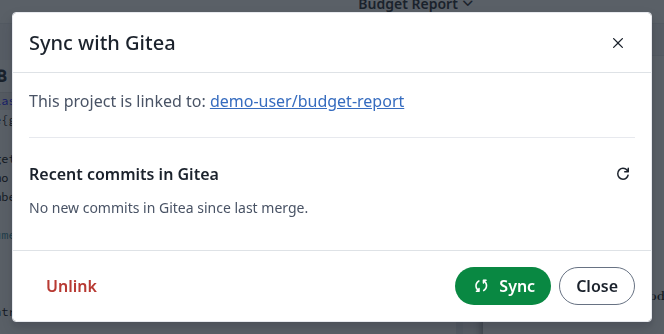
</Frame>
</Step>
</Steps>

## Sync

<Steps>
<Step title="Open the sync dialog">
Open a linked project. In the left bar, click **Integrations**, then **Gitea**.

**Recent commits in Gitea** lists what will come into the project.

<Frame caption="A new commit waiting in Gitea">
  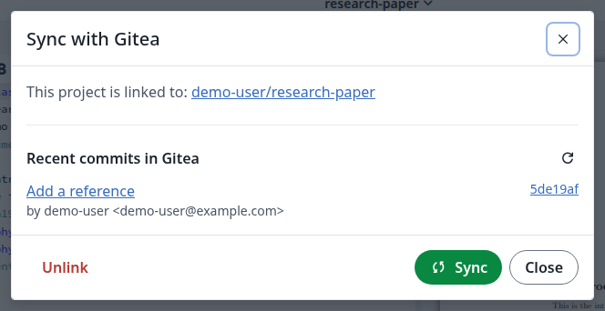
</Frame>
</Step>

<Step title="Describe your changes">
If you changed something in the project, a commit message box appears. It is optional: when you leave it empty, the commit is called `Updates from Overleaf`.

<Frame caption="The commit message for your changes">
  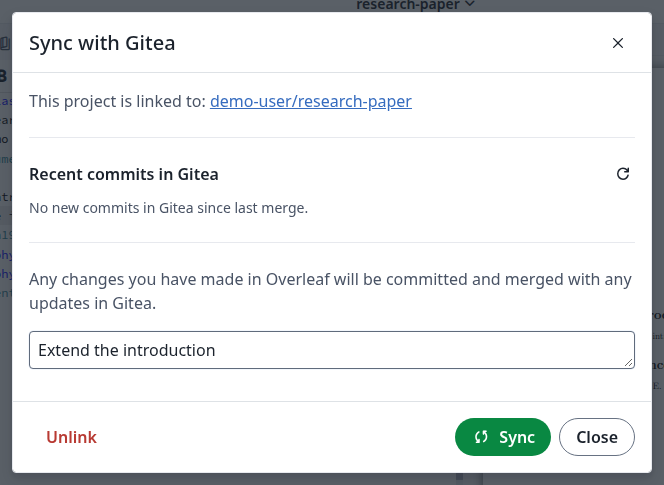
</Frame>
</Step>

<Step title="Click Sync">
Click **Sync**. New commits from Gitea come into the project, and your changes go to the default branch of the repository. If both sides changed different things, they are merged for you through a pull request, which stays on Gitea as a record.
</Step>

<Step title="Check the result">
The dialog shows <strong>No new commits in Gitea since last merge.</strong> and the commit message box is gone. The files in the editor and the commits on Gitea are up to date.

<Frame caption="Everything is in sync">
  
</Frame>
</Step>
</Steps>

### If the same lines changed on both sides

The dialog says the changes could not be merged and names a new branch, `overleaf-YYYY-MM-DD-HHMMSS`, which holds your changes. Overleaf also opens a pull request from that branch on Gitea.

<Frame caption="A conflict">
  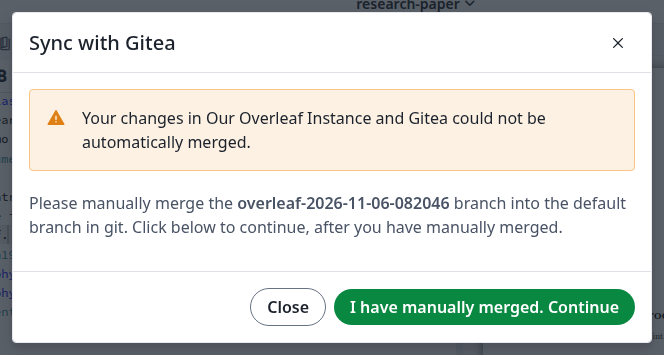
</Frame>

1.  Merge that branch into the default branch with Git, and fix the conflict. You can close the dialog in the meantime: it shows the same message when you open it again.

    ```bash
    git clone <repository-address>
    cd <repository-name>
    git merge origin/overleaf-YYYY-MM-DD-HHMMSS
    # fix the conflict in the file Git names
    git add <file>
    git commit
    git push
    ```
2. Click **I have manually merged. Continue**. The merged result comes into the project. If you click it before the branch is merged, the dialog stays as it is.
3. The branch stays on Gitea and its pull request stays open. Close the pull request and delete the branch when you no longer need them.

The same dialog appears when a branch protection rule holds the pull request back, for example when it needs an approval, even if no lines conflict. Once the rule allows it, merge the pull request on Gitea and click **I have manually merged. Continue**. See [How syncing works with Gitea](/on-premises/configuration/overleaf-toolkit/integrations/gitea-synchronisation#how-syncing-works-with-gitea).

## Unlink a project

Do this when you no longer want the project to sync.

<Steps>
<Step title="Click Unlink">
In the sync dialog, click **Unlink**.
</Step>

<Step title="Confirm">
Click **Confirm**. This only removes the link: the connection to a repository you own, which the warning mentions, is an option you have afterwards, not something that happens now.

<Frame caption="Confirm the unlink">
  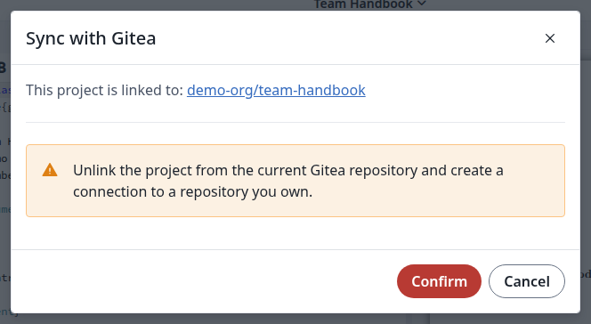
</Frame>
</Step>

<Step title="Check the result">
The dialog now shows **Export Project to Gitea**. The project and the repository both keep their content. To sync again, export the project to a new repository, or import the repository into a new project.
</Step>
</Steps>

## Unlink your Gitea account

In **Account settings**, under **Gitea**, click **Unlink**, then **Unlink** again in the dialog.

<Frame caption="Unlink your account">
  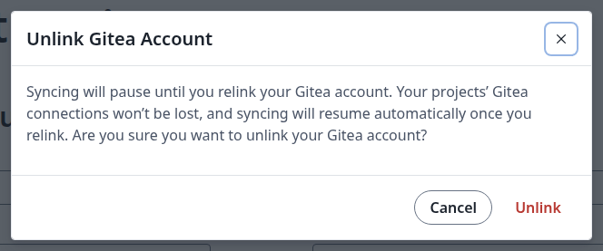
</Frame>

Your projects stay linked to their repositories. You cannot sync them until you link your account again.

<Info>

For who can do what in a shared project, see [Who can link and sync](/on-premises/configuration/overleaf-toolkit/integrations/gitea-synchronisation#who-can-link-and-sync).

</Info>
