Connect a project to a GitHub repository. Changes go both ways, and only when you click **Sync**: nothing syncs on its own.

<Info>

If you see no GitHub option in **Account settings** or in the editor, ask your administrator to turn on [GitHub Synchronisation](/on-premises/configuration/overleaf-toolkit/integrations/github-synchronisation).

</Info>

## Link your GitHub account

You do this once.

<Steps>
<Step title="Open your account settings">
Click **Account**, then **Account settings**. Scroll to **GitHub** and click **Link**.

<Frame caption="GitHub in the account settings">
  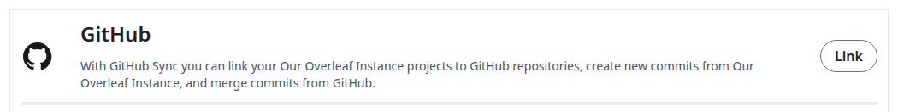
</Frame>
</Step>

<Step title="Authorize on GitHub">
GitHub opens. Sign in if you are asked to, then authorize the application.
</Step>

<Step title="Check the link">
You are back in the account settings, and the button now says **Unlink**.

<Frame caption="Your GitHub account is linked">
  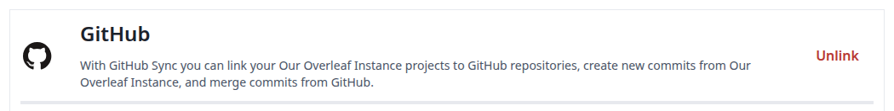
</Frame>
</Step>
</Steps>

If your account is not linked yet, **Import from GitHub** and the **GitHub** card in the editor ask you to link it first. Click **Link to your GitHub account**. You also end up in the account settings, in a new tab if you started in the editor. Then go back and start again.

<Frame caption="The prompt when your account is not linked">
  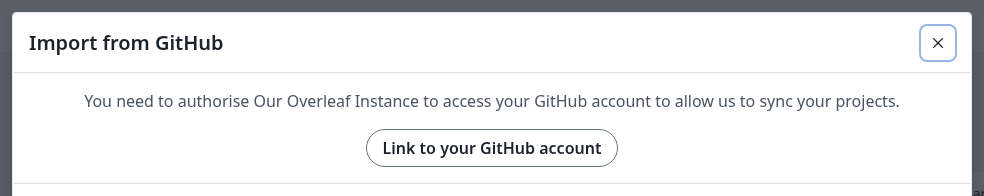
</Frame>

## Import a repository

This creates a new project from a GitHub repository, already linked to it.

<Steps>
<Step title="Open the import dialog">
On the projects page, click **New project**, then **Import from GitHub**.

<Frame caption="The New project menu">
  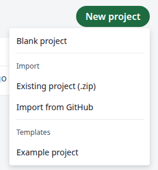
</Frame>

<Info>

**New project** appears once you have a project. The **Create a new project** menu on the welcome page has no import, so create a blank project first.

</Info>
</Step>

<Step title="Choose the repository">
Click **Import to Overleaf** next to the repository. The list includes your repositories and those of your organizations.

<Frame caption="Your GitHub repositories">
  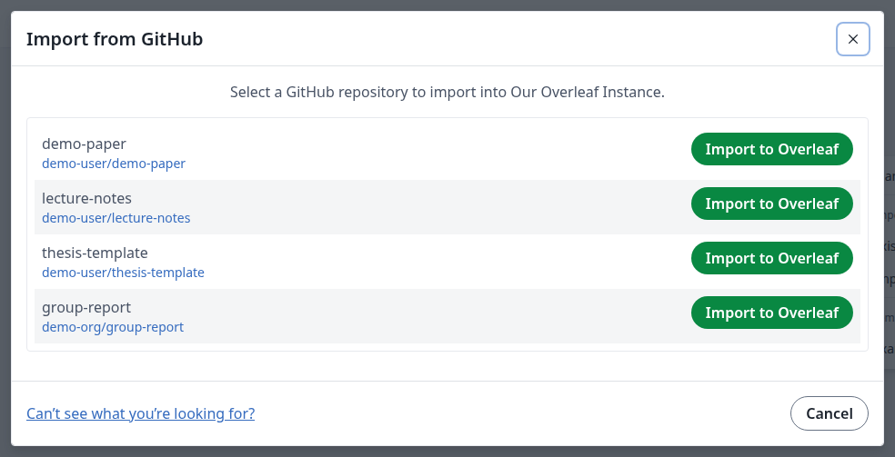
</Frame>

If an organization's repository is missing, click <strong>Can't see what you're looking for?</strong> for GitHub's help on approving the application for that organization.
</Step>

<Step title="Check the project">
The new project opens with the files of the repository.

<Frame caption="The imported project">
  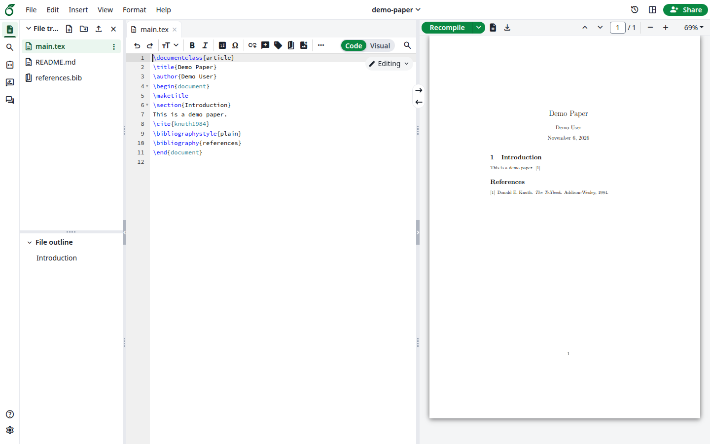
</Frame>
</Step>
</Steps>

## Export a project to a new repository

This creates a repository from a project you own and links them. A project can only be linked this way or by importing: you cannot link it to a repository that already exists.

<Steps>
<Step title="Open GitHub in the editor">
Open the project. In the left bar, click **Integrations**, then **GitHub**.

<Frame caption="The Integrations panel">
  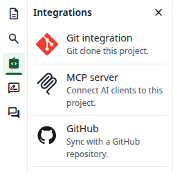
</Frame>
</Step>

<Step title="Fill in the repository">
Choose the **Owner**, which can be you or one of your organizations. **Repository Name** starts as the project's name. The description is optional, and **Private** is selected by default. Click **Create a GitHub repository**.

<Frame caption="Export Project to GitHub">
  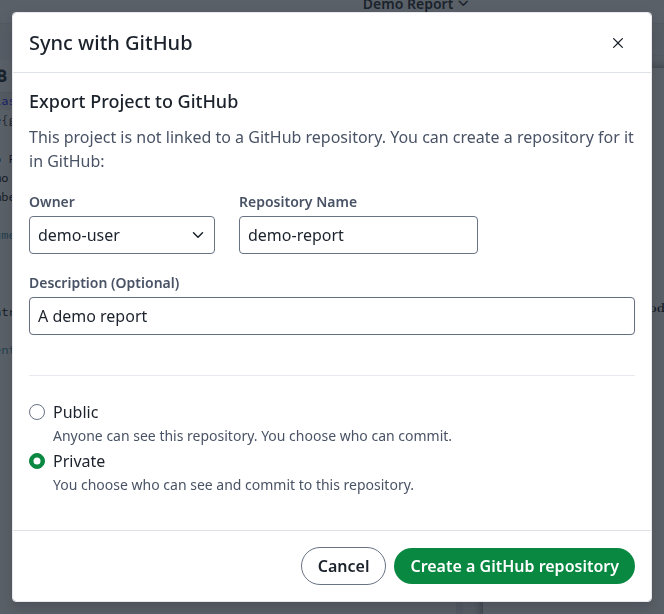
</Frame>
</Step>

<Step title="Check the link">
The dialog now says **This project is linked to** and names the repository.

<Frame caption="The project is linked">
  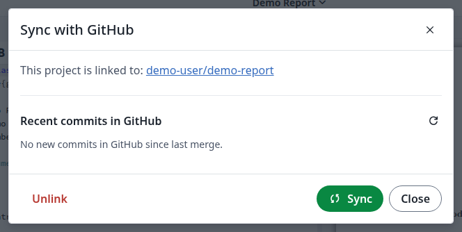
</Frame>
</Step>
</Steps>

## Sync

<Steps>
<Step title="Open the sync dialog">
Open a linked project. In the left bar, click **Integrations**, then **GitHub**.

**Recent commits in GitHub** lists what will come into the project.

<Frame caption="A new commit waiting in GitHub">
  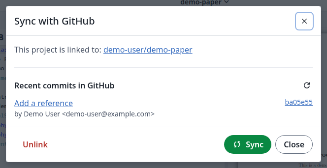
</Frame>
</Step>

<Step title="Describe your changes">
If you changed something in the project, a commit message box appears. It is optional: when you leave it empty, the commit is called `Updates from Overleaf`.

<Frame caption="The commit message for your changes">
  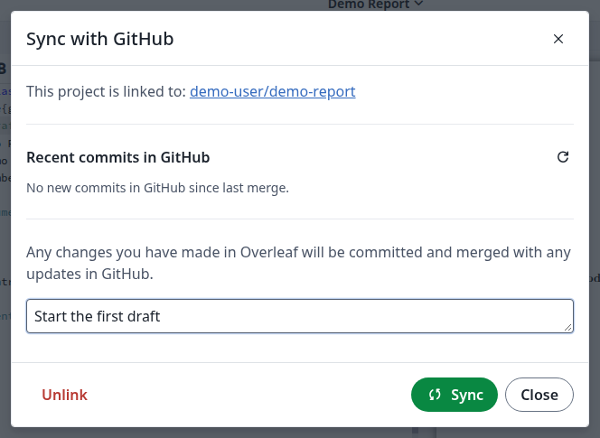
</Frame>
</Step>

<Step title="Click Sync">
Click **Sync**. New commits from GitHub come into the project, and your changes go to the default branch of the repository. If both sides changed different things, they are merged for you.
</Step>

<Step title="Check the result">
The dialog shows <strong>No new commits in GitHub since last merge.</strong> and the commit message box is gone. The files in the editor and the commits on GitHub are up to date.

<Frame caption="Everything is in sync">
  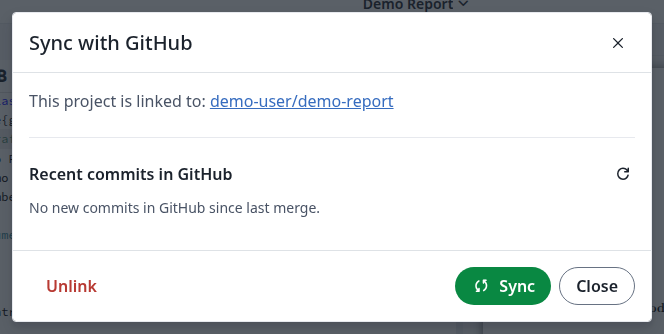
</Frame>
</Step>
</Steps>

### If the same lines changed on both sides

The dialog says the changes could not be merged and names a new branch, `overleaf-YYYY-MM-DD-HHMMSS`, which holds your changes.

<Frame caption="A conflict">
  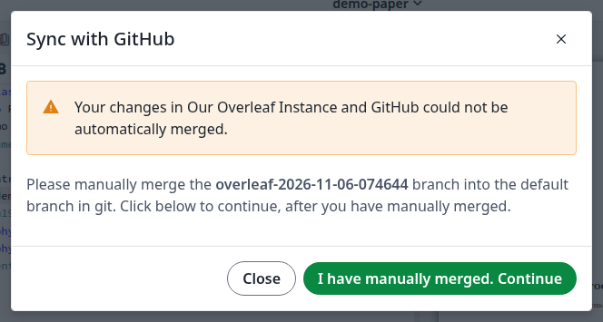
</Frame>

1. Merge that branch into the default branch on GitHub or with Git. You can close the dialog in the meantime: it shows the same message when you open it again.
2. Click **I have manually merged. Continue**. The merged result comes into the project.
3. The branch stays on GitHub. Delete it when you no longer need it.

## Unlink a project

Do this when you no longer want the project to sync. Only the project owner can.

<Steps>
<Step title="Click Unlink">
In the sync dialog, click **Unlink**.
</Step>

<Step title="Confirm">
Click **Confirm**. The note about a subscription does not stop you from linking the project again.

<Frame caption="Confirm the unlink">
  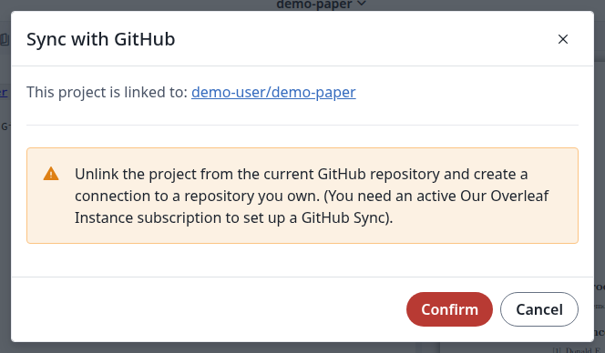
</Frame>
</Step>

<Step title="Check the result">
The dialog now shows **Export Project to GitHub**. The project and the repository both keep their content. To sync again, export the project to a new repository, or import the repository into a new project.
</Step>
</Steps>

## Unlink your GitHub account

In **Account settings**, under **GitHub**, click **Unlink**, then **Unlink** again in the dialog.

<Frame caption="Unlink your account">
  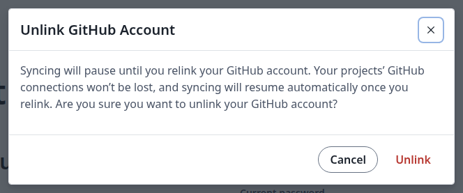
</Frame>

Your projects stay linked to their repositories. You cannot sync them until you link your account again.

<Info>

For who can do what in a shared project, see [Who can link and sync](/on-premises/configuration/overleaf-toolkit/integrations/github-synchronisation#who-can-link-and-sync). Every collaborator who syncs links their own GitHub account.

</Info>
