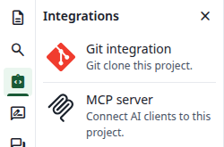
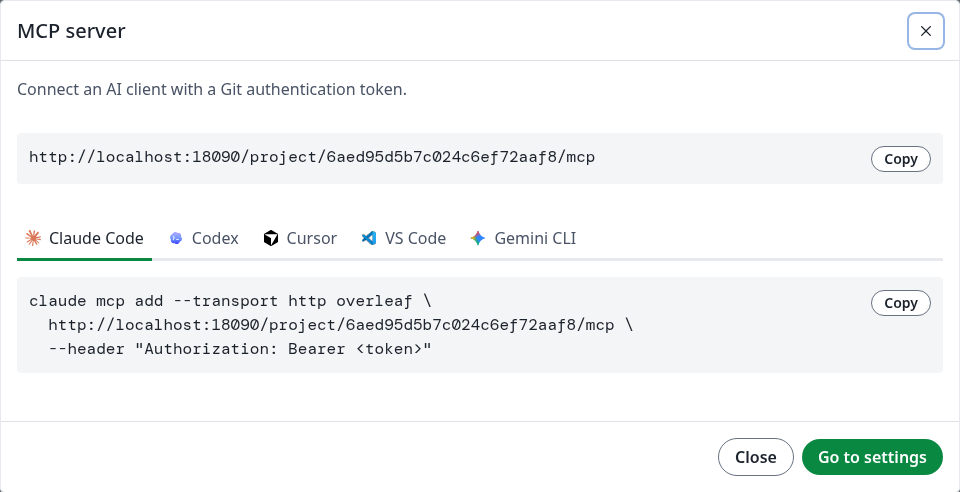
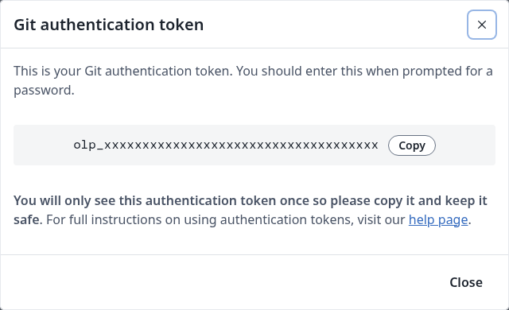
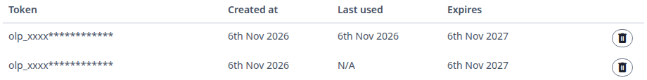
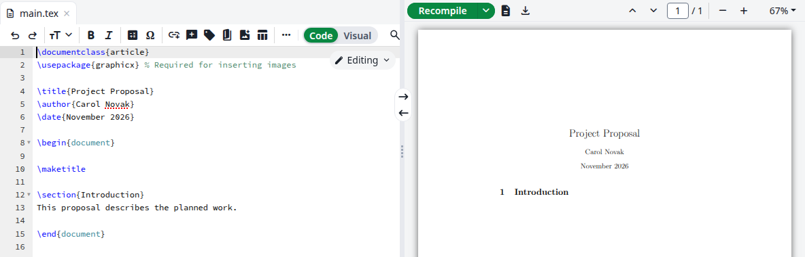
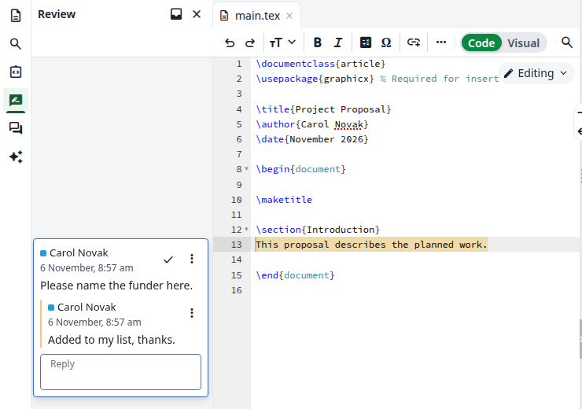

Each project has its own MCP server, so an AI client on your computer can read and edit the project, compile it and answer its comments. The client signs in with a Git authentication token.

<Info>

If you see no **MCP server** card, see [MCP Server](/on-premises/configuration/overleaf-toolkit/integrations/mcp-server) for your administrator.

</Info>

## Connect a client

<Steps>
<Step title="Open the dialog">
Open the project. In the left bar, click **Integrations**, then **MCP server**.

<Frame caption="The Integrations panel">
  
</Frame>

The dialog shows the address of this project's server and a tab for each client: **Claude Code**, **Codex**, **Cursor**, **VS Code** and **Gemini CLI**.

<Frame caption="The MCP server dialog">
  
</Frame>
</Step>

<Step title="Create a token">
Click **Go to settings**. Your account settings open in a new tab. Under **Git integration**, click **Generate token**, or **Add another token** if you already have one. Click **Copy** and keep the token somewhere safe, because you only see it once. Then click **Close**.

<Frame caption="Your new token">
  
</Frame>

A token you already use for [Git integration](/on-premises/user-guide/users/git-integration) works too, and so does one token for all your projects.
</Step>

<Step title="Add the server to your client">
Back in the dialog, click the tab of your client and click **Copy** next to the configuration.

| Tab | Where it goes | The token |
| --- | ------------- | --------- |
| **Claude Code** | Run the command in a terminal | Replace `<token>` in the command |
| **Codex** | `~/.codex/config.toml` | Put it in the environment variable `OVERLEAF_TOKEN` |
| **Cursor** | `~/.cursor/mcp.json` | Put it in the environment variable `OVERLEAF_TOKEN` |
| **VS Code** | `.vscode/mcp.json` | The file has a password prompt called `overleaf-token` instead of the token |
| **Gemini CLI** | Run the command in a terminal | Replace `<token>` in the command |

The address belongs to one project. To connect another project, add it under another name, because `overleaf` is taken. For Claude Code, for example, change `overleaf` in the command to `overleaf-lab`.
</Step>
</Steps>

## Check the connection

### With Claude Code

```bash
claude mcp list
```

The server is listed as connected:

```text
overleaf: https://<your-site>/project/<project-id>/mcp (HTTP) - ✔ Connected
```

### With curl

This works whatever your client is. Replace the address and the token, and send the `initialize` request of the MCP protocol:

```bash
curl -X POST https://<your-site>/project/<project-id>/mcp \
  -H "Authorization: Bearer <token>" \
  -H "Content-Type: application/json" \
  -H "Accept: application/json, text/event-stream" \
  -d '{"jsonrpc":"2.0","id":1,"method":"initialize","params":{"protocolVersion":"2025-06-18","capabilities":{},"clientInfo":{"name":"curl","version":"1.0"}}}'
```

The answer names the server, followed by its instructions for clients:

```json
{"result":{"protocolVersion":"2025-06-18","capabilities":{"tools":{"listChanged":true}},"serverInfo":{"name":"overleaf","version":"1.0.0"},"instructions":"This server works on one Overleaf project. ..."},"jsonrpc":"2.0","id":1}
```

To see the tools, send `tools/list` with the same command. The answer lists 17 tools.

```bash
  -d '{"jsonrpc":"2.0","id":2,"method":"tools/list","params":{}}'
```

To call one, send `tools/call`:

```bash
  -d '{"jsonrpc":"2.0","id":3,"method":"tools/call","params":{"name":"list_files","arguments":{}}}'
```

```json
{"result":{"content":[{"type":"text","text":"[\n  {\n    \"path\": \"main.tex\",\n    \"type\": \"doc\"\n  }\n]"}]},"jsonrpc":"2.0","id":3}
```

### In your account settings

Under **Git integration**, **Last used** shows the date for a token the server has received.

<Frame caption="The first token has been used">
  
</Frame>

### If it does not connect

| What you see | What it means |
| ------------ | ------------- |
| Status `401`, or in Claude Code `✘ Failed to connect` with `HTTP 401` | The token is missing, wrong or deleted |
| Status `404` | No project has this ID |
| Status `405` | The request was not a `POST` |
| Status `406` with `Not Acceptable` | The `Accept` header is missing: the client must accept both `application/json` and `text/event-stream` |

## What you see when a client works

Edits appear in an open editor as the client makes them, like a collaborator's, without reloading. New files and folders appear in the file tree.

<Frame caption="A line added by edit_file">
  
</Frame>

`edit_file` only changes text that appears exactly once. Otherwise the client gets an error, such as `oldString not found in main.tex, read_file again` or `oldString appears 2 times in main.tex, add context`, and nothing changes.

Replies to comments appear in the review panel under your name, because the token is yours. A comment resolved through the server leaves the panel, and reopening it brings it back.

<Frame caption="A reply sent by reply_to_comment">
  
</Frame>

`compile` compiles the project and returns the list of output files. `get_output_file_link` then gives a link to download the PDF or another output file. The link needs no token and stops working after 5 minutes.

For the full list of tools and what each role may do, see [Tools](/on-premises/configuration/overleaf-toolkit/integrations/mcp-server#tools) and [Permissions](/on-premises/configuration/overleaf-toolkit/integrations/mcp-server#permissions).

## Disconnect a client

Delete the token: see [Delete a token](/on-premises/user-guide/users/git-integration#delete-a-token). From then on, the server answers `401` to that token. If you also use it for Git, Git stops accepting it too.
