Import a Mendeley library into a project as a `.bib` file, then cite from it as usual. The file is a copy: it changes only when you click **Refresh**.

<Info>

If you see no Mendeley option in **Account settings**, ask your administrator to turn on [Mendeley Integration](/on-premises/configuration/overleaf-toolkit/integrations/mendeley-integration).

</Info>

## Link your Mendeley account

You do this once.

<Steps>
<Step title="Open your account settings">
Click **Account**, then **Account settings**. Under **Reference managers**, find **Mendeley** and click **Link to Mendeley**.

<Frame caption="Mendeley in the account settings">
  
</Frame>

The **Mendeley** card in the editor's **Integrations** panel takes you to the same place, in the same tab.

<Frame caption="The Integrations panel">
  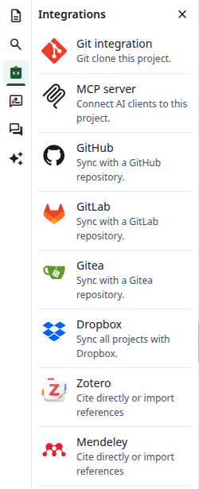
</Frame>
</Step>

<Step title="Authorize on Mendeley">
Mendeley opens. Sign in if you are asked to, then authorize the application.
</Step>

<Step title="Check the link">
You are back in the account settings. A green message says **Reference manager linked**, and the button now says **Unlink**.

<Frame caption="Your Mendeley account is linked">
  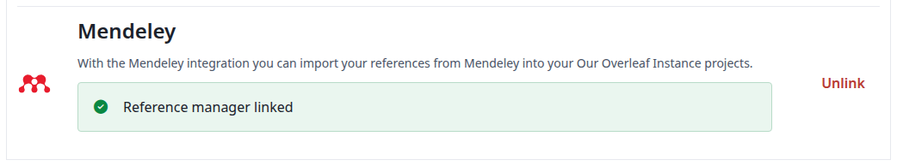
</Frame>
</Step>
</Steps>

If you do not allow access on Mendeley, the same section says **Sorry, something went wrong**. Click **Link to Mendeley** to try again.

## Create a file from your library

<Steps>
<Step title="Open the Add files dialog">
Open a project. In the file tree, click **New file**, then **From Mendeley**. This entry is only there once your account is linked.
</Step>

<Step title="Choose the file name and the library">
**File Name** starts as `mendeley.bib`. Keep the `.bib` ending: without it you get no preview, and neither `\cite` nor `\bibliography` finds its entries.

**Library** starts as **My Library**, and also lists your groups. One file holds one library.

<Frame caption="A file from your personal library">
  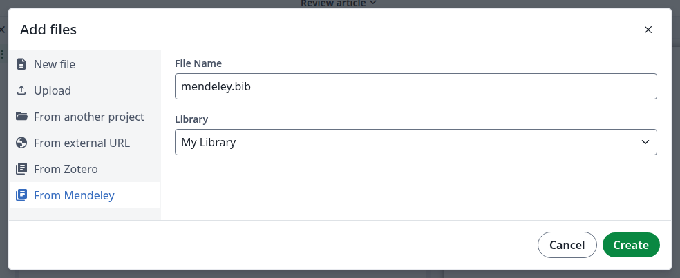
</Frame>
</Step>

<Step title="Click Create">
The dialog closes and the file is in the file tree. Click it: it shows when it was imported, and its entries. You cannot edit it in the editor.

<Frame caption="The imported file">
  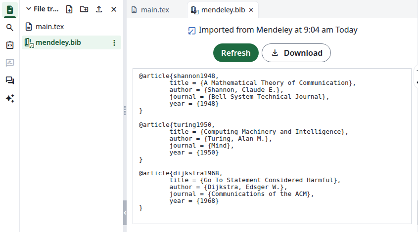
</Frame>

If **Create** seems to do nothing, a file with that name already exists. Choose another name.
</Step>
</Steps>

### Import a group

Do the same again, with a file name of its own, and choose the group under **Library**. A project can have several of these files.

<Frame caption="A file from a group">
  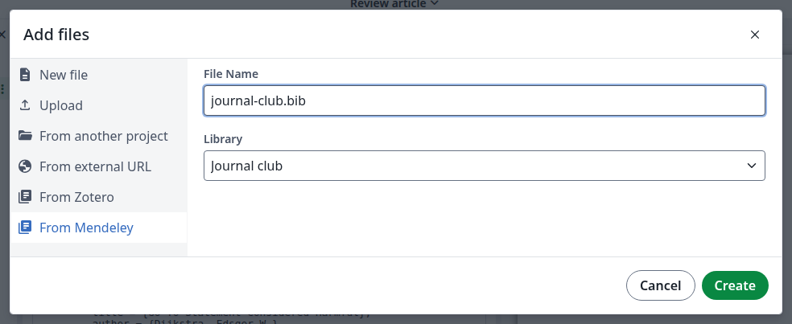
</Frame>

## Cite from the file

<Steps>
<Step title="Start a citation">
In a `.tex` file, type `\cite{`. The list shows the entries of all the `.bib` files in the project. Click one to insert it.

<Frame caption="The entries of the imported files">
  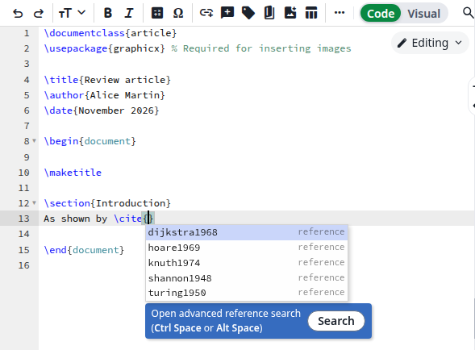
</Frame>
</Step>

<Step title="Or search by title or author">
Click **Search** under the list, or press Ctrl+Space inside the braces. Type to filter, click one or more entries, then click **Insert**.

<Frame caption="The reference search">
  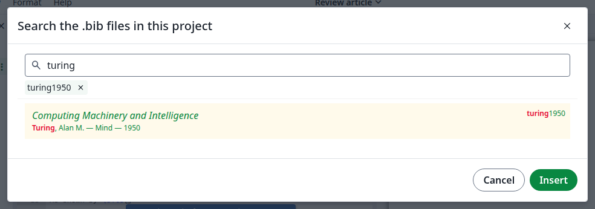
</Frame>
</Step>

<Step title="Add the bibliography">
Add these lines before `\end{document}`, using the name of your file without `.bib`. For several files, separate the names with commas.

```latex
\bibliographystyle{plain}
\bibliography{mendeley}
```

Click **Recompile**. The reference appears in the PDF.

<Frame caption="The compiled reference">
  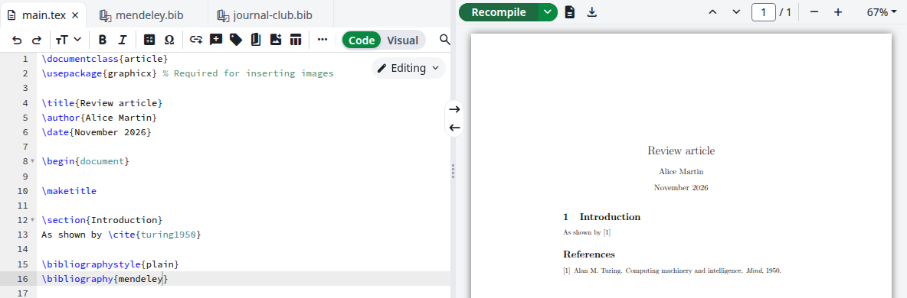
</Frame>
</Step>
</Steps>

Imported files are not offered in **Settings** under **References**, **Main bibliography file for this project**, so the list stays empty if the project has no other `.bib` file. You can still cite from them.

<Frame caption="The empty list is expected">
  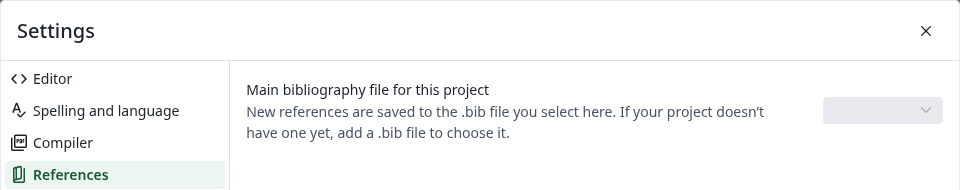
</Frame>

## Refresh the file

Changes in your Mendeley library do not reach the project on their own.

<Steps>
<Step title="Open the file">
In the file tree, click the imported file.
</Step>

<Step title="Click Refresh">
The whole file is imported again from the library you chose when you created it: new entries appear and removed ones disappear. The time at the top changes.

<Frame caption="The refreshed file">
  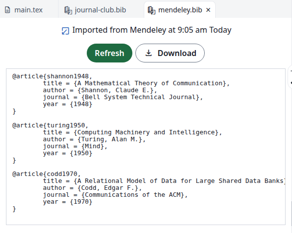
</Frame>
</Step>

<Step title="Recompile">
Click **Recompile** to update the PDF.
</Step>
</Steps>

Each file refreshes on its own: refresh your group's file separately. For who can refresh a file in a shared project, see the [notes for administrators](/on-premises/configuration/overleaf-toolkit/integrations/mendeley-integration#notes).

## Unlink your Mendeley account

In **Account settings**, under **Mendeley**, click **Unlink**, then **Unlink** again in the dialog. The button says **Link to Mendeley** again.

<Frame caption="Unlink your account">
  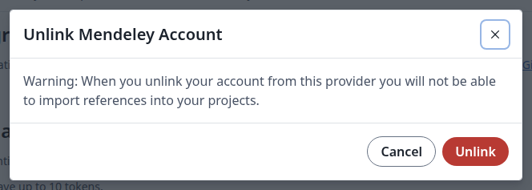
</Frame>

The files you imported stay in your projects and still compile. **From Mendeley** is gone from the **Add files** dialog, and **Refresh** shows an error until you link your account again.

<Frame caption="Refreshing without a linked account">
  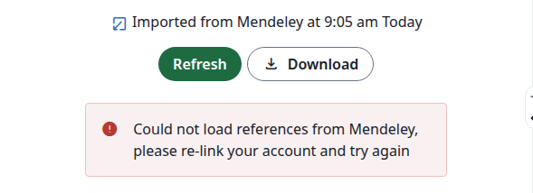
</Frame>

After you link again, **Refresh** works on the same files.

## If something goes wrong

**Could not load references from Mendeley, please re-link your account and try again**, or **There was an error accessing your Mendeley data** in the **Add files** dialog: Overleaf can no longer read your library, for example because you removed its access on Mendeley. In **Account settings**, click **Unlink**, then **Link to Mendeley**. **Create** also fails until then, with the message **The project that contains this file is not shared with you**, even in your own project.

<Frame caption="Overleaf can no longer read your library">
  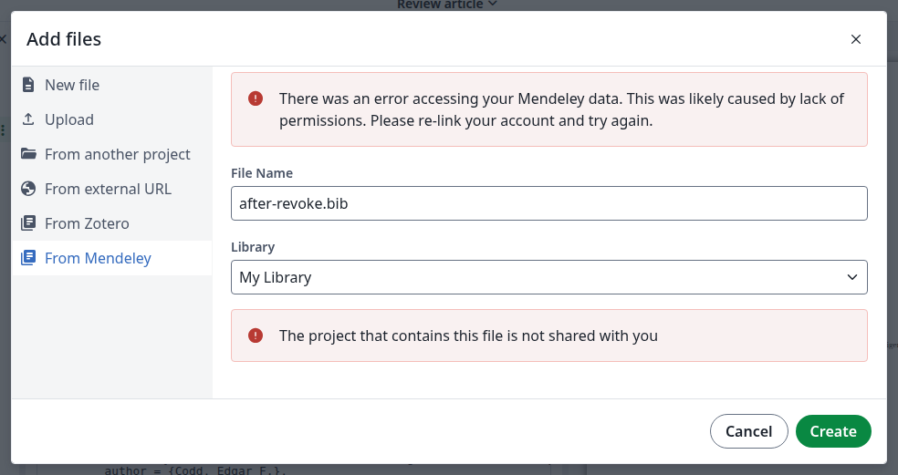
</Frame>

**The remote service produced an error** when you click **Refresh**: the request to Mendeley failed. The file keeps its content. Click **Refresh** again later.
