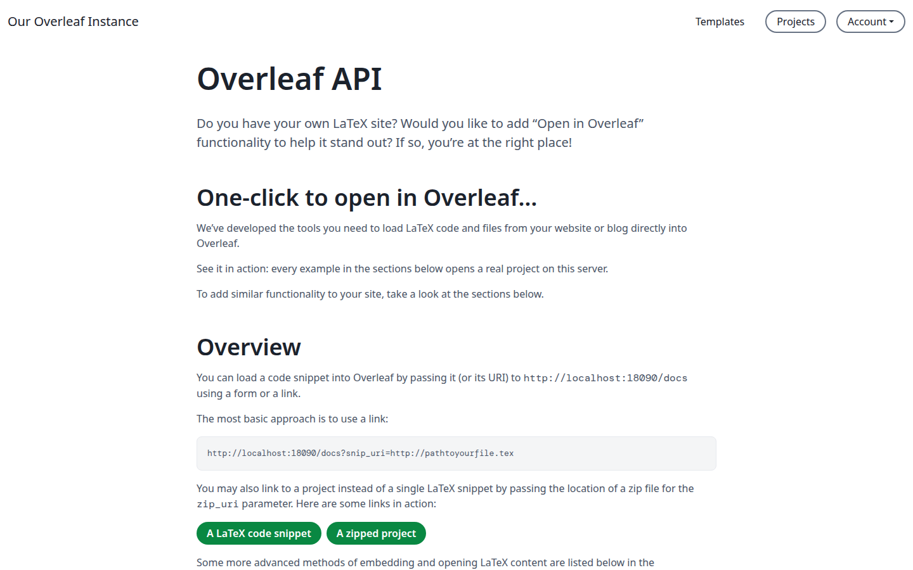
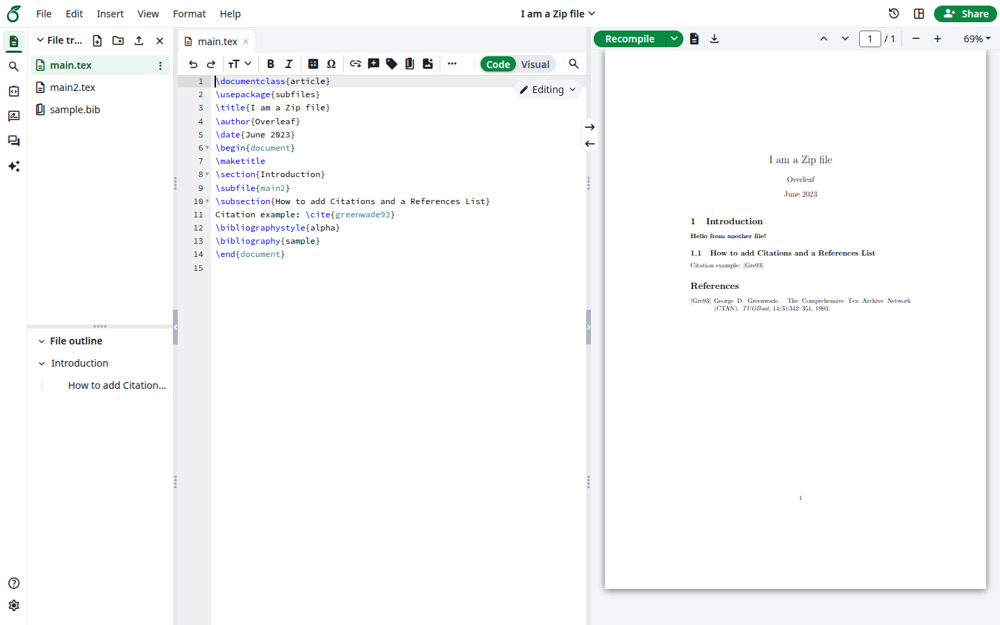
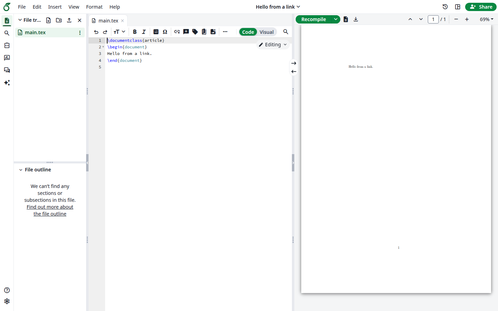
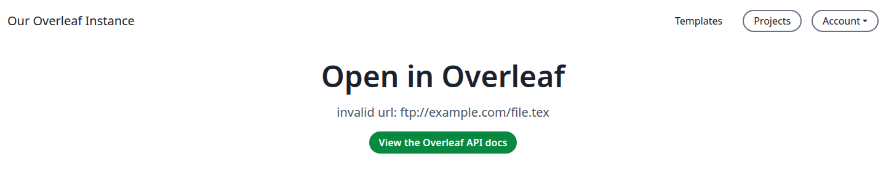

Put a link on your website, blog or course page. Anyone who clicks it gets a new project of their own with your files. Nothing needs to be set up.

Visitors need an account on your instance. A visitor who is not logged in goes to the login page first, and the project opens after logging in.

The pages of this feature use the name Overleaf. Your own link or button can say anything, such as **Open in Ayakaleaf**.

## See the examples

Open `/devs` on your site, for example `https://ayakaleaf.example.com/devs`. No menu links to this page, so type the address. By default you have to be logged in to see it.

<Frame caption="The Overleaf API page">
  
</Frame>

Click **A LaTeX code snippet** or **A zipped project**. A new project opens with the example.

<Frame caption="The project from the zipped example">
  
</Frame>

## Link to a file on your website

<Steps>
<Step title="Build the link">
Put the address of the file after `/docs?snip_uri=`, URL-encoded:

```text
https://ayakaleaf.example.com/docs?snip_uri=https%3A%2F%2Fexample.com%2Fmain.tex
```

For a zipped project, use `zip_uri`:

```text
https://ayakaleaf.example.com/docs?zip_uri=https%3A%2F%2Fexample.com%2Fproject.zip
```

Your instance downloads the file, so it must be reachable over HTTP or HTTPS. Addresses on a private network are refused, see [External URL](/on-premises/configuration/overleaf-toolkit/external-url).
</Step>

<Step title="Add it to your page">
```html
<a href="https://ayakaleaf.example.com/docs?snip_uri=https%3A%2F%2Fexample.com%2Fmain.tex">Open in Ayakaleaf</a>
```
</Step>

<Step title="Click it">
The new project opens in the editor, with a single file saved as `main.tex`.

<Frame caption="A project opened from a link">
  
</Frame>

Each click creates another project. The project is a copy, so later changes to your file do not reach it.
</Step>
</Steps>

## Put the file in the link

For a small file, you do not need to host anything: put its content in the link as a Base64 data URL. In JavaScript:

```javascript
const tex = '\\documentclass{article}\n\\begin{document}\nHello from a link.\n\\end{document}\n'
const link = 'https://ayakaleaf.example.com/docs?' + new URLSearchParams({
  snip_uri: 'data:application/x-tex;base64,' + btoa(tex),
  name: 'Hello from a link',
})
```

`btoa` only takes Latin-1 characters, so encode other text as UTF-8 first. For a zipped project, use `zip_uri` and `data:application/zip;base64,`.

A link longer than about 8 KB is refused with the error **414 Request-URI Too Large**. For anything bigger, host the file or use a [form](#use-a-button-instead-of-a-link).

## Choose the options

Add these to the link, or to the form as hidden fields:

| Parameter                   | What it does                                                                                                                 | Example                                            |
| --------------------------- | ---------------------------------------------------------------------------------------------------------------------------- | -------------------------------------------------- |
| `name`                      | Names the project. Without it, a zipped project takes the name in its `\title`, anything else is `Open in Overleaf project`. | `name=My%20notes`                                  |
| `engine`                    | Sets the compiler: `latex_dvipdf`, `pdflatex`, `xelatex` or `lualatex`.                                                      | `engine=xelatex`                                   |
| `main_document`             | Sets the main `.tex` file, which opens first.                                                                                | `main_document=thesis.tex`                         |
| `snip_uri[]`, `snip_name[]` | Imports several files, each with its own name, in the same order.                                                            | `snip_uri[]=.../a.tex&snip_name[]=a.tex`           |

A `.tex` file without `\documentclass` is wrapped in a standard document, so it compiles right away:

```latex
\documentclass[12pt]{article}
\usepackage[english]{babel}
\usepackage{amsmath}
\usepackage{tikz}
\begin{document}
Your file
\end{document}
```

## Use a button instead of a link

A form sends the same parameters as a link:

```html
<form action="https://ayakaleaf.example.com/docs" method="post" target="_blank">
  <input type="hidden" name="snip_uri" value="https://example.com/main.tex">
  <input type="hidden" name="engine" value="xelatex">
  <button type="submit">Open in Ayakaleaf</button>
</form>
```

To send the LaTeX itself, use `snip` for plain text or `encoded_snip` for text passed through `encodeURIComponent`.

A form does not always work, which is why a link is the better choice unless your file is too long for one:

| Where the form is                                     | Visitor is logged in            | Visitor is not logged in        |
| ----------------------------------------------------- | ------------------------------- | ------------------------------- |
| On the same domain as your instance, or a subdomain   | The project opens               | Login page, and no project      |
| On another domain                                     | Login page, and no project      | Login page, and no project      |

If your administrator sets `OVERLEAF_ALLOW_PUBLIC_ACCESS=true`, the project opens in all these cases, after logging in if needed. That setting also opens other pages to signed-out visitors, see [Page Access](/on-premises/configuration/overleaf-toolkit/authentication/public-access#page-access).

For the rest of what administrators can set, see [Overleaf Import API](/on-premises/configuration/overleaf-toolkit/integrations/overleaf-import-api). The `/devs` page has more examples.

## If the project does not open

The page says what went wrong. **View the Overleaf API docs** takes you to `/devs`.

<Frame caption="A link the instance cannot use">
  
</Frame>

| Message                                      | Why                                                 | What to do                                  |
| -------------------------------------------- | --------------------------------------------------- | ------------------------------------------- |
| `no snippet, snip_uri or zip_uri provided`   | The link has none of these                          | Check the parameter names                   |
| `invalid url: ...`                           | The address does not start with HTTP or HTTPS       | Use an HTTP or HTTPS address, or a data URL |
| `could not download ... (HTTP 404)`          | The file is not at that address                     | Check the address                           |
| `could not download ... (HTTP 403)`          | The address is on a private network                 | Host the file where your instance may reach it |
| `zip_uri did not resolve to a zip archive`   | The file behind `zip_uri` is not a zip file         | Check the file                              |
| `invalid base64 data url`                    | The data URL is damaged                             | Encode the file again and URL-encode the link |
