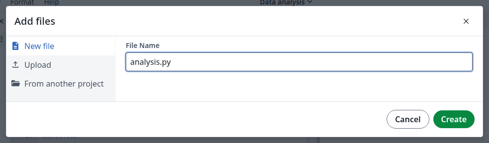
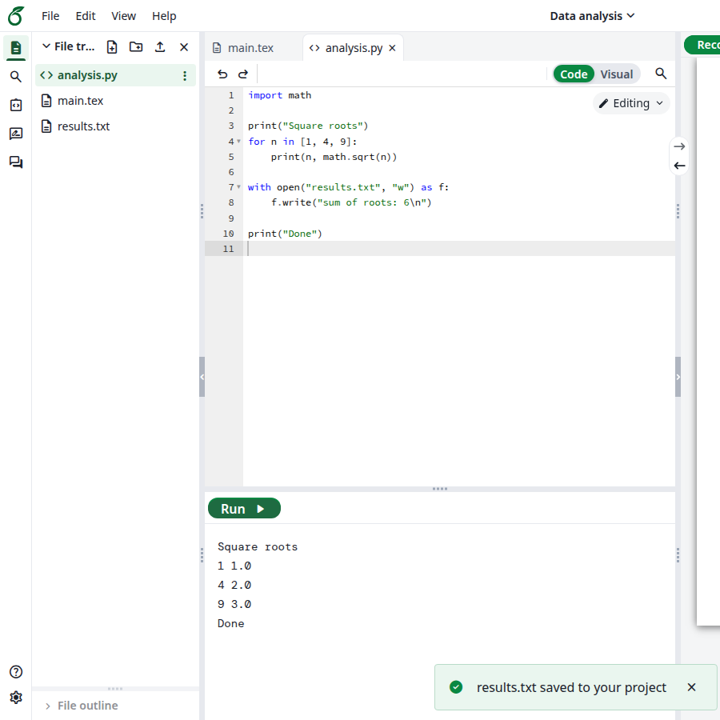
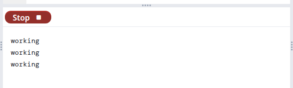
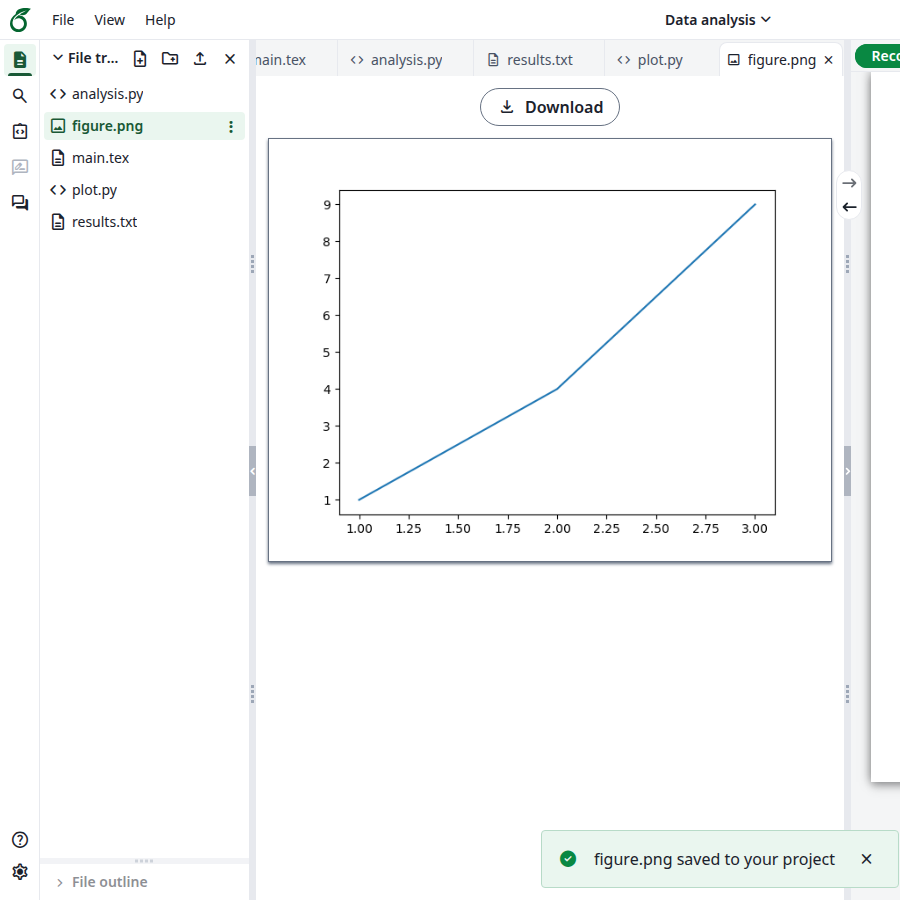
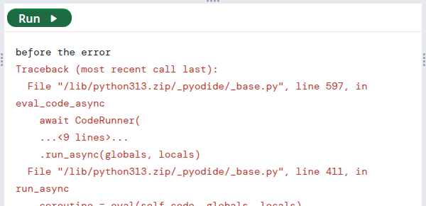
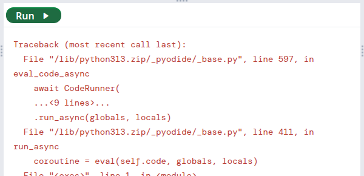

Python scripts run in your browser, so the output appears right below the editor. Nothing needs to be set up.

<Steps>
<Step title="Create a script">
In the file tree, click the **New file** icon. Enter a name that ends in `.py` and click **Create**.

<Frame caption="A new Python file">
  
</Frame>

The **Run** button and an output pane appear below the editor. The first time, the button stays disabled while Python loads.
</Step>

<Step title="Run it">
Write your code and click **Run**. What the script prints appears in the output pane. You don't have to save first.

Files the script writes go into your project. A message tells you which, for example **results.txt saved to your project**, and the file appears in the file tree.

<Frame caption="The output and a saved file">
  
</Frame>
</Step>

<Step title="Stop a script">
While a script runs, **Run** becomes **Stop**. Click it to interrupt the script. The output pane ends with **Execution interrupted**.

<Frame caption="A running script">
  
</Frame>
</Step>
</Steps>

## Use a figure in your document

Plots have no window to appear in, so save them to a file. For example:

```python
import matplotlib.pyplot as plt

plt.plot([1, 2, 3], [1, 4, 9])
plt.savefig("figure.png")
```

`figure.png` appears in your project, ready for `\includegraphics{figure.png}`.

<Frame caption="A saved plot">
  
</Frame>

## Read your project's files

A script can open the files of your project by their path:

```python
print(open("results.txt").read())
```

## If something goes wrong

<strong>The script raises an error.</strong> The error appears in red in the output pane, after anything the script printed before it.

<Frame caption="An error in a script">
  
</Frame>

<strong>`ModuleNotFoundError: No module named ...`.</strong> Only the packages built into Pyodide are available, and packages installed with `pip` cannot be used. NumPy and Matplotlib are among those available, and the message links to the [full list](https://pyodide.org/en/stable/usage/packages-in-pyodide.html).

<Frame caption="A package that is not available">
  
</Frame>
