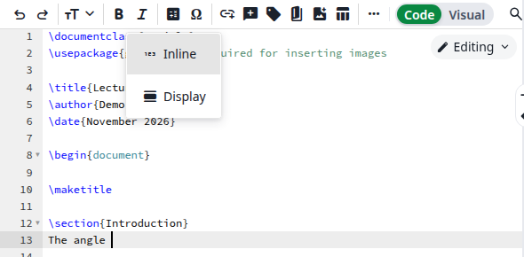
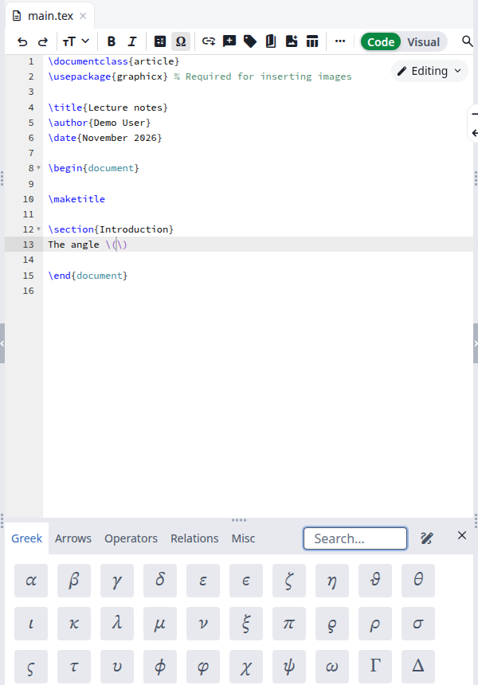
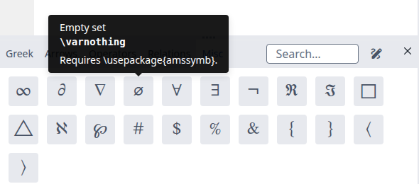
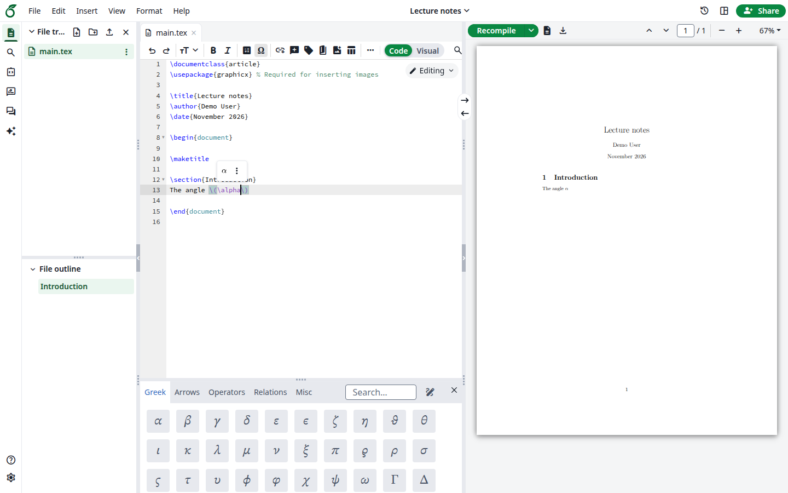
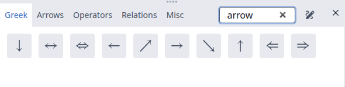
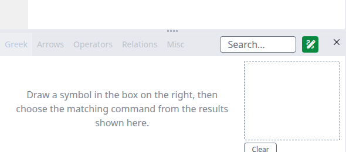
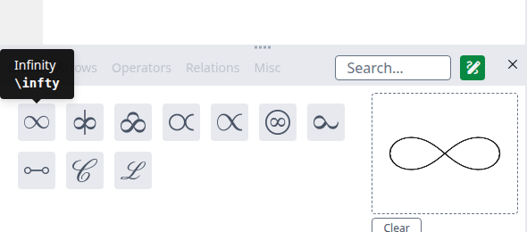
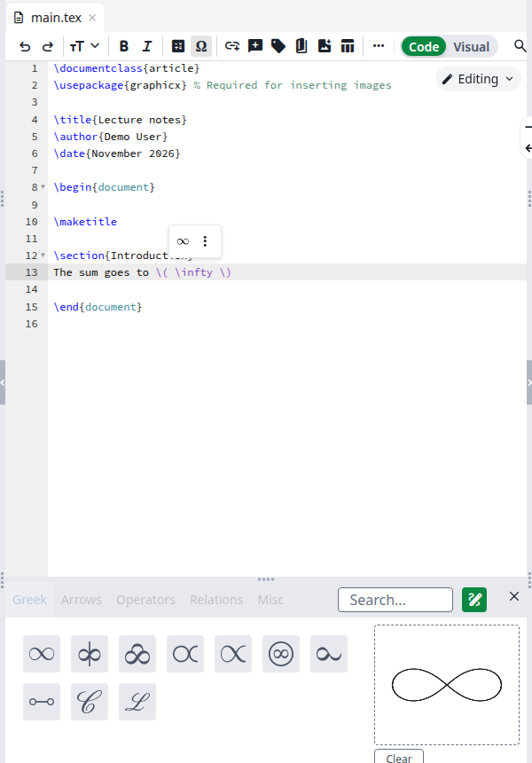
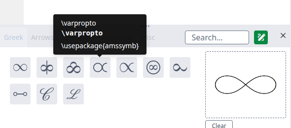

The symbol palette inserts math symbols into your document. If you do not know a symbol's name, draw it and your browser finds the command. Nothing needs to be set up.

## Insert a symbol

<Steps>
<Step title="Put the cursor inside math">
Most symbols only work inside math. Click where the symbol should go. In the editor toolbar, click **Insert math**, then **Inline**. The cursor is now between `\(` and `\)`.

<Frame caption="The Insert math menu">
  
</Frame>
</Step>

<Step title="Open the palette">
In the toolbar, click the **Ω** button, **Insert symbol**. You can also click **Insert**, then **Symbol**, at the top of the page. The palette opens below the editor.

<Frame caption="The symbol palette">
  
</Frame>
</Step>

<Step title="Find the symbol">
Click a tab: **Greek**, **Arrows**, **Operators**, **Relations** or **Misc**. Hold the pointer over a symbol to see its name and command. Some also show a note, such as the package they need.

<Frame caption="The name, command and note of a symbol">
  
</Frame>
</Step>

<Step title="Click it">
The command appears at the cursor. The palette stays open, so you can add the next symbol right away. Click **Recompile** to see the symbol in the PDF.

<Frame caption="The symbol in the document and the PDF">
  
</Frame>
</Step>
</Steps>

The palette works the same way in the **Visual** editor.

## Search for a symbol

Type in the **Search** box. You can search for a command (`\sum`), a word from the symbol's name (`arrow`), or the character itself (`α`). The search covers all the tabs. Clear the box to go back to the tabs.

<Frame caption="Searching for arrow">
  
</Frame>

If nothing matches, the palette shows **No symbols found**.

## Draw a symbol

Use this when you can picture a symbol but do not know its name.

<Steps>
<Step title="Click the pencil icon">
Click the pencil icon, **Draw a symbol**, to the right of the **Search** box. The tabs are greyed out and a dashed box appears on the right.

<strong>Loading model…</strong> shows until the recognition is ready. The first time, your browser downloads about 40 MB from your site. After that it keeps these files.

<Frame caption="Draw mode">
  
</Frame>
</Step>

<Step title="Draw in the dashed box">
When you finish a stroke, up to ten matches appear on the left, the closest first. Hold the pointer over one to see its command. A symbol with several strokes updates the matches after each stroke.

<Frame caption="The matches for a drawing">
  
</Frame>
</Step>

<Step title="Click the match">
The command appears at the cursor. Your drawing stays, so you can try another match. Click **Clear** before you draw the next symbol.

<Frame caption="The command at the cursor">
  
</Frame>
</Step>
</Steps>

To go back to the tabs, click the pencil icon again or click the **Search** box.

The recognition runs in your browser. Your drawing is not sent to your site.

### Matches that need a package

Drawing knows more than 1,300 commands, while the tabs list 117. Many of the others come from a LaTeX package. In that case the tooltip shows the line to add.

<Frame caption="A match that needs a package">
  
</Frame>

Add the line to your preamble, before `\begin{document}`:

```latex
\usepackage{amssymb}
```

The palette does not add it for you.

## Use the keyboard

From the **Search** box, press Tab until a symbol is selected. The arrow keys move between symbols. Enter inserts the selected symbol and closes the palette.

## Close the palette

Click the <strong>×</strong> at the top right of the palette. The **Ω** button and **Insert**, then **Symbol**, also close it.

## If something goes wrong

| What you see | Why | What to do |
| ------------ | --- | ---------- |
| The compile says **Missing \$ inserted** | The symbol is outside math | Move it between `\(` and `\)`, or use **Insert math** first |
| The compile says **Undefined control sequence** | The command needs a package | Hold the pointer over the symbol in the palette to see which one, and add it to your preamble |
| There is no pencil icon | Your browser cannot run the recognition, for example Safari 15 | Update your browser or use another one. The tabs and the search still work |
| **Recognition unavailable** below the dashed box | The browser could not load the recognition files | Click **Please try again** |
