Templates are projects that your administrator published. Opening one gives you a new project of your own.

<Info>

If you see no **Templates** link, ask your administrator to turn on the [Template Gallery](/on-premises/configuration/overleaf-toolkit/templates).

</Info>

## Open the gallery

On the projects page, click **Templates** at the top right.

<Frame caption="The Templates link">
  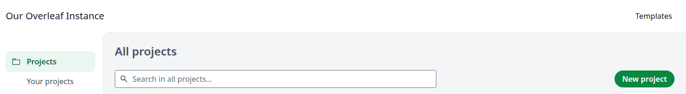
</Frame>

The **All templates** page opens, with the most recently updated templates first.

<Frame caption="All templates">
  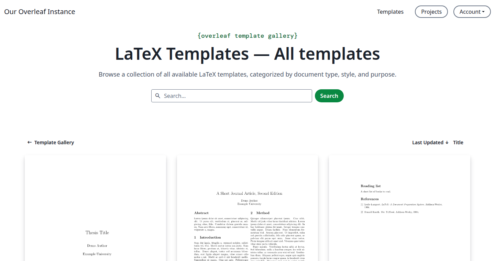
</Frame>

If you have no projects yet, click **Browse templates** on the welcome page.

<Frame caption="The welcome page">
  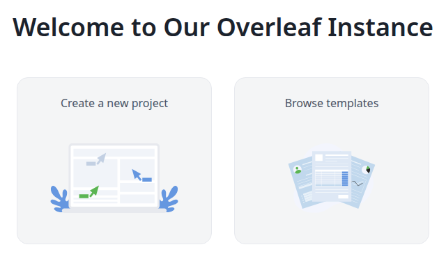
</Frame>

If you have projects, you can also click **New project**, then **More templates**, then a category.

<Frame caption="More templates">
  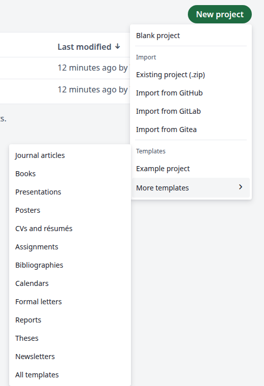
</Frame>

By default the gallery needs a login: if someone sends you a link to a template and you are not logged in, you go to the login page first, then to the template.

## Find a template

**Search** in the box. The list updates as you type and matches the title, author and description. If nothing matches, the page shows <strong>No Templates.</strong>

<Frame caption="Searching for slides">
  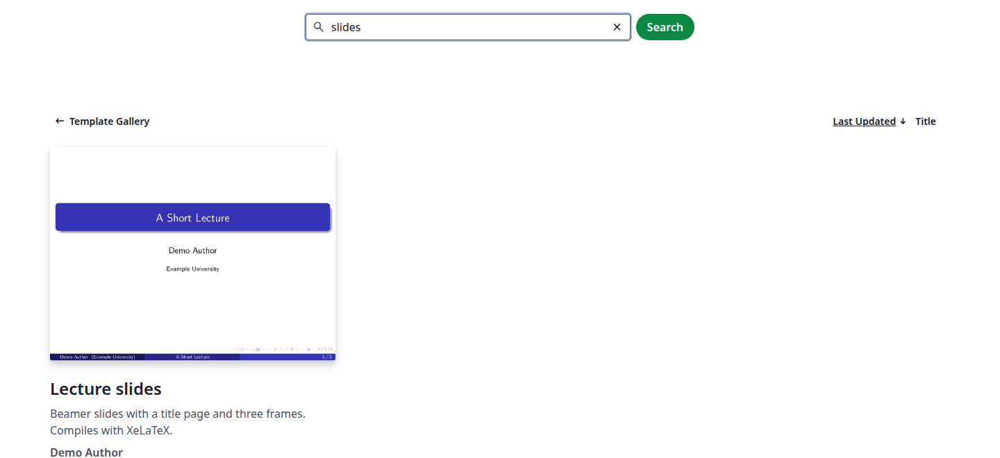
</Frame>

**Sort** with **Last Updated** or **Title**, on the right above the list. Click the one in use again to reverse the order.

**Change page** below the list. A page shows nine templates.

<Frame caption="The page buttons">
  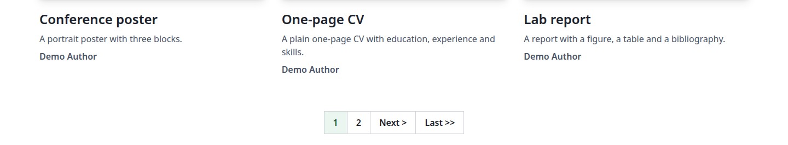
</Frame>

<strong>Browse by category:</strong> click **Template Gallery** on the **All templates** page. The gallery page has a card for each category, with all templates below them.

<Frame caption="The categories">
  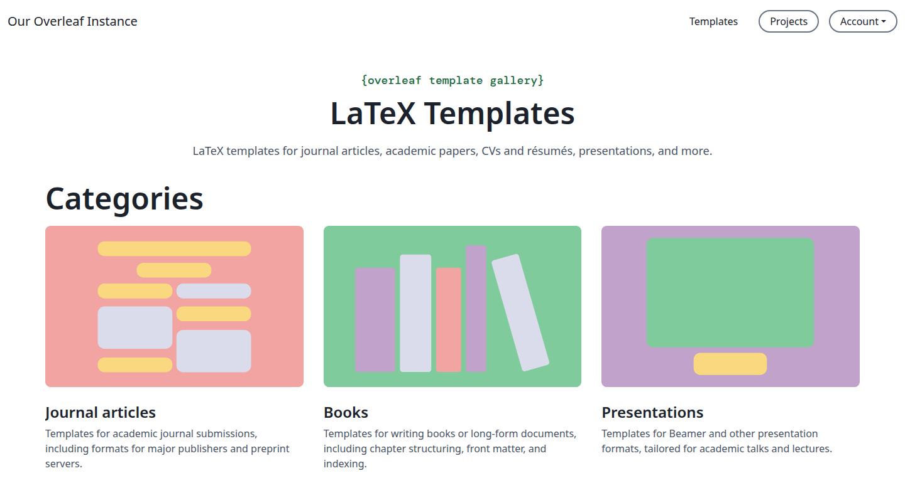
</Frame>

Click a card to see the templates of that category. You can search and sort here too, and **All templates** takes you back.

<Frame caption="A category page">
  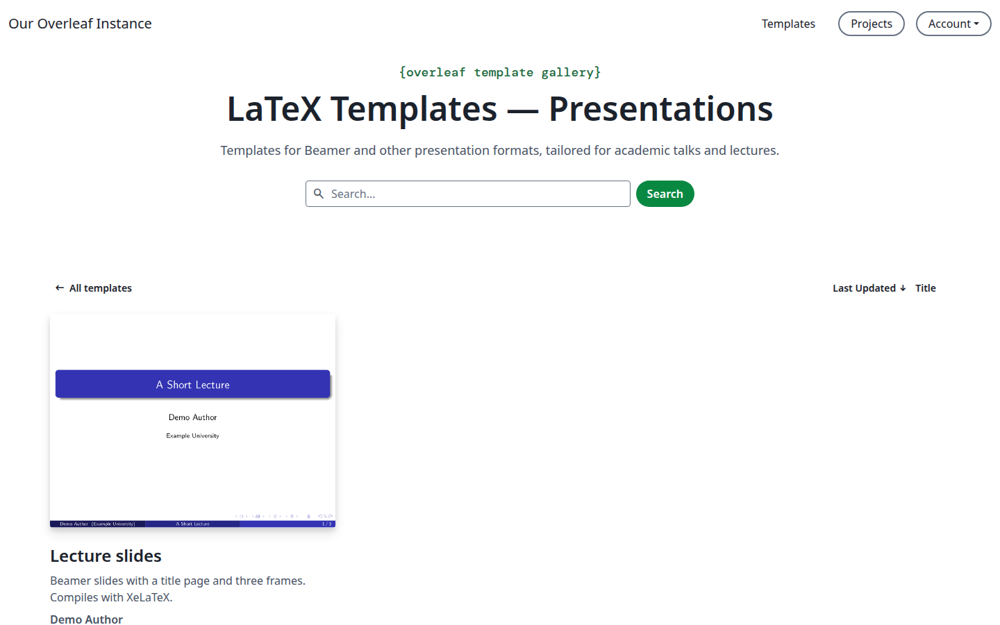
</Frame>

## Open a template as a new project

<Steps>
<Step title="Open the template">
Click a template. You see a preview of its first page, the author, the last update, the license and the abstract.

<Frame caption="The template page">
  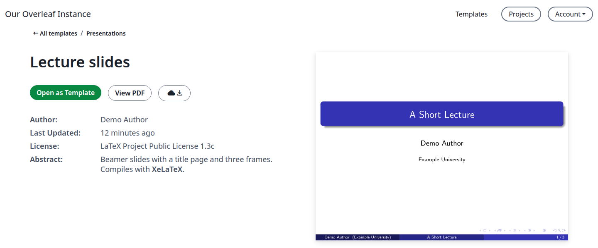
</Frame>

**View PDF** opens the whole PDF. The button next to it downloads the files as a zip.
</Step>

<Step title="Click Open as Template">
After a short loading screen, the editor opens with your new project.

<Frame caption="Your new project">
  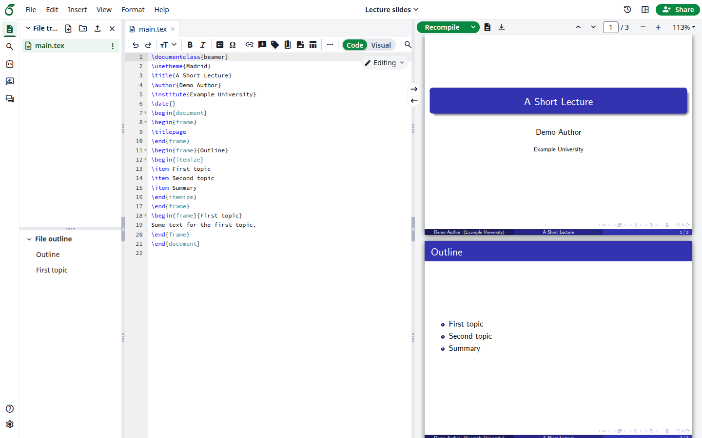
</Frame>
</Step>

<Step title="Check the project">
The project has the name and the files of the template, and the same compiler and main document. It compiles when it opens, and you are its owner in the projects list.

Opening the same template again creates another project, such as `Journal article (1)`.

<Frame caption="Each opening creates a project">
  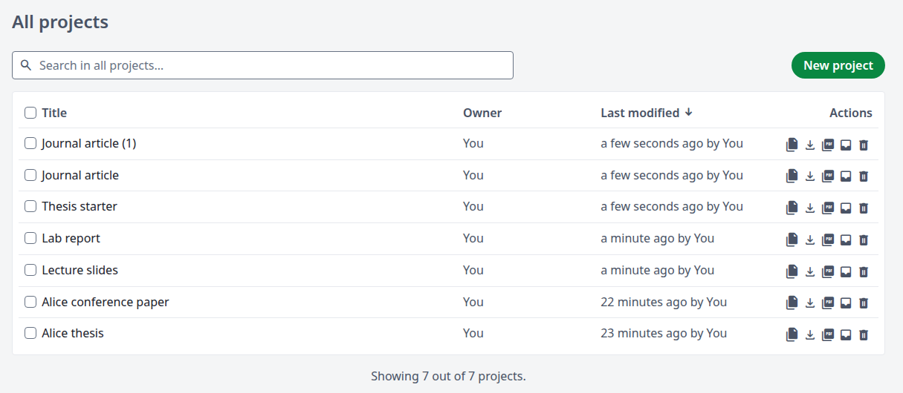
</Frame>
</Step>
</Steps>

Your project does not depend on the template: it stays as it is when the template is updated or deleted.

<Info>

A normal account cannot publish or change templates: the **File** menu has no **Manage Template**, and the template page has no **Edit** or **Delete**. To add a template to the gallery, ask your administrator.

</Info>
