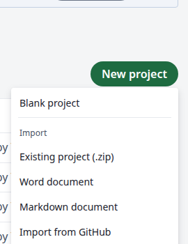
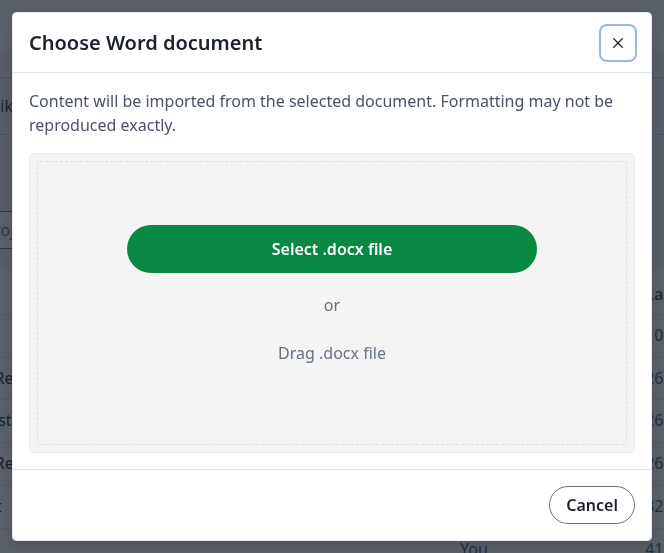
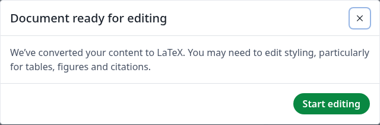
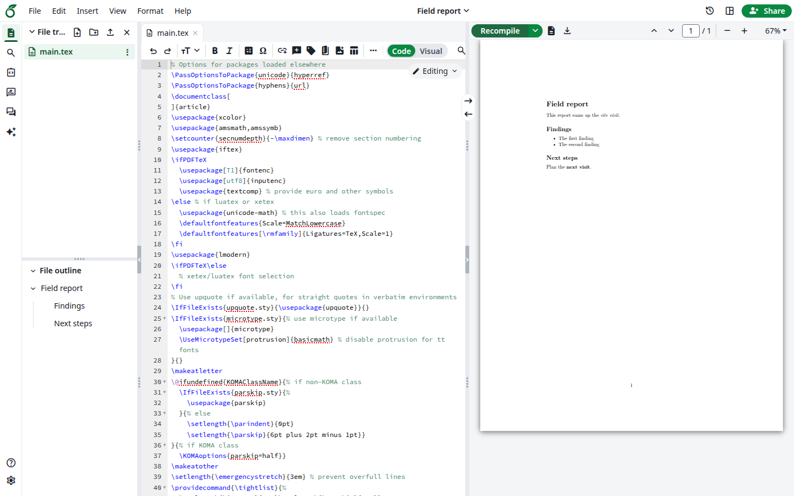
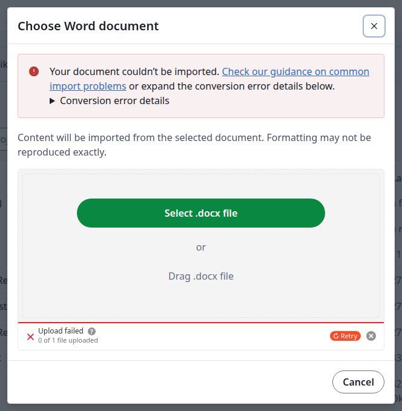
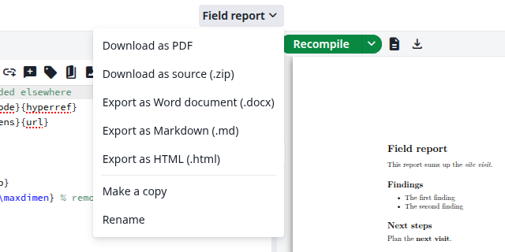

<Info>

If you do not see these options, ask your administrator to turn on [Pandoc Import and Export](/on-premises/configuration/overleaf-toolkit/pandoc-import-and-export).

</Info>

## Import a document

This creates a new LaTeX project from a Word document (`.docx`) or a Markdown file (`.md`). The project's name comes from the file's name.

<Steps>
<Step title="Open the import dialog">
On the projects page, click **New project**. Under **Import**, click **Word document** or **Markdown document**.

<Frame caption="The New project menu">
  
</Frame>
</Step>

<Step title="Choose the file">
Click **Select .docx file**, or drag the file into the dialog. For Markdown, the button is **Select .md file**. The import starts right away.

<Frame caption="Choosing a Word document">
  
</Frame>
</Step>

<Step title="Start editing">
The new project opens with the message **Document ready for editing**. Click **Start editing**.

<Frame caption="The import has finished">
  
</Frame>
</Step>

<Step title="Check the result">
The document is now in `main.tex`, with its headings in the file outline. Click **Recompile** to see the PDF. Check the styling, particularly tables, figures and citations, which may need editing.

<Frame caption="The imported project">
  
</Frame>
</Step>
</Steps>

### If the import fails

If the file cannot be converted, the dialog says **Your document couldn't be imported**. Expand **Conversion error details** to see why. No project is created.

<Frame caption="A document that could not be imported">
  
</Frame>

The dialog only takes the type you chose. A `.md` file in the Word dialog shows **You can only upload: .docx**.

## Export a project

Open the project, then click its name at the top of the editor. Click one of these:

| Option                              | You get                                       |
| ----------------------------------- | --------------------------------------------- |
| <strong>Export as Word document (.docx)</strong> | A `.docx` file named after the project        |
| <strong>Export as Markdown (.md)</strong>        | A `.zip` file with `main.md`                  |
| <strong>Export as HTML (.html)</strong>          | A `.zip` file with `main.html`                |

The download starts by itself. The conversion can't reproduce all LaTeX formatting, so check the result.

<Frame caption="The export options">
  
</Frame>
