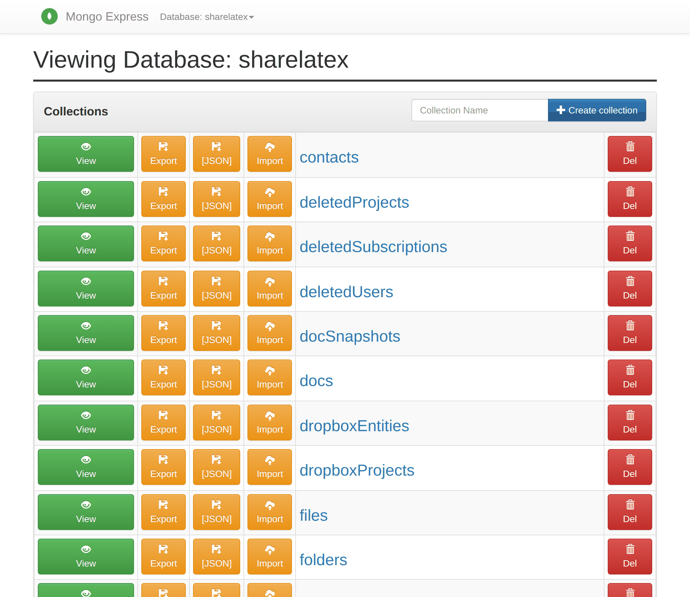

## Zalecane narzędzia deweloperskie {#develop-tools-recommended}

Te opcjonalne usługi nie są potrzebne do uruchomienia Overleaf, ale bardzo pomagają przy tworzeniu, debugowaniu i przeglądaniu danych. Wszystkie są częścią środowiska deweloperskiego, więc nie trzeba niczego dodawać do `docker-compose.yml`. Po zalogowaniu się do witryny menu **Dev tools** na jej pasku nawigacji prowadzi do narzędzi, które witryna udostępnia pod własnymi ścieżkami.

| Narzędzie | Adres | Zdefiniowane w |
| --- | --- | --- |
| **Grafana**, stan, metryki i logi każdej usługi | [http://localhost/grafana/](http://localhost/grafana/) | `develop/grafana/docker-compose.yml`, włączone przy `GRAFANA_ENABLED=true` w `develop/dev.rc` (domyślnie) |
| **Mailpit**, skrzynka odbiorcza na każdy e-mail wysłany przez witrynę | [http://localhost/mailpit/](http://localhost/mailpit/) | `develop/mail/docker-compose.yml`, włączone przy `MAILPIT_ENABLED=true` (domyślnie) |
| **Mongo Express**, interfejs do MongoDB | [http://localhost/mongo-express/](http://localhost/mongo-express/) | `develop/docker-compose.yml`, zawsze włączone |
| **RedisInsight**, interfejs do danych Redis | [http://localhost/redis-insight/](http://localhost/redis-insight/) | `develop/docker-compose.yml`, zawsze włączone |
| **Hoppscotch**, przeglądarkowy klient API podobny do Postmana | [http://localhost:9170](http://localhost:9170/) (`HOPPSCOTCH_PORT`) | `develop/hoppscotch/docker-compose.yml`, włączone przy `HOPPSCOTCH_ENABLED=true` (domyślnie) |

<Warning>

Żadne z tych narzędzi nie ma logowania: anonimowi użytkownicy Grafany są jej administratorami, a Mongo Express może zmienić dowolny dokument. Witryna, Hoppscotch, Mongo Express (8081) i RedisInsight (5540) nasłuchują tylko na `127.0.0.1` hosta, więc inne hosty nie mają do nich dostępu.

</Warning>

### Grafana {#grafana}

Grafana jest udostępniana przez witrynę pod `/grafana/` przez webpack-dev-server, więc nie potrzebuje własnego portu. Jej folder **Overleaf Develop** zawiera te pulpity:

| Pulpit | Co pokazuje |
| --- | --- |
| All services (strona główna) | Stan każdej usługi, wskaźniki hosta, obciążenie i logi. Kliknięcie usługi otwiera jej pulpit |
| Server | CPU, obciążenie, pamięć, dysk i sieć hosta oraz kompilacje clsi |
| Errors | Logi błędów, odpowiedzi 5xx i 4xx, najczęstsze komunikaty błędów i zawodzące trasy |
| Data flow | Droga edycji: document-updater i Redis, project-history, history-v1, Mongo, magazyn obiektów |
| Containers | Stan każdego kontenera, CPU, pamięć, sieć i dysk, łącznie z kompilacjami w piaskownicy |
| Jeden na usługę | Usługi Node.js, git-bridge (JVM), mongo i redis |

<Columns cols={2}>
<Column>

<Frame caption="All services: stan każdej usługi, host i zasoby używane przez każdą usługę">
  
</Frame>

</Column>

<Column>

<Frame caption="Data flow: edycja w drodze od document-updater przez project-history do history-v1 i Mongo">
  
</Frame>

</Column>
</Columns>

Prometheus pobiera `/metrics` usług, `mongodb-exporter`, `redis-exporter`, `cadvisor` i `node-exporter`; Alloy wysyła logi każdego kontenera projektu do Loki, gdzie odczytują je filtry **Log search**, **Service** i **Log level** pulpitów. Ich dane istnieją tylko w kontenerach, więc odtworzenie kontenerów je czyści. cAdvisor działa w trybie uprzywilejowanym i odczytuje `/`, `/sys`, dane Dockera i gniazdo containerd hosta w trybie tylko do odczytu; node-exporter odczytuje `/` hosta.

Pulpity są generowane: zmień `develop/grafana/make-dashboards` i uruchom go, zamiast edytować pliki JSON.

### Mailpit {#mailpit}

Przy `MAILPIT_ENABLED=true` `web` wysyła każdy e-mail do Mailpit zamiast do prawdziwego serwera pocztowego, a potwierdzanie e-maili jest włączone (`EMAIL_CONFIRMATION_DISABLED=false`). Linki aktywacyjne, zaproszenia do projektów, resety haseł i kody potwierdzające można wtedy otwierać ze skrzynki odbiorczej.

<Frame caption="E-mail aktywacyjny, zaproszenie do projektu, kod potwierdzający i reset hasła w Mailpit">
  
</Frame>

Mailpit nie ma woluminu: odtworzenie jego kontenera czyści skrzynkę odbiorczą.

### Mongo Express {#mongo-express}

Mongo Express pokazuje kolekcje bazy `sharelatex` i pozwala przeglądać, edytować, importować i eksportować ich dokumenty.

<Frame caption="Kolekcje bazy sharelatex w Mongo Express">
  
</Frame>

### RedisInsight {#redisinsight}

RedisInsight przechowuje swoje połączenia w `develop/data/redis-insight`. Za pierwszym razem wybierz **Connect existing database** i podaj host `redis` oraz port `6379`.

<Frame caption="RedisInsight połączony z usługą redis">
  
</Frame>

### Konfiguracja Hoppscotch {#setup-hoppscotch}

#### Przekierowanie żądań API przez proxy {#proxy-api-request}

Hoppscotch wysyła żądania z przeglądarki, która nie może dotrzeć do usług po ich nazwach w Dockerze. Jego proxy, Proxyscotch, działa w sieci Dockera i jest udostępniane pod `/proxy` adresu Hoppscotch. Otwórz [http://localhost:9170](http://localhost:9170/), przejdź do Settings → Interceptor, wybierz **Proxy** i ustaw Proxy URL na `http://localhost:9170/proxy`. Ustawienie pozostaje w przeglądarce.

<Frame caption="Ustawienie Interceptor. Zrzut ekranu pochodzi ze starszej konfiguracji: użyj `http://localhost:9170/proxy` jako Proxy URL.">
  
</Frame>

Teraz możesz wykonać test z użyciem [http://web:3000/status](http://web:3000/status), aby sprawdzić, czy usługa web działa:

<Frame>
  
</Frame>

#### Import API usług {#import-the-service-apis}

`develop/hoppscotch/openapi/` zawiera plik OpenAPI z wewnętrznym API każdej usługi. W Hoppscotch otwórz Collections → Import → Import from File i zaznacz wszystkie pliki naraz. Każdy plik staje się kolekcją, której żądania trafiają pod adres usługi w Dockerze. Te same pliki są pokazane w sekcji [API usług](/pl/dev/service-api/overview).

#### Problemy z CSRF {#csrf-problems}

<Warning>

Jeśli używasz Postmana lub innych narzędzi debugowania do wygenerowania żądania **POST**, może się okazać, że logowanie jest **zabronione**, a przyczyną jest błąd 403. Dzieje się tak, ponieważ Overleaf jest chroniony weryfikacją **CSRF**.

</Warning>

<Frame>
  
</Frame>

W konsoli możesz zobaczyć:

<Frame>
  
</Frame>

Aby poradzić sobie z tym podczas pracy nad Overleaf, musisz skonfigurować token CSRF. Oto szczegółowa instrukcja.

<Steps>
<Step title="Dodaj skrypt Pre-Request">
Dodaj poniższy kod w sekcji Pre-Request

<Frame>
  
</Frame>

Skrypt wygląda następująco:

```js wrap
pm.sendRequest("http://web:3000/dev/csrf", function (err, res) {
    if (err) {
        console.log(err);
        return;
    }

    // 1) Save CSRF token (/dev/csrf)
    const token = res.text().trim();
    pw.env.set("csrftoken", token);
    console.log("csrftoken =", token);

    const setCookieHeader = (res.headers || []).find(h => h.key?.toLowerCase() === "set-cookie")?.value;
    console.log("set-cookie =", setCookieHeader);

    if (!setCookieHeader) return;

    const cookiePair = setCookieHeader.split(";")[0].trim(); // overleaf.sid=...
    pw.env.set("cookie_header", cookiePair);
    console.log("cookie_header =", cookiePair);
});
```
</Step>

<Step title="Dodaj nagłówki żądania">
Musisz dodać następujące nagłówki:

| Nazwa nagłówka | Wartość nagłówka    |
| -------------- | ------------------- |
| Content-Type   | `application/json`  |
| X-Csrf-Token   | `<<csrftoken>>`     |
| Cookie         | `<<cookie_header>>` |

<Frame>
  
</Frame>
</Step>

<Step title="Zaloguj się za pomocą narzędzi API">
Teraz możesz zalogować się, używając swojej nazwy użytkownika i hasła.

```json5
{
  "_csrf": "<<csrftoken>>",
  "email": "admin@overleaf.com",
  "password": "xxxxxx"
}
```

Oto odpowiedź w przypadku podania błędnej nazwy użytkownika lub hasła.

<Frame>
  
</Frame>
</Step>
</Steps>
