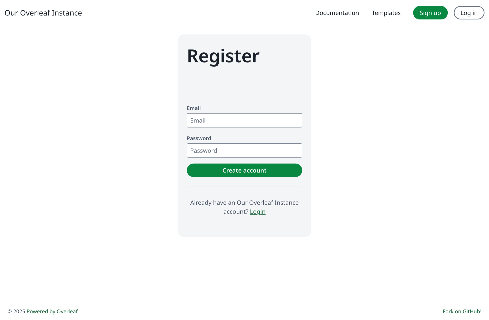

Instancję Overleaf możesz udostępnić osobom bez konta na trzy sposoby:

* [#project-access](/pl/on-premises/configuration/overleaf-toolkit/authentication/public-access#project-access  "mention"): pozwól gościom otworzyć udostępniony link do projektu bez logowania
* [#page-access](/pl/on-premises/configuration/overleaf-toolkit/authentication/public-access#page-access  "mention"): pozwól niezalogowanym odwiedzającym przeglądać strony takie jak `/learn`, `/templates` i `/devs`
* [#public-registration](/pl/on-premises/configuration/overleaf-toolkit/authentication/public-access#public-registration  "mention"): pozwól użytkownikom samodzielnie się rejestrować, opcjonalnie z wiadomością aktywacyjną i z ograniczeniem do domen e-mail

### Dostęp do projektów {#project-access}

<Info>

Domyślnie, nawet jeśli użytkownik otrzyma link do udostępnionego projektu, musi się **zalogować**, zanim będzie mógł dołączyć do wspólnej sesji edycji projektu.

</Info>

Aby zezwolić na anonimowy dostęp do projektów udostępnionych przez link, ustaw obie poniższe zmienne:

```dotenv title="config/variables.env"
OVERLEAF_ALLOW_ANONYMOUS_READ_AND_WRITE_SHARING=true
OVERLEAF_ALLOW_PUBLIC_ACCESS=true
```

`OVERLEAF_ALLOW_ANONYMOUS_READ_AND_WRITE_SHARING` włącza anonimowy odczyt i zapis w projektach udostępnionych przez link.

`OVERLEAF_ALLOW_PUBLIC_ACCESS` zapobiega przekierowywaniu nieuwierzytelnionych użytkowników na stronę logowania.

Linki do edycji mają postać `/1234567890abcdefghijkl` (10 cyfr, a potem 12 małych liter); linki do podglądu mają postać `/read/abcdefghijkl` (12 małych liter).

Aby zezwolić wyłącznie na dostęp tylko do odczytu, ustaw samo `OVERLEAF_ALLOW_PUBLIC_ACCESS=true`: goście mogą wtedy otwierać linki do wyświetlania (`/read/...`) bez logowania, natomiast linki do edycji nadal wymagają zalogowania.

Utwórz ponownie kontenery poleceniem `bin/up`. Następnie otwórz adres URL udostępniania w oknie prywatnym.

### Dostęp do stron {#page-access}

Domyślnie (gdy `OVERLEAF_ALLOW_PUBLIC_ACCESS` nie jest ustawione) **każda** strona poza stronami logowania i rejestracji przekierowuje niezalogowanych odwiedzających na stronę logowania. Dotyczy to również stron, które mają być publiczne, więc linki do nich działają tylko dla użytkowników, którzy są już zalogowani.

Przy ustawieniu `OVERLEAF_ALLOW_PUBLIC_ACCESS=true` niezalogowani odwiedzający mogą otworzyć:

| Strona                                                                | Wymaga                           |
| --------------------------------------------------------------------- | -------------------------------- |
| Pomoc LaTeX pod adresem `/learn` (zobacz [adding-latex-user-help.md](/pl/on-premises/configuration/overleaf-toolkit/adding-latex-user-help  "mention")) | `OVERLEAF_PROXY_LEARN=true`      |
| Galerię szablonów pod adresem `/templates`, strony szablonów, podglądy i pobieranie plików ZIP (zobacz [templates.md](/pl/on-premises/configuration/overleaf-toolkit/templates  "mention")) | `OVERLEAF_TEMPLATE_GALLERY=true` |
| Stronę Overleaf Import API pod adresem `/devs` (zobacz [overleaf-import-api.md](/pl/on-premises/configuration/overleaf-toolkit/integrations/overleaf-import-api  "mention")) | —                                |

Pozwala to również [#signed-out-visitors](/pl/on-premises/configuration/overleaf-toolkit/integrations/overleaf-import-api#signed-out-visitors  "mention") zachować formularz przesłany przez niezalogowanego odwiedzającego do momentu, aż się zaloguje.

Lista projektów, edytor oraz tworzenie projektów (również z szablonu lub przez Import API) nadal wymagają zalogowania.

### Rejestracja publiczna {#public-registration}

Rejestracja publiczna jest dostępna wyłącznie w [ayaka-notes/ayakaleaf-pro](https://github.com/ayaka-notes/ayakaleaf-pro).

<Danger>

Pamiętaj, że po włączeniu rejestracji publicznej **każdy**, kto ma dostęp do Twojej instancji Overleaf, może zarejestrować się jako użytkownik.

Przy wartości `true` proces rejestracji nie weryfikuje adresów e-mail, dlatego używaj go tylko w intranecie lub w zaufanym środowisku albo zamiast tego użyj [rejestracji z wiadomością aktywacyjną](/pl/on-premises/configuration/overleaf-toolkit/authentication/public-access#registration-with-activation-email).

W instancji z OIDC nie używaj `true`: każdy mógłby zarejestrować się z adresem e-mail współpracownika przed jego pierwszym logowaniem przez OIDC, co połączyłoby współpracownika z tym kontem. Użyj [rejestracji z wiadomością aktywacyjną](/pl/on-premises/configuration/overleaf-toolkit/authentication/public-access#registration-with-activation-email) albo wyłącz rejestrację publiczną, zobacz [Konta i hasła](/pl/on-premises/configuration/overleaf-toolkit/authentication#accounts-and-passwords).

</Danger>

Domyślnie ani Community Edition, ani Overleaf Pro nie zezwalają na rejestrację publiczną.

Aby ją włączyć, dodaj to do `config/variables.env`:

```dotenv title="config/variables.env"
OVERLEAF_ALLOW_PUBLIC_REGISTRATION=true
```

Utwórz ponownie kontenery poleceniem `bin/up`.

Następnie kliknij **Sign up** lub przejdź pod adres `/register`.

<Frame>
  
</Frame>

### Rejestracja z wiadomością aktywacyjną {#registration-with-activation-email}

Rejestracja z wiadomością aktywacyjną jest dostępna wyłącznie w [ayaka-notes/ayakaleaf-pro](https://github.com/ayaka-notes/ayakaleaf-pro). Użytkownicy rejestrują się, podając jedynie adres e-mail, a hasło ustawiają za pomocą linku w wiadomości aktywacyjnej, dzięki czemu z konta może korzystać tylko właściciel danego adresu. Lista domen i symbole wieloznaczne wymagają wersji v6.4.0 lub nowszej; wcześniejsze wersje akceptują tylko jedną domenę, np. `@example.com`.

Przed jej włączeniem skonfiguruj wysyłkę wiadomości e-mail, w przeciwnym razie użytkownicy nigdy nie otrzymają wiadomości aktywacyjnej. Zobacz [Wysyłka e-maili](/pl/on-premises/configuration/overleaf-toolkit/email-delivery).

Następnie dodaj następujący wiersz do `config/variables.env`:

```dotenv title="config/variables.env" wrap
OVERLEAF_ALLOW_PUBLIC_REGISTRATION=@example.com,@*.example.org
```

`OVERLEAF_ALLOW_PUBLIC_REGISTRATION` można ustawić na:

| Wartość                       | Kto może się zarejestrować                            | Weryfikacja e-mail |
| ----------------------------- | ----------------------------------------------------- | :----------------: |
| `true`                        | Każdy, za pomocą adresu e-mail i hasła                |        Nie         |
| `@example.com`                | Adresy w domenie `example.com`                        |        Tak         |
| `@*.example.org`              | Adresy w subdomenach, takich jak `cs.example.org`, ale nie w samej `example.org` |        Tak         |
| `@example.com,@*.example.org` | Dowolny z wymienionych wpisów, oddzielonych przecinkami |        Tak         |
| `@*`                          | Każdy                                                 |        Tak         |

Domeny są dopasowywane bez rozróżniania wielkości liter. Aby zezwolić na domenę i jej subdomeny, podaj obie: `@example.org,@*.example.org`.

### Pytania i odpowiedzi {#q&a}

<Accordion title="Co niezalogowany edytor może robić z komentarzami?">

<strong>Odpowiedź:</strong> Niezalogowany użytkownik, który otwiera projekt za pomocą linku do edycji, otrzymuje taki sam dostęp jak edytor, z wyjątkiem działań, które rejestrują, kto je wykonał:

| Działanie | Niezalogowany edytor |
| --- | ---: |
| Edycja tekstu, wyświetlanie komentarzy i śledzonych zmian | Tak |
| Akceptowanie śledzonych zmian, przełączanie trybu edycji | Tak |
| Usuwanie komentarza lub całego wątku | Tak |
| Dodawanie komentarza, odpowiadanie na niego lub jego edycja | Nie |
| Rozwiązywanie lub ponowne otwieranie komentarza | Nie |

Panel recenzji nadal wyświetla im przycisk **Resolve**, ale rozwiązanie kończy się komunikatem o błędzie.

Użytkownicy, którzy otwierają projekt za pomocą linku do wyświetlania, w ogóle nie widzą komentarzy, zobacz [Role i uprawnienia](/pl/on-premises/user-and-project-management/roles-and-permissions#collaborating).

</Accordion>

<Accordion title="Czy mogę dodawać użytkowników i zapraszać współpracowników bez wiadomości e-mail lub za pomocą kodu zaproszenia?">

<strong>Odpowiedź:</strong> Nie ma kodów zaproszeń, ale użytkowników można dodawać bez poczty e-mail. W **Admin → Manage Users** kliknij **Create account**, wpisz adres e-mail i kliknij **Create**: okno dialogowe pokaże link aktywacyjny ważny przez 7 dni, który możesz skopiować i samodzielnie wysłać użytkownikowi. Aby później uzyskać nowy link, kliknij ikonę koperty w wierszu użytkownika, a następnie **Send activation email**. Aby udostępnić projekt, zaproś użytkowników, którzy mają już konto: zaproszenie pojawi się również na ich liście projektów, więc mogą je przyjąć bez wiadomości e-mail. Osoby bez konta otrzymują zaproszenie tylko e-mailem, więc najpierw utwórz im konto.

</Accordion>
