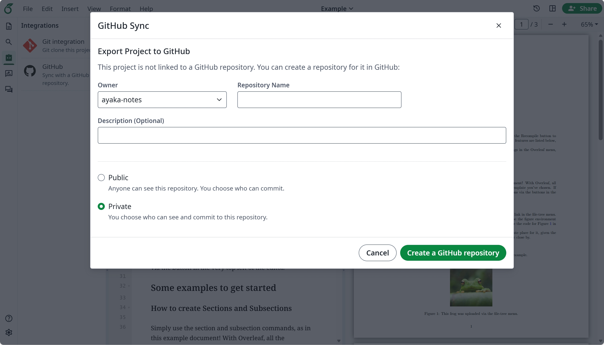
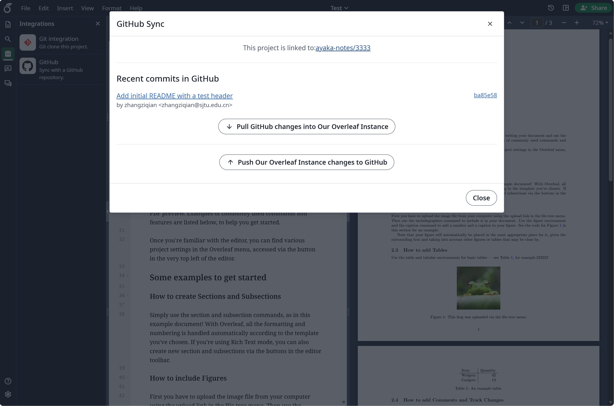
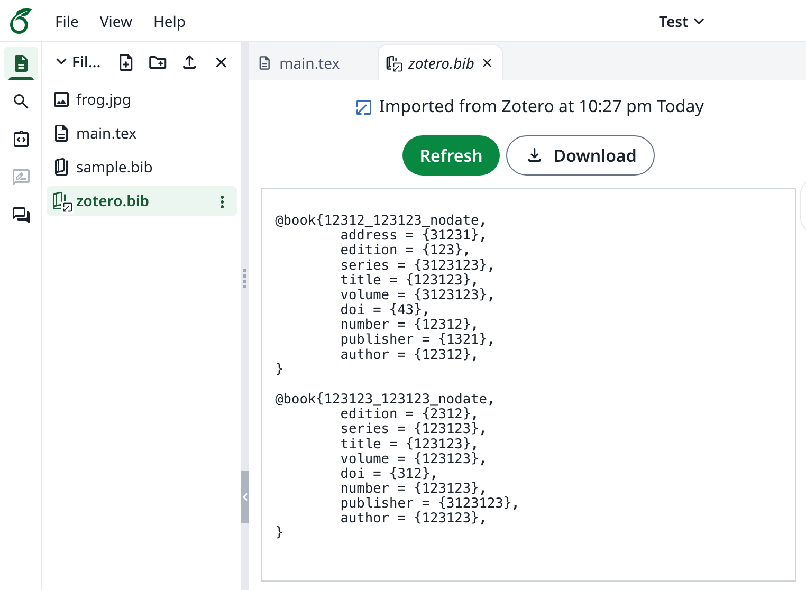

<Info>

Ta funkcja została opracowana przez [ayaka-notes/ayakaleaf-pro](https://github.com/ayaka-notes/ayakaleaf-pro) i zmodyfikowana przez [yu-i-i/overleaf-cep](https://github.com/yu-i-i/overleaf-cep). Jest dostępna od wersji v6.2.0. Nadal znajduje się w fazie beta. Jeśli napotkasz jakiekolwiek problemy, prosimy o opinię.

</Info>

<Columns cols={2}>
<Column>

<Frame>
  
</Frame>

<Frame>
  
</Frame>

</Column>

<Column>

<Frame>
  
</Frame>

<Frame>
  
</Frame>

</Column>
</Columns>

### Konfiguracja synchronizacji z GitHub {#setup-github-synchronisation}

<Warning>

Przed użyciem synchronizacji z GitHub musisz najpierw włączyć [git-bridge](/pl/on-premises/configuration/overleaf-toolkit/integrations/git-integration).

```dotenv title="config/overleaf.rc"
GIT_BRIDGE_ENABLED=true
```

</Warning>

Przejdź do [ustawień deweloperskich](https://github.com/settings/developers), aby utworzyć aplikację GitHub OAuth, i skopiuj swoje `CLIENT_ID` oraz `SECRET`.

**Uwaga**: podczas tworzenia aplikacji OAuth wpisz `${OVERLEAF_SITE_URL}/user/github-sync/oauth2/callback` w polu **Authorization callback URL**. Ayakaleaf Pro buduje ten sam adres na podstawie `OVERLEAF_SITE_URL`, więc nie trzeba niczego ustawiać w tym zakresie w `config/variables.env`.

Następnie dodaj poniższe ustawienia do plików ze zmiennymi środowiskowymi Overleaf.

```dotenv title="config/variables.env" wrap
# used to encrypt the user's GitHub access token.
# How to generate: `openssl rand -hex 32`
GITHUB_TOKEN_CIPHER_PASSWORD=0123456789ABCDEFG # changed to yours

# Github Sync Settings
GITHUB_SYNC_ENABLED=true
GITHUB_SYNC_CLIENT_ID=
GITHUB_SYNC_CLIENT_SECRET=

# OAuth callback is: ${OVERLEAF_SITE_URL}/user/github-sync/oauth2/callback
# (Optional) GITHUB_SYNC_PROXY_URL=http://10.0.0.1:10808
```

<Warning>

Przed skonfigurowaniem adresu URL wywołania zwrotnego GitHub OAuth upewnij się, że `OVERLEAF_SITE_URL` jest ustawiony poprawnie.

</Warning>

Jeśli znajdujesz się w regionie z ograniczonym dostępem do sieci, może być konieczne skonfigurowanie proxy, aby uzyskać dostęp do GitHub. Ustaw następującą zmienną środowiskową: `GITHUB_SYNC_PROXY_URL=http://10.0.0.1:10808`. Upewnij się, że korzystanie z proxy jest zgodne z lokalnymi przepisami prawa.

<Warning>

`GITHUB_SYNC_PROXY_URL` musi być standardowym serwerem proxy przekazującym HTTP/HTTPS (np. portem HTTP Clash). Mirrory pobierania GitHub, takie jak `gh-proxy.org`, nie są obsługiwane.

</Warning>

<Warning>

Nie używaj `127.0.0.1` jako hosta proxy. Jeśli proxy działa na serwerze hosta, użyj adresu IP serwera w sieci LAN (np. `192.168.1.xx`) i upewnij się, że proxy jest skonfigurowane do przyjmowania połączeń z urządzeń w sieci lokalnej.

</Warning>

### GitHub Enterprise {#github-enterprise}

<Info>

Obsługa GitHub Enterprise jest dostępna od wersji v6.3.1. Wcześniejsze wersje łączą się wyłącznie z `github.com`, a poniższe zmienne nie mają żadnego efektu.

</Info>

Domyślnie synchronizacja z GitHub łączy się z `github.com`. Aby korzystać z GitHub Enterprise Server (hostowanego samodzielnie) lub GitHub Enterprise Cloud z rezydencją danych (`GHE.com`), ustaw `GITHUB_SYNC_URL` na adres internetowy swojej instancji, czyli ten, pod którym otwierasz repozytoria w przeglądarce.

```dotenv title="config/variables.env" wrap
# GitHub Enterprise Server
GITHUB_SYNC_URL=https://github.example.com

# or GitHub Enterprise Cloud with data residency
# GITHUB_SYNC_URL=https://octocorp.ghe.com
```

Punkty końcowe REST API i GraphQL API są wyprowadzane z `GITHUB_SYNC_URL` w taki sam sposób, jak robi to GitHub CLI:

| `GITHUB_SYNC_URL`                | REST API                        | GraphQL API                             |
| -------------------------------- | ------------------------------- | --------------------------------------- |
| `https://github.com` (domyślnie) | `https://api.github.com`        | `https://api.github.com/graphql`        |
| `https://SUBDOMAIN.ghe.com`      | `https://api.SUBDOMAIN.ghe.com` | `https://api.SUBDOMAIN.ghe.com/graphql` |
| `https://HOST` (dowolny inny)    | `https://HOST/api/v3`           | `https://HOST/api/graphql`              |

Ustawiaj punkty końcowe API tylko wtedy, gdy Twoja instancja udostępnia je pod innym adresem, na przykład za bramą API:

| Zmienna                   | Wartość domyślna                                                                          |
| ------------------------- | ----------------------------------------------------------------------------------------- |
| `GITHUB_SYNC_URL`         | `https://github.com`                                                                      |
| `GITHUB_SYNC_API_URL`     | Wyprowadzana z `GITHUB_SYNC_URL`, zobacz tabelę powyżej                                   |
| `GITHUB_SYNC_GRAPHQL_URL` | Wyprowadzana z `GITHUB_SYNC_API_URL`, jeśli jest ustawiona (`/api/v3` zmienia się w `/api/graphql`, w przeciwnym razie dołączane jest `/graphql`), a w innym przypadku z `GITHUB_SYNC_URL` |

<Warning>

* Utwórz aplikację OAuth w swojej instancji enterprise (_Settings → Developer settings → OAuth Apps_) — aplikacja z `github.com` nie będzie tam działać. Adres URL wywołania zwrotnego jest taki sam: `${OVERLEAF_SITE_URL}/user/github-sync/oauth2/callback`.
* `GITHUB_SYNC_URL` to wyłącznie adres internetowy. Nie ustawiaj w nim adresu API, takiego jak `https://api.github.com` lub `https://HOST/api/v3`, i nie dodawaj ścieżki organizacji.
* Wszystkie trzy adresy muszą wskazywać na tę samą instancję GitHub.

</Warning>

<Info>

Jeśli Twoja instancja używa certyfikatu wystawionego przez prywatny urząd certyfikacji (CA), zamontuj certyfikat CA w kontenerze i wskaż go w `NODE_EXTRA_CA_CERTS`, np. `NODE_EXTRA_CA_CERTS=/var/lib/overleaf/certs/github-ca.pem`.

</Info>

<Danger>

Połączone konta i projekty należą do instancji, z którą zostały połączone. Przed przełączeniem `GITHUB_SYNC_URL` na inną instancję poproś użytkowników o odłączenie ich kont GitHub i projektów.

</Danger>

### Kto może łączyć i synchronizować {#who-can-link-and-sync}

Podobnie jak w Overleaf Cloud, tylko właściciel projektu może połączyć projekt z repozytorium GitHub. Po połączeniu każdy współpracownik z uprawnieniami do edycji może go synchronizować.

| Działanie                                                  | Kto może je wykonać                                            |
| ---------------------------------------------------------- | -------------------------------------------------------------- |
| Eksport projektu do nowego repozytorium GitHub             | Właściciel projektu                                            |
| Import repozytorium GitHub do nowego projektu              | Dowolny użytkownik, który staje się właścicielem nowego projektu |
| Pobieranie, wypychanie i scalanie połączonego projektu     | Właściciel i współpracownicy z uprawnieniami do edycji         |
| Odłączenie projektu od repozytorium                        | Właściciel projektu                                            |

* Overleaf komunikuje się z GitHub przy użyciu konta GitHub użytkownika, który synchronizuje, więc każdy synchronizujący współpracownik łączy własne konto GitHub i musi mieć uprawnienia do wypychania zmian do domyślnej gałęzi repozytorium.
* Współpracownicy z dostępem tylko do odczytu nie mogą korzystać z synchronizacji z GitHub w danym projekcie.

### Pytania i odpowiedzi {#q&a}

<Accordion title="Jak połączyć projekt z GitHub i go synchronizować?">

<strong>Odpowiedź:</strong> W edytorze otwórz **Integrations** i kliknij **GitHub**. Jeśli Twoje konto GitHub nie jest jeszcze połączone, najpierw kliknij **Link to your GitHub account**. W **Export Project to GitHub** wpisz nazwę repozytorium, wybierz **Private** w **Repository visibility** i kliknij **Create a GitHub repository**.

Następnie ta sama karta otwiera **Sync with GitHub**, gdzie wyświetlane są nowe commity w GitHub. Kliknij **Sync**, aby zatwierdzić zmiany z Overleaf w domyślnej gałęzi i przenieść zmiany z GitHub do projektu. Synchronizacja działa w obu kierunkach, ale uruchamia się tylko wtedy, gdy ktoś kliknie **Sync**; nie ma synchronizacji według harmonogramu. Gdy zmiany zaszły po obu stronach, Overleaf scala je przez tymczasową gałąź o nazwie `overleaf-YYYY-MM-DD-HHMMSS`. Jeśli przy tym scalaniu wystąpi konflikt, samodzielnie scal gałąź w GitHub, a następnie kliknij **I have manually merged. Continue**.

</Accordion>

<Accordion title="Jak odłączyć projekt od jego repozytorium GitHub?">

<strong>Odpowiedź:</strong> Otwórz projekt, kliknij **Integrations**, a następnie **GitHub**. W oknie **Sync with GitHub** kliknij **Unlink** i potwierdź. Tylko właściciel projektu może go odłączyć; pozostali współpracownicy zobaczą prośbę o kontakt z właścicielem. Jeśli repozytorium zostało usunięte lub utraciłeś do niego dostęp, okno dialogowe o tym informuje i zamiast tego oferuje **Unlink GitHub repository**.

Odłączenie usuwa jedynie powiązanie, które Overleaf przechowuje dla projektu. Projekt i jego pliki, repozytorium GitHub i jego commity, połączone konta GitHub oraz ustawienia synchronizacji z GitHub na instancji pozostają bez zmian. Następnie projekt ponownie wyświetla opcję **Export Project to GitHub**, która tworzy nowe repozytorium.

</Accordion>

<Accordion title="Czy mogę wymusić wypchnięcie (force push) do domyślnej gałęzi?">

<strong>Odpowiedź:</strong> Nie zalecamy tego. Overleaf wykrywa wymuszone wypchnięcie, ostrzega o nim i przejmuje przepisaną gałąź, scalając zmiany wprowadzone w Overleaf od ostatniej synchronizacji. Aby uniknąć niespodzianek, zabezpiecz domyślną gałąź przed wymuszonym wypychaniem w ustawieniach repozytorium.

</Accordion>

<Accordion title="Czy mogę zmienić nazwę domyślnej gałęzi połączonego projektu?">

<strong>Odpowiedź:</strong> Prosimy tego nie robić. Overleaf nadal synchronizuje się z gałęzią, z którą projekt został połączony. Aby synchronizować z inną gałęzią, odłącz projekt, a następnie zaimportuj repozytorium do nowego projektu, który będzie używał bieżącej domyślnej gałęzi.

</Accordion>

<Accordion title='Synchronizacja z GitHub wyświetla komunikat "Something wrong with GitHub request"'>

<strong>Odpowiedź:</strong> Ten komunikat oznacza, że serwer nie mógł połączyć się z GitHub, na przykład z powodu problemu z siecią, DNS, TLS lub proxy. Uruchom `bin/logs web`, aby zobaczyć pełny błąd. Jeśli serwer potrzebuje proxy, aby połączyć się z GitHub, ustaw `GITHUB_SYNC_PROXY_URL`.

</Accordion>

<Accordion title='Czy należy wyłączyć opcję "Expire user access tokens" w aplikacji GitHub OAuth?'>

<strong>Odpowiedź:</strong> Tak. Synchronizacja z GitHub nie odnawia wygasłych tokenów. Przy włączonych wygasających tokenach użytkownicy muszą ponownie łączyć GitHub za każdym razem, gdy ich token wygaśnie.

</Accordion>

<Accordion title="Czy moja instancja musi być dostępna z internetu?">

<strong>Odpowiedź:</strong> Nie. Łączenie konta odbywa się za pośrednictwem przeglądarki użytkownika, więc adres wywołania zwrotnego OAuth musi jedynie otwierać się w przeglądarce użytkownika. Serwer musi jedynie mieć dostęp do GitHub; jeśli potrzebuje do tego proxy, ustaw `GITHUB_SYNC_PROXY_URL`. GitHub nigdy nie łączy się z Twoją instancją: projekt jest synchronizowany tylko wtedy, gdy użytkownik zsynchronizuje go w edytorze.

</Accordion>

<Accordion title="Łączenie konta GitHub kończy się niepowodzeniem lub wraca bez połączenia">

<strong>Odpowiedź:</strong> Sprawdź kolejno:

* Otwórz Overleaf dokładnie pod adresem ustawionym w `OVERLEAF_SITE_URL`. GitHub odsyła Cię do `${OVERLEAF_SITE_URL}/user/github-sync/oauth2/callback`, a Twoje zalogowanie istnieje tylko pod adresem, od którego zacząłeś, więc inny host, adres IP lub port kończy się na stronie logowania lub komunikatem „Restricted, sorry you don’t have permission to load this page”.
* **Authorization callback URL** aplikacji OAuth musi mieć wartość `${OVERLEAF_SITE_URL}/user/github-sync/oauth2/callback`, z tym samym schematem, hostem i portem.
* Strona błędu z komunikatem `Failed to obtain access token from Git server` oznacza, że GitHub nie zwrócił tokenu: sprawdź `GITHUB_SYNC_CLIENT_ID` i `GITHUB_SYNC_CLIENT_SECRET` oraz to, czy serwer ma dostęp do GitHub. Uruchom `bin/logs web`, aby zobaczyć pełny błąd.

Po zmianie `config/variables.env` uruchom `bin/up`, aby odtworzyć kontenery.

</Accordion>

<Accordion title="Import repozytorium kończy się błędem „EmptyZipFileError: empty_zip_file” lub „unzip failed”">

<strong>Odpowiedź:</strong> Overleaf importuje archiwum zip najnowszego commita w domyślnej gałęzi repozytorium, a ten błąd oznacza, że archiwum nie zawiera żadnego pliku, który Overleaf może zaimportować. Sprawdź domyślną gałąź w GitHub:

* Zawiera pliki projektu, a nie tylko pliki pomijane przez Overleaf podczas importu: pliki ukryte, takie jak `.gitignore` i `.gitmodules` (`.latexmkrc` jest zachowywany), oraz pliki kompilacji, takie jak `*.aux`, `*.log`, `*.bbl`, `*.synctex.gz`, `*.doc` i `*.docx`.
* Pliki nie znajdują się wyłącznie w submodułach Git. Archiwum GitHub pozostawia submoduły jako puste foldery.
* Oczekiwane pliki znajdują się w domyślnej gałęzi, a nie w innej. Import zawsze używa domyślnej gałęzi.

</Accordion>

<Accordion title="Import repozytorium kończy się błędem „connect ECONNREFUSED” do „sharelatex:3054”">

<strong>Odpowiedź:</strong> `V1_HISTORY_URL` jest ustawione na `http://sharelatex:3054`, czyli wartość podawaną w starszych wersjach tej dokumentacji. Port `3054` to usługa `project-history`, która nasłuchuje tylko wewnątrz kontenera, natomiast `V1_HISTORY_URL` musi wskazywać na `history-v1`. Overleaf zapisuje każdy plik binarny (obrazy, pliki PDF) importowanego repozytorium w `history-v1`, więc import kończy się niepowodzeniem; przesłanie takiego pliku w edytorze kończy się tak samo. W pliku `docker-compose.yml` ustaw `V1_HISTORY_URL: "http://sharelatex:3100/api"` dla usługi `sharelatex` (zobacz [Integracja z Git](/pl/on-premises/configuration/overleaf-toolkit/integrations/git-integration)) i odtwórz kontener. Toolkit ustawia już tę wartość; sprawdź, czy `docker-compose.override.yml` jej nie nadpisuje.

</Accordion>
