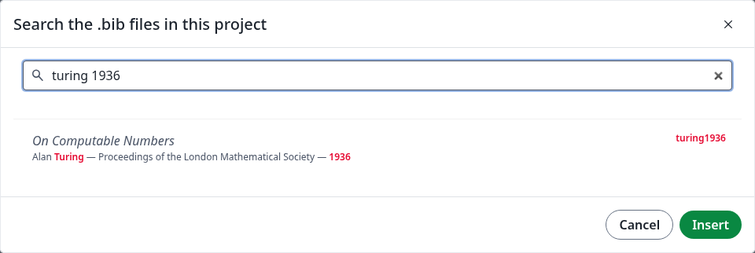

Wyszukiwanie bibliografii przegląda wszystkie pliki `.bib` w projekcie, więc znajdziesz pozycję bez pamiętania jej klucza cytowania. Nie trzeba niczego konfigurować.

Projekt potrzebuje co najmniej jednego pliku `.bib`. Możesz go przesłać lub zaimportować bibliotekę z [Zotero](/pl/on-premises/user-guide/users/zotero-integration) albo [Mendeley](/pl/on-premises/user-guide/users/mendeley-integration).

## Wstawianie cytowania {#insert-a-citation}

<Steps>
<Step title="Rozpocznij cytowanie">
W pliku `.tex` wpisz `\cite{`. Edytor doda nawias zamykający. Pod kursorem zobaczysz klucze cytowania i niebieskie pole **Open advanced reference search**.

<Frame caption="Niebieskie pole pod cytowaniem">
  
</Frame>

Przycisk **Insert citation** na pasku narzędzi oraz **Insert**, a potem **Citation**, również rozpoczynają `\cite{}`. Pole pojawia się też przy innych poleceniach cytowania, takich jak `\citep`, `\autocite`, `\parencite` i `\textcite`.
</Step>

<Step title="Otwórz wyszukiwanie">
Kliknij **Search** w niebieskim polu lub naciśnij Ctrl+Spacja między nawiasami klamrowymi. Okno wyświetla wszystkie wpisy z tytułem, kluczem cytowania, autorem, czasopismem i rokiem.

<Frame caption="Wszystkie wpisy projektu">
  
</Frame>
</Step>

<Step title="Znajdź wpis">
Wpisz tekst w polu wyszukiwania. Wyszukiwanie obejmuje klucz cytowania, autora, tytuł, czasopismo i rok, a znalezione fragmenty są wyróżniane. Każde słowo musi pasować, więc `turing 1936` znajduje artykuł Turinga z 1936 roku. Inne pola, na przykład wydawca, nie są przeszukiwane.

<Frame caption="Wyszukiwanie według autora i roku">
  
</Frame>
</Step>

<Step title="Wybierz jeden lub więcej wpisów">
Kliknij wpis. Zmieni kolor na zielony, a jego klucz pojawi się nad listą. Aby dodać kolejny, kliknij go lub wyszukaj ponownie: wybrane wpisy pozostają. Aby usunąć wpis, kliknij go ponownie lub kliknij <strong>×</strong> obok jego klucza.

<Frame caption="Dwa wybrane wpisy">
  
</Frame>
</Step>

<Step title="Kliknij Insert">
Klucze pojawią się między nawiasami klamrowymi, oddzielone przecinkami. Jeśli dokument nie ma jeszcze bibliografii, dodaj te wiersze przed `\end{document}`, podając nazwy plików `.bib` bez rozszerzenia:

```latex
\bibliographystyle{plain}
\bibliography{refs,more}
```

Kliknij **Recompile**. Pozycje pojawią się w pliku PDF.

<Frame caption="Skompilowane cytowanie">
  
</Frame>
</Step>
</Steps>

W edytorze **Visual** wyszukiwanie działa tak samo.

## Zmiana cytowania {#change-a-citation}

<strong>Dodawanie pozycji:</strong> umieść kursor między nawiasami klamrowymi istniejącego cytowania i otwórz wyszukiwanie. **Insert** dodaje nowe klucze po już istniejących.

<strong>Zastępowanie pozycji:</strong> zaznacz klucze w edytorze, a następnie naciśnij Ctrl+Spacja. Klucze pojawią się nad listą, a przycisk zmieni nazwę na **Replace**. Usuń niepotrzebne, dodaj inne i kliknij **Replace**. Klucz, którego nie ma w żadnym pliku `.bib`, pozostaje, dopóki go nie usuniesz.

<Frame caption="Zastępowanie zaznaczonych kluczy">
  
</Frame>

## Korzystanie z klawiatury {#use-the-keyboard}

| Klawisz | Działanie |
| --- | ------------ |
| **Strzałka w dół** | Przechodzi z pola wyszukiwania do listy, a potem w dół listy |
| **Strzałka w górę** | Przechodzi w górę listy |
| **Spacja** | Wybiera wpis lub usuwa go z wybranych |
| **Enter** | Wstawia wybrane wpisy, gdy jesteś na liście |
| **Tab** | Przechodzi między polem wyszukiwania, listą i przyciskami |
| **Esc** | Zamyka okno bez wprowadzania zmian |

## Skąd pochodzą wpisy {#where-the-entries-come-from}

Wyszukiwanie obejmuje każdy plik `.bib` w projekcie, w tym pliki zaimportowane z Zotero lub Mendeley. Gdy edytujesz plik `.bib`, następne wyszukiwanie znajdzie nowe wpisy.

## Jeśli coś pójdzie nie tak {#if-something-goes-wrong}

| Co widzisz | Dlaczego | Co zrobić |
| ------------ | --- | ---------- |
| Lista w oknie jest pusta | Projekt nie ma pliku `.bib` | Prześlij lub utwórz taki plik |
| Brak niebieskiego pola, a Ctrl+Spacja wyświetla polecenia LaTeX | Kursor nie znajduje się między nawiasami klamrowymi cytowania | Kliknij między nawiasami |
| Ctrl+Spacja nic nie robi | Komputer używa tego skrótu do czegoś innego | Kliknij **Search** w niebieskim polu |
| Wpis nie zostaje znaleziony | Wyszukiwanie obejmuje tylko klucz, autora, tytuł, czasopismo i rok | Szukaj według jednego z tych pól |
