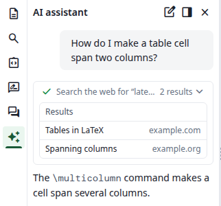
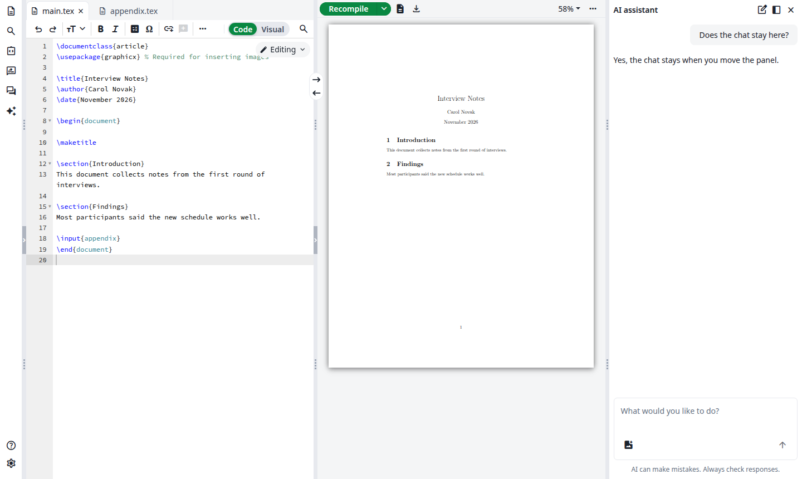

Asystent pracuje na otwartym projekcie. Czyta Twoje dokumenty i sugeruje zmiany, a Ty stosujesz lub odrzucasz każdą z nich. Odpowiedzi na zrzutach ekranu są przykładami: to, co otrzymasz, zależy od modelu używanego przez Twoją instancję.

<Info>

Jeśli na lewym pasku nie widzisz **AI assistant**, wskaż administratorowi stronę [Integracja AI](/pl/on-premises/configuration/overleaf-toolkit/integrations/ai-integration).

</Info>

## Rozpoczęcie czatu {#start-a-chat}

<Steps>
<Step title="Otwórz asystenta">
Na lewym pasku edytora kliknij **AI assistant**. Panel otworzy się obok edytora.
</Step>

<Step title="Zaakceptuj warunki">
Za pierwszym razem panel wyświetla warunki korzystania z funkcji AI. Kliknij **Accept and continue**. Robisz to tylko raz i dotyczy to również [Asystenta błędów](/pl/on-premises/user-guide/users/error-assistant).

<Frame caption="Warunki wyświetlane raz">
  
</Frame>
</Step>

<Step title="Zadaj pytanie">
Wpisz tekst w <strong>What would you like to do?</strong> i naciśnij Enter lub kliknij strzałkę. Możesz też kliknąć sugestię w sekcji **Start a chat**. Sugestie zmieniają się w każdym czacie, a gdy ostatnia kompilacja zawiera błędy, dochodzi do nich **Fix the compile errors**.

<Frame caption="Pusty czat">
  
</Frame>
</Step>

<Step title="Przeczytaj odpowiedź">
To, co zrobił asystent, pojawia się jako wiersze w ramce, na przykład **Read line 15-16 of main.tex**, ze znacznikiem po zakończeniu kroku. Następnie pojawia się odpowiedź. Jeśli model udostępnia swoje rozumowanie, kliknij **Reasoned for 1 s**, aby je przeczytać.

<Frame caption="Pytanie i odpowiedź">
  
</Frame>
</Step>
</Steps>

## Pytanie o zaznaczone wiersze {#ask-about-selected-lines}

Zaznacz wiersze w edytorze. Nad polem wiadomości pojawi się etykieta, na przykład `main.tex: 16`, a zaznaczony tekst zostanie wysłany razem z wiadomością. W pustym czacie sugestie dotyczą zaznaczenia, na przykład **Make it shorter**.

<Frame caption="Zaznaczony wiersz">
  
</Frame>

## Przegląd sugerowanej zmiany {#review-a-suggested-edit}

Zmiana trafia do dokumentu dopiero wtedy, gdy ją zastosujesz.

<Steps>
<Step title="Przeczytaj sugestię">
Ramka **Edit line 16** pokazuje powód, numer wiersza i zmianę: stary tekst jest przekreślony, a nowy wyróżniony. Dokument jeszcze się nie zmienił. **Show result** pokazuje tylko nowy tekst, a **Show diff** przywraca poprzedni widok.

<Frame caption="Zmiana czekająca na Twoją decyzję">
  
</Frame>
</Step>

<Step title="Zastosuj ją">
Kliknij **Apply**. Zmiana pojawi się w edytorze, ramka otrzyma znacznik, a asystent będzie kontynuował. Jeśli zmiana dotyczy innego dokumentu, zostanie on otwarty.

<Frame caption="Zmiana została zastosowana">
  
</Frame>
</Step>

<Step title="Cofnij, jeśli zmienisz zdanie">
**Undo** usuwa zmianę z dokumentu, a **Apply** przywraca ją. Asystent nie dowiaduje się o żadnej z tych operacji.
</Step>
</Steps>

### Odrzucanie zmiany {#reject-an-edit}

Kliknij **Reject**. Dokument pozostaje bez zmian, ramka wyświetla <strong>The user declined this edit.</strong>, a asystent kontynuuje, wiedząc, że odmówiłeś. Przyciski znikają, więc aby odzyskać zmianę, poproś o nią ponownie.

Jeśli zamiast podjąć decyzję napiszesz nową wiadomość, zmiana nie zostanie zastosowana, a ramka to zaznaczy.

<Frame caption="Odrzucona zmiana i zmiana bez decyzji">
  
</Frame>

## Co asystent może robić w projekcie {#what-the-assistant-can-do-in-a-project}

Na Ciebie czekają tylko zmiany. Pozostałe kroki są wykonywane od razu, gdy asystent je podejmuje.

| Wiersz w czacie | Działanie |
| -------------------- | ------------ |
| **Read line 15-16 of main.tex** | Czyta wiersze dokumentu |
| **Find “schedule” in main.tex** | Szuka tekstu w dokumencie |
| **List the project files** | Wyświetla pliki projektu |
| **Create appendix.tex** | Tworzy pusty dokument i go otwiera |
| **Edit line 16** | Sugeruje zmianę, zobacz wyżej |
| **Compile** | Kompiluje projekt |
| **Check the compile log** | Czyta błędy i ostrzeżenia ostatniej kompilacji |
| **Look at PDF page 1** | Pokazuje stronę PDF w czacie |
| **Read the PDF structure** | Czyta strukturę pliku PDF |
| **Switch to xelatex** | Zmienia kompilator projektu, jak w **Settings** |
| <strong>Search the web for “...”</strong> | Przeszukuje internet |
| <strong>Search the help pages for “...”</strong> | Przeszukuje strony pomocy |

<Frame caption="Nowy plik, a potem zmiana w innym dokumencie">
  
</Frame>

<Frame caption="Kompilacja i strona pliku PDF">
  
</Frame>

Wiersz wyszukiwania pokazuje, ile wyników znaleziono. Kliknij go, aby je wyświetlić. Dostępność wyszukiwania zależy od Twojej instancji, zobacz [Opcjonalne usługi wyszukiwania](/pl/on-premises/configuration/overleaf-toolkit/integrations/ai-integration#optional-search-services).

<Frame caption="Wyniki wyszukiwania">
  
</Frame>

Sugestia **Fix the compile errors** prosi asystenta o sprawdzenie logu i poprawienie znalezionych problemów. Poprawki przychodzą jako zmiany do przejrzenia.

## Dołączanie obrazu lub pliku PDF {#attach-an-image-or-a-pdf}

W polu wiadomości kliknij ikonę obrazu, **Attach image or PDF**, i wybierz plik. Jego nazwa pojawi się nad tekstem. Napisz wiadomość i wyślij ją.

<Frame caption="Plik dołączony do wiadomości">
  
</Frame>

Panel odrzuca inne pliki komunikatem <strong>Only images and PDF files can be attached.</strong>, a duże pliki komunikatem <strong>Files must be smaller than 2 MB.</strong>

## Zatrzymywanie asystenta {#stop-the-assistant}

Podczas pracy asystenta strzałka w polu wiadomości zmienia się w przycisk **Stop**. Kliknij go. Trwający krok kończy się komunikatem <strong>Stopped by the user.</strong> i nic więcej się nie dzieje, dopóki znów nie napiszesz.

<Frame caption="Przycisk Stop">
  
</Frame>

## Gdy asystent sam się zatrzyma {#if-the-assistant-stops-by-itself}

Asystent może wykonać ograniczoną liczbę kroków dla jednej wiadomości. Po osiągnięciu limitu panel wyświetla <strong>The assistant used all the steps it may take for one message. Reply to let it carry on.</strong> Odpowiedz, na przykład `Go on`, a asystent będzie kontynuował.

<Frame caption="Limit kroków">
  
</Frame>

Jeśli panel wyświetla **Something’s gone wrong**, żądanie się nie powiodło. Wyślij wiadomość ponownie lub kliknij **Start new chat**.

## Przenoszenie panelu i rozpoczynanie od nowa {#move-the-panel-and-start-over}

Te przyciski znajdują się u góry panelu:

* **Start new chat** czyści panel. Nie ma listy wcześniejszych czatów. Przeładowanie strony również czyści czat.
* **Move to the right** przenosi panel na prawo od pliku PDF, gdzie pozostaje otwarty podczas korzystania z drzewa plików. **Move to the left** przywraca go na miejsce. Czat pozostaje.
* **Close** ukrywa panel. Kliknij **AI assistant** na lewym pasku, aby go przywrócić razem z czatem.

<Frame caption="Panel po prawej stronie">
  
</Frame>

## Zużycie tokenów {#token-usage}

Asystent nie pokazuje, ile tokenów zużyłeś. Jeśli Twoja instancja ustawia limit i go osiągniesz, następna wiadomość nie otrzyma odpowiedzi. Panel wyświetla **Usage limit reached** i czas pozostały do ponownej możliwości czatowania, a pole wiadomości jest wyszarzone.

<Frame caption="Limit został osiągnięty">
  
</Frame>

Nowy czat wyświetla to samo powiadomienie. Po przeładowaniu pole znów wygląda normalnie, ale następna wiadomość również otrzyma powiadomienie. [Asystent błędów](/pl/on-premises/user-guide/users/error-assistant) wlicza się do tego samego limitu i wyświetla **Usage limit reached** we wpisie logu.

Limit ustawia administrator, zobacz [Zużycie i resetowanie](/pl/on-premises/configuration/overleaf-toolkit/integrations/ai-integration#usage-and-reset).
