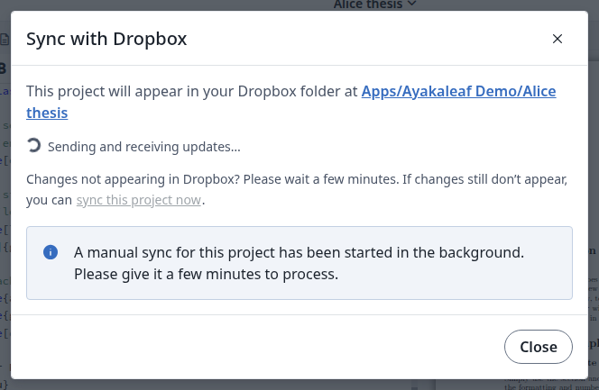

Synchronizuj wszystkie swoje projekty z folderem w Dropbox. Zmiany przepływają w obu kierunkach w tle, z jednym wyjątkiem: to, co wpisujesz w edytorze, trafia do Dropbox kilka minut po opuszczeniu projektu lub gdy klikniesz **sync this project now**.

<Info>

Jeśli nie widzisz opcji Dropbox w **Account settings** ani w edytorze, poproś administratora o włączenie [synchronizacji z Dropbox](/pl/on-premises/configuration/overleaf-toolkit/integrations/dropbox-synchronisation).

</Info>

## Łączenie konta Dropbox {#link-your-dropbox-account}

Robisz to raz.

<Steps>
<Step title="Otwórz ustawienia konta">
Kliknij **Account**, a następnie **Account settings**. W sekcji **Project synchronisation** znajdź **Dropbox** i kliknij **Link**.

<Frame caption="Dropbox w ustawieniach konta">
  
</Frame>
</Step>

<Step title="Autoryzuj w Dropbox">
Otworzy się Dropbox. Zaloguj się, jeśli zostaniesz o to poproszony, a następnie autoryzuj aplikację.
</Step>

<Step title="Sprawdź połączenie">
Wracasz do ustawień konta. Zielony komunikat informuje, że Twoje konto Dropbox jest połączone, a na przycisku jest teraz napis **Unlink**. Pod Dropbox status pokazuje, że Twoje projekty są wysyłane.

<Frame caption="Twoje konto Dropbox jest połączone">
  
</Frame>

Gdy wszystkie dotrą, status zmieni się na **Overleaf and Dropbox have processed all updates**.

<Frame caption="Wszystko jest zsynchronizowane">
  
</Frame>
</Step>
</Steps>

Jeśli Twoje konto nie jest jeszcze połączone, karta **Dropbox** w edytorze najpierw poprosi o jego połączenie. Kliknij **Update Dropbox Settings**: ustawienia konta otworzą się w nowej karcie. Połącz tam konto, a następnie odśwież stronę edytora, zgodnie z informacją w oknie dialogowym.

<Frame caption="Komunikat, gdy konto nie jest połączone">
  
</Frame>

Jeśli nie zezwolisz na dostęp w Dropbox, wrócisz do ustawień konta bez komunikatu, a na przycisku nadal będzie napis **Link**.

### Jeśli masz projekty o tej samej nazwie {#if-you-have-projects-with-the-same-name}

Nie możesz połączyć konta, dopóki dwa Twoje projekty mają tę samą nazwę. Komunikat je wymienia. Liczą się też projekty zarchiwizowane i w koszu.

<Frame caption="Dwa projekty o tej samej nazwie">
  
</Frame>

Zmień nazwę jednego z nich i ponownie kliknij **Link**.

## Znajdowanie projektów w Dropbox {#find-your-projects-in-dropbox}

Każdy Twój projekt to folder w `Apps/<app name>/` w Twoim Dropbox, ze wszystkimi plikami. Nazwę aplikacji wybrał administrator. Synchronizowany jest każdy projekt, także te, które utworzysz później: nie można wybrać tylko niektórych.

Aby zobaczyć folder projektu, otwórz projekt. Na lewym pasku kliknij **Integrations**, a następnie **Dropbox**.

<Frame caption="Panel Integrations">
  
</Frame>

Okno dialogowe podaje nazwę folderu i zawiera link do niego w Dropbox.

<Frame caption="Folder tego projektu">
  
</Frame>

Nowy projekt o takiej samej nazwie jak istniejący otrzymuje folder z numerem, na przykład `Field notes (1)`. Okno dialogowe pokazuje, który folder należy do niego.

<Frame caption="Folder z numerem">
  
</Frame>

## Zmiany wprowadzane w Overleaf {#changes-you-make-in-overleaf}

Nie musisz niczego klikać.

* **Nowe pliki, zmiany nazw, przeniesienia i usunięcia** trafiają do Dropbox od razu. Nowy folder pojawia się tam razem z pierwszym plikiem.
* **Zmiana nazwy projektu** zmienia nazwę jego folderu.
* **Edycje wpisywane w edytorze** nie trafiają do Dropbox, dopóki projekt jest otwarty, a kliknięcie **Recompile** ich nie wysyła. Są wysyłane około trzech minut po tym, jak wszyscy opuszczą projekt. Aby wysłać je wcześniej, zobacz [Wymuszanie synchronizacji](#force-a-sync).
* **Usunięcie projektu** pozostawia jego folder w Dropbox. Usuń folder samodzielnie, jeśli nie jest już potrzebny.

## Zmiany wprowadzane w Dropbox {#changes-you-make-in-dropbox}

Tu również nie musisz niczego klikać. Dropbox powiadamia Overleaf o zmianie, która zwykle pojawia się w ciągu kilku sekund, także w otwartym edytorze, bez przeładowania.

* **Nowe pliki, edycje, zmiany nazw i usunięcia** w folderze projektu są stosowane do projektu. Podobnie nowe foldery.
* **Nowy folder na najwyższym poziomie folderu aplikacji** staje się nowym projektem.
* **Pliki, których Overleaf nie synchronizuje**, takie jak `.DS_Store` czy `.aux`, pozostają tylko w Dropbox.

Historia projektu oznacza te zmiany jako <strong>(via Dropbox)</strong>.

### Jeśli plik jest otwarty w edytorze {#if-the-file-is-open-in-the-editor}

Plik zmienia się na Twoich oczach, a okno dialogowe Cię o tym informuje. Kliknij **OK**.

<Frame caption="Otwarty plik zmienił się w Dropbox">
  
</Frame>

Wersja z Dropbox zastępuje to, co wpisałeś i czego jeszcze nie wysłano. Twój tekst nie ginie: pozostaje w historii projektu.

<Frame caption="Zastąpiony tekst w historii">
  
</Frame>

### Zmiana nazwy lub usuwanie folderu projektu {#rename-or-delete-a-project-folder}

Zmieniaj nazwę projektu w Overleaf, a nie w Dropbox. Dla Overleaf folder, którego nazwę zmieniono w Dropbox, to usunięty folder i nowy folder: otrzymujesz nowy projekt z nową nazwą, a stary projekt pozostaje.

Gdy usuniesz folder projektu w Dropbox, projekt pozostaje na liście projektów, z plikami i historią. Przy następnym otwarciu okno dialogowe poinformuje Cię o tym jeden raz. Kliknij **OK**.

<Frame caption="Folder tego projektu zniknął z Dropbox">
  
</Frame>

Projekt nadal się synchronizuje. Aby ponownie umieścić go w całości w Dropbox, kliknij **sync this project now**.

### Gdy projekt jest zarchiwizowany lub w koszu {#while-a-project-is-archived-or-in-the-trash}

Zmiany wprowadzane w jego folderze w Dropbox nie są stosowane, a przywrócenie projektu ich nie wczytuje. Overleaf przestaje wtedy wysyłać zmienione przez Ciebie pliki, więc obie strony się różnią. Zapisz taki plik w Dropbox jeszcze raz: wersja z Dropbox zastąpi wersję w Overleaf.

## Wymuszanie synchronizacji {#force-a-sync}

Każdy projekt ma własny link. Użyj go, gdy chcesz od razu mieć swoje edycje w Dropbox, bez opuszczania projektu.

<Steps>
<Step title="Otwórz okno synchronizacji">
Otwórz projekt. Na lewym pasku kliknij **Integrations**, a następnie **Dropbox**.
</Step>

<Step title="Kliknij sync this project now">
Link znajduje się na końcu <strong>Changes not appearing in Dropbox?</strong>
</Step>

<Step title="Sprawdź wynik">
Niebieski komunikat informuje, że rozpoczęła się ręczna synchronizacja, a status pokazuje **Sending and receiving updates**. Po zakończeniu synchronizacji wraca do **Overleaf and Dropbox have processed all updates**.

<Frame caption="Trwa ręczna synchronizacja">
  
</Frame>
</Step>
</Steps>

Link wysyła cały projekt do Dropbox, łącznie z edycjami, które są jeszcze w edytorze. Odczytuje też zmiany oczekujące w Dropbox, dla wszystkich Twoich projektów. Jeśli Twoja witryna nie może odbierać [powiadomień z Dropbox](/pl/on-premises/configuration/overleaf-toolkit/integrations/dropbox-synchronisation#webhook), zmiany z Dropbox docierają tylko w ten sposób.

Możesz to zrobić raz na minutę dla każdego projektu. Wcześniej czerwony komunikat poprosi o odczekanie.

<Frame caption="Odczekaj minutę przed kolejną">
  
</Frame>

## Odłączanie konta Dropbox {#unlink-your-dropbox-account}

<Steps>
<Step title="Kliknij Unlink">
W **Account settings**, w sekcji **Dropbox**, kliknij **Unlink**.
</Step>

<Step title="Potwierdź">
Kliknij **Unlink** w oknie dialogowym.

<Frame caption="Odłączanie konta">
  
</Frame>
</Step>

<Step title="Sprawdź wynik">
Na przycisku znów jest napis **Link**, a karta **Dropbox** w edytorze informuje, że konto nie jest połączone. Nic już nie jest synchronizowane w żadnym kierunku. Twoje projekty i foldery w Dropbox zachowują swoje pliki.
</Step>
</Steps>

### Ponowne połączenie później {#link-again-later}

Kliknij **Link**. Twoje projekty są ponownie wysyłane do Dropbox:

* Każdy plik zastępuje plik o tej samej nazwie w Dropbox. Zmiany wprowadzone w tych plikach w Dropbox w czasie, gdy konto było odłączone, zostaną nadpisane, więc najpierw przenieś je do projektu.
* Plik, który istnieje tylko w Dropbox, pozostaje tam i trafia do projektu przy następnej zmianie.
* Projekt, którego nazwę zmieniłeś, gdy konto było odłączone, otrzymuje nowy folder. Stary folder pozostaje.

### Jeśli Overleaf odłączy Twoje konto {#if-overleaf-unlinks-your-account}

Overleaf odłącza Twoje konto, gdy Dropbox przestaje akceptować połączenie. Lista projektów pokazuje przyczynę, dopóki ponownie nie połączysz konta.

<Frame caption="Twoje konto zostało odłączone">
  
</Frame>

Przyczyny opisano w Q\&A na stronie [synchronizacji z Dropbox](/pl/on-premises/configuration/overleaf-toolkit/integrations/dropbox-synchronisation).

<Info>

Informacje o tym, co otrzymują współpracownicy we wspólnym projekcie, znajdziesz w sekcji [Jak działa synchronizacja](/pl/on-premises/configuration/overleaf-toolkit/integrations/dropbox-synchronisation#jak-działa-synchronizacja).

</Info>
