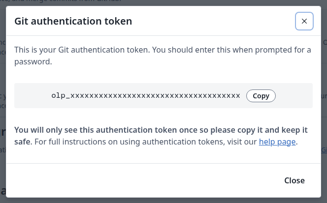

Pracuj nad projektem na własnym komputerze za pomocą Git. Zmiany są przesyłane tylko wtedy, gdy uruchomisz `git pull` lub `git push`.

<Info>

Administrator musi najpierw włączyć [integrację z Git](/pl/on-premises/configuration/overleaf-toolkit/integrations/git-integration).

</Info>

## Tworzenie tokenu {#create-a-token}

Git loguje się za pomocą tokenu uwierzytelniania Git, a nie hasła do konta.

<Steps>
<Step title="Otwórz ustawienia konta">
Kliknij **Account**, a następnie **Account settings**. W sekcji **Git integration** kliknij **Generate token**. Gdy masz już token, ten przycisk nazywa się **Add another token**.

<Frame caption="Integracja z Git w ustawieniach konta">
  
</Frame>
</Step>

<Step title="Skopiuj token">
Kliknij **Copy** i przechowuj token w bezpiecznym miejscu. Widzisz go tylko raz. Następnie kliknij **Close**.

<Frame caption="Twój nowy token">
  
</Frame>
</Step>

<Step title="Sprawdź token">
Lista pokazuje teraz początek tokenu, datę utworzenia i ostatniego użycia. Token wygasa po roku. Możesz mieć do 10 tokenów.

<Frame caption="Twoje tokeny">
  
</Frame>
</Step>
</Steps>

## Klonowanie projektu {#clone-a-project}

<Steps>
<Step title="Otwórz integrację z Git w edytorze">
Otwórz projekt. Na lewym pasku kliknij **Integrations**, a następnie **Git integration**.

<Frame caption="Panel Integrations">
  
</Frame>
</Step>

<Step title="Skopiuj polecenie">
Okno dialogowe **Clone with Git** pokazuje polecenie z adresem Twojej witryny i ID projektu. Kliknij **Copy**. Jeśli nie masz jeszcze tokenu, **Go to settings** otworzy ustawienia konta w nowej karcie.

<Frame caption="Polecenie klonowania">
  
</Frame>
</Step>

<Step title="Uruchom je">
Wklej polecenie do terminala. Gdy Git poprosi o hasło, wklej swój token.

```text
$ git clone https://git@<your-site>/git/<project-id>
Cloning into '<project-id>'...
Password for 'https://git@<your-site>': <your-token>
```

Folder nazwany identyfikatorem projektu zawiera teraz pliki projektu na gałęzi `main`. Aby wybrać nazwę folderu, dodaj ją na końcu polecenia.
</Step>
</Steps>

Git prosi o token za każdym razem, gdy łączy się z witryną. Aby go zapamiętać, włącz credential helper: Git zapyta jeszcze raz, a potem zachowa token. Helper `store` przechowuje go bez szyfrowania w `~/.git-credentials`.

```bash
git config --global credential.helper store
```

## Pobieranie zmian z edytora {#pull-changes-from-the-editor}

W folderze uruchom:

```bash
git pull
```

Git wyświetli listę zmienionych plików. Zmiany wprowadzone w edytorze przychodzą jako commity o nazwie `Update on Overleaf.`.

```text
Updating db007e3..c3e6332
Fast-forward
 main.tex | 2 +-
 1 file changed, 1 insertion(+), 1 deletion(-)
```

## Wysyłanie zmian {#push-your-changes}

Zatwierdź zmiany, a następnie je wyślij:

```bash
git add main.tex
git commit -m "Add a line from Git"
git push
```

Ostatni wiersz wyniku pokazuje gałąź, która się przesunęła:

```text
   53aca61..db007e3  main -> main
```

Zmiany pojawiają się w edytorze, a otwarty edytor aktualizuje się sam. Nowe pliki, foldery i zmiany nazw pojawiają się w drzewie plików. W **History** Twoja zmiana jest oznaczona jako <strong>You (via Git)</strong>. Komunikat commita nie jest tam wyświetlany.

<Frame caption="Push w historii projektu">
  
</Frame>

### Jeśli Git odrzuci push {#if-git-refuses-your-push}

Jeśli projekt w międzyczasie się zmienił, Git odrzuca push:

```text
 ! [rejected]        main -> main (fetch first)
```

Najpierw pobierz te zmiany, a następnie wyślij ponownie:

```bash
git pull --no-rebase --no-edit
git push
```

Zwykłe `git pull` może zatrzymać się z komunikatem `fatal: Need to specify how to reconcile divergent branches.` Opcja `--no-rebase` powyżej to rozwiązuje: scala obie strony.

Jeśli te same wiersze zmieniły się po obu stronach, pull zatrzymuje się z komunikatem `CONFLICT (content): Merge conflict in main.tex`. Popraw plik, a następnie uruchom:

```bash
git add main.tex
git commit -m "Merge the changes from the editor"
git push
```

Są dwie rzeczy, których witryna nie akceptuje:

* Inne gałęzie: `! [remote rejected] feature -> feature (wrong branch)`. Istnieje tylko `main`, więc wysyłaj tam swoją pracę.
* Wymuszony push: `! [remote rejected] main -> main (forced push prohibited)`. Zamiast tego umieść swoje zmiany na bieżącej gałęzi `main`.

### Jeśli Git zgłasza Authentication failed {#if-git-says-authentication-failed}

```text
remote: Enter your Git authentication token when prompted for a password.
fatal: Authentication failed for 'https://<your-site>/git/<project-id>/'
```

Token jest nieprawidłowy lub został usunięty albo wpisano hasło do konta. Utwórz nowy token, jeśli już go nie masz, ponieważ istniejącego tokenu nie można ponownie wyświetlić.

## Usuwanie tokenu {#delete-a-token}

W **Account settings**, w sekcji **Git integration**, kliknij ikonę usuwania obok tokenu, a następnie **Delete** w oknie dialogowym. Od tej pory Git odpowiada `Authentication failed` na ten token.

<Frame caption="Usuwanie tokenu">
  
</Frame>

<Info>

Informacje o tym, co mogą robić współpracownicy z dostępem tylko do odczytu, znajdziesz w Q\&A na stronie [integracji z Git](/pl/on-premises/configuration/overleaf-toolkit/integrations/git-integration).

</Info>
