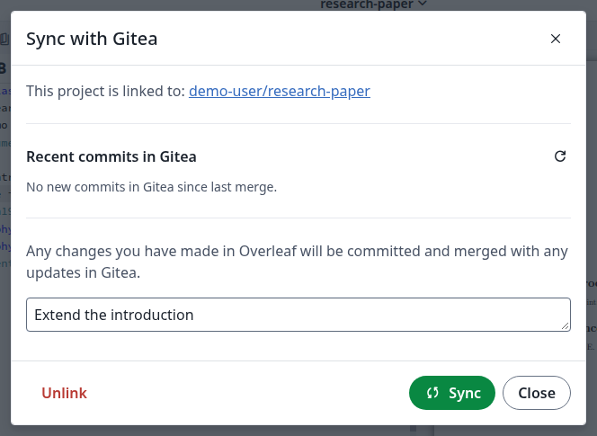

Połącz projekt z repozytorium Gitea. Zmiany przepływają w obu kierunkach i tylko wtedy, gdy klikniesz **Sync**: nic nie synchronizuje się samo.

<Info>

Administrator musi najpierw włączyć [synchronizację z Gitea](/pl/on-premises/configuration/overleaf-toolkit/integrations/gitea-synchronisation).

</Info>

## Łączenie konta Gitea {#link-your-gitea-account}

Robisz to raz.

<Steps>
<Step title="Otwórz ustawienia konta">
Kliknij **Account**, a następnie **Account settings**. W sekcji **Project synchronisation** znajdź **Gitea** i kliknij **Link**.

<Frame caption="Gitea w ustawieniach konta">
  
</Frame>
</Step>

<Step title="Autoryzuj w Gitea">
Otworzy się Gitea. Zaloguj się, jeśli zostaniesz o to poproszony, a następnie autoryzuj aplikację.
</Step>

<Step title="Sprawdź połączenie">
Wracasz do ustawień konta. Zielony komunikat informuje, że Twoje konto Gitea jest połączone, a na przycisku jest teraz napis **Unlink**.

<Frame caption="Twoje konto Gitea jest połączone">
  
</Frame>
</Step>
</Steps>

Jeśli Twoje konto nie jest jeszcze połączone, **Import from Gitea** i karta **Gitea** w edytorze najpierw poproszą o jego połączenie. Kliknij **Link to your Gitea account**. Również w ten sposób trafisz do ustawień konta, w nowej karcie, jeśli zacząłeś w edytorze. Następnie wróć i zacznij od nowa.

<Frame caption="Komunikat, gdy konto nie jest połączone">
  
</Frame>

## Importowanie repozytorium {#import-a-repository}

Tworzy to nowy projekt z repozytorium Gitea, już z nim połączony.

<Steps>
<Step title="Otwórz okno importu">
Na stronie projektów kliknij **New project**, a następnie **Import from Gitea**.

<Frame caption="Menu New project">
  
</Frame>
</Step>

<Step title="Wybierz repozytorium">
Kliknij **Import to Overleaf** obok repozytorium. Lista zawiera Twoje repozytoria i repozytoria Twoich organizacji. Puste repozytorium nie jest wyświetlane: potrzebuje co najmniej jednego commita.

<Frame caption="Twoje repozytoria Gitea">
  
</Frame>
</Step>

<Step title="Sprawdź projekt">
Nowy projekt otworzy się z plikami repozytorium.

<Frame caption="Zaimportowany projekt">
  
</Frame>
</Step>
</Steps>

## Eksportowanie projektu do nowego repozytorium {#export-a-project-to-a-new-repository}

Tworzy to repozytorium z projektu i łączy je. Projekt można połączyć tylko w ten sposób lub przez import: nie można połączyć go z istniejącym już repozytorium.

<Steps>
<Step title="Otwórz Gitea w edytorze">
Otwórz projekt. Na lewym pasku kliknij **Integrations**, a następnie **Gitea**.

<Frame caption="Panel Integrations">
  
</Frame>
</Step>

<Step title="Wypełnij dane repozytorium">
Wybierz **Owner**: może to być Twoje konto lub jedna z Twoich organizacji. Gdy wybierzesz organizację, to pole nazywa się **Organization**. **Repository Name** początkowo jest nazwą projektu: jeśli ta nazwa zawiera spacje, zmień ją, ponieważ Gitea ich nie akceptuje. Opis jest opcjonalny, a **Private** jest domyślnie zaznaczone. Kliknij **Create a Gitea repository**.

<Frame caption="Export Project to Gitea">
  
</Frame>

Jeśli nazwa zawiera spacje lub jest już zajęta, okno dialogowe wyświetli <strong>Please check that the repository name is valid, and that you have permission to create the repository.</strong> Zmień nazwę i ponownie kliknij przycisk.
</Step>

<Step title="Sprawdź połączenie">
Okno dialogowe pokazuje teraz **This project is linked to** i nazwę repozytorium.

<Frame caption="Projekt jest połączony">
  
</Frame>
</Step>
</Steps>

## Synchronizacja {#sync}

<Steps>
<Step title="Otwórz okno synchronizacji">
Otwórz połączony projekt. Na lewym pasku kliknij **Integrations**, a następnie **Gitea**.

**Recent commits in Gitea** pokazuje, co trafi do projektu.

<Frame caption="Nowy commit czeka w Gitea">
  
</Frame>
</Step>

<Step title="Opisz swoje zmiany">
Jeśli coś zmieniłeś w projekcie, pojawi się pole na komunikat commita. Jest opcjonalne: jeśli zostawisz je puste, commit będzie nazywał się `Updates from Overleaf`.

<Frame caption="Komunikat commita dla Twoich zmian">
  
</Frame>
</Step>

<Step title="Kliknij Sync">
Kliknij **Sync**. Nowe commity z Gitea trafiają do projektu, a Twoje zmiany do domyślnej gałęzi repozytorium. Jeśli obie strony zmieniły różne rzeczy, zostaną one scalone automatycznie przez pull request, który pozostaje w Gitea jako zapis.
</Step>

<Step title="Sprawdź wynik">
Okno dialogowe pokazuje <strong>No new commits in Gitea since last merge.</strong>, a pole komunikatu commita znika. Pliki w edytorze i commity w Gitea są aktualne.

<Frame caption="Wszystko jest zsynchronizowane">
  
</Frame>
</Step>
</Steps>

### Jeśli te same wiersze zmieniły się po obu stronach {#if-the-same-lines-changed-on-both-sides}

Okno dialogowe informuje, że zmian nie udało się scalić, i podaje nazwę nowej gałęzi `overleaf-YYYY-MM-DD-HHMMSS`, która zawiera Twoje zmiany. Overleaf otwiera też w Gitea pull request z tej gałęzi.

<Frame caption="Konflikt">
  
</Frame>

1.  Scal tę gałąź z gałęzią domyślną za pomocą Git i rozwiąż konflikt. W międzyczasie możesz zamknąć okno dialogowe: po ponownym otwarciu pokaże ten sam komunikat.

    ```bash
    git clone <repository-address>
    cd <repository-name>
    git merge origin/overleaf-YYYY-MM-DD-HHMMSS
    # fix the conflict in the file Git names
    git add <file>
    git commit
    git push
    ```
2. Kliknij **I have manually merged. Continue**. Scalony wynik trafi do projektu. Jeśli klikniesz przed scaleniem gałęzi, okno dialogowe pozostanie bez zmian.
3. Gałąź pozostaje w Gitea, a jej pull request pozostaje otwarty. Zamknij pull request i usuń gałąź, gdy nie będą już potrzebne.

To samo okno dialogowe pojawia się, gdy reguła ochrony gałęzi wstrzymuje pull request, na przykład gdy wymaga zatwierdzenia, nawet jeśli żadne wiersze nie są w konflikcie. Gdy reguła na to pozwoli, scal pull request w Gitea i kliknij **I have manually merged. Continue**. Zobacz [Jak działa synchronizacja z Gitea](/pl/on-premises/configuration/overleaf-toolkit/integrations/gitea-synchronisation#how-syncing-works-with-gitea).

## Odłączanie projektu {#unlink-a-project}

Zrób to, gdy nie chcesz już synchronizować projektu.

<Steps>
<Step title="Kliknij Unlink">
W oknie synchronizacji kliknij **Unlink**.
</Step>

<Step title="Potwierdź">
Kliknij **Confirm**. To tylko usuwa połączenie: połączenie z repozytorium, którego jesteś właścicielem, wspomniane w ostrzeżeniu, to opcja, którą masz później, a nie coś, co dzieje się teraz.

<Frame caption="Potwierdzenie odłączenia">
  
</Frame>
</Step>

<Step title="Sprawdź wynik">
Okno dialogowe pokazuje teraz **Export Project to Gitea**. Projekt i repozytorium zachowują swoją zawartość. Aby ponownie synchronizować, wyeksportuj projekt do nowego repozytorium lub zaimportuj repozytorium do nowego projektu.
</Step>
</Steps>

## Odłączanie konta Gitea {#unlink-your-gitea-account}

W **Account settings**, w sekcji **Gitea**, kliknij **Unlink**, a następnie ponownie **Unlink** w oknie dialogowym.

<Frame caption="Odłączanie konta">
  
</Frame>

Twoje projekty pozostają połączone ze swoimi repozytoriami. Nie możesz ich synchronizować, dopóki ponownie nie połączysz konta.

<Info>

Informacje o tym, kto może co robić we wspólnym projekcie, znajdziesz w sekcji [Kto może łączyć i synchronizować](/pl/on-premises/configuration/overleaf-toolkit/integrations/gitea-synchronisation#who-can-link-and-sync).

</Info>
