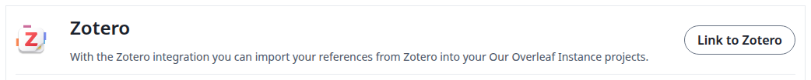

Zaimportuj bibliotekę Zotero do projektu jako plik `.bib`, a następnie cytuj z niego jak zwykle. Plik jest kopią: zmienia się tylko wtedy, gdy klikniesz **Refresh**.

<Info>

Jeśli w **Account settings** nie widzisz opcji Zotero, poproś administratora o włączenie [integracji z Zotero](/pl/on-premises/configuration/overleaf-toolkit/integrations/zotero-integration).

</Info>

## Połącz konto Zotero {#link-your-zotero-account}

Robisz to tylko raz.

<Steps>
<Step title="Otwórz ustawienia konta">
Kliknij **Account**, a następnie **Account settings**. W sekcji **Reference managers** znajdź **Zotero** i kliknij **Link to Zotero**.

<Frame caption="Zotero w ustawieniach konta">
  
</Frame>

Karta **Zotero** w panelu **Integrations** edytora prowadzi w to samo miejsce, w tej samej karcie przeglądarki.

<Frame caption="Panel Integrations">
  
</Frame>
</Step>

<Step title="Autoryzuj w Zotero">
Otworzy się Zotero. Zaloguj się, jeśli pojawi się taka prośba, a następnie autoryzuj aplikację. Prosi ona tylko o odczyt Twojej biblioteki i grup, więc nie może niczego zmienić w Zotero.
</Step>

<Step title="Sprawdź połączenie">
Wrócisz do ustawień konta. Zielony komunikat brzmi **Reference manager linked**, a na przycisku widnieje teraz **Unlink**.

<Frame caption="Konto Zotero jest połączone">
  
</Frame>
</Step>
</Steps>

Jeśli nie zezwolisz na dostęp w Zotero, ta sama sekcja wyświetli **Sorry, something went wrong**. Kliknij **Link to Zotero**, aby spróbować ponownie.

## Utwórz plik z biblioteki {#create-a-file-from-your-library}

<Steps>
<Step title="Otwórz okno Add files">
Otwórz projekt. W drzewie plików kliknij **New file**, a następnie **From Zotero**. Ta pozycja pojawia się dopiero po połączeniu konta.
</Step>

<Step title="Wybierz nazwę pliku i bibliotekę">
Pole **File Name** ma początkowo wartość `zotero.bib`. Zachowaj rozszerzenie `.bib`: bez niego nie zobaczysz podglądu, a ani `\cite`, ani `\bibliography` nie znajdą wpisów.

Pole **Library** ma początkowo wartość **My Library** i wyświetla też Twoje biblioteki grupowe. Jeden plik zawiera jedną bibliotekę.

<Frame caption="Plik z biblioteki osobistej">
  
</Frame>
</Step>

<Step title="Kliknij Create">
Okno się zamknie, a plik pojawi się w drzewie plików. Kliknij go: zobaczysz, kiedy został zaimportowany, oraz jego wpisy. Nie możesz go edytować w edytorze.

<Frame caption="Zaimportowany plik">
  
</Frame>

Jeśli **Create** pozornie nic nie robi, plik o tej nazwie już istnieje. Wybierz inną nazwę.
</Step>
</Steps>

### Importowanie biblioteki grupowej {#import-a-group-library}

Powtórz te same kroki z osobną nazwą pliku i wybierz grupę w polu **Library**. Projekt może zawierać kilka takich plików.

<Frame caption="Plik z biblioteki grupowej">
  
</Frame>

## Cytowanie z pliku {#cite-from-the-file}

<Steps>
<Step title="Rozpocznij cytowanie">
W pliku `.tex` wpisz `\cite{`. Lista pokazuje wpisy ze wszystkich plików `.bib` w projekcie. Kliknij wpis, aby go wstawić.

<Frame caption="Wpisy z zaimportowanych plików">
  
</Frame>
</Step>

<Step title="Albo wyszukaj według tytułu lub autora">
Kliknij **Search** pod listą lub naciśnij Ctrl+Spacja wewnątrz nawiasów klamrowych. Wpisz tekst, aby filtrować, kliknij jeden lub więcej wpisów, a następnie **Insert**.

<Frame caption="Wyszukiwanie bibliografii">
  
</Frame>
</Step>

<Step title="Dodaj bibliografię">
Dodaj te wiersze przed `\end{document}`, podając nazwy plików bez `.bib`, oddzielone przecinkami:

```latex
\bibliographystyle{plain}
\bibliography{reading-group,zotero}
```

Kliknij **Recompile**. Pozycja pojawi się w pliku PDF.

<Frame caption="Skompilowana pozycja">
  
</Frame>
</Step>
</Steps>

Zaimportowane pliki nie są proponowane w **Settings** w sekcji **References**, **Main bibliography file for this project**, więc lista pozostaje pusta, jeśli projekt nie ma innego pliku `.bib`. Nadal możesz z nich cytować.

<Frame caption="Pusta lista jest oczekiwana">
  
</Frame>

## Odśwież plik {#refresh-the-file}

Zmiany w Twojej bibliotece Zotero nie trafiają do projektu same, a kompilacja ich nie pobiera.

<Steps>
<Step title="Otwórz plik">
W drzewie plików kliknij zaimportowany plik.
</Step>

<Step title="Kliknij Refresh">
Cały plik zostaje ponownie zaimportowany z biblioteki wybranej podczas tworzenia: nowe wpisy się pojawiają, a usunięte znikają. Godzina u góry się zmienia.

<Frame caption="Odświeżony plik">
  
</Frame>
</Step>

<Step title="Skompiluj ponownie">
Nowe wpisy od razu pojawiają się na liście `\cite{`. Kliknij **Recompile**, aby zaktualizować PDF.
</Step>
</Steps>

Każdy plik odświeża się osobno: plik grupy odśwież oddzielnie. Kto może odświeżyć plik we współdzielonym projekcie, opisano w [uwagach dla administratorów](/on-premises/configuration/overleaf-toolkit/integrations/zotero-integration#notes).

## Odłącz konto Zotero {#unlink-your-zotero-account}

W **Account settings** w sekcji **Zotero** kliknij **Unlink**, a następnie ponownie **Unlink** w oknie dialogowym. Na przycisku znów widnieje **Link to Zotero**.

<Frame caption="Odłączanie konta">
  
</Frame>

Zaimportowane pliki pozostają w Twoich projektach i nadal się kompilują. Pozycja **From Zotero** znika z okna **Add files**, a **Refresh** pokazuje błąd, dopóki ponownie nie połączysz konta.

<Frame caption="Odświeżanie bez połączonego konta">
  
</Frame>

Po ponownym połączeniu **Refresh** działa na tych samych plikach.

## Jeśli coś pójdzie nie tak {#if-something-goes-wrong}

**Could not load references from Zotero, please re-link your account and try again** lub **There was an error accessing your Zotero data** w oknie **Add files**: Overleaf nie może już odczytać Twojej biblioteki, na przykład dlatego, że cofnięto mu dostęp w Zotero. W **Account settings** kliknij **Unlink**, a następnie **Link to Zotero**. Do tego czasu **Create** również kończy się niepowodzeniem z komunikatem **The project that contains this file is not shared with you**, nawet w Twoim własnym projekcie.

<Frame caption="Overleaf nie może już odczytać Twojej biblioteki">
  
</Frame>

**The remote service produced an error** po kliknięciu **Refresh**: żądanie do Zotero nie powiodło się. Plik zachowuje swoją zawartość. Kliknij **Refresh** ponownie później.
