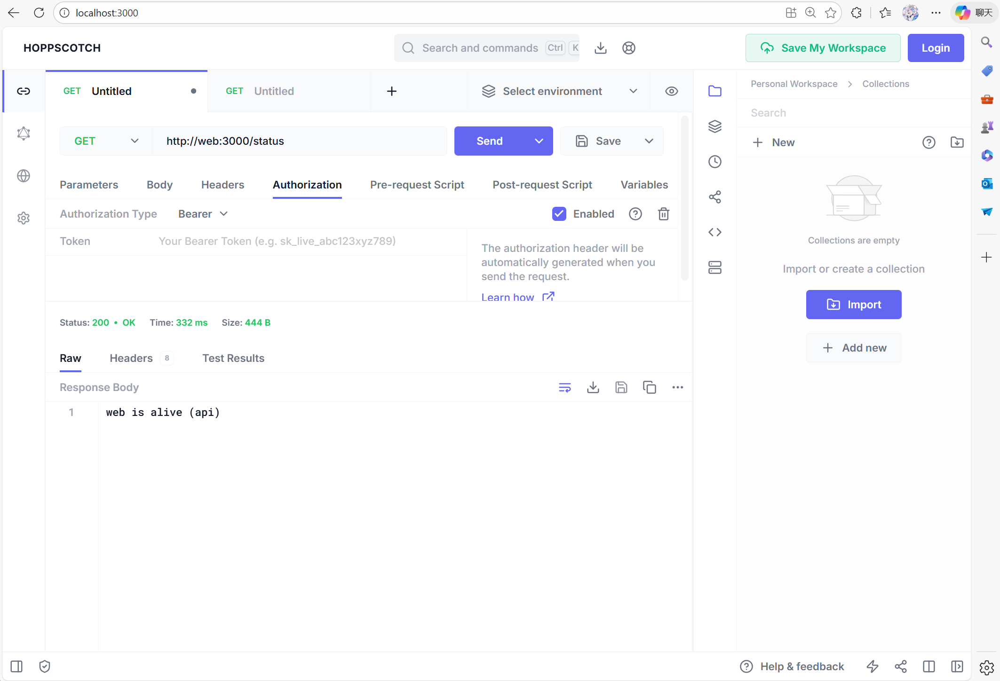

## Ferramentas de desenvolvimento recomendadas {#develop-tools-recommended}

Estes serviços opcionais não são necessários para executar o Overleaf, mas ajudam muito a desenvolver, depurar e examinar os dados. Todos fazem parte do ambiente de desenvolvimento, então não há nada a adicionar ao `docker-compose.yml`. Depois que você faz login no site, o menu **Dev tools** na barra de navegação aponta para os que o site serve em seus próprios caminhos.

| Ferramenta | Endereço | Definida em |
| --- | --- | --- |
| **Grafana**, o estado, as métricas e os logs de cada serviço | [http://localhost/grafana/](http://localhost/grafana/) | `develop/grafana/docker-compose.yml`, ativa com `GRAFANA_ENABLED=true` em `develop/dev.rc` (padrão) |
| **Mailpit**, uma caixa de entrada para cada e-mail que o site envia | [http://localhost/mailpit/](http://localhost/mailpit/) | `develop/mail/docker-compose.yml`, ativa com `MAILPIT_ENABLED=true` (padrão) |
| **Mongo Express**, uma interface para o MongoDB | [http://localhost/mongo-express/](http://localhost/mongo-express/) | `develop/docker-compose.yml`, sempre ativa |
| **RedisInsight**, uma interface para os dados do Redis | [http://localhost/redis-insight/](http://localhost/redis-insight/) | `develop/docker-compose.yml`, sempre ativa |
| **Hoppscotch**, um cliente de API no navegador, semelhante ao Postman | [http://localhost:9170](http://localhost:9170/) (`HOPPSCOTCH_PORT`) | `develop/hoppscotch/docker-compose.yml`, ativa com `HOPPSCOTCH_ENABLED=true` (padrão) |

<Warning>

Nenhuma dessas ferramentas tem login: os usuários anônimos do Grafana são seus administradores, e o Mongo Express pode alterar qualquer documento. O site, o Hoppscotch, o Mongo Express (8081) e o RedisInsight (5540) escutam apenas em `127.0.0.1` do host, então outros hosts não conseguem acessá-los.

</Warning>

### Grafana {#grafana}

O Grafana é servido pelo site em `/grafana/`, por meio do webpack-dev-server, então não precisa de uma porta própria. Sua pasta **Overleaf Develop** tem estes dashboards:

| Dashboard | O que mostra |
| --- | --- |
| All services (início) | Estado de cada serviço, indicadores do host, carga e logs. Um clique em um serviço abre o dashboard dele |
| Server | CPU, carga, memória, disco e rede do host, e as compilações do clsi |
| Errors | Logs de erro, respostas 5xx e 4xx, mensagens de erro mais frequentes e rotas com falha |
| Data flow | O caminho de uma edição: document-updater e Redis, project-history, history-v1, Mongo, armazenamento de objetos |
| Containers | Estado de cada contêiner, CPU, memória, rede e disco, incluindo as compilações em sandbox |
| Um por serviço | Os serviços Node.js, git-bridge (JVM), mongo e redis |

<Columns cols={2}>
<Column>

<Frame caption="All services: o estado de cada serviço, o host e os recursos que cada serviço usa">
  
</Frame>

</Column>

<Column>

<Frame caption="Data flow: uma edição a caminho do document-updater, passando pelo project-history, até o history-v1 e o Mongo">
  
</Frame>

</Column>
</Columns>

O Prometheus coleta `/metrics` dos serviços, `mongodb-exporter`, `redis-exporter`, `cadvisor` e `node-exporter`; o Alloy envia os logs de cada contêiner do projeto ao Loki, onde os filtros **Log search**, **Service** e **Log level** dos dashboards os leem. Os dados ficam apenas nos contêineres, então recriá-los os esvazia. O cAdvisor roda com privilégios e lê `/`, `/sys`, os dados do Docker e o socket do containerd do host, somente leitura; o node-exporter lê `/` do host.

Os dashboards são gerados: altere `develop/grafana/make-dashboards` e execute-o, em vez de editar os arquivos JSON.

### Mailpit {#mailpit}

Com `MAILPIT_ENABLED=true`, o `web` envia todo e-mail ao Mailpit em vez de a um servidor de e-mail real, e a confirmação de e-mail fica ativada (`EMAIL_CONFIRMATION_DISABLED=false`). Links de ativação, convites de projeto, redefinições de senha e códigos de confirmação podem então ser seguidos pela caixa de entrada.

<Frame caption="Um e-mail de ativação, um convite de projeto, um código de confirmação e uma redefinição de senha no Mailpit">
  
</Frame>

O Mailpit não tem volume: recriar o contêiner esvazia a caixa de entrada.

### Mongo Express {#mongo-express}

O Mongo Express mostra as coleções do banco `sharelatex` e permite ver, editar, importar e exportar seus documentos.

<Frame caption="As coleções do banco sharelatex no Mongo Express">
  
</Frame>

### RedisInsight {#redisinsight}

O RedisInsight guarda suas conexões em `develop/data/redis-insight`. Na primeira vez, escolha **Connect existing database** e informe o host `redis` e a porta `6379`.

<Frame caption="RedisInsight conectado ao serviço redis">
  
</Frame>

### Configurar o Hoppscotch {#setup-hoppscotch}

#### Requisições de API via proxy {#proxy-api-request}

O Hoppscotch envia requisições a partir do navegador, que não consegue alcançar os serviços pelos nomes do Docker. Seu proxy, o Proxyscotch, roda dentro da rede do Docker e é servido em `/proxy` do endereço do Hoppscotch. Abra [http://localhost:9170](http://localhost:9170/), vá em Settings → Interceptor, escolha **Proxy** e defina a Proxy URL como `http://localhost:9170/proxy`. A configuração fica no navegador.

<Frame caption="A configuração do Interceptor. A captura de tela é de uma configuração antiga: use `http://localhost:9170/proxy` como Proxy URL.">
  
</Frame>

Agora você pode testar com [http://web:3000/status](http://web:3000/status) para verificar se o web está ativo:

<Frame>
  
</Frame>

#### Importar as APIs dos serviços {#import-the-service-apis}

`develop/hoppscotch/openapi/` tem um arquivo OpenAPI para a API interna de cada serviço. No Hoppscotch, abra Collections → Import → Import from File e selecione todos os arquivos de uma vez. Cada arquivo vira uma coleção cujas requisições vão para o endereço Docker do serviço. Os mesmos arquivos aparecem na seção [API dos serviços](/pt/dev/service-api/overview).

#### Problemas de CSRF {#csrf-problems}

<Warning>

Se você usar o Postman ou outras ferramentas de depuração para gerar uma requisição **post**, poderá perceber que o login é **proibido**, resultando em um erro 403. Isso acontece porque o Overleaf é protegido por verificação **csrf**.

</Warning>

<Frame>
  
</Frame>

No seu console, você poderá ver:

<Frame>
  
</Frame>

Para lidar com isso no desenvolvimento do Overleaf, você precisa configurar o seu token csrf. Aqui está o tutorial detalhado.

<Steps>
<Step title="Adicionar Pre-Request">
Adicione o seguinte código ao Pre-Request

<Frame>
  
</Frame>

O script é o seguinte:

```js wrap
pm.sendRequest("http://web:3000/dev/csrf", function (err, res) {
    if (err) {
        console.log(err);
        return;
    }

    // 1) Save CSRF token (/dev/csrf)
    const token = res.text().trim();
    pw.env.set("csrftoken", token);
    console.log("csrftoken =", token);

    const setCookieHeader = (res.headers || []).find(h => h.key?.toLowerCase() === "set-cookie")?.value;
    console.log("set-cookie =", setCookieHeader);

    if (!setCookieHeader) return;

    const cookiePair = setCookieHeader.split(";")[0].trim(); // overleaf.sid=...
    pw.env.set("cookie_header", cookiePair);
    console.log("cookie_header =", cookiePair);
});
```
</Step>

<Step title="Adicionar cabeçalhos da requisição">
Você precisa adicionar os seguintes cabeçalhos:

| Nome do cabeçalho | Valor do cabeçalho  |
| ----------------- | ------------------- |
| Content-Type      | `application/json`  |
| X-Csrf-Token      | `<<csrftoken>>`     |
| Cookie            | `<<cookie_header>>` |

<Frame>
  
</Frame>
</Step>

<Step title="Fazer login com ferramentas de API">
Agora você pode fazer login com seu nome de usuário e senha.

```json5
{
  "_csrf": "<<csrftoken>>",
  "email": "admin@overleaf.com",
  "password": "xxxxxx"
}
```

Esta é a resposta quando você informa um nome de usuário ou senha incorretos.

<Frame>
  
</Frame>
</Step>
</Steps>
