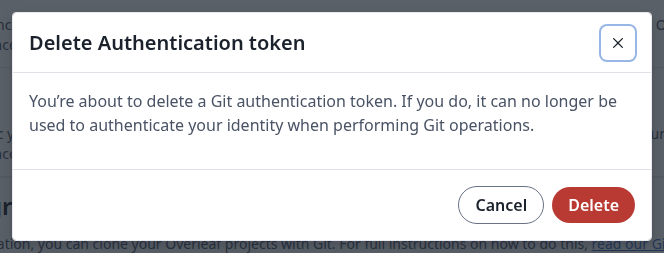

Trabalhe em um projeto no seu próprio computador com Git. As alterações só são transferidas quando você executa `git pull` ou `git push`.

<Info>

Um administrador precisa ativar primeiro a [integração com Git](/pt/on-premises/configuration/overleaf-toolkit/integrations/git-integration).

</Info>

## Criar um token {#create-a-token}

O Git faz login com um token de autenticação do Git, não com a senha da sua conta.

<Steps>
<Step title="Abra as configurações da conta">
Clique em **Account** e depois em **Account settings**. Em **Git integration**, clique em **Generate token**. Depois que você tiver um token, esse botão passa a se chamar **Add another token**.

<Frame caption="A integração com Git nas configurações da conta">
  
</Frame>
</Step>

<Step title="Copie o token">
Clique em **Copy** e guarde o token em um lugar seguro. Você só o vê uma vez. Depois clique em **Close**.

<Frame caption="Seu novo token">
  
</Frame>
</Step>

<Step title="Verifique o token">
A lista agora mostra o início do token, quando ele foi criado e quando foi usado pela última vez. Ele expira após um ano. Você pode ter até 10 tokens.

<Frame caption="Seus tokens">
  
</Frame>
</Step>
</Steps>

## Clonar um projeto {#clone-a-project}

<Steps>
<Step title="Abra a integração com Git no editor">
Abra o projeto. Na barra à esquerda, clique em **Integrations** e depois em **Git integration**.

<Frame caption="O painel Integrations">
  
</Frame>
</Step>

<Step title="Copie o comando">
A caixa de diálogo **Clone with Git** mostra o comando, com o endereço do seu site e o ID do projeto. Clique em **Copy**. Se você ainda não tiver um token, **Go to settings** abre as configurações da sua conta em uma nova aba.

<Frame caption="O comando de clonagem">
  
</Frame>
</Step>

<Step title="Execute o comando">
Cole o comando em um terminal. Quando o Git pedir uma senha, cole seu token.

```text
$ git clone https://git@<your-site>/git/<project-id>
Cloning into '<project-id>'...
Password for 'https://git@<your-site>': <your-token>
```

Uma pasta com o nome do ID do projeto agora contém os arquivos do projeto, no branch `main`. Para escolher o nome da pasta, adicione-o ao final do comando.
</Step>
</Steps>

O Git pede o token toda vez que se conecta ao site. Para que ele seja lembrado, ative um credential helper: o Git pede mais uma vez e depois guarda o token. O helper `store` o guarda sem criptografia em `~/.git-credentials`.

```bash
git config --global credential.helper store
```

## Trazer as alterações do editor {#pull-changes-from-the-editor}

Dentro da pasta, execute:

```bash
git pull
```

O Git lista os arquivos que mudaram. As alterações feitas no editor chegam como commits chamados `Update on Overleaf.`.

```text
Updating db007e3..c3e6332
Fast-forward
 main.tex | 2 +-
 1 file changed, 1 insertion(+), 1 deletion(-)
```

## Enviar suas alterações {#push-your-changes}

Faça commit das suas alterações e depois envie-as com push:

```bash
git add main.tex
git commit -m "Add a line from Git"
git push
```

A última linha da saída mostra o branch que avançou:

```text
   53aca61..db007e3  main -> main
```

As alterações aparecem no editor, e um editor aberto se atualiza sozinho. Novos arquivos, pastas e renomeações aparecem na árvore de arquivos. Em **History**, sua alteração aparece marcada como <strong>You (via Git)</strong>. Sua mensagem de commit não é mostrada ali.

<Frame caption="Um push no histórico do projeto">
  
</Frame>

### Se o Git recusar seu push {#if-git-refuses-your-push}

Se o projeto mudou nesse meio-tempo, o Git rejeita o push:

```text
 ! [rejected]        main -> main (fetch first)
```

Traga essas alterações primeiro e depois faça push de novo:

```bash
git pull --no-rebase --no-edit
git push
```

Um `git pull` simples pode parar com `fatal: Need to specify how to reconcile divergent branches.` A opção `--no-rebase` acima resolve isso: ela mescla os dois lados.

Se as mesmas linhas mudaram dos dois lados, o pull para com `CONFLICT (content): Merge conflict in main.tex`. Corrija o arquivo e depois execute:

```bash
git add main.tex
git commit -m "Merge the changes from the editor"
git push
```

Há duas coisas que o site não aceita:

* Outros branches: `! [remote rejected] feature -> feature (wrong branch)`. Só existe `main`, então envie seu trabalho para ele.
* Force push: `! [remote rejected] main -> main (forced push prohibited)`. Em vez disso, coloque suas alterações sobre o `main` atual.

### Se o Git disser Authentication failed {#if-git-says-authentication-failed}

```text
remote: Enter your Git authentication token when prompted for a password.
fatal: Authentication failed for 'https://<your-site>/git/<project-id>/'
```

O token está errado ou foi excluído, ou você digitou a senha da sua conta. Crie um novo token se não tiver mais o antigo, porque não é possível ver um token existente de novo.

## Excluir um token {#delete-a-token}

Em **Account settings**, em **Git integration**, clique no ícone de exclusão ao lado do token e depois em **Delete** na caixa de diálogo. A partir daí, o Git responde `Authentication failed` para esse token.

<Frame caption="Excluir um token">
  
</Frame>

<Info>

Para saber o que colaboradores com acesso somente leitura podem fazer, consulte o Q\&A da [integração com Git](/pt/on-premises/configuration/overleaf-toolkit/integrations/git-integration).

</Info>
