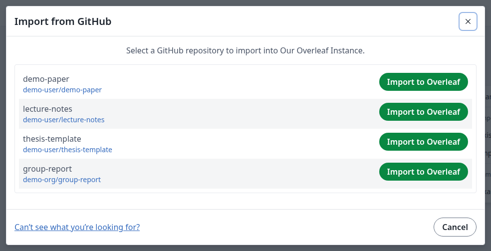

Conecte um projeto a um repositório do GitHub. As alterações vão nos dois sentidos, e só quando você clica em **Sync**: nada é sincronizado sozinho.

<Info>

Se você não vir nenhuma opção do GitHub em **Account settings** ou no editor, peça ao seu administrador para ativar a [sincronização com GitHub](/pt/on-premises/configuration/overleaf-toolkit/integrations/github-synchronisation).

</Info>

## Vincular sua conta do GitHub {#link-your-github-account}

Você faz isso uma vez.

<Steps>
<Step title="Abra as configurações da conta">
Clique em **Account** e depois em **Account settings**. Role até **GitHub** e clique em **Link**.

<Frame caption="GitHub nas configurações da conta">
  
</Frame>
</Step>

<Step title="Autorize no GitHub">
O GitHub abre. Faça login se for solicitado e depois autorize o aplicativo.
</Step>

<Step title="Verifique o vínculo">
Você volta às configurações da conta, e o botão agora diz **Unlink**.

<Frame caption="Sua conta do GitHub está vinculada">
  
</Frame>
</Step>
</Steps>

Se sua conta ainda não estiver vinculada, **Import from GitHub** e o cartão **GitHub** no editor pedem que você a vincule primeiro. Clique em **Link to your GitHub account**. Você também chega às configurações da conta, em uma nova aba se tiver começado no editor. Depois volte e comece de novo.

<Frame caption="O aviso quando sua conta não está vinculada">
  
</Frame>

## Importar um repositório {#import-a-repository}

Isso cria um novo projeto a partir de um repositório do GitHub, já vinculado a ele.

<Steps>
<Step title="Abra a caixa de diálogo de importação">
Na página de projetos, clique em **New project** e depois em **Import from GitHub**.

<Frame caption="O menu New project">
  
</Frame>

<Info>

**New project** aparece quando você tem um projeto. O menu **Create a new project** da página de boas-vindas não tem importação, então crie primeiro um projeto em branco.

</Info>
</Step>

<Step title="Escolha o repositório">
Clique em **Import to Overleaf** ao lado do repositório. A lista inclui seus repositórios e os das suas organizações.

<Frame caption="Seus repositórios do GitHub">
  
</Frame>

Se faltar o repositório de uma organização, clique em <strong>Can't see what you're looking for?</strong> para ver a ajuda do GitHub sobre como aprovar o aplicativo para essa organização.
</Step>

<Step title="Verifique o projeto">
O novo projeto abre com os arquivos do repositório.

<Frame caption="O projeto importado">
  
</Frame>
</Step>
</Steps>

## Exportar um projeto para um novo repositório {#export-a-project-to-a-new-repository}

Isso cria um repositório a partir de um projeto do qual você é dono e os vincula. Um projeto só pode ser vinculado dessa forma ou por importação: não é possível vinculá-lo a um repositório que já existe.

<Steps>
<Step title="Abra o GitHub no editor">
Abra o projeto. Na barra à esquerda, clique em **Integrations** e depois em **GitHub**.

<Frame caption="O painel Integrations">
  
</Frame>
</Step>

<Step title="Preencha o repositório">
Escolha o **Owner**, que pode ser você ou uma das suas organizações. **Repository Name** começa com o nome do projeto. A descrição é opcional, e **Private** vem selecionado por padrão. Clique em **Create a GitHub repository**.

<Frame caption="Export Project to GitHub">
  
</Frame>
</Step>

<Step title="Verifique o vínculo">
A caixa de diálogo agora diz **This project is linked to** e nomeia o repositório.

<Frame caption="O projeto está vinculado">
  
</Frame>
</Step>
</Steps>

## Sincronizar {#sync}

<Steps>
<Step title="Abra a caixa de diálogo de sincronização">
Abra um projeto vinculado. Na barra à esquerda, clique em **Integrations** e depois em **GitHub**.

**Recent commits in GitHub** lista o que vai entrar no projeto.

<Frame caption="Um novo commit esperando no GitHub">
  
</Frame>
</Step>

<Step title="Descreva suas alterações">
Se você alterou algo no projeto, aparece um campo para a mensagem de commit. Ele é opcional: se você deixá-lo vazio, o commit se chama `Updates from Overleaf`.

<Frame caption="A mensagem de commit das suas alterações">
  
</Frame>
</Step>

<Step title="Clique em Sync">
Clique em **Sync**. Os novos commits do GitHub entram no projeto, e suas alterações vão para o branch padrão do repositório. Se os dois lados alteraram coisas diferentes, elas são mescladas para você.
</Step>

<Step title="Verifique o resultado">
A caixa de diálogo mostra <strong>No new commits in GitHub since last merge.</strong> e o campo da mensagem de commit desaparece. Os arquivos no editor e os commits no GitHub estão atualizados.

<Frame caption="Tudo está sincronizado">
  
</Frame>
</Step>
</Steps>

### Se as mesmas linhas mudaram dos dois lados {#if-the-same-lines-changed-on-both-sides}

A caixa de diálogo informa que as alterações não puderam ser mescladas e nomeia um novo branch, `overleaf-YYYY-MM-DD-HHMMSS`, que contém suas alterações.

<Frame caption="Um conflito">
  
</Frame>

1. Mescle esse branch no branch padrão no GitHub ou com Git. Você pode fechar a caixa de diálogo nesse meio-tempo: ela mostra a mesma mensagem quando você a abre de novo.
2. Clique em **I have manually merged. Continue**. O resultado mesclado entra no projeto.
3. O branch fica no GitHub. Exclua-o quando não precisar mais dele.

## Desvincular um projeto {#unlink-a-project}

Faça isso quando não quiser mais que o projeto seja sincronizado. Só o dono do projeto pode fazer isso.

<Steps>
<Step title="Clique em Unlink">
Na caixa de diálogo de sincronização, clique em **Unlink**.
</Step>

<Step title="Confirme">
Clique em **Confirm**. A observação sobre uma assinatura não impede que você vincule o projeto de novo.

<Frame caption="Confirme a desvinculação">
  
</Frame>
</Step>

<Step title="Verifique o resultado">
A caixa de diálogo agora mostra **Export Project to GitHub**. O projeto e o repositório mantêm seu conteúdo. Para sincronizar de novo, exporte o projeto para um novo repositório ou importe o repositório para um novo projeto.
</Step>
</Steps>

## Desvincular sua conta do GitHub {#unlink-your-github-account}

Em **Account settings**, em **GitHub**, clique em **Unlink** e depois em **Unlink** novamente na caixa de diálogo.

<Frame caption="Desvincule sua conta">
  
</Frame>

Seus projetos continuam vinculados aos repositórios. Você não pode sincronizá-los até vincular sua conta de novo.

<Info>

Para saber quem pode fazer o quê em um projeto compartilhado, consulte [Quem pode vincular e sincronizar](/pt/on-premises/configuration/overleaf-toolkit/integrations/github-synchronisation#who-can-link-and-sync). Cada colaborador que sincroniza vincula a própria conta do GitHub.

</Info>
