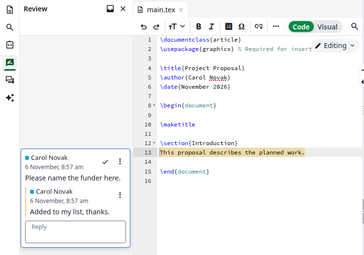

Cada projeto tem seu próprio servidor MCP, para que um cliente de IA no seu computador possa ler e editar o projeto, compilá-lo e responder aos seus comentários. O cliente faz login com um token de autenticação do Git.

<Info>

Se você não vê o cartão **MCP server**, indique ao seu administrador a página [Servidor MCP](/pt/on-premises/configuration/overleaf-toolkit/integrations/mcp-server).

</Info>

## Novidades da v6.3.3 {#new-in-v6-3-3}

A partir da v6.3.3, o cliente também pode trabalhar com o histórico do projeto: listar as alterações, comparar duas versões, ler um arquivo como ele era, salvar e excluir versões e restaurar um arquivo ou o projeto inteiro. Ele pode listar as alterações rastreadas e aceitá-las ou rejeitá-las, e transformar as próprias edições em alterações rastreadas quando você pedir. Pode comentar um trecho de texto e editar ou excluir mensagens de comentários, ler e enviar mensagens no chat do projeto, mover e renomear arquivos e pastas, criar pastas e mudar o idioma da verificação ortográfica. Quem pode fazer o quê segue o seu papel no projeto, como no editor, porque o cliente trabalha com o seu token: veja [Quem pode fazer o quê](#who-may-do-what).

O servidor MCP foi introduzido na v6.3.1. A v6.3.1 e a v6.3.2 têm as mesmas 17 ferramentas; a v6.3.3 tem 33.

| Ferramentas | v6.3.1 e v6.3.2 | v6.3.3 |
| ----- | ----------------- | ------ |
| `get_clone_info`, `get_settings`, `list_files`, `delete_file`, `compile`, `get_compile_log`, `get_output_file_link`, `word_count`, `reply_to_comment`, `resolve_comment`, `reopen_comment` | Sim | Sim, sem alterações |
| `read_file` | O conteúdo mais recente | Também um arquivo como era em uma `version` |
| `edit_file`, `write_file` | Seguem a configuração de rastreamento de alterações do projeto | Também `trackChanges`, para tornar a edição uma alteração rastreada |
| `update_settings` | Compilador, imagem do TeX Live e documento principal | Também o idioma da verificação ortográfica |
| `list_versions` | Versão, comentário e data | Também o `id` que `delete_version` recebe, e quem a salvou |
| `list_comments` | Mensagens sem id | Também o `id` de cada mensagem, que `edit_comment_message` e `delete_comment_message` recebem |
| `list_changes`, `diff`, `create_version`, `delete_version`, `restore_file`, `restore_project`, `list_tracked_changes`, `accept_tracked_changes`, `reject_tracked_changes`, `add_comment`, `edit_comment_message`, `delete_comment_message`, `list_chat_messages`, `send_chat_message`, `move_file`, `create_folder` | Não | Sim |

## Conectar um cliente {#connect-a-client}

<Steps>
<Step title="Abrir a caixa de diálogo">
Abra o projeto. Na barra à esquerda, clique em **Integrations** e depois em **MCP server**.

<Frame caption="O painel Integrations">
  
</Frame>

A caixa de diálogo mostra o endereço do servidor deste projeto e uma aba para cada cliente: **Claude Code**, **Codex**, **Cursor**, **VS Code** e **Gemini CLI**.

<Frame caption="A caixa de diálogo MCP server">
  
</Frame>
</Step>

<Step title="Criar um token">
Clique em **Go to settings**. As configurações da sua conta abrem em uma nova aba. Em **Git integration**, clique em **Generate token**, ou em **Add another token** se você já tiver um. Clique em **Copy** e guarde o token em um lugar seguro, porque você só o vê uma vez. Depois clique em **Close**.

<Frame caption="Seu novo token">
  
</Frame>

Um token que você já usa para a [integração com Git](/pt/on-premises/user-guide/users/git-integration) também funciona, assim como um único token para todos os seus projetos.
</Step>

<Step title="Adicionar o servidor ao seu cliente">
De volta à caixa de diálogo, clique na aba do seu cliente e em **Copy** ao lado da configuração.

| Aba | Onde colocar | O token |
| --- | ------------- | --------- |
| **Claude Code** | Execute o comando em um terminal | Substitua `<token>` no comando |
| **Codex** | `~/.codex/config.toml` | Coloque-o na variável de ambiente `OVERLEAF_TOKEN` |
| **Cursor** | `~/.cursor/mcp.json` | Coloque-o na variável de ambiente `OVERLEAF_TOKEN` |
| **VS Code** | `.vscode/mcp.json` | O arquivo tem um pedido de senha chamado `overleaf-token` no lugar do token |
| **Gemini CLI** | Execute o comando em um terminal | Substitua `<token>` no comando |

O endereço pertence a um único projeto. Para conectar outro projeto, adicione-o com outro nome, porque `overleaf` já está em uso. No Claude Code, por exemplo, troque `overleaf` no comando por `overleaf-lab`.
</Step>
</Steps>

## Verificar a conexão {#check-the-connection}

### Com o Claude Code {#with-claude-code}

```bash
claude mcp list
```

O servidor aparece como conectado:

```text
overleaf: https://<your-site>/project/<project-id>/mcp (HTTP) - ✔ Connected
```

### Com curl {#with-curl}

Isso funciona seja qual for o seu cliente. Substitua o endereço e o token e envie a requisição `initialize` do protocolo MCP:

```bash
curl -X POST https://<your-site>/project/<project-id>/mcp \
  -H "Authorization: Bearer <token>" \
  -H "Content-Type: application/json" \
  -H "Accept: application/json, text/event-stream" \
  -d '{"jsonrpc":"2.0","id":1,"method":"initialize","params":{"protocolVersion":"2025-06-18","capabilities":{},"clientInfo":{"name":"curl","version":"1.0"}}}'
```

A resposta traz o nome do servidor, seguido das instruções dele para os clientes:

```json
{"result":{"protocolVersion":"2025-06-18","capabilities":{"tools":{"listChanged":true}},"serverInfo":{"name":"overleaf","version":"1.0.0"},"instructions":"This server works on one Overleaf project. ..."},"jsonrpc":"2.0","id":1}
```

Para ver as ferramentas, envie `tools/list` com o mesmo comando. A resposta lista 33 ferramentas, ou 31 se o seu site tiver o chat do projeto desativado. Antes da v6.3.3, lista 17.

```bash
  -d '{"jsonrpc":"2.0","id":2,"method":"tools/list","params":{}}'
```

Para chamar uma, envie `tools/call`:

```bash
  -d '{"jsonrpc":"2.0","id":3,"method":"tools/call","params":{"name":"list_files","arguments":{}}}'
```

```json
{"result":{"content":[{"type":"text","text":"[\n  {\n    \"path\": \"main.tex\",\n    \"type\": \"doc\"\n  }\n]"}]},"jsonrpc":"2.0","id":3}
```

### Nas configurações da sua conta {#in-your-account-settings}

Em **Git integration**, **Last used** mostra a data de um token que o servidor recebeu.

<Frame caption="O primeiro token foi usado">
  
</Frame>

### Se não conectar {#if-it-does-not-connect}

| O que você vê | O que significa |
| ------------ | ------------- |
| Status `401`, ou no Claude Code `✘ Failed to connect` com `HTTP 401` | O token está ausente, errado ou foi excluído |
| Status `404` | Nenhum projeto tem esse ID |
| Status `405` | A requisição não era um `POST` |
| Status `406` com `Not Acceptable` | Falta o cabeçalho `Accept`: o cliente precisa aceitar tanto `application/json` quanto `text/event-stream` |

## O que você vê quando um cliente trabalha {#what-you-see-when-a-client-works}

As edições aparecem em um editor aberto à medida que o cliente as faz, como as de um colaborador, sem recarregar. Novos arquivos e pastas, movimentações e renomeações aparecem na árvore de arquivos.

<Frame caption="Uma linha adicionada por edit_file">
  
</Frame>

`edit_file` só altera texto que aparece exatamente uma vez. Caso contrário, o cliente recebe um erro, como `oldString not found in main.tex, read_file again` ou `oldString appears 2 times in main.tex, add context`, e nada muda.

A partir da v6.3.3, `move_file` move ou renomeia um arquivo ou pasta, criando as pastas do novo caminho quando necessário, e `create_folder` cria uma pasta. Se o arquivo não for encontrado ou o novo caminho já existir, o cliente recebe um erro e nada muda. `update_settings` também pode mudar o idioma da verificação ortográfica, por exemplo para `de`, ou desativá-la.

As respostas a comentários aparecem no painel de revisão com o seu nome, porque o token é seu. Um comentário resolvido pelo servidor sai do painel, e reabri-lo o traz de volta.

<Frame caption="Uma resposta enviada por reply_to_comment">
  
</Frame>

A partir da v6.3.3, `add_comment` comenta um trecho de texto. O texto precisa aparecer exatamente uma vez no arquivo; quando aparece mais de uma vez, o cliente também informa um trecho maior em volta dele que aparece uma única vez, e só o texto é comentado. O comentário aparece no painel de revisão com o seu nome e permanece no seu texto conforme o arquivo muda. `edit_comment_message` altera uma das suas próprias mensagens. `delete_comment_message` exclui uma mensagem, e excluir a primeira exclui o comentário inteiro, como no painel de revisão.

`compile` compila o projeto e retorna a lista de arquivos de saída. Em seguida, `get_output_file_link` fornece um link para baixar o PDF ou outro arquivo de saída. O link não precisa de token e deixa de funcionar após 5 minutos.

Para a lista completa de ferramentas, veja [Tools](/on-premises/configuration/overleaf-toolkit/integrations/mcp-server#tools).

## Alterações rastreadas {#tracked-changes}

A partir da v6.3.3, você pode pedir ao cliente que faça das suas edições alterações rastreadas, por exemplo *Rewrite the abstract as a tracked change*. `edit_file` e `write_file` então transformam a alteração em um arquivo existente em uma alteração rastreada no seu nome, mesmo quando o rastreamento de alterações está desativado no projeto, e você a aceita ou rejeita no painel de revisão. Um arquivo novo nunca é uma alteração rastreada. Se você não pedir, as edições seguem a configuração de rastreamento do projeto, como as suas no editor: são rastreadas quando o rastreamento está ativado para você ou para todos.

Se a conta do dono do projeto não tiver rastreamento de alterações, o cliente recebe `Track changes is off for this project` e nada muda.

Para revisar cada edição do cliente, ative o rastreamento de alterações para você. Para distinguir as edições dele das suas no painel de revisão, dê ao cliente o token de outra conta com a qual você compartilha o projeto.

`list_tracked_changes` lista as alterações rastreadas com o arquivo, o texto inserido ou excluído, o autor e o horário. `accept_tracked_changes` e `reject_tracked_changes` recebem os ids das alterações e funcionam como o painel de revisão: uma alteração aceita permanece no texto, uma inserção rejeitada é removida e uma exclusão rejeitada volta. Um editor aberto mostra o resultado sem recarregar. As ferramentas orientam o cliente a aceitar ou rejeitar apenas as alterações que você pedir.

## Histórico {#history}

A partir da v6.3.3, o cliente vê o histórico do projeto como o painel de histórico o mostra.

| Ferramenta | O que faz |
| ---- | ------------ |
| `list_changes` | Lista as alterações, das mais recentes para as mais antigas: quem alterou quais arquivos e quando, com as versões antes e depois de cada alteração. Alterações mais antigas vêm em lotes seguintes. |
| `diff` | Compara duas versões: um arquivo como diff unificado, como `git diff`, ou os arquivos adicionados, removidos, editados ou renomeados |
| `read_file` com `version` | Lê um arquivo como era em uma versão |
| `list_versions` | Lista as versões salvas, com seu comentário e quem as salvou |
| `create_version` | Salva a versão mais recente, ou uma anterior, com um comentário, como **Label this version** |
| `delete_version` | Exclui uma versão salva; suas alterações permanecem |
| `restore_file` | Restaura um arquivo como era em uma versão, como **Restore this version** |
| `restore_project` | Restaura o projeto inteiro como era em uma versão, como **Restore project to this version** |

Uma restauração é ela própria uma nova alteração, então você pode desfazê-la da mesma forma. As ferramentas orientam o cliente a restaurar apenas quando você pedir.

Se o dono do projeto não tiver o histórico completo do projeto, o cliente vê apenas as alterações das últimas 24 horas, ou a mais recente se todas forem mais antigas, como no painel de histórico. Ele não pode comparar, ler ou restaurar versões mais antigas.

## Chat do projeto {#project-chat}

A partir da v6.3.3, `list_chat_messages` lê o chat do projeto, das mais recentes para as mais antigas, 50 mensagens por vez. `send_chat_message` envia uma mensagem com o seu nome, e ela aparece imediatamente em um chat aberto. Se o seu site tiver o chat do projeto desativado, o cliente não tem nenhuma das duas ferramentas.

## Quem pode fazer o quê {#who-may-do-what}

O cliente pode fazer o que o seu papel no projeto permite.

| O que o cliente faz | Dono | Editor | Revisor | Leitor (colaborador nomeado) | Leitor (compartilhamento por link) |
| -------------------- | ----: | -----: | -------: | --------------------------: | --------------------: |
| Ler arquivos e configurações, compilar, ler o log, baixar o PDF | Sim | Sim | Sim | Sim | Sim |
| Escrever, editar, mover e excluir arquivos, criar pastas, mudar as configurações | Sim | Sim | Não | Não | Não |
| Ver o histórico, os comentários e as alterações rastreadas | Sim | Sim | Sim | Sim | Não |
| Ler e enviar mensagens de chat | Sim | Sim | Sim | Sim | Não |
| Adicionar comentários e respondê-los | Sim | Sim | Sim | Não | Não |
| Resolver, reabrir ou excluir um comentário | Sim | Sim | Os que iniciou | Não | Não |
| Editar uma mensagem de comentário | As próprias | As próprias | As próprias | Não | Não |
| Excluir uma mensagem de comentário | Sim | Sim | As próprias | Não | Não |
| Aceitar ou rejeitar alterações rastreadas | Sim | Sim | Não | Não | Não |
| Salvar uma versão | Sim | Sim | Sim | Não | Não |
| Excluir uma versão salva | Sim | As que salvou | As que salvou | Não | Não |
| Restaurar um arquivo ou o projeto | Sim | Sim | Não | Não | Não |

Editores que entraram por link contam como editores. Revisores não podem editar arquivos via MCP, nem mesmo como alterações rastreadas.

## Desconectar um cliente {#disconnect-a-client}

Exclua o token: veja [Excluir um token](/pt/on-premises/user-guide/users/git-integration#delete-a-token). A partir daí, o servidor responde `401` a esse token. Se você também o usa para o Git, o Git também deixa de aceitá-lo.
