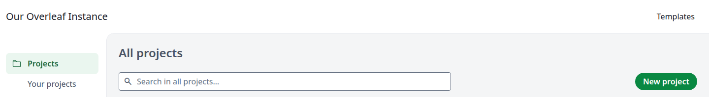
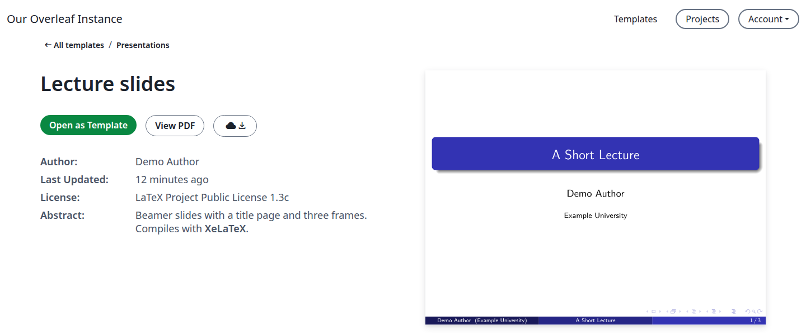

Modelos são projetos que o seu administrador publicou. Abrir um deles cria um novo projeto só seu.

<Info>

Se você não vê o link **Templates**, peça ao seu administrador para ativar a [galeria de modelos](/pt/on-premises/configuration/overleaf-toolkit/templates).

</Info>

## Abrir a galeria {#open-the-gallery}

Na página de projetos, clique em **Templates** no canto superior direito.

<Frame caption="O link Templates">
  
</Frame>

A página **All templates** é aberta, com os modelos atualizados mais recentemente primeiro.

<Frame caption="Todos os modelos">
  
</Frame>

Se você ainda não tem projetos, clique em **Browse templates** na página de boas-vindas.

<Frame caption="A página de boas-vindas">
  
</Frame>

Se você tem projetos, também pode clicar em **New project**, depois em **More templates** e depois em uma categoria.

<Frame caption="More templates">
  
</Frame>

Por padrão, a galeria exige login: se alguém enviar a você um link para um modelo e você não estiver conectado, você vai primeiro para a página de login e depois para o modelo.

## Encontrar um modelo {#find-a-template}

**Pesquise** na caixa. A lista é atualizada enquanto você digita e corresponde ao título, ao autor e à descrição. Se nada corresponder, a página mostra <strong>No Templates.</strong>

<Frame caption="Pesquisando slides">
  
</Frame>

**Ordene** com **Last Updated** ou **Title**, à direita acima da lista. Clique novamente na opção em uso para inverter a ordem.

**Mude de página** abaixo da lista. Cada página mostra nove modelos.

<Frame caption="Os botões de página">
  
</Frame>

<strong>Navegar por categoria:</strong> clique em **Template Gallery** na página **All templates**. A página da galeria tem um cartão para cada categoria, com todos os modelos abaixo deles.

<Frame caption="As categorias">
  
</Frame>

Clique em um cartão para ver os modelos daquela categoria. Aqui também é possível pesquisar e ordenar, e **All templates** leva você de volta.

<Frame caption="Uma página de categoria">
  
</Frame>

## Abrir um modelo como um novo projeto {#open-a-template-as-a-new-project}

<Steps>
<Step title="Abra o modelo">
Clique em um modelo. Você vê uma prévia da primeira página, o autor, a última atualização, a licença e o resumo.

<Frame caption="A página do modelo">
  
</Frame>

**View PDF** abre o PDF inteiro. O botão ao lado baixa os arquivos como zip.
</Step>

<Step title="Clique em Open as Template">
Depois de uma breve tela de carregamento, o editor abre com o seu novo projeto.

<Frame caption="Seu novo projeto">
  
</Frame>
</Step>

<Step title="Confira o projeto">
O projeto tem o nome e os arquivos do modelo, e o mesmo compilador e documento principal. Ele é compilado ao abrir, e você é o proprietário dele na lista de projetos.

Abrir o mesmo modelo novamente cria outro projeto, como `Journal article (1)`.

<Frame caption="Cada abertura cria um projeto">
  
</Frame>
</Step>
</Steps>

Seu projeto não depende do modelo: ele continua como está quando o modelo é atualizado ou excluído.

<Info>

Uma conta normal não pode publicar nem alterar modelos: o menu **File** não tem **Manage Template**, e a página do modelo não tem **Edit** nem **Delete**. Para adicionar um modelo à galeria, peça ao seu administrador.

</Info>
