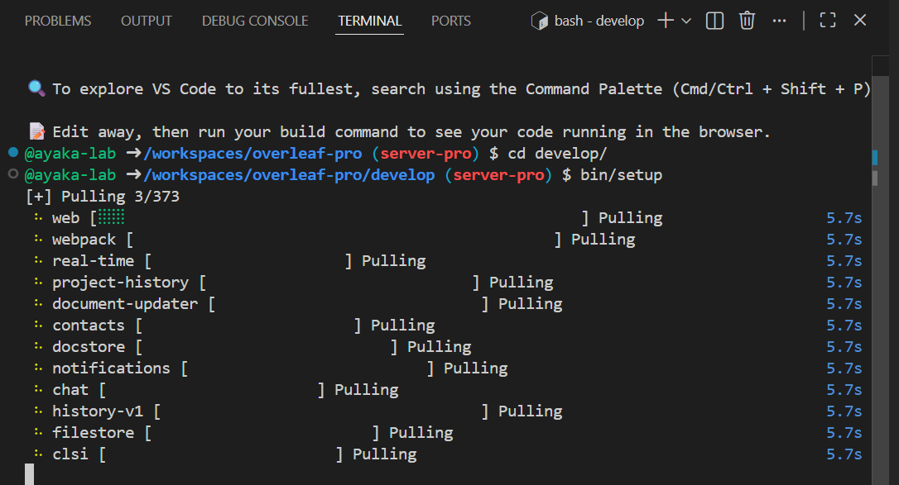

Чтобы сэкономить время и быстро развернуть среду разработки, мы предоставляем альтернативный вариант её конфигурации — GitHub Codespace.

## Руководство по настройке {#configuration-tutorial}

<Steps>
<Step title="Создание Codespaces">
Нажмите на кнопку ниже, чтобы создать облачный codespace для разработки server-pro.

[](https://codespaces.new/ayaka-notes/ayakaleaf-pro)

Рекомендуется выбирать **Machine Type** не менее **4-core**. Если вам нужна более мощная машина, вы можете отправить запрос в официальную службу поддержки GitHub, создав обращение [здесь](https://support.github.com/contact?tags=rr-codespaces%2Ccat_codespaces).

<Frame>
  
</Frame>
</Step>

<Step title="Запуск скрипта настройки">
Придётся немного подождать, пока codespace будет создан. Как только вам станет доступен терминал, выполните следующую команду:

```text
cd develop/
bin/setup
bin/i18n
```

`bin/setup` загружает образы и запускает сервисы; затем `bin/i18n` применяет переводы модулей Ayakaleaf Pro, которых нет в закоммиченных файлах локалей, см. [Обновление переводов i18n](/ru/dev/environment/update-i18n-translations).

<Frame>
  
</Frame>

<Warning>

Этот скрипт (`bin/setup`) позволяет в кратчайшие сроки настроить среду разработки на последнем коммите ветки `server-pro`. Он может не подойти для более старых версий или других веток.

Мы ежедневно собираем Docker-образ для разработки с помощью [GitHub Action](https://github.com/ayaka-notes/ayakaleaf-pro/actions).

</Warning>
</Step>

<Step title="Доступ к Launchpad">
Перейдите на вкладку портов, и вы увидите список доступных веб-портов. Нажмите на порт `80` (`OVERLEAF_PORT` в `develop/dev.rc`). Теперь должна открыться страница launchpad. Mailpit, Grafana, Mongo Express и RedisInsight доступны по путям того же порта (`/mailpit/`, `/grafana/`, `/mongo-express/` и `/redis-insight/`), а меню **Dev tools** сайта ссылается на них после входа. Консоль RustFS работает на 9001, а Hoppscotch на 9170, см. [Порты](/ru/dev/environment/setup-develop-environment-local#ports).

<Frame>
  
</Frame>

Вы увидите:

<Frame>
  
</Frame>
</Step>

<Step title="Приятной разработки">
Теперь ваш черёд! Начните создавать свою замечательную функцию. `bin/setup` уже запускает каждый сервис в режиме разработки (`node --watch`, как и `bin/dev`), поэтому изменения кода видны без дополнительных команд.

После изменения `develop/dev.rc` снова запустите `bin/setup`: он работает через `bin/docker-compose`, который добавляет файлы включённых функций.

<Warning>

Не запускайте сервисы вручную командой `docker compose -f docker-compose.yml -f docker-compose.dev.yml -f docker-compose.image.yml up`. Она пропускает файлы функций из `dev.rc`, поэтому `web`, `filestore` и `history-v1` пересоздаются без настроек RustFS и переходят на локальные тома, где нет истории и двоичных файлов ваших проектов.

</Warning>
</Step>
</Steps>
