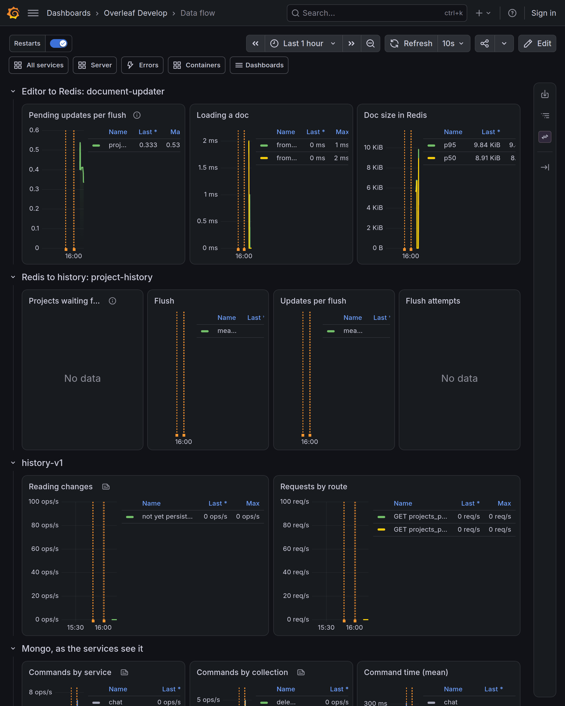

## Рекомендуемые инструменты разработки {#develop-tools-recommended}

Эти необязательные сервисы не нужны для работы Overleaf, но очень помогают при разработке, отладке и изучении данных. Все они входят в среду разработки, поэтому в `docker-compose.yml` ничего добавлять не нужно. После входа на сайт меню **Dev tools** в его панели навигации ссылается на инструменты, которые сайт отдаёт по собственным путям.

| Инструмент | Адрес | Где определён |
| --- | --- | --- |
| **Grafana**, состояние, метрики и логи каждого сервиса | [http://localhost/grafana/](http://localhost/grafana/) | `develop/grafana/docker-compose.yml`, включён при `GRAFANA_ENABLED=true` в `develop/dev.rc` (по умолчанию) |
| **Mailpit**, почтовый ящик для каждого письма, которое отправляет сайт | [http://localhost/mailpit/](http://localhost/mailpit/) | `develop/mail/docker-compose.yml`, включён при `MAILPIT_ENABLED=true` (по умолчанию) |
| **Mongo Express**, интерфейс для MongoDB | [http://localhost/mongo-express/](http://localhost/mongo-express/) | `develop/docker-compose.yml`, всегда включён |
| **RedisInsight**, интерфейс для данных Redis | [http://localhost/redis-insight/](http://localhost/redis-insight/) | `develop/docker-compose.yml`, всегда включён |
| **Hoppscotch**, браузерный API-клиент, похожий на Postman | [http://localhost:9170](http://localhost:9170/) (`HOPPSCOTCH_PORT`) | `develop/hoppscotch/docker-compose.yml`, включён при `HOPPSCOTCH_ENABLED=true` (по умолчанию) |

<Warning>

Ни у одного из этих инструментов нет входа: анонимные пользователи Grafana являются её администраторами, а Mongo Express может изменить любой документ. Сайт, Hoppscotch, Mongo Express (8081) и RedisInsight (5540) слушают только `127.0.0.1` хоста, поэтому другие хосты не могут к ним обратиться.

</Warning>

### Grafana {#grafana}

Grafana отдаётся сайтом по пути `/grafana/` через webpack-dev-server, поэтому ей не нужен собственный порт. В её папке **Overleaf Develop** есть такие дашборды:

| Дашборд | Что показывает |
| --- | --- |
| All services (главная) | Состояние каждого сервиса, индикаторы хоста, нагрузка и логи. Щелчок по сервису открывает его дашборд |
| Server | CPU, нагрузка, память, диск и сеть хоста, а также компиляции clsi |
| Errors | Логи ошибок, ответы 5xx и 4xx, самые частые сообщения об ошибках и сбойные маршруты |
| Data flow | Путь правки: document-updater и Redis, project-history, history-v1, Mongo, объектное хранилище |
| Containers | Состояние каждого контейнера, CPU, память, сеть и диск, включая компиляции в песочнице |
| По одному на сервис | Сервисы Node.js, git-bridge (JVM), mongo и redis |

<Columns cols={2}>
<Column>

<Frame caption="All services: состояние каждого сервиса, хост и ресурсы, которые использует каждый сервис">
  
</Frame>

</Column>

<Column>

<Frame caption="Data flow: правка на пути от document-updater через project-history к history-v1 и Mongo">
  
</Frame>

</Column>
</Columns>

Prometheus собирает `/metrics` сервисов, `mongodb-exporter`, `redis-exporter`, `cadvisor` и `node-exporter`; Alloy отправляет логи каждого контейнера проекта в Loki, откуда их читают фильтры **Log search**, **Service** и **Log level** дашбордов. Их данные хранятся только в контейнерах, поэтому пересоздание контейнеров их очищает. cAdvisor работает в привилегированном режиме и только читает `/`, `/sys`, данные Docker и сокет containerd хоста; node-exporter читает `/` хоста.

Дашборды генерируются: вместо редактирования JSON-файлов измените `develop/grafana/make-dashboards` и запустите его.

### Mailpit {#mailpit}

При `MAILPIT_ENABLED=true` `web` отправляет каждое письмо в Mailpit вместо настоящего почтового сервера, а подтверждение email включено (`EMAIL_CONFIRMATION_DISABLED=false`). Ссылки активации, приглашения в проекты, сбросы пароля и коды подтверждения можно открывать прямо из почтового ящика.

<Frame caption="Письмо активации, приглашение в проект, код подтверждения и сброс пароля в Mailpit">
  
</Frame>

У Mailpit нет тома: пересоздание его контейнера очищает почтовый ящик.

### Mongo Express {#mongo-express}

Mongo Express показывает коллекции базы данных `sharelatex` и позволяет просматривать, редактировать, импортировать и экспортировать их документы.

<Frame caption="Коллекции базы данных sharelatex в Mongo Express">
  
</Frame>

### RedisInsight {#redisinsight}

RedisInsight хранит свои подключения в `develop/data/redis-insight`. В первый раз выберите **Connect existing database** и укажите хост `redis` и порт `6379`.

<Frame caption="RedisInsight, подключённый к сервису redis">
  
</Frame>

### Настройка Hoppscotch {#setup-hoppscotch}

#### Проксирование API-запросов {#proxy-api-request}

Hoppscotch отправляет запросы из браузера, который не может обратиться к сервисам по их именам в Docker. Его прокси, Proxyscotch, работает внутри сети Docker и доступен по пути `/proxy` адреса Hoppscotch. Откройте [http://localhost:9170](http://localhost:9170/), перейдите в Settings → Interceptor, выберите **Proxy** и задайте Proxy URL `http://localhost:9170/proxy`. Настройка сохраняется в браузере.

<Frame caption="Настройка Interceptor. Снимок экрана сделан со старой конфигурации: используйте `http://localhost:9170/proxy` в качестве Proxy URL.">
  
</Frame>

Теперь можно отправить запрос на [http://web:3000/status](http://web:3000/status), чтобы проверить, работает ли web:

<Frame>
  
</Frame>

#### Импорт API сервисов {#import-the-service-apis}

В `develop/hoppscotch/openapi/` есть файл OpenAPI для внутреннего API каждого сервиса. В Hoppscotch откройте Collections → Import → Import from File и выберите все файлы сразу. Каждый файл становится коллекцией, запросы которой идут на Docker-адрес сервиса. Те же файлы показаны в разделе [API сервисов](/ru/dev/service-api/overview).

#### Проблемы с CSRF {#csrf-problems}

<Warning>

Если вы используете Postman или другие инструменты отладки для отправки **POST**-запроса, вход может оказаться **запрещён** с ошибкой 403. Это происходит потому, что Overleaf защищён проверкой **CSRF**.

</Warning>

<Frame>
  
</Frame>

В консоли вы можете увидеть:

<Frame>
  
</Frame>

Чтобы решить эту проблему при разработке Overleaf, нужно настроить CSRF-токен. Ниже приведена подробная инструкция.

<Steps>
<Step title="Добавьте Pre-Request">
Добавьте следующий код в Pre-Request

<Frame>
  
</Frame>

Скрипт выглядит так:

```js wrap
pm.sendRequest("http://web:3000/dev/csrf", function (err, res) {
    if (err) {
        console.log(err);
        return;
    }

    // 1) Save CSRF token (/dev/csrf)
    const token = res.text().trim();
    pw.env.set("csrftoken", token);
    console.log("csrftoken =", token);

    const setCookieHeader = (res.headers || []).find(h => h.key?.toLowerCase() === "set-cookie")?.value;
    console.log("set-cookie =", setCookieHeader);

    if (!setCookieHeader) return;

    const cookiePair = setCookieHeader.split(";")[0].trim(); // overleaf.sid=...
    pw.env.set("cookie_header", cookiePair);
    console.log("cookie_header =", cookiePair);
});
```
</Step>

<Step title="Добавьте заголовки запроса">
Необходимо добавить следующие заголовки:

| Имя заголовка | Значение заголовка  |
| ------------ | ------------------- |
| Content-Type | `application/json`  |
| X-Csrf-Token | `<<csrftoken>>`     |
| Cookie       | `<<cookie_header>>` |

<Frame>
  
</Frame>
</Step>

<Step title="Войдите с помощью инструментов API">
Теперь можно войти, используя имя пользователя и пароль.

```json5
{
  "_csrf": "<<csrftoken>>",
  "email": "admin@overleaf.com",
  "password": "xxxxxx"
}
```

Так выглядит ответ, если введены неверные имя пользователя или пароль.

<Frame>
  
</Frame>
</Step>
</Steps>
