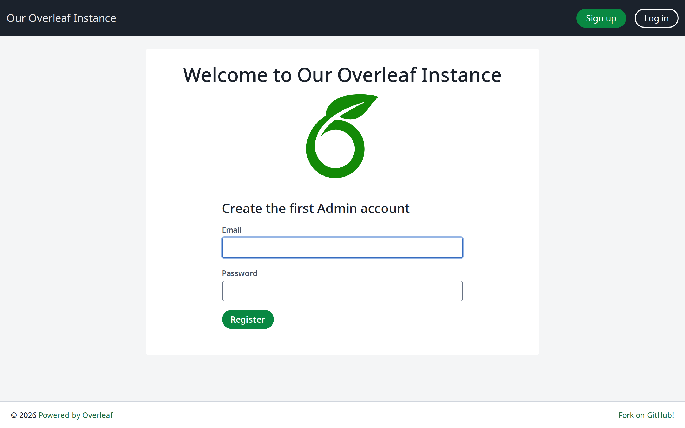
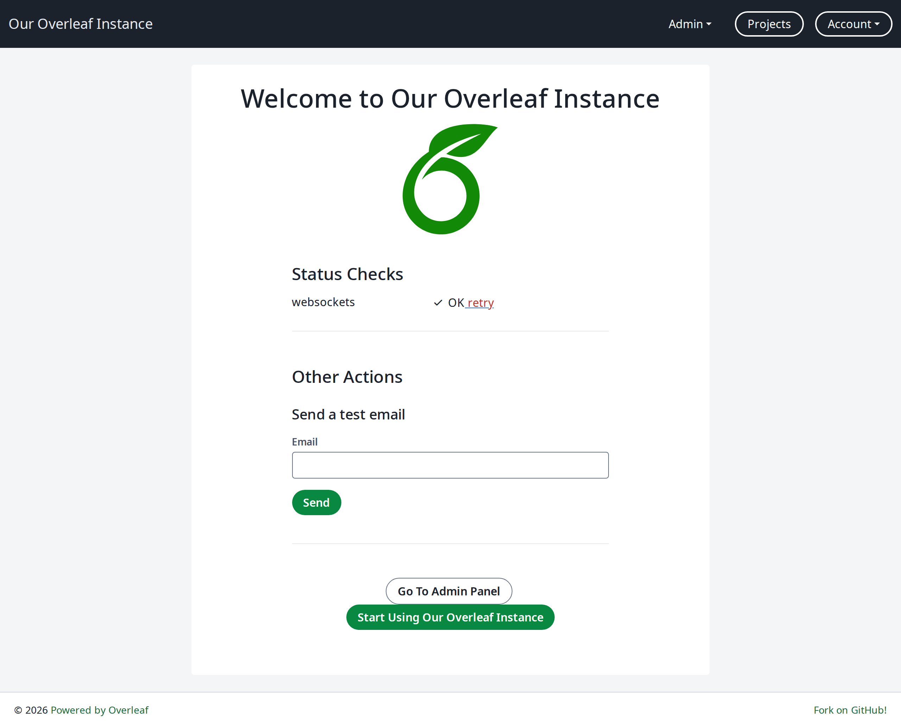
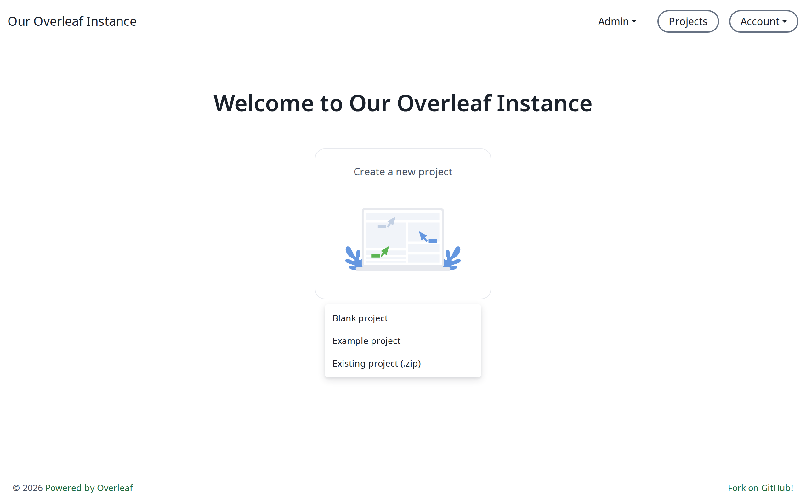
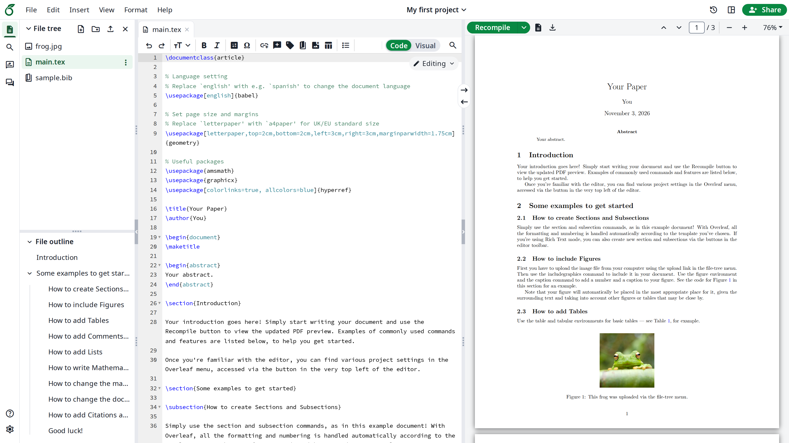

### Создание первой учётной записи администратора {#creating-your-first-administrator-account}

Откройте в браузере [http://localhost/launchpad](http://localhost/launchpad). Если вы изменили `OVERLEAF_LISTEN_IP` или `OVERLEAF_PORT`, используйте вместо этого ваш `OVERLEAF_SITE_URL`, например `http://192.168.1.20:8080/launchpad`. То же относится и к другим ссылкам на `localhost` на этой странице. Вы увидите форму с полями для адреса электронной почты и пароля. Введите учётные данные, которые хотите использовать для учётной записи администратора, и нажмите **Register**.

<Info>

Пароль должен содержать не менее 8 символов (и не более 72), не может содержать адрес электронной почты или быть слишком похожим на него и должен состоять только из допустимых символов.

</Info>

Затем вы попадёте на страницу входа ([http://localhost/login](http://localhost/login)). Введите учётные данные. После входа вы снова увидите страницу launchpad, теперь уже с проверками состояния.

Нажмите зелёную кнопку внизу страницы, чтобы начать работу с Overleaf.

### Создание первого примера проекта {#creating-your-first-example-project}

Откройте в браузере [http://localhost/project](http://localhost/project) — вы увидите кнопку с предложением создать первый проект.

Нажмите эту кнопку, выберите **Example project** и следуйте инструкциям на экране.

Откроется новый проект с текстовым редактором и предварительным просмотром PDF.

В завершение нажмите на логотип Overleaf в левом верхнем углу, чтобы вернуться на страницу проектов.
