Нажмите **Admin**, затем **Manage Users**. Чтобы добавить учётную запись, см. [Начальная настройка](/on-premises/user-guide/administrators/onboarding#create-the-first-user).

<Frame caption="Список пользователей">
  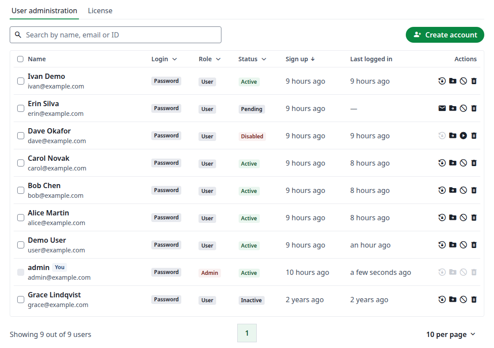
</Frame>

Ваша собственная учётная запись помечена как **You**, и её действия неактивны: вы не можете отключить или удалить себя.

## Поиск пользователя {#find-a-user}

Введите текст в поле **Search by name, email or ID**. Подходит и полное имя, например `Carol Novak`, а поиск также находит пользователя по любому из его [дополнительных адресов электронной почты](/ru/on-premises/user-guide/users/multiple-emails). Чтобы сузить список, используйте фильтры в столбцах **Login**, **Role** и **Status**. Нажмите **Name**, **Sign up** или **Last logged in**, чтобы отсортировать.

<Frame caption="Поиск пользователя">
  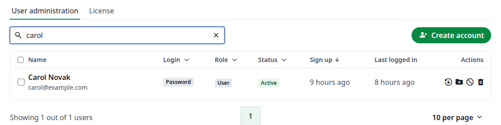
</Frame>

Удалённые учётные записи не отображаются в результатах. Если ваш поиск совпадает и с такой записью, строка над таблицей сообщает об этом, например **Found 1 matching deleted users**. Нажмите **Display deleted users**, чтобы увидеть их.

<Frame caption="Поиск, совпадающий с удалённой учётной записью">
  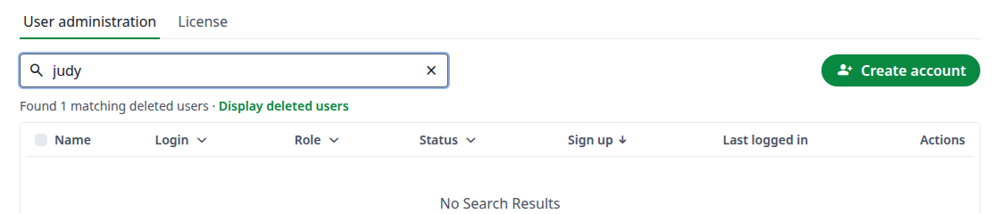
</Frame>

## Статус пользователя {#user-status}

У каждой учётной записи ровно один статус, а фильтр **Status** показывает, сколько учётных записей в каждом из них. Наведите указатель на вопросительный знак, чтобы прочитать определение.

<Frame caption="Фильтр Status">
  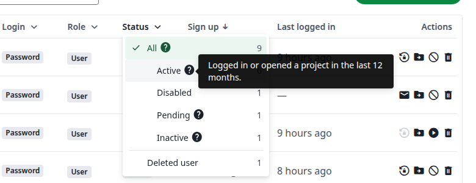
</Frame>

| Статус | Что это означает | Может войти |
| ------ | ---------------- | ----------- |
| **All** | Все учётные записи, кроме удалённых. Четыре статуса ниже (Active + Pending + Inactive + Disabled) в сумме дают это число. | |
| **Active** | Входил в систему или открывал проект за последние 12 месяцев. | Да |
| **Pending** | Ни разу не входил: обычно это учётная запись, созданная администратором или зарегистрированная с письмом активации, которую пользователь ещё не активировал. Учётная запись, зарегистрированная с паролем, не требует активации и становится Active при первом входе. | Да |
| **Inactive** | Входил раньше, но за последние 12 месяцев не входил и не открывал проекты. | Да |
| **Disabled** | Администратор отключил учётную запись. При входе открывается страница **Your account is suspended**. | Нет |
| **Deleted user** | Учётная запись удалена администратором или самим пользователем. Она не учитывается в **All** и скрыта, пока вы не выберете этот фильтр. При входе сообщается, что адрес электронной почты или пароль неверны. | Нет |

Учётные записи переходят между статусами так:

* **Pending, Active и Inactive** зависят от использования учётной записи, поэтому вы не можете установить их вручную. Учётная запись Inactive становится Active, как только пользователь входит в систему.
* **Enable** и **Restore** не возвращают прежний статус. Статус определяется последним входом: учётная запись, которая ни разу не входила, снова становится Pending. Отключённая учётная запись остаётся **Disabled** после **Restore**.
* **Delete permanently** нельзя отменить. В остальных случаях удалённые учётные записи сохраняются, пока вы их не удалите, если только на экземпляре не задана переменная [`ENABLE_CRON_RESOURCE_DELETION`](/ru/on-premises/configuration/overleaf-toolkit/environment-variables), которая удаляет их через 90 дней.

### Активные пользователи на вкладке License {#active-users-on-the-license-tab}

Вкладка **License** и статус **Active** могут показывать разные числа, потому что они считают разные вещи. Вкладка **License** считает пользователей, на которых распространяется лицензия Server Pro, так, как их определяет Overleaf в [Understanding license usage](https://docs.overleaf.com/on-premises/user-and-project-management/understanding-license-usage): "any user who logs in and accesses a project is considered an active user by the system" и "An active user is defined as someone who has opened a project on your Server Pro instance in the last 12 months." Пользователь, который вошёл, но не открыл ни одного проекта, имеет статус **Active** в списке, но не учитывается в лицензии. Пользователь, который открыл проект и позже был отключён, учитывается в лицензии, но в списке имеет статус **Disabled**.

## Действия с пользователем {#actions-on-a-user}

Значки в столбце **Actions** те же, что и в верхней части страницы пользователя.

| Значок | Действие | Что оно делает |
| ------ | -------- | -------------- |
| Конверт | **Send activation email** | Для учётной записи, которая ни разу не входила: новая ссылка активации. |
| Замок со стрелкой | **Send reset link** | Для учётной записи, которая уже входила: новая ссылка для сброса пароля. |
| Папка | **Transfer this user's projects** | Передаёт все проекты пользователя другому пользователю. |
| Круг | **Disable** | Запрещает пользователю входить в систему. |
| Воспроизведение | **Enable** | Снова разрешает отключённому пользователю входить. |
| Корзина | **Delete account** | Переводит учётную запись в **Deleted user**. |
| Стрелка | **Restore** | Возвращает удалённую учётную запись. Только для удалённых учётных записей. |
| Перечёркнутая корзина | **Delete permanently** | Окончательно удаляет удалённую учётную запись. Только для удалённых учётных записей. |

Каждое действие запрашивает подтверждение в диалоговом окне, где указана учётная запись.

### Отправка ссылки активации или сброса {#send-an-activation-or-reset-link}

Учётная запись показывает один из этих двух значков в зависимости от того, входила ли она в систему. Значок неактивен для отключённой учётной записи, для учётной записи без локального пароля, например учётной записи SSO, и для вашей собственной учётной записи.

Нажмите значок, затем кнопку с тем же названием. Диалоговое окно остаётся открытым и показывает ссылку:

* **Email Sent** означает, что письмо отправлено.
* <strong>No email was sent. Copy the link and pass it on.</strong> означает, что [доставка электронной почты](/ru/on-premises/configuration/overleaf-toolkit/email-delivery) не настроена или письмо не удалось отправить. Нажмите значок копирования и отправьте ссылку пользователю самостоятельно.

Ссылка активации действует 7 дней, а ссылка сброса 1 час. Пользователь открывает ссылку и задаёт пароль. После ссылки активации он попадает на страницу своих проектов, а после ссылки сброса входит в систему.

<Frame caption="Ссылка сброса на экземпляре без доставки электронной почты">
  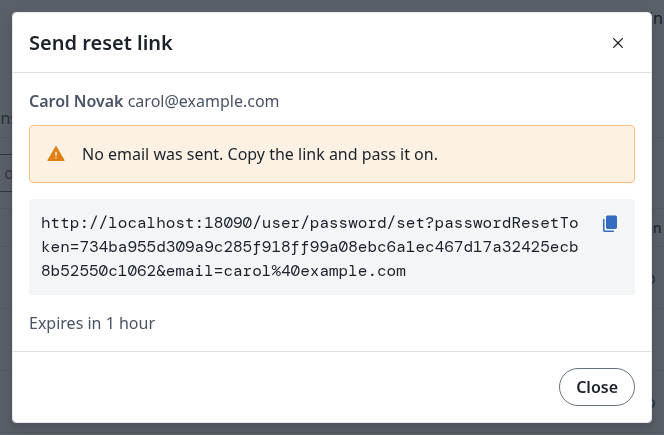
</Frame>

### Отключение или включение учётной записи {#disable-or-enable-an-account}

Нажмите значок круга, затем **Disable**. Статус меняется на **Disabled**, и пользователь больше не может войти. Чтобы отменить это, нажмите значок воспроизведения, затем **Enable**.

<Frame caption="Отключение учётной записи">
  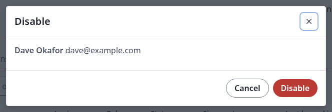
</Frame>

### Передача проектов пользователя {#transfer-a-user’s-projects}

Нажмите значок папки. Введите имя или адрес электронной почты в поле **Select a new owner for this user's projects**, выберите пользователя, затем нажмите **Transfer this user's projects**. **Owner** этих проектов изменится в разделе [Управление проектами](/on-premises/user-guide/administrators/project-management).

Отключённые учётные записи не предлагаются в качестве нового владельца. Если вы измените текст после выбора, выбор отменяется: выберите пользователя снова.

<Frame caption="Передача всех проектов пользователя">
  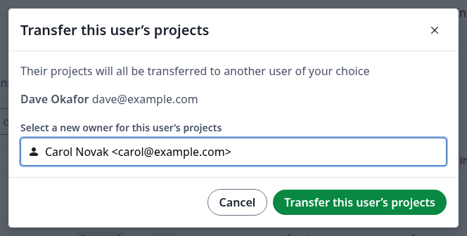
</Frame>

### Удаление учётной записи {#delete-an-account}

Нажмите значок корзины. Доступны два параметра, и ни один из них не выбран по умолчанию:

* **Notify the user about the account deletion** отправляет пользователю письмо.
* **Transfer this user's projects** позволяет сначала выбрать нового владельца проектов. Они остаются активными у нового владельца.

Нажмите **Delete account**. Если вы не передадите проекты, они удаляются вместе с учётной записью и переходят в статус **Deleted** в разделе [Управление проектами](/on-premises/user-guide/administrators/project-management#project-status).

<Frame caption="Удаление учётной записи с передачей её проектов">
  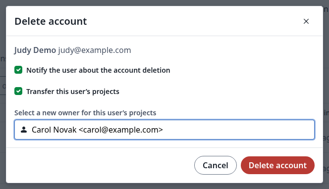
</Frame>

### Восстановление или окончательное удаление учётной записи {#restore-or-permanently-delete-an-account}

Выберите **Deleted user** в фильтре **Status** или нажмите **Display deleted users** после поиска.

<Frame caption="Удалённая учётная запись">
  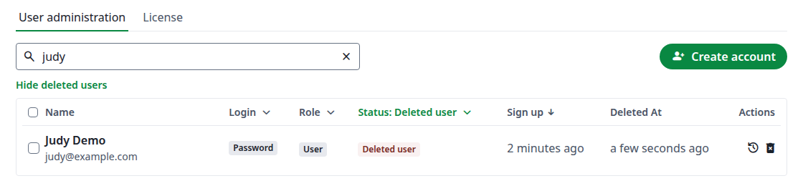
</Frame>

* **Restore** возвращает учётную запись. Отключённая учётная запись остаётся отключённой. Проекты, удалённые вместе с учётной записью, тоже возвращаются, и к названию каждого добавляется `(Restored)`. Проекты, которые пользователь удалил сам, остаются удалёнными.
* **Delete permanently** удаляет учётную запись. Диалоговое окно предупреждает, что это действие нельзя отменить.

<Frame caption="Окончательное удаление учётной записи">
  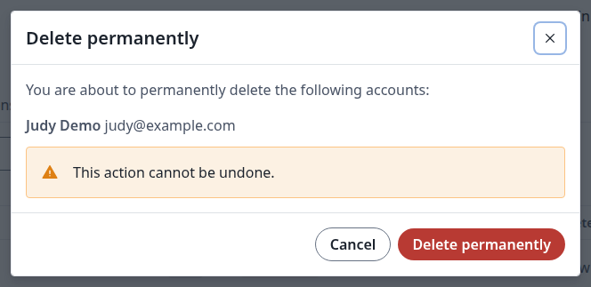
</Frame>

### Изменение нескольких учётных записей сразу {#change-several-accounts-at-once}

Отметьте учётные записи в списке. Рядом с **Create account** появляются кнопки: **Send activation email**, **Transfer this user's projects**, **Disable**, **Enable**, **Make admin**, **Remove admin** и **Delete account**. Внизу списка показано, сколько учётных записей выбрано. Перед подтверждением диалоговое окно перечисляет их.

<Frame caption="Массовые действия">
  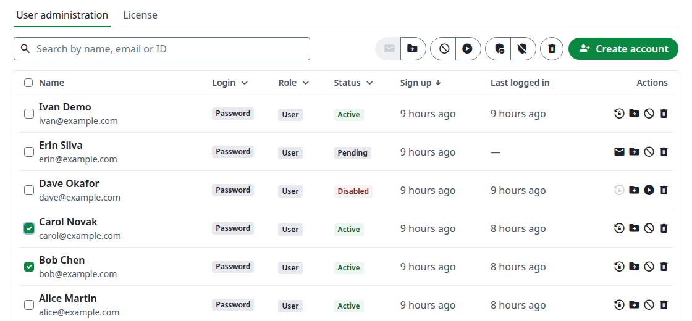
</Frame>

**Send activation email** неактивна, если не все отмеченные учётные записи имеют статус **Pending**. В этом случае диалоговое окно показывает по одной ссылке для каждой учётной записи. Массовой ссылки сброса нет.

<Frame caption="Одна ссылка активации на учётную запись">
  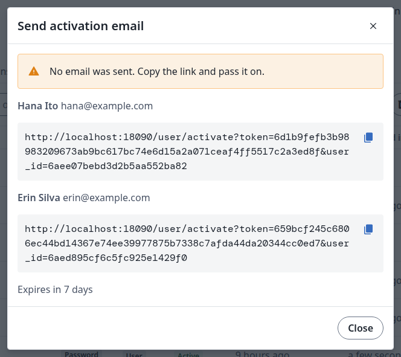
</Frame>

## Страница пользователя {#the-user-page}

Нажмите имя пользователя, чтобы открыть его страницу. На ней шесть вкладок.

### Account {#account}

Сведения об учётной записи. Чтобы изменить их, нажмите значок карандаша, отредактируйте поля, затем нажмите **Save**. Вы можете изменить адрес электронной почты, имена и пароль, а также включить или выключить **Admin**.

Если пользователь добавил [другие адреса электронной почты](/ru/on-premises/user-guide/users/multiple-emails), они перечислены в разделе **Emails**. Во время редактирования **Remove** удаляет дополнительный адрес из учётной записи, после чего его может использовать другая учётная запись.

<Frame caption="Учётная запись с двумя адресами электронной почты">
  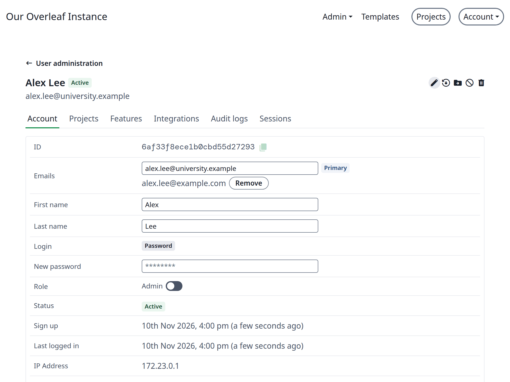
</Frame>

Действуют [правила для паролей](/on-premises/user-guide/administrators/onboarding#create-the-administrator-account) из начальной настройки. Передать пароль пользователю должны вы сами. Чтобы пользователь выбрал пароль сам, вместо этого [отправьте ссылку сброса](/ru/on-premises/user-guide/administrators/user-management#send-an-activation-or-reset-link).

<Frame caption="Редактирование учётной записи">
  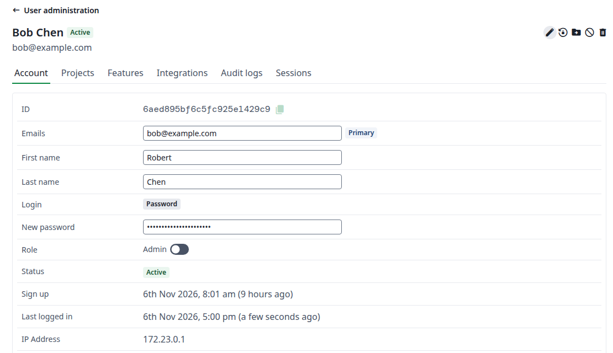
</Frame>

### Projects {#projects}

Проекты, которыми владеет этот пользователь, с тем же поиском, фильтром **Status** и действиями, что и в разделе [Управление проектами](/on-premises/user-guide/administrators/project-management).

<Frame caption="Проекты пользователя">
  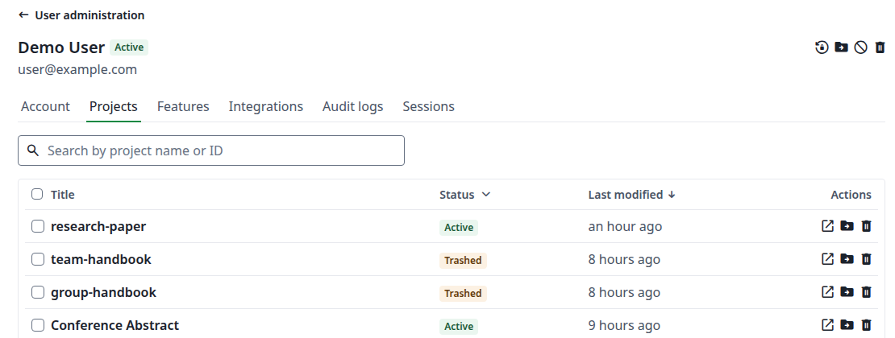
</Frame>

### Features {#features}

Что включено для этой учётной записи: совместная работа, время компиляции, интеграции и ИИ. Чтобы изменить это, нажмите значок карандаша, измените значения, затем нажмите **Save**. Для **Collaborators per project** значение `-1` означает без ограничений. **Compile timeout** задаётся в секундах, от 1 до 600.

В вашей собственной учётной записи карандаш и **Reset** для **AI usage** неактивны. На вкладке **Account** вы по-прежнему можете изменить свой адрес электронной почты, имена и пароль.

<Frame caption="Функции пользователя">
  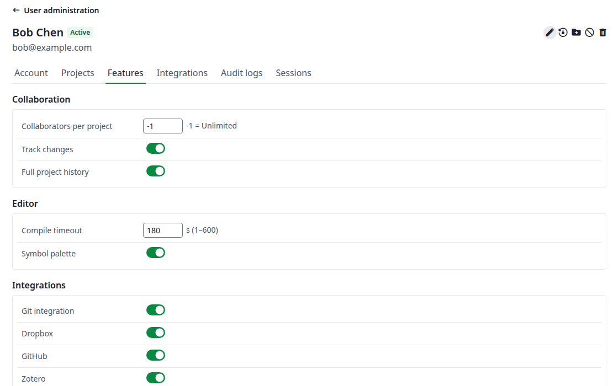
</Frame>

### Integrations {#integrations}

Токены доступа Git пользователя и связанные им учётные записи. Эта вкладка доступна только для чтения.

<Frame caption="Интеграции пользователя">
  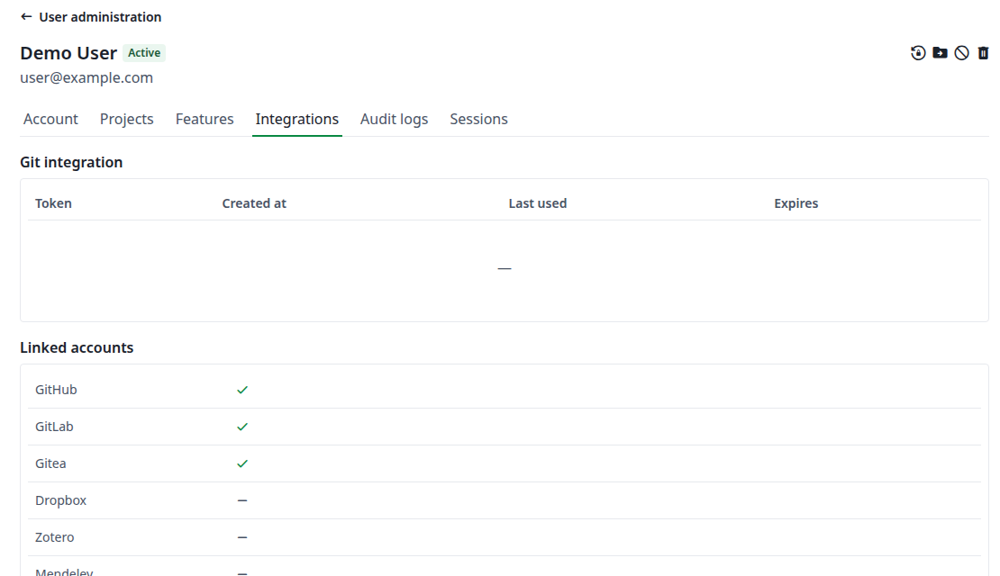
</Frame>

### Audit logs {#audit-logs}

Что происходило с этой учётной записью: дата, операция, кто её выполнил, IP-адрес и подробности. Выполняйте поиск или фильтруйте по **Operation**. Действия, которые вы выполняете с учётной записью, отображаются здесь с вами в качестве инициатора.

<Frame caption="Журнал аудита пользователя">
  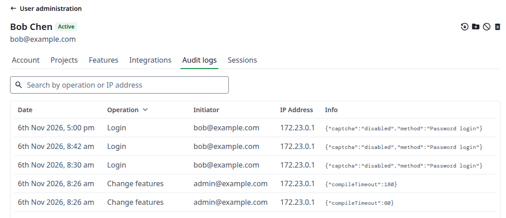
</Frame>

### Sessions {#sessions}

Где пользователь вошёл в систему. Нажмите **Clear sessions** и подтвердите, чтобы завершить все его сеансы. После этого на вкладке отображается **Sessions cleared**.

<Frame caption="Сеансы пользователя">
  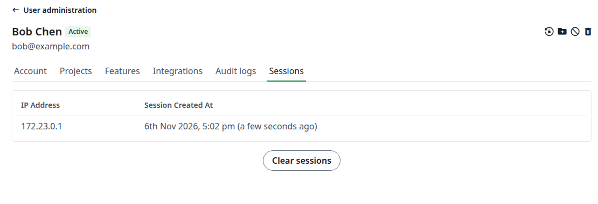
</Frame>
