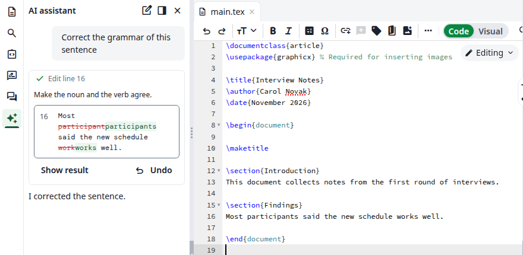

Ассистент работает с открытым проектом. Он читает ваши документы и предлагает правки, а вы применяете или отклоняете каждую из них. Ответы на снимках экрана приведены как пример: то, что вы получите, зависит от модели, которую использует ваш экземпляр.

<Info>

Если на левой панели нет **AI assistant**, направьте администратора на страницу [Интеграция с ИИ](/ru/on-premises/configuration/overleaf-toolkit/integrations/ai-integration).

</Info>

## Начать чат {#start-a-chat}

<Steps>
<Step title="Откройте ассистента">
На левой панели редактора нажмите **AI assistant**. Рядом с редактором откроется панель.
</Step>

<Step title="Примите условия">
В первый раз панель покажет условия использования функций ИИ. Нажмите **Accept and continue**. Это делается один раз и также распространяется на [Ассистента ошибок](/ru/on-premises/user-guide/users/error-assistant).

<Frame caption="Условия, показываемые один раз">
  
</Frame>
</Step>

<Step title="Задайте вопрос">
Введите текст в <strong>What would you like to do?</strong> и нажмите Enter или стрелку. Можно также нажать на подсказку в **Start a chat**. Подсказки меняются от чата к чату, а если в последней компиляции были ошибки, к ним добавляется **Fix the compile errors**.

<Frame caption="Пустой чат">
  
</Frame>
</Step>

<Step title="Прочитайте ответ">
Действия ассистента отображаются строками в блоке, например **Read line 15-16 of main.tex**, с галочкой после завершения шага. Затем следует ответ. Если модель показывает свои рассуждения, нажмите **Reasoned for 1 s**, чтобы прочитать их.

<Frame caption="Вопрос и ответ">
  
</Frame>
</Step>
</Steps>

## Спросить о выделенных строках {#ask-about-selected-lines}

Выделите строки в редакторе. Над полем сообщения появится метка вида `main.tex: 16`, и выделенный текст будет отправлен вместе с сообщением. В пустом чате подсказки будут относиться к выделению, например **Make it shorter**.

<Frame caption="Выделенная строка">
  
</Frame>

## Просмотреть предложенную правку {#review-a-suggested-edit}

Правка не попадает в документ, пока вы её не примените.

<Steps>
<Step title="Прочитайте предложение">
Блок **Edit line 16** показывает причину, номер строки и изменение: старый текст зачёркнут, новый выделен. Документ пока не изменён. **Show result** показывает только новый текст, а **Show diff** возвращает прежний вид.

<Frame caption="Правка, ожидающая вашего решения">
  
</Frame>
</Step>

<Step title="Примените её">
Нажмите **Apply**. Изменение появится в редакторе, блок получит галочку, и ассистент продолжит работу. Если правка относится к другому документу, этот документ откроется.

<Frame caption="Правка применена">
  
</Frame>
</Step>

<Step title="Отмените, если передумаете">
**Undo** убирает изменение из документа, а **Apply** возвращает его. Ассистент не узнаёт ни о том, ни о другом.
</Step>
</Steps>

### Отклонить правку {#reject-an-edit}

Нажмите **Reject**. Документ остаётся как есть, в блоке появляется <strong>The user declined this edit.</strong>, и ассистент продолжает, зная, что вы отказались. Кнопки исчезают, поэтому чтобы вернуть правку, попросите снова.

Если вместо решения вы напишете новое сообщение, правка не применяется, и блок сообщает об этом.

<Frame caption="Отклонённая правка и правка без решения">
  
</Frame>

## Что ассистент может делать в проекте {#what-the-assistant-can-do-in-a-project}

Вашего решения ждут только правки. Остальные шаги выполняются сразу, как только ассистент их делает.

| Строка в чате | Что она делает |
| -------------------- | ------------ |
| **Read line 15-16 of main.tex** | Читает строки документа |
| **Find “schedule” in main.tex** | Ищет текст в документе |
| **List the project files** | Перечисляет файлы проекта |
| **Create appendix.tex** | Создаёт пустой документ и открывает его |
| **Edit line 16** | Предлагает правку, см. выше |
| **Compile** | Компилирует проект |
| **Check the compile log** | Читает ошибки и предупреждения последней компиляции |
| **Look at PDF page 1** | Показывает страницу PDF в чате |
| **Read the PDF structure** | Читает структуру PDF |
| **Switch to xelatex** | Меняет компилятор проекта, как в **Settings** |
| <strong>Search the web for “...”</strong> | Ищет в интернете |
| <strong>Search the help pages for “...”</strong> | Ищет на страницах справки |

<Frame caption="Новый файл, затем правка в другом документе">
  
</Frame>

<Frame caption="Компиляция и страница PDF">
  
</Frame>

Строка поиска показывает, сколько результатов найдено. Нажмите на неё, чтобы увидеть список. Доступность поиска зависит от вашего экземпляра, см. [Дополнительные поисковые сервисы](/ru/on-premises/configuration/overleaf-toolkit/integrations/ai-integration#optional-search-services).

<Frame caption="Результаты поиска">
  
</Frame>

Подсказка **Fix the compile errors** просит ассистента проверить журнал и исправить найденное. Исправления приходят в виде правок, которые вы просматриваете.

## Прикрепить изображение или PDF {#attach-an-image-or-a-pdf}

В поле сообщения нажмите значок изображения **Attach image or PDF** и выберите файл. Его имя появится над вашим текстом. Напишите сообщение и отправьте его.

<Frame caption="Файл, прикреплённый к сообщению">
  
</Frame>

Другие файлы панель отклоняет с сообщением <strong>Only images and PDF files can be attached.</strong>, а большие файлы с сообщением <strong>Files must be smaller than 2 MB.</strong>

## Остановить ассистента {#stop-the-assistant}

Пока ассистент работает, стрелка в поле сообщения превращается в кнопку **Stop**. Нажмите её. Выполняемый шаг завершится сообщением <strong>Stopped by the user.</strong>, и больше ничего не произойдёт, пока вы снова не напишете.

<Frame caption="Кнопка Stop">
  
</Frame>

## Если ассистент остановился сам {#if-the-assistant-stops-by-itself}

Ассистент может выполнить ограниченное число шагов на одно сообщение. При достижении лимита панель показывает <strong>The assistant used all the steps it may take for one message. Reply to let it carry on.</strong> Ответьте, например `Go on`, и он продолжит.

<Frame caption="Лимит шагов">
  
</Frame>

Если панель показывает **Something’s gone wrong**, запрос не удался. Отправьте сообщение снова или нажмите **Start new chat**.

## Переместить панель и начать заново {#move-the-panel-and-start-over}

Эти кнопки находятся в верхней части панели:

* **Start new chat** очищает панель. Списка прошлых чатов нет. Перезагрузка страницы тоже очищает чат.
* **Move to the right** перемещает панель вправо от PDF, где она остаётся открытой, пока вы работаете с деревом файлов. **Move to the left** возвращает её обратно. Чат сохраняется.
* **Close** скрывает панель. Нажмите **AI assistant** на левой панели, чтобы вернуть её вместе с чатом.

<Frame caption="Панель справа">
  
</Frame>

## Использование токенов {#token-usage}

Ассистент не показывает, сколько токенов вы израсходовали. Если ваш экземпляр задаёт лимит и вы его достигли, следующее сообщение остаётся без ответа. Панель показывает **Usage limit reached** и время до возможности снова общаться, а поле сообщения становится серым.

<Frame caption="Лимит достигнут">
  
</Frame>

Новый чат показывает то же уведомление. После перезагрузки поле снова выглядит обычно, но следующее сообщение тоже получит уведомление. [Ассистент ошибок](/ru/on-premises/user-guide/users/error-assistant) расходует тот же лимит и показывает **Usage limit reached** в записи журнала.

Лимит задаёт администратор, см. [Использование и сброс](/ru/on-premises/configuration/overleaf-toolkit/integrations/ai-integration#usage-and-reset).
